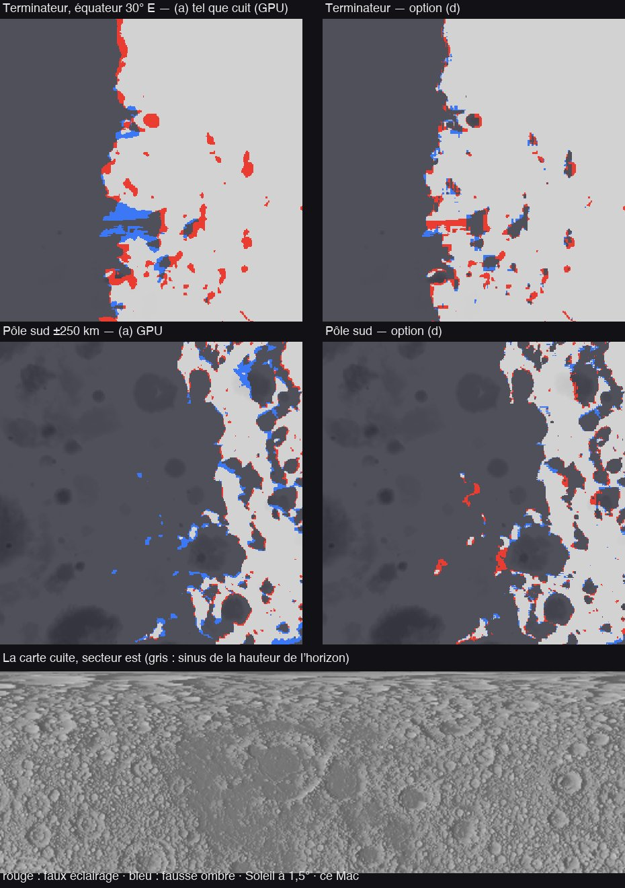

# H1 — la cuisson des cartes d'horizon, le pilote (la Lune)

Plan : [PLAN-REFRACTION-HORIZONS.md](../../PLAN-REFRACTION-HORIZONS.md), phase H1 (§2.5). Le 2 novembre 2026, sur ce Mac (M1 Max).
e2e `tests/e2e/horizon-pilot.e2e.test.ts` ; unitaires `tests/horizon-maps.test.ts` ; données :
[H1/horizon-pilot.json](H1/horizon-pilot.json).

## Fait

- **L'API de cuisson** (`src/system/horizon-maps.ts`, `src/shaders/horizon.wgsl`) :
  - **Le treillis est quelconque** : la carte lat/lon d'un corps, une fenêtre lat/lon locale (le cache de la Terre, H5) ou
    une calotte stéréographique.
  - **Les hauteurs** sont lues dans la pyramide du DEM (`hdRelief`, G le maximum le long des mips).
  - **Par texel** : 8 secteurs de 3 rayons (−15°, 0, +15°), de `D_cuisson` (2 texels) à la portée tirée des données. Cette
    portée vaut √(2R·Δh) : au-delà, tout le relief du corps passe sous l'horizon. Pas ×1,25, courbure exacte.
  - **L'encodage** : racine signée dans des couches `rgba8unorm`, 0,074° le pas vers 0,5° d'élévation. Les mips sont
    moyennées, pour le rendu seulement.
- **Les calottes** : stéréographiques, 256², 16 directions par les axes de la grille, 4 couches par calotte. Elles vont
  jusqu'à 77° pour le fondu de 78–80°.
- **La Lune** : la carte fait 2048 × 1024 × 2 couches, plus les deux calottes, soit **25 Mo** avec les mips.
  - `D_cuisson` = 10,7 km (6,2 km sur les calottes), portée 262 km, 16 pas (18 sur les calottes).
- **L'ordonnancement** : une bande de lignes par image, commencée au début de l'image.
  - La bande est réglée sur son temps mesuré par le profileur (`budgetMs` 2 ms, ×2 au plus d'une bande à l'autre).
  - La cuisson est abandonnée quand les cartes fines du corps partent.
- **Une référence CPU, lecture pour lecture** (`bakeTexel`). Elle lit les mêmes demi-flottants du DEM que le GPU.
- **Pas encore** : la liaison au traceur (liaisons 42 et 43, le bloc `BEGIN_HORIZON`). Elle va avec son premier lecteur (H2
  ou H3), et le choix de la porte décide de ce qu'on y lit.

## Mesuré

**La cuisson** (ce Mac, la scène « Moon: an afternoon on the plains ») :
- 80 à 95 bandes de 1,2 à 2,9 ms, soit **~150 ms de GPU** en tout, sur 7 à 9 s de temps réel (une bande par image).
- **GPU contre CPU** : 99,94 % des octets de la carte à un code près (le pire à 3). Calottes : 99,96 % et 99,1 % (le pire à
  16, au voisinage du pôle sud). Aucune erreur GPU.

**Le pilote** : 2 000 points sur la carte et 400 sur les calottes, un Soleil à un azimut au hasard et entre 0 et 5° de
hauteur.
- **La vérité** : le sol moyen, marché par demi-texel le long de l'azimut exact, depuis la hauteur propre du récepteur, de
  `D_cuisson` à la portée.
- **« Dur »** : le Soleil à plus que son rayon (0,27°) de l'horizon vrai.

| | Faux éclairage | Fausse ombre | « Durs » (FE / FO) | Erreur d'angle, médiane (5–95 %) |
|---|---:|---:|---:|---|
| **Carte cuite (GPU)**, depuis le haut du texel | **12,7 %** | 2,65 % | 11,1 / 1,8 % | −0,16° (−5,0 … +1,1°) |
| Calottes (GPU) | 4,25 % | 5,25 % | 3,75 / 3,0 % | +0,25° (−2,3 … +1,6°) |
| (b) depuis la moyenne du texel | 0,6 % | **13,5 %** | 0,45 / 10,8 % | +0,82° (−0,16 … +3,0°) |
| (c) les bloqueurs gardés, la hauteur propre du récepteur | 1,95 % | 9,85 % | 1,65 / 7,7 % | +0,52° (−0,8 … +2,5°) |
| **(d) = (c), les rayons lisant les moyennes** | **5,95 %** | **2,35 %** | 4,45 / 1,5 % | −0,13° (−2,2 … +1,0°) |

28 % des échantillons sont vraiment à l'ombre. Les options (b) à (d) sont cuites au CPU, au texel le plus proche.

**Ce que ça dit** :
- **Mesurer depuis le haut du texel** (le choix du plan, §2.5) sous-ombre comme prévu, mais beaucoup : 12,7 % de faux
  éclairage, soit près de la moitié des points à l'ombre. Un récepteur au fond d'un cratère, vu depuis le plus haut de ses
  16 km, voit un horizon bien plus bas que le sien. Ce sont les « plaines éclairées au terminateur » que H veut corriger.
- **Depuis le haut, le tracé lui-même** surestime l'horizon de 0,67° (médiane). Chaque pas lit le maximum d'une fenêtre qui
  couvre le pas : aucun bloqueur n'échappe, mais leur hauteur est prise un peu trop près.
- **L'option (d)** garde, par direction, la distance du bloqueur dominant (la « distance par direction » du plan, 2 couches de
  plus, mémoire ×2) et lit les moyennes. Elle divise le faux éclairage par 2 sans ajouter de fausse ombre : 8,3 % d'erreurs
  en tout contre 15 %.
- **Les planches** (Soleil à 1,5°, part de la planche) :

  | Planche | (a) GPU : faux éclairage / fausse ombre | (d) |
  |---|---:|---:|
  | Terminateur, équateur 30° E (±200 km) | 3,4 / 1,6 % | 2,2 / 0,8 % |
  | Pôle sud (±250 km) | 1,25 / 2,4 % | 1,7 / 1,1 % |

  Les planches de (d) sont en blocs parce qu'elles prennent le texel le plus proche, sans interpolation.
- **Le proche n'est pas compté** : en dessous de `D_cuisson`, la carte du Soleil et les marches de H3 répondent. Ces taux ne
  portent que sur ce que la carte doit dire au-delà.

**Contre la référence au pas d'un texel** (unitaires, corps cratérisé synthétique) : ±0,3° de 5 à 95 %, extrêmes −0,7° et
+1,6°. **La cible du plan (0,1°) n'est pas tenue.** Il faudrait des pas plus fins ou deux lectures par pas, soit un coût ×2.

## Tests

- **Unitaires** (`tests/horizon-maps.test.ts`, 9 tests) : verts.
  - L'encodage aller-retour (0,074° le pas à 0,5°), et la sphère nue à −D/2R (la convention).
  - Un bloc de 4 km à 50 km (−0,25° de la vérité), et un pic étroit entre deux rayons. Il est attrapé : les lectures
    s'élargissent avec la distance. Il est surestimé d'environ 0,4°.
  - L'azimut qui franchit un secteur, et le bloqueur dominant qui change avec la hauteur du récepteur.
  - La cuisson contre la référence (le ±0,3° ci-dessus).
  - Les calottes : un bloc vu à 0,25° près par la calotte et par la carte à 79° ; un pic au pôle vu dans les 16 directions,
    chacune à −0,23 … +0,63° de son attendu ; aucun NaN.
  - Une fenêtre lat/lon locale, identique à la carte globale.
- **WGSL** : 69 sur 69 compilent (`horizon.wgsl` compris).
- **e2e** `horizon-pilot` : vert ici (~4 min).
  - Ses trois premiers lancements ont trouvé trois défauts, corrigés :
    - un uniforme détruit avant la soumission de l'image (3 erreurs GPU) ;
    - le récepteur lu 8 × 8 texels trop haut (21 km au lieu de « le texel et ses voisins ») ;
    - une fenêtre 2 × 2 tombée pile sur un coin de texel : f32 et f64 n'y prenaient pas la même, d'où la parité à 80 %. La
      lecture du récepteur est maintenant la 3 × 3 autour du texel le plus proche.

## La porte de décision (Sam)

Le plan veut une décision ici : étendre, corriger ou réduire. Les options, chiffrées ci-dessus :
1. **(d)** : la distance par direction (2 couches de plus, ~50 Mo pour la Lune avec les calottes) et les moyennes le long des
   rayons. La moitié du faux éclairage, la même fausse ombre. Puis Mars, Mercure et Cérès.
2. **(a) tel quel** : la carte depuis le haut du texel, 25 Mo. Beaucoup de faux éclairage au-delà de `D_cuisson`, que H3 ne
   rattrape qu'en dessous.
3. **Réduire** : la carte pour les disques lointains seulement (H2, où l'erreur sous-pixel compte moins), H3 gardant ses
   marches.
