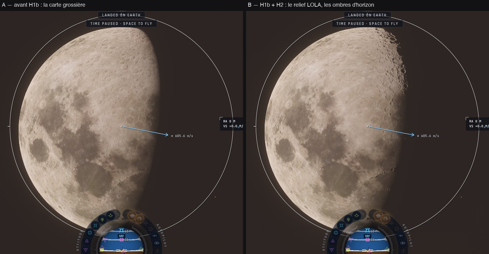
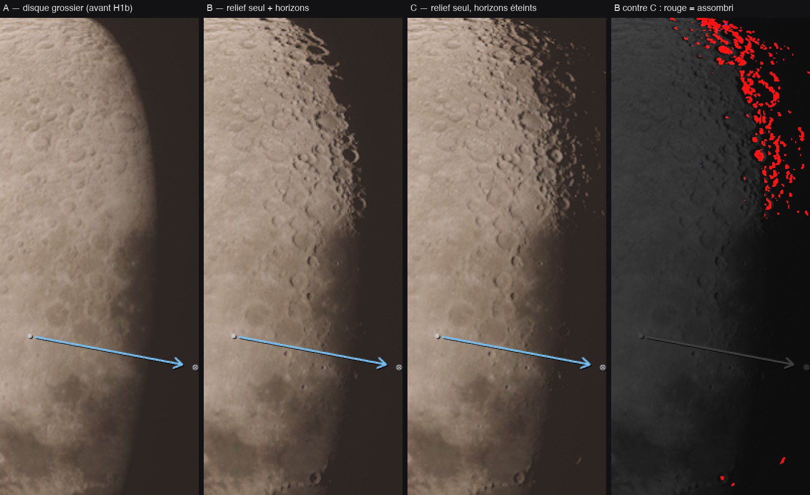

# H1b + H2 — la Lune au télescope : son relief seul et les ombres de son terminateur

Plan : [PLAN-REFRACTION-HORIZONS.md](../../PLAN-REFRACTION-HORIZONS.md), phases H1b et H2. Le 3 novembre 2026, kerr-mini
(M1, Chrome plein écran). e2e `tests/e2e/horizon-discs.e2e.test.ts` ; unitaires `tests/horizon-maps.test.ts` ; données :
[H2/horizon-discs.json](H2/horizon-discs.json).

## Fiche (§20.8 de l'analyse de stratégie)

| Champ | Réponse |
|---|---|
| Destination | §7.8 : une ombre par échelle, ici l'horizon lointain estimé, avec son domaine déclaré (le corps HD vu de loin). §19.4 : le rendu ne décide plus du sol de contact. |
| Bénéfice courant | La Lune au télescope montre enfin son relief mesuré (LOLA) au lieu de la carte grossière, et un terminateur dentelé : les pentes éclairées au-delà de la ligne s'éteignent derrière leur horizon. |
| Réutilisation | Les cartes d'horizon de H1 (format, cuisson, calottes) ; le DEM et sa pyramide de `hd-maps.ts` ; `horizonLight` resservira à H3 (le corps proche) et à Mars (quand il sera cuit). |
| Dépendance retirée | Le chargement HD ne touche plus d'office au sol physique : le mode « relief seul » sépare le rendu du sol du CPU (`groundHeights` réservé au mode complet). |
| Acceptation | Effet visible au bon endroit, aucun pixel éclairci à tort (< 0,2 %), coût non mesurable à ±3 ms, sol du CPU intouché, aucune erreur GPU. Reste à faire : la comparaison à une photo réelle à la même colongitude. |
| État de preuve | **Mesuré** (kerr-mini, un passage vert, un passage précédent au seuil arbitraire) ; **vérifié statiquement** : 69/69 shaders, budgets des noyaux, 86 tests unitaires. Non mesuré : le Mac de Sam, le PC. |
| Transition restante | Le DEM est décodé sur le fil de la page (59–79 ms d'écart d'image au chargement) : à passer dans un worker. La cuisson met 25–34 s sur le mini (2 ms par image). Mars dans `otherGround` attend que Mars soit cuit (H1c/H4). |

## Fait

- **H2, le lecteur** (`horizon-maps.ts withHorizonMaps` → `trace.wgsl horizonLight`) :
  - **Les liaisons** : la carte et les calottes aux liaisons 42 et 43, au palier de 29 textures (`HORIZON_TEXTURE_LIMIT`) ;
    en dessous, un talon qui rend 1 (aucune ombre, le comportement d'avant). Des textures 1 × 1 de repli restent liées tant
    qu'aucune carte n'existe ; les groupes de liaison sont refaits quand les cartes naissent ou partent.
  - **La table** : deux lignes `TABLE_HORIZON` à la fin du tampon des tables (aucun décalage déplacé). Leur drapeau ne
    s'allume qu'une fois la cuisson finie, pour le corps HD qu'elle a cuit.
  - **La lecture** : les deux secteurs autour de l'azimut du Soleil, décodés (racine signée), revus depuis la hauteur propre
    du point selon l'option (d) (tan e' = tan e + (h0 − h)/d, d la distance du bloqueur dominant), interpolés. La calotte
    polaire au-delà de 78°, fondue jusqu'à 80°. La mip selon l'empreinte du pixel. Une seule copie des lectures (une boucle
    carte puis calotte) : chaque appel est recopié par le compilateur.
  - **L'ombre** : un smoothstep sur le rayon du Soleil, multiplié à l'argument `rs0` de `planetShade` (sa signature ne change
    pas). Soleil au-dessus de 30° : 1, sans lecture ; plus de 8,6° sous l'horizon : 0.
  - **Le réglage** `horizonMaps` (préférence, allumé ; Ciel › Le relief des mondes) : éteint, ni cuisson ni lecture.
- **H1b, le relief seul de l'astre regardé** :
  - `loadHdMap(…, "relief")` charge le DEM seul (couleur de repli 1 × 1, la carte grossière dessinée). `hdMap.mode` dit lequel ;
    `hdGeneration` compte chaque publication (monde, mode et relief échangés d'un coup).
  - **La vue** (main.ts `lookedBodiesNow`, 4 fois par seconde) donne au renderer les mondes à DEM qu'elle regarde : leur
    distance en rayons, leur disque dans l'image ou à une demi-largeur de champ.
  - **La règle** : épinglé > corps proche (`dN < hdAt`) > **le monde regardé**, le plus proche dans le champ en deçà de
    `reliefAt` = 8 × la portée de `hdAt` (~3° de champ pour la Lune depuis la Terre) ; gardé tant qu'il reste à une demi-largeur
    de champ et en deçà de deux fois le seuil ; libéré 3 s après.
  - **Le sol du CPU** n'est jamais touché en mode relief (`groundHeights` réservé au mode complet) — décision du plan §5.8 et
    §19.4 de l'analyse de stratégie.
  - **Le traceur** : `P.hd2.x` vaut 2 en mode relief et `planetMapAt` garde alors la carte grossière ; le gain de couleur HD
    est neutre.
- **Corrigé au passage** (commit à part, b7780d14) : le traceur ne compilait plus sur les appareils sans 9ᵉ tampon de stockage
  depuis Q2/Q3 ; `check-wgsl` repasse à 69/69.

## Mesuré

| | Passage 1 | Passage 2 |
|---|---:|---:|
| Relief voulu → publié | 0,2 s | 0,2 s |
| Plus long écart d'image au chargement | 79,1 ms | 58,7 ms |
| Cuisson des horizons | 34,4 s | 24,6 s |
| GPU, A grossier | 30,4 ms | 24,1 ms |
| GPU, B relief + horizons | 29,4 ms | 24,5 ms |
| GPU, C relief seul | 30,2 ms | 27,3 ms |
| Pixels assombris par les horizons (B/C) | 2 648 (0,13 %) | 2 683 (0,13 %) |
| Pixels éclaircis (B/C) | 156 | 237 (0,012 %) |
| Sol du CPU | intouché | intouché |
| Erreurs GPU | 0 | 0 |

Les écarts de temps entre états (±3 ms) suivent les passages, pas les états : aucun coût mesurable à cette précision.

## Ce que les e2e ont appris

- **Le premier essai, la Lune à 4 000 km au champ de 8° : 35 pixels changés sur 1,09 M.** Un corps à moins de 300 rayons
  (`LOCAL_RANGE`) est toujours le corps proche, tracé par `nearMarch`/`shadeNear`, jamais par `ourSegment`. Or les cartes HD
  ne se chargeaient que pour le corps proche : `ourSegment` ne dessinait jamais le corps HD. **H1b avant H2, l'ordre du plan,
  était nécessaire** ; les ombres d'horizon du corps proche sont H3 (`nearShadow`).
- **Sans les horizons, le relief HD éclaire trop loin dans la nuit** : ses pentes tournées vers le Soleil s'allument jusqu'à
  ~40 px (~270 km) au-delà du terminateur. Les cartes d'horizon les éteignent. Elles retirent aussi quelques sommets isolés
  éclairés, réels ceux-là : le point est revu à la hauteur moyenne de son empreinte (6,7 km par pixel ici), plus bas que son
  sommet.
- **En raster, l'image ne passe jamais à l'état « convergé »** : un e2e attend un nombre d'images, pas cet état.

## Reste

- La comparaison à une photo réelle du terminateur à la même colongitude (LROC WAC ou amateur).
- Le DEM décodé dans un worker (l'écart de 59–79 ms au chargement).
- La cuisson plus rapide quand l'image a de la marge (25–34 s sur le mini avant que les ombres apparaissent).
- Mars dans `otherGround`, quand Mars sera cuit ; H3 (le corps proche), H1c (Shackleton), H5 (la Terre), H4.
