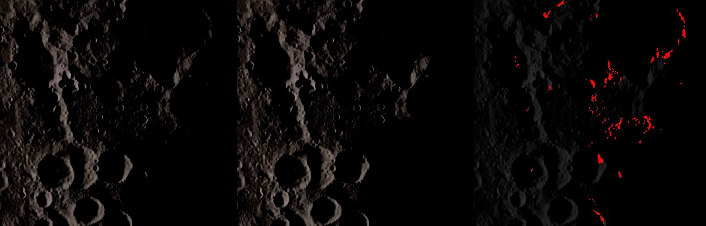
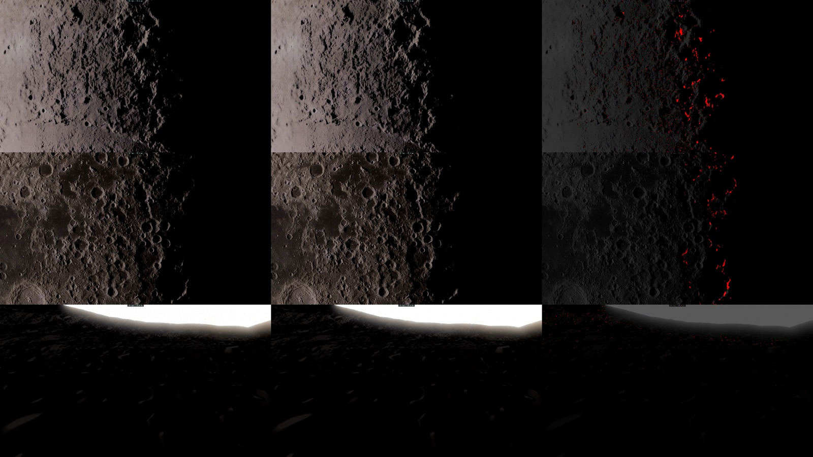
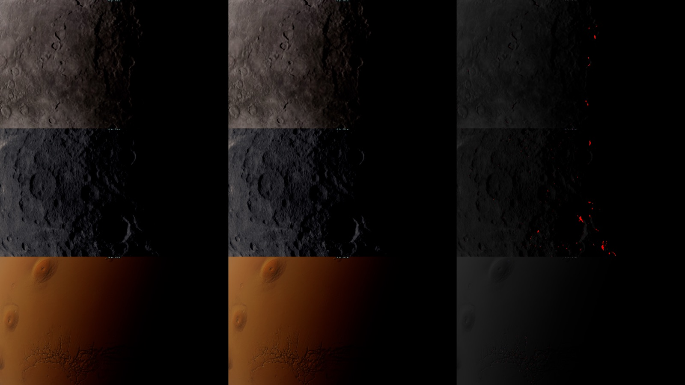

# H3 — le corps proche : les ombres longues d'un Soleil bas, lues sur ses cartes d'horizon

Plan : [PLAN-REFRACTION-HORIZONS.md](../../PLAN-REFRACTION-HORIZONS.md), phase H3. Le 3 novembre 2026, kerr-mini
(M1, Chrome plein écran). e2e `tests/e2e/horizon-near.e2e.test.ts` ; unitaires `tests/horizon-maps.test.ts`,
`tests/kernel-budget.test.ts`, `tests/gpu-tables.test.ts` ; données : [H3/horizon-near-lune.json](H3/horizon-near-lune.json),
[H3/horizon-near-mondes.json](H3/horizon-near-mondes.json).

## Fiche (§20.8 de l'analyse de stratégie)

| Champ | Réponse |
|---|---|
| Destination | §7.8 : une ombre par échelle — la marche et la carte du Soleil pour le proche, la carte d'horizon pour le lointain, chacune dans son domaine déclaré. |
| Bénéfice courant | Près du terminateur, les sommets et remparts qu'un relief à plus de 20 km cache du Soleil s'éteignent enfin : la marche du corps proche s'arrêtait à ~20 km (Lune) et laissait allumé tout ce qu'un bloqueur plus lointain cache. Mercure, Cérès et Mars ont désormais leurs cartes. |
| Réutilisation | Le lecteur de H2 (`horizonSin`, les deux secteurs revus depuis la hauteur propre du point — option (d)), la cuisson de H1, le fondu de la table. |
| Dépendance retirée | Aucune. **La marche lointaine reste** : son retrait n'a pas passé le critère de non-régression (voir plus bas). |
| Acceptation | La carte n'éclaircit pas plus que deux fois le bruit des captures (ou 0,2 %), n'ajoute pas de grain (énergie haute fréquence à 10 % près), assombrit ≥ 0,05 % au terminateur, aucune erreur GPU. |
| État de preuve | **Mesuré** sur le mini : Lune (3 vues), Mercure, Cérès, Mars. **Vérifié statiquement** : 69/69 shaders, budgets des noyaux, tests unitaires. Non mesuré : le Mac de Sam, le PC, une photo réelle à même colongitude. |
| Transition restante | Le gain de coût prévu (la carte remplaçant la marche au-delà de `D_cuisson`) n'est pas obtenu. Mars : effet non démontré dans les vues essayées (voir plus bas). `otherGround` (Mars en disque lointain) pas branché. |

## Fait

- **`nearHorizon`** (`trace.wgsl`) : sur le corps HD, la carte d'horizon vers le Soleil (`horizonSin` : sinus de
  l'horizon et distance des bloqueurs), revue depuis **la hauteur propre du point** (relief, cratères et houle compris : un
  sommet au-delà du terminateur garde sa lumière). La part du disque solaire au-dessus : un smoothstep sur le rayon du
  Soleil **plus ce que l'horizon balaie sous le pixel** (pente × empreinte / distance du bloqueur) — sans ce terme, un
  pointillé 2 × 2 apparaissait là où l'horizon d'un bloqueur proche traverse le pixel (+28 % d'énergie haute fréquence ; +4,6 %
  après). Pas dans les sondes (`NEAR_DETAIL`).
- **`nearShadow`** : la carte d'abord — Soleil entièrement sous l'horizon : 0, rien d'autre lu ; sinon le min avec la marche
  et la carte du Soleil.
- **Mars** (`earthNear`) : `REL_SH` s'effaçait entre 15 et 25 km de la caméra ; la carte est lue une fois, **après** ce fondu
  (elle reste vue depuis l'orbite) ; `nearShadow` la saute alors (`HZ_SKIP`). La normale passée à l'ombre (`SUN_N`) est
  celle du sol (`HD_N`, comme `n0` de la Lune), la sphère pour Vénus.
- **Le fondu d'arrivée** : le poids de la table monte de 0 à 1 en 1,5 s après la cuisson (`renderer.horizonOnAt`) — les ombres
  longues n'apparaissent pas d'un coup ; `horizonLight` (H2) le suit.
- **Les mondes cuits** (décision 37) : la Lune, Mars, Mercure, Cérès (Vénus exclue : son Soleil ne traverse pas ses nuages).
  Largeur de la carte : 2048 au plus, le DEM au plus — la moitié du DEM pour la Lune et Mars, la pleine résolution pour
  Mercure et Cérès (l'ancienne règle `demW >> 1` leur aurait donné 1024).
- **Comparaison** : `renderer.liteSkip` 524288 coupe la lecture (la marche seule, comme avant).

## Mesuré (kerr-mini)

| Vue | Chemin | Assombri | Éclairci (bruit) | HF avec / sans | GPU avec / sans (ms) |
|---|---|---:|---:|---:|---:|
| Lune, terminateur 500 km | raster | 1,76 % | 0,155 % (0,115 %) | 1,35 / 1,37 | 19,5 / 20,1 |
| Lune, terminateur 4 000 km, 8° | tracé (convergé) | 0,63 % | 0 (0) | 3,24 / 2,94 (temps réel) | 27,1 / 27,8 |
| Lune, pôle sud au sol | raster | 0,52 % | 0,015 % (0,011 %) | 0,77 / 0,80 | 22,8 / 22,9 |
| Mercure, terminateur 700 km | raster | 0,085 % | 0,001 % (0) | 0,44 / 0,44 | 18,1 / 18,1 |
| Cérès, terminateur 200 km | raster | 0,47 % | 0,006 % (0,008 %) | 0,57 / 0,57 | 20,6 / 21,5 |
| Mars, terminateur 1 500 km | raster | 0,027 % (bruit 0,042 %) | 0,002 % | 0,53 / 0,51 | 25,8 / 25,5 |

Cuisson : Lune 16–21 s, Mercure 24 s, Cérès 22 s, Mars 21–36 s. Aucune erreur GPU. Les écarts de temps (≤ 0,9 ms) suivent
les passages, pas les états : **ni coût ni gain mesurable**.

## Ce que les e2e ont appris

- **L'exposition automatique faussait la comparaison** : la carte assombrit l'image, le posemètre la relève, et les pixels
  éclairés paraissent « éclaircis » par une carte qui ne fait qu'assombrir. Le test fige l'exposition à la lecture du
  posemètre, carte allumée — après avoir attendu une **nouvelle** lecture (sinon il fige celle de la scène précédente :
  la vue polaire surexposée).
- **Le bruit du tracé temps réel** se déplace avec les tirages aléatoires que la sortie anticipée décale : la vue tracée se
  compare à convergence ; les images temps réel servent à mesurer le grain.
- **Retirer la marche au-delà de `D_cuisson`** (le gain de coût prévu) **rééclaire 0,73 %** des pixels au terminateur, au-delà
  du bruit : la carte, estimation à −2,2…+1,0° près (pilote H1), manque des bloqueurs que la marche voit. La coupure est
  retirée ; le plan l'exigeait (« la marche reprise n'est retirée que là où son remplacement est démontré »).
- **Une bulle de l'interface** apparue dans une capture et pas l'autre faisait échouer la comparaison (0,275 % « éclaircis ») :
  les captures se font sous `hide-ui`.
- **Mars** : son terminateur se fond dans le crépuscule de sa poussière, sous le seuil de luminance de la comparaison ; la
  vue à 300 km sous un Soleil à 4° ne montrait aucun écart (21 pixels sur 925 000) ; un œil à 2 km au-dessus des plaines,
  le Soleil à 3° derrière lui, donnait une image trop sombre pour juger (58 000 pixels éclairés, le bruit à 23 %) — et une
  bande de points brillants scintillants sur l'horizon, avec ou sans la carte, à examiner à part. L'effet sur Mars reste à
  démontrer.

## Reste

- Le gain de coût : une carte prudente (le maximum des mips, décision du challenge §5.6) pour décider l'ombre certaine, la
  marche seulement dans la zone d'incertitude — H3a si sa borne est prouvée.
- Mars : une vue où ses ombres longues sortent du crépuscule ; `otherGround` (Mars en disque lointain, H2).
- H1c (Shackleton, données régionales), H4 (mesures, planche contre photo réelle, docs FR + EN), H5 (la Terre).
