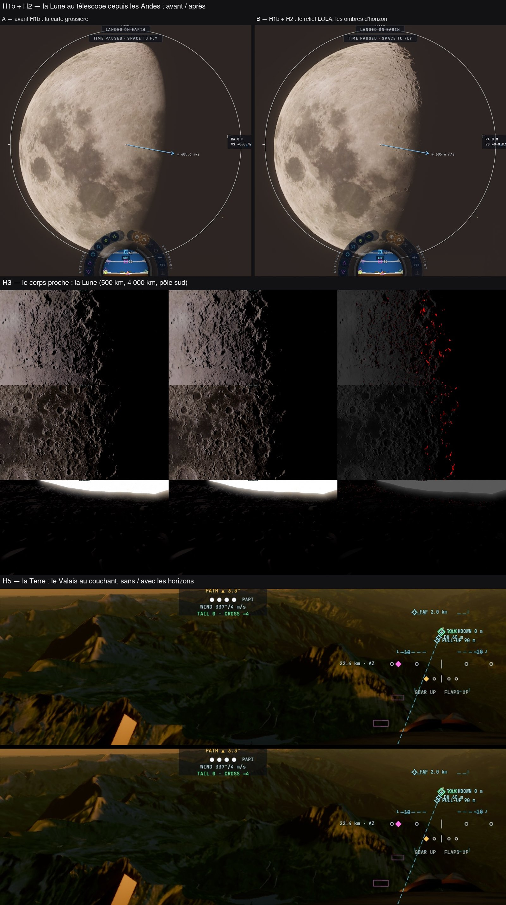

# H4 — le bilan des horizons (H1 → H5) : mesures, décisions, documentation

Plan : [PLAN-REFRACTION-HORIZONS.md](../../PLAN-REFRACTION-HORIZONS.md), phase H4. Le 3 novembre 2026. Les mesures viennent des
fiches de chaque phase (kerr-mini, M1, Chrome plein écran) ; aucune nouvelle campagne pour cette fiche — elles y sont relues.
Documentation : [HORIZONS.md](../../HORIZONS.md) (EN + FR).

## Fiche (§20.8 de l'analyse de stratégie)

| Champ | Réponse |
|---|---|
| Destination | §7.8 : une ombre par échelle, chacune dans son domaine déclaré, sans double compte (minimum des parties). |
| Bénéfice courant | Les ombres longues du Soleil bas existent maintenant aux trois échelles qui en manquaient : le disque lointain (la Lune au télescope), le corps proche au-delà de la marche (~20 km), la Terre au-delà des cascades (~10 km, jusqu'à 150 km). |
| Réutilisation | Une cuisson générique (treillis lat/lon, fenêtre locale, calottes), un encodage, une relecture depuis la hauteur du point (option (d)), un fondu de publication ; la même logique pour la Lune, Mercure, Cérès, Mars et la Terre. |
| Dépendance retirée | Le chargement des cartes HD ne décide plus du sol de contact (H1b, mode « relief seul ») ; le traceur compile de nouveau sans le décor mondial. |
| Acceptation | Chaque phase : assombrissement au bon endroit, rien d'éclairci au-delà du bruit des captures, pas de grain, aucune erreur GPU — tenu (H2, H3, H5). |
| État de preuve | **Mesuré** sur le mini pour chaque phase ; **vérifié statiquement** (shaders, budgets, tests). **Non vérifié** : la justesse contre une photo réelle (Lune à même colongitude) et contre la marche tracée (Terre) ; le Mac de Sam, le PC. |
| Transition restante | H1c (Shackleton, données régionales : hébergement à décider) ; la marche lointaine du corps proche gardée (son retrait rééclairait 0,73 %) ; la lecture de H5 +0,2 à +0,7 ms (cible 0,2) ; Mars en disque lointain (`otherGround`). |

## Ce qui est livré

| Phase | Commit | Ce qu'elle fait |
|---|---|---|
| H1 (d) | 09eb027a | La cuisson GPU : moyennes le long des rayons, pas du bloqueur dominant par secteur, relecture depuis la hauteur du point. |
| H1b + H2 | 041c2468 | Le relief seul de l'astre regardé (la Lune au télescope) ; `horizonLight` sur les disques lointains. |
| H3 | 82d6dad4 | Le corps proche (`nearShadow`) lit sa carte ; Mercure, Cérès, Mars cuits. |
| H5 | 572758ec, 66740996 | L'horizon de la Terre en 8 directions sur les niveaux 4–6 du cache, en minimum avec les cascades. |
| H4 | (ce commit) | L'état des horizons dans la télémétrie « sky » de TARS (`renderer.horizonStatus`), la documentation, ce bilan. |

## Les mesures, résumées

| Vue (kerr-mini) | Assombri | Éclairci (bruit) | Coût |
|---|---:|---:|---|
| Lune au télescope, premier quartier (H2) | 0,13 % | 0,012 % | aucun mesurable (±3 ms entre passages) |
| Lune, terminateur 500 km (H3, raster) | 1,76 % | 0,155 % (0,115 %) | aucun mesurable |
| Lune, pôle sud au sol (H3) | 0,52 % | 0,015 % (0,011 %) | aucun mesurable |
| Cérès, terminateur 200 km (H3) | 0,47 % | 0,006 % (0,008 %) | aucun mesurable |
| Valais au couchant, 3 000 m (H5) | 2,2 % | 0,003 % (0,005 %) | +0,4 à +0,8 ms au matériau raster |
| Valais à midi (H5) | 0,003 % (bruit) | 0,001 % | +0,15 ms |

Mémoire : 50 Mo par monde cuit (carte 2048 × 1024 × 4 couches + calottes, mips), un monde à la fois ; 6,3 Mo pour la Terre. Cuisson
16–36 s selon le monde (2 ms par image), 1,5 ms par image pendant 8–10 images par niveau de la Terre.

## Décisions consignées

- **La résolution des cartes** : 2048 × 1024 (la moitié du DEM pour la Lune et Mars, sa pleine résolution pour Mercure et Cérès) ;
  4096 non adopté — la mémoire (88 Mo) sans gain démontré.
- **La distance par direction** (option (d), décision 37) : gardée partout (H1–H5). La relecture depuis la hauteur propre du point est
  ce qui rend leur lumière aux sommets isolés au-delà du terminateur.
- **Le minimum des parties** : chaque échelle donne sa part (marche, carte du Soleil, cascades, horizon), le minimum les combine ; une
  pénombre vue de deux n'est jamais assombrie deux fois.
- **H5 en texture filtrée** : différé. Un stockage `rgba16float` des grandeurs linéaires perd ~0,4° par annulation (h0/d jusqu'à 15
  sur les nœuds de 153 m) ; le `rgba32float` n'est pas filtrable sans extension ; et rien ne prouve que les lectures dominent le coût.

## Reste

- **H1c (Shackleton)** : les DEM régionaux LOLA du pôle sud. Ils pèsent plus que la limite de 8 Mo par fichier du CI et le dépôt est
  déjà à 565 Mo de binaires sur 600 : **où les héberger est une décision de Sam**.
- La comparaison à une photo réelle du terminateur (même colongitude) et des ombres de H5 à la marche tracée.
- Le coût de lecture de H5 ; Mars en disque lointain ; le retrait de la marche lointaine du corps proche là où il sera démontré.
