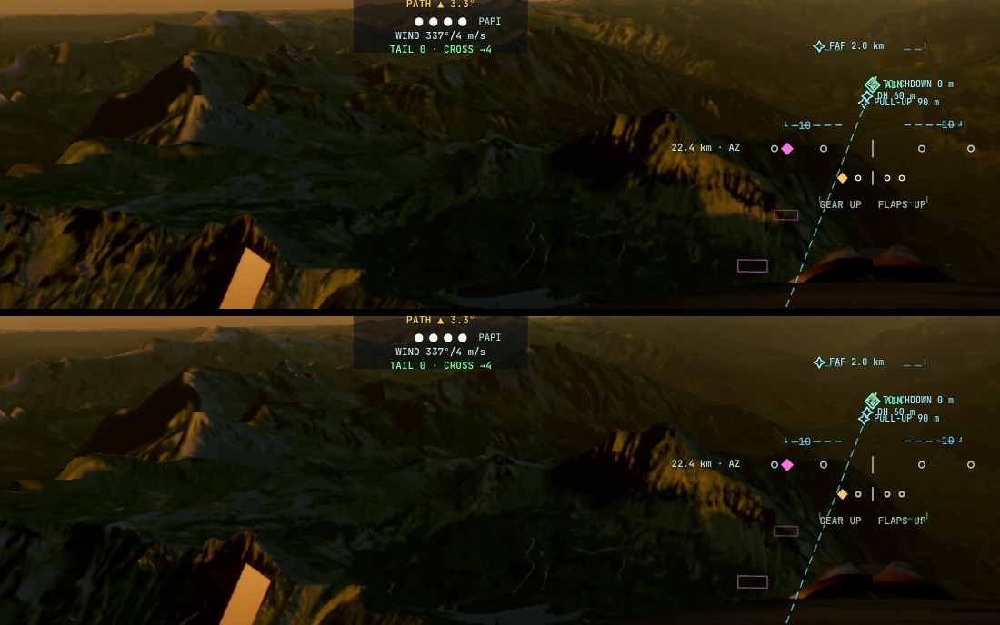
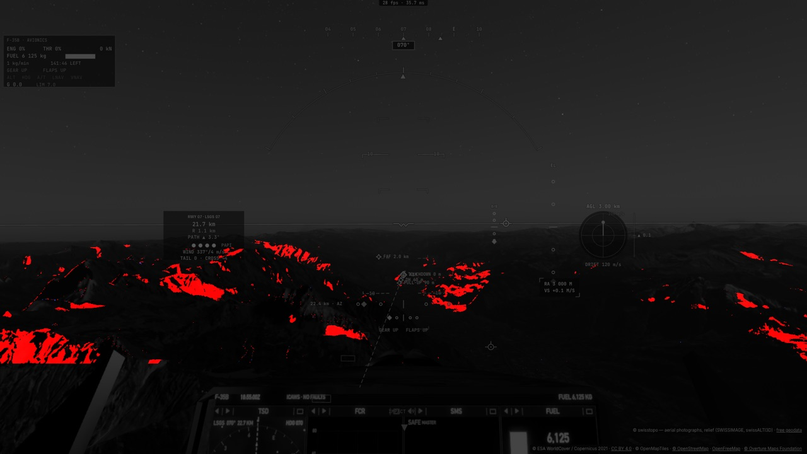

# H5 — l'horizon de la Terre en 8 directions : les ombres des chaînes lointaines au Soleil bas

Plan : [PLAN-REFRACTION-HORIZONS.md](../../PLAN-REFRACTION-HORIZONS.md), phase H5 (décision 17). Le 3 novembre 2026,
kerr-mini (M1, Chrome plein écran). e2e `tests/e2e/earth-horizons.e2e.test.ts` ; unitaires `tests/earth-horizons.test.ts`,
`tests/gpu-tables.test.ts`, `tests/kernel-budget.test.ts` ; données : [H5/earth-horizons.json](H5/earth-horizons.json).

## Fiche (§20.8 de l'analyse de stratégie)

| Champ | Réponse |
|---|---|
| Destination | §7.8 : une ombre par échelle — les cascades (±1,5 et ±10 km) pour le proche, l'horizon du cache pour le lointain (jusqu'à 150 km), chacune dans son domaine, en min. |
| Bénéfice courant | Au Soleil bas, le relief au-delà des cascades portait **aucune ombre** en raster (et les bloqueurs hors de leur boîte non plus) : les versants que cache une crête lointaine restaient éclairés. Ils s'éteignent maintenant. |
| Réutilisation | Le cache du relief (T3/T4 : ses fenêtres, ses hauteurs, ses générations) ; l'encodage et l'option (d) de H1 ; la table du traceur (aucune liaison ajoutée). Servira à Q4 (L2b, la visibilité du ciel des vallées). |
| Dépendance retirée | Aucune. |
| Acceptation | Les trois niveaux cuits et fondus en moins de 90 s ; ≥ 0,5 % de pixels assombris au couchant ; rien d'éclairci au-delà de deux fois le bruit ; < 0,05 % à midi ; aucune erreur GPU. |
| État de preuve | **Mesuré** sur le mini (un passage vert après mise au point) ; **vérifié statiquement** : 70/70 shaders (la cuisson comprise), budgets des noyaux, tests unitaires. **Non vérifié** : la justesse des ombres contre une référence (la marche du traceur jusqu'à 50 km, ou une photo) ; le Mac de Sam, le PC. |
| Transition restante | Coût de lecture au-dessus de la cible (voir plus bas) ; validation contre la référence tracée ; Q4 (le ciel des vallées). |

## Fait

- **La cuisson** (`system/earth-horizons.ts`, `earthHorizonShader`) : sur les niveaux 4, 5 et 6 du cache (nœuds à 153 m,
  611 m, 2,4 km ; fenêtres ±20, ±78, ±313 km), pour chaque nœud et chacun des 8 secteurs, l'élévation la plus haute du sol
  de 2 nœuds à 150 km (trois rayons par secteur, pas × 1,25), lue dans les hauteurs du cache lui-même — le niveau le plus fin
  dont les nœuds ne sont pas plus fins que 1/50 de la distance et dont la fenêtre contient le point. La géométrie : la sphère
  locale de rayon N (grande normale), la verticale géodésique — celle de l'éclairage (`gq`, le Soleil physique incident de R3).
- **Le moment** : quand le cache recuit un niveau (sa fenêtre a bougé : tout de suite ; de nouvelles tuiles : au plus toutes les
  5 s) — **jamais quand le Soleil tourne**. Un niveau à la fois, une bande de lignes par image (taille réglée sur le temps
  mesuré, 1,5 ms visé), le niveau entier recopié dans la table d'un coup avec son en-tête : jamais moitié ancien, moitié neuf.
- **Le stockage** : dans la table du traceur (`TABLE_EARTH_HORIZON`, après les cartes de H2), **aucune liaison ni texture en
  plus** : par nœud, deux vec4 — les 8 sinus (deux octets par flottant, la racine signée de H1), les 8 pas du bloqueur (trois
  par flottant) et la hauteur du nœud. 6,3 Mo.
- **La lecture** (`earthHorizonSin`, injectée avec le lecteur du cache) : le niveau le plus fin qui contient le point, fondu
  dans le suivant sur ses 12 derniers nœuds et à son arrivée (1,5 s) ; les deux secteurs autour de l'azimut du Soleil, revus
  depuis **la hauteur propre du point** (option (d)) ; bilinéaire sur les 4 nœuds. `earthHorizonLight` : le smoothstep sur le
  rayon du Soleil plus ce que l'horizon balaie sous le pixel ; Soleil au-dessus de 30° ou sous l'horizon : rien n'est lu.
- **Branché** dans `liteSun` (le sol raster : en min avec les cascades) et `earthGround` (le sol tracé, hors sondes), atténué
  sur la mer comme la marche existante.
- **Le niveau 3** (38 m, ±4,9 km) est laissé de côté : sa fenêtre est entière dans la portée des cascades, et l'horizon des
  nœuds de 153 m, revu depuis la hauteur du point, résout les crêtes lointaines.
- **Comparaison** : `renderer.liteSkip` 1048576 coupe la lecture ; le réglage `horizonMaps` coupe tout. Diagnostic :
  `renderer.earthHorizonTable(slot)`, `renderer.earthHorizons.stats()`.

## Mesuré (kerr-mini)

| Vue | Assombri | Éclairci (bruit) | Matériau raster avec / sans | Image avec / sans |
|---|---:|---:|---:|---:|
| Valais, 3 000 m, ~30 min avant le coucher | 2,24 % | 0,003 % (0,005 %) | 15,16 / 14,37 ms | 34,4 / 35,0 ms |
| Annecy, 5 000 m, ~25 min avant le coucher | 0,38 % | 0,012 % (0,001 %) | 14,08 / 13,64 ms | 33,2 / 30,6 ms |
| Valais à midi | 0,003 % (bruit 0,003 %) | 0,001 % | 14,72 / 14,57 ms | 36,9 / 34,4 ms |

- **La lecture coûte +0,4 à +0,8 ms** au matériau raster au couchant (+0,15 ms à midi, la sortie anticipée) — au-dessus de
  la cible du plan (< 0,2 ms). L'image totale varie de ±2,5 ms d'un passage à l'autre : le surcoût n'y est pas isolable.
- **La cuisson** : ~1,5 ms par image tant qu'une bande est en cours (budget réglé à 1,5 ms) ; un niveau entier en 260–380 ms.
  La cible du plan (< 1 ms par recuisson) n'est pas tenue telle quelle : c'est ~1,5 ms × 8–10 images par niveau.
- Les trois niveaux sont cuits et fondus avant la fin du chargement des tuiles.

## Ce que les e2e ont appris

- **La lecture était inerte au premier passage** : je l'avais conditionnée à `HAS_TERRAIN_CACHE`, qui dit que *le traceur*
  lit les hauteurs du cache — or en raster le cache est cuit pour le maillage sans que le traceur le lise (`earthTerrainCache`
  est éteint par défaut). Les horizons étaient cuits (relus dans la table : 20–30° dans le fond du Valais) mais jamais lus.
- **Figer l'exposition par le réglage manuel fausse l'image** : l'exposition automatique éteinte, le ciel est dessiné à son
  échelle physique et non à celle de l'image (`skyScale`) — un ciel blanc couvert d'étoiles en plein jour, et une lecture du
  posemètre périmée (EV de la scène précédente). Le test **tient l'exposition automatique à sa valeur** (`autoExposureEV`,
  image par image) après une lecture fraîche. L'e2e de H3 avait le même défaut (la vue polaire « surexposée » de la session
  précédente) : corrigé de la même façon.
- **Le bandeau du lieu** (en haut) et le tableau de bord changent entre deux captures : la comparaison ne porte que sur le
  paysage entre les deux.

## Reste

- **La justesse** : comparer, sur les mêmes vues, les pixels assombris par H5 en raster aux ombres de la marche du traceur
  (`earthTerrainShadow`, jusqu'à 50 km) et à une photo ; mesurer les fausses ombres sur les crêtes fines.
- **Le coût** : une seule lecture des deux secteurs par nœud (aujourd'hui 4 nœuds × 2 secteurs) ou un niveau unique par
  pixel hors des bandes de fondu ; viser < 0,2 ms.
- **Q4 (L2b)** : la visibilité du ciel des vallées depuis les mêmes horizons.
