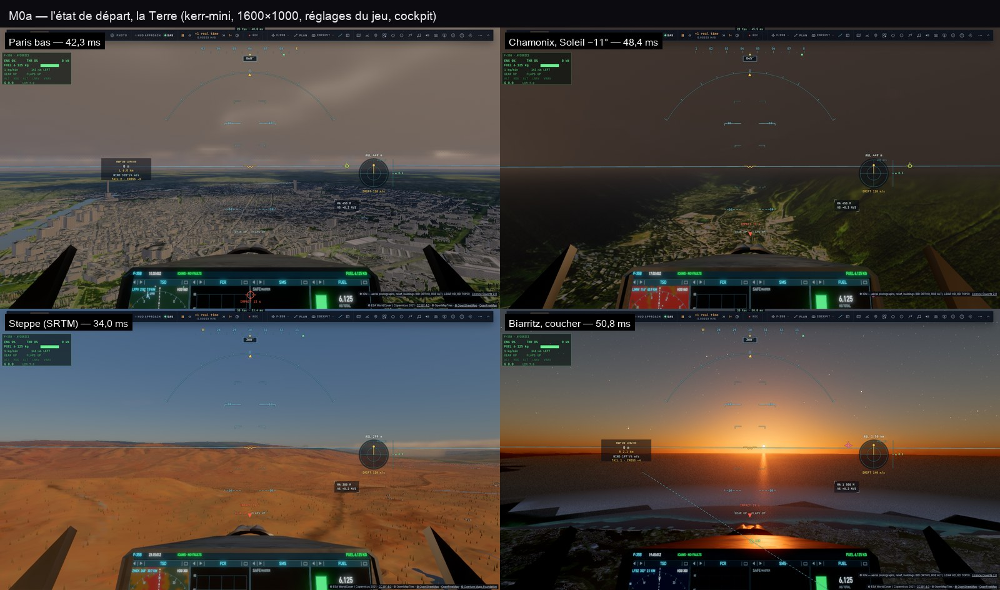
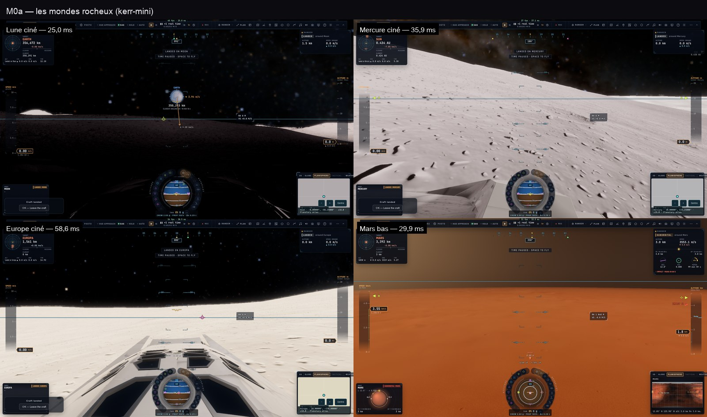

# M0a — l'état de départ

Plan : [PLAN-REFRACTION-HORIZONS.md](../../PLAN-REFRACTION-HORIZONS.md), phase M0a (décision 21). Mesuré le 2 novembre 2026
sur **kerr-mini** (M1, plein écran, page 1600 × 1000), `main` à `555079c4` + la vue remise à zéro (`81b06d83`, les réglages
du jeu inchangés). Outil : la suite partagée `tests/e2e/plan-views.e2e.test.ts` (décision 36), job
`20261102-032012-m0a-plan-views-2`, 10 min. Données brutes : [M0a/plan-views.json](M0a/plan-views.json).

**Méthode** : chaque vue tenue (F-35 en cockpit, vue remise à zéro, le vol figé), les réglages du jeu (qualité « game »,
gouverneur actif) ; 120 images terminées, le profileur éteint → médiane, 95ᵉ et 99ᵉ centiles ; puis 4 s profileur allumé →
les passes ; la mémoire GPU comptée depuis la première allocation (`#vram`). Puis 30 s de vol au-dessus de Chamonix.

## Les chiffres

| Vue | Médiane | p95 | p99 | Échelle · taux | Mémoire GPU (pic) | Tuiles prêtes |
|---|---:|---:|---:|---|---:|---|
| Paris bas, 450 m, matin | **42,3 ms** | 46,7 | 50,8 | 0,75 · 1/16 | 1 554 Mio (1 573) | relief + ortho 89 s |
| Chamonix, 450 m, Soleil ~11° | **48,4 ms** | 51,5 | 63,0 | 0,75 · 1/16 | 1 434 (1 468) | relief 53 s, ortho 55 s |
| Steppe mongole (SRTM), 300 m | **34,0 ms** | 37,1 | 39,5 | 0,75 · 1/16 | 1 554 (1 554) | relief 15 s |
| Biarritz, 1 500 m, coucher | **50,8 ms** | 55,6 | 55,9 | 0,75 · 1/16 | 1 554 (1 573) | relief 58 s |
| **Chamonix, 30 s de vol** | **49,8 ms** | 54,6 | 57,2 (max 59,9) | — | — | — |
| Terre, orbite | 15,6 ms | 16,3 | 16,5 | 1 · 1/4 | 1 231 (1 271) | — |
| Lune, ciné | 25,0 ms | 62,5 | 138,5 | 0,75 · 1/4 | 1 210 (1 558) | — |
| Mars, bas | 29,9 ms | **104,1** | 187,8 | 0,75 · 1/4 | 1 104 (1 558) | — |
| Mercure, ciné | 35,9 ms | 69,0 | 96,1 | 0,75 · 1/4 | 1 016 (1 386) | — |
| Europe, ciné | 58,6 ms | 62,5 | 63,6 | 0,75 · 1/4 | 976 (1 558) | — |
| Cérès, ciné | 21,9 ms | 28,9 | 30,2 | 0,75 · 1/4 | 915 (1 558) | — |

Les passes de **calcul** principales (les passes de rendu — affichage, vaisseau, masque — se chevauchent sur Apple : leurs
temps ne s'additionnent pas) :

| Vue | Matériau du sol | Eau | Nuages ½ | Visibilité raster | Trace |
|---|---:|---:|---:|---:|---:|
| Paris bas | 13,7 ms | — | 4,5 | 5,4 | 1,4 |
| Chamonix, Soleil bas | 16,2 | — | **15,7** | 1,4 | 1,8 |
| Steppe | 12,8 | — | 3,4 | 1,2 | 2,4 |
| Biarritz, coucher | 13,4 | **11,3** | 2,1 | 5,4 | 2,2 |

## Ce que M0a établit

1. **Le budget (≥ 25 i/s en vol, ≤ 40 ms — décision 26) n'est tenu sur aucune vue basse de la Terre** : 34 à 51 ms ;
   49,8 ms en vol. La vue en orbite tient (15,6 ms).
2. **Le matériau du sol** (`earth lite`) coûte 13–16 ms partout : le premier poste (T9, Q1).
3. **Deux postes inattendus** :
   - **les nuages en demi-résolution à 15,7 ms au Soleil bas** (Chamonix, contre 2–4,5 ms ailleurs) — la passe des nuages
     coûte 4 à 7 fois plus quand le Soleil est bas (sa marche de lumière, ses pas) : à traiter avec Q5 (C6, VIPER C2) ;
   - **l'eau à 11,3 ms au coucher sur la mer** (Biarritz) — le reflet du Soleil rasant, le SSR : à traiter avec T7.
4. **Les queues des planètes** : Mars bas p95 104 ms, Mercure 69, la Lune 62,5 — des à-coups, pas un coût moyen (à
   regarder en M0b).
5. **La mémoire GPU** : ~1,55 Gio au pic sur la Terre (le plafond du mini est 2 Gio, C0-8). La texture des tuiles en compte
   436 Mo (T10).
6. **Les tuiles fines arrivent en 15 à 90 s** (Paris : 89 s jusqu'à l'ortho z18 et le relief z17) : le chargement (T8)
   est un vrai sujet.
7. **À l'image** :
   - Chamonix, vers le nord-est : les versants au-dessus de la vallée sont un **aplat brun sans détail** — la perspective
     aérienne et l'éclairage par facettes sans ombres portées (§3.3, §3.4 du plan) ; à vérifier en M0b ;
   - Biarritz : la côte en **polygones** au premier plan, sur la mer (§3.5) ;
   - la steppe : un relief **mou et plissé** (§3.2).

## Reproductibilité

Écart entre deux passages (le premier, `20261102-030804`, à 18:40 UTC pour Chamonix et sans remise à zéro de la vue) :
Paris 41,6 → 42,3 ms, steppe 31,1 → 34,0, Biarritz 51,3 → 50,8, Europe 36,1 → 58,6 (!). La Terre tient à ±3–9 % ;
**Europe varie du simple au double** : une vue à ne pas utiliser seule pour un A/B (des rounds A B B A obligatoires).
