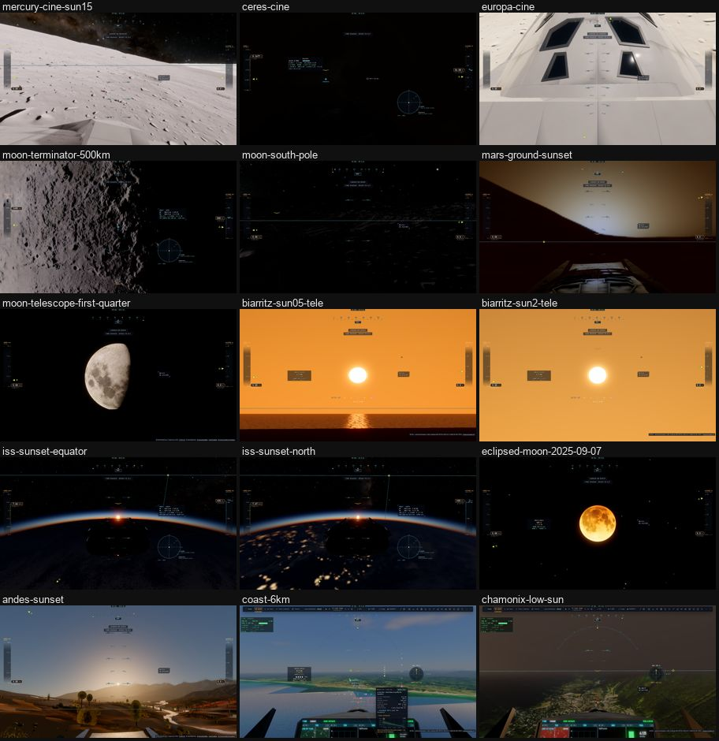

# M0b — les références détaillées

Plan : [PLAN-REFRACTION-HORIZONS.md](../../PLAN-REFRACTION-HORIZONS.md), phase M0b. Mesuré le 2 novembre 2026 sur
**kerr-mini** (M1, plein écran, 1600 × 1000), `main` à `5cdd71fc` (avant R3 et T6). Outil : la suite partagée
`tests/e2e/plan-views.e2e.test.ts` avec `PV_M0B=1 PV_FLIGHT_S=120 AB_ROUNDS=2`, job `20261102-135433-m0b-views`, deux tours
de 34 min. Données : [M0b/plan-views.json](M0b/plan-views.json) ; pentes : [M0b/smax.json](M0b/smax.json) (script
[M0b/smax.ts](M0b/smax.ts)).

## Ce que M0b a ajouté

- **L'entrée `moon shadeLite`** dans les profils des noyaux (`scripts/lib/kernel-profiles.ts`). La Lune passe par le raster
  comme les autres mondes. Son budget : 26 000 lignes inlinées (22 823 mesurées + 10 %).
- **La suite partagée** (`PV_M0B=1`) :
  - les vues de scène (`SCENE_VIEWS`, `tests/e2e/lib/plan-views.ts`), chacune avec la place du Soleil et de la Lune
    (`skyInfo`) ;
  - pour les mondes à ombres, leur part : `liteSkip` 4 (sans ombres du relief) et 8192 (sans carte du Soleil) ;
  - une côte vue de 6 km ;
  - 20 s d'images pendant l'arrivée des tuiles ;
  - un vol de durée réglable (`PV_FLIGHT_S`).
- **Les poses** des couchers vus de l'ISS ont été trouvées par balayage de la hauteur du Soleil selon la phase et la longitude (une sonde, non gardée) : Soleil à
  −19,8°, au ras du limbe vu de 420 km. Les captures des scènes sont prises sans l'interface.
- **Plafonds** : la suite n'attend plus 10 min sans rien dire sur un monde. Elle s'arrête à 120 s et dit ce qui manque
  (noyaux, tuiles, décor).
- **Relu** : `origin/master` d'Alex (`02f6a2b`, sessions 4u à 4y, les nuages en bouffées des géantes). Rien qui touche le
  relief, les horizons ou la réfraction.

## La Terre (vues de M0a et la côte)

| Vue | Tour 1 | Tour 2 | A/A | p95 | Relief prêt |
|---|---:|---:|---:|---:|---:|
| Paris bas | 32,9 ms | 32,9 | 0,0 % | 37,6 | 57 s / 30 s |
| Chamonix, Soleil bas | 49,2 | 49,4 | 0,4 % | 52,9 | 45 / 22 |
| Steppe (SRTM) | 34,9 | 32,2 | 7,7 % | 38,2 | 13 / 3 |
| Biarritz, coucher | 49,1 | 49,6 | 1,0 % | 55,0 | 38 |
| **Côte à 6 km** | 44,1 | 43,9 | 0,5 % | 48,5 | 22 |
| **Chamonix, 2 min de vol** | 30,1 | 31,8 | 5,6 % | 37,2 / 39,9 (max 72,6) | — |

- **Paris** : 42,3 ms en M0a, 32,9 ms ici. C'est le gain de Q1 (boîtes triées, ponts maillés) et de T8a.
- **Le vol de 2 min** : 1 937 et 1 960 cuissons du cache, soit **16 par seconde**. C'est la référence de T4.
- **Les tuiles à Paris**, à froid : 384 en attente à 1 s, 273 à 17 s. L'orthophoto z 18 arrive à 5 s, le relief complet à
  57 s.
- **Les passes** : le matériau du sol 12–17 ms partout. L'eau coûte 11,5 ms au coucher et 14,8 ms sur la côte à midi
  (T7). Les nuages en demi-résolution 15,8 ms au Soleil bas (Q5).

## Les mondes rocheux et la part de leurs ombres

| Vue | Image | Sans ombres (4) | Sans carte du Soleil (8192) | A/A |
|---|---:|---:|---:|---:|
| Mercure ciné, Soleil 15° | 36,9 ms | **22,9** (−14 ms) | 41,1 | 1,1 % |
| Cérès ciné | 25,2 | 20,2 (−5) | 19,9 | 9,6 % |
| Europe ciné | 59,5 | 51,4 (−8) | 74,4 | 6,6 % |
| Lune au terminateur, 500 km | 20,1 | 14,9 (−5) | 20,0 | 0,0 % |
| Pôle sud lunaire | 28,4 | 27,1 | 40,6 | 3,5 % |
| Mars au sol au couchant | 21,1 | 21,6 | 22,4 | 6,6 % |

- **Les ombres du relief coûtent encore 5 à 14 ms** sur les mondes à cratères. C'est la part que H3 vise.
- **Sans la carte du Soleil, c'est plus cher** : Mercure 41,1 ms, Europe 74,4, le pôle 40,6, parce que la marche reprend
  sur toute sa portée. La carte de P1-2 paie déjà.
- **Les queues** de Mars au couchant (p95 100 à 198 ms) et de la Lune au terminateur (p95 112 ms au tour 2) sont des
  à-coups, pas un coût moyen.

## La réfraction, les couchers (vues de R)

| Vue | Image | Soleil (géométrique / vu) | A/A |
|---|---:|---|---:|
| Biarritz, télé 4°, Soleil ~0,5° | 24,7 ms | 0,65° / 1,01° | 0,4 % |
| Biarritz, télé 4°, Soleil ~2° | 14,4 | 2,19° / 2,43° | 2,8 % |
| ISS, coucher à l'équateur | 18,2 | −19,8° (au limbe) | 0,5 % |
| ISS, coucher par 72° N | 20,1 | −19,7° | 1,5 % |
| Lune éclipsée du 7/9/2025, New Delhi, 2° | 14,3 | Lune à 53,6° | 0,7 % |
| Les Andes au couchant | 21,8 | 9,7° / 9,8° | 13,3 % |
| Lune au télescope (1°), premier quartier | 29,2 | Lune à 34,7° | 31,8 % |
| La Hague | 27,2 | −0,32° / 0,2° | 58,5 % |

## L'A/A (±1 % demandé)

- **Tenu** : Paris, Chamonix, Biarritz, la côte, Mercure, la Lune au terminateur, les deux couchers de l'ISS, la Lune
  éclipsée, Biarritz au télé.
- **Pas tenu** :
  - **la steppe (7,7 %), la Lune au télescope (31,8 %)** : leurs images sont identiques d'un tour à l'autre ; c'est le temps
    d'image d'une vue légère qui varie. Pour un A/B, il faut des tours A B B A, comme pour Europe (M0a) ;
  - **les Andes (13,3 %)** : le décor n'était pas chargé au premier tour. La suite attend maintenant aussi le décor ;
  - **La Hague (58,5 %)** : la vue était cassée (la caméra au ras du Ranger posé, dans la végétation). Elle est
    maintenant sans vaisseau, et montre le crépuscule sur une mer noire (à voir avec T7).
- **Vues à reprendre** :
  - **Cérès ciné** est noire. C'était déjà la vue de M0a : il n'existe pas de scène vitrine de Cérès ;
  - **le pôle sud lunaire** est noir, avec le Soleil à 0,83° (les calottes de H1/H4) ;
  - **Europe ciné** est vue à travers la coque du vaisseau.

## Les décisions de M0b

1. **S_max par corps : pas de borne utile, donc H3a est abandonné**, selon la règle du plan (« la règle est exacte ou
   elle n'est pas livrée »). Pentes mesurées :

   | Corps | MNT global, pente max (99,9ᵉ c.) | Cratères procéduraux, pente max (99,9ᵉ c.) |
   |---|---|---|
   | Lune (2,7 km/texel) | 49,7° (27,4°) | 73,7° (43,1°) |
   | Mars (5,2 km) | 39,7° (15,2°) | 40,8° (26,9°) |
   | Mercure (7,5 km) | 57,4° (14,3°) | 66,2° (43,1°) |
   | Cérès (1,4 km) | 60,3° (36,5°) | 89,9° (40,6°) |

   - Une borne prudente additionne les composantes. La seule paroi d'une cuvette vaut 0,8 de pente (38,7°) à chacun des
     7 niveaux de cratères, à quoi s'ajoutent le bruit de 90 m, le MNT et les tuiles fines, plus raides que le global.
   - **Le taux de déclenchement** sur toutes les vues de H (Soleil de 0,8 à 20°) : **0 %**.
2. **`reliefAt` = 8 × plus tôt que `hdAt`** (décision 7), c'est-à-dire le relief seul dès qu'un texel du MNT couvre
   1,3/8 px. La Lune vue de la Terre a son relief jusqu'à ~3° de champ ; la vue au télescope (1°) l'aurait.
3. **Les calottes polaires gardent 78° et 256 × 256** :

   | Corps | Texel de la calotte | Texel du MNT |
   |---|---:|---:|
   | Lune | 2,84 km | 2,67 km |
   | Mars | 5,5 km | 5,2 km |
   | Mercure | 4 km | 7,5 km |
   | Cérès | 0,77 km | 1,44 km |

   Elles sont partout aussi fines que le MNT ou plus.
4. **Pour T4** : 16 cuissons par seconde en vol bas ; c'est elles que T4 divise.
