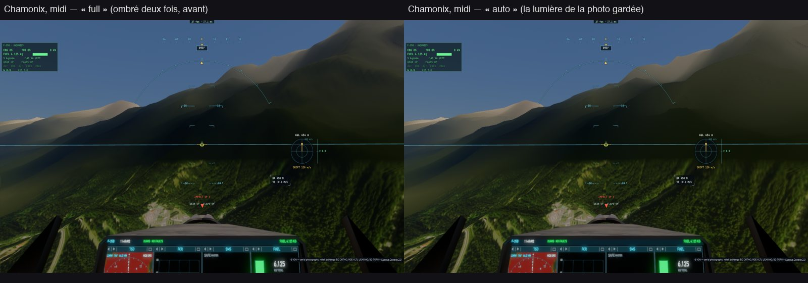
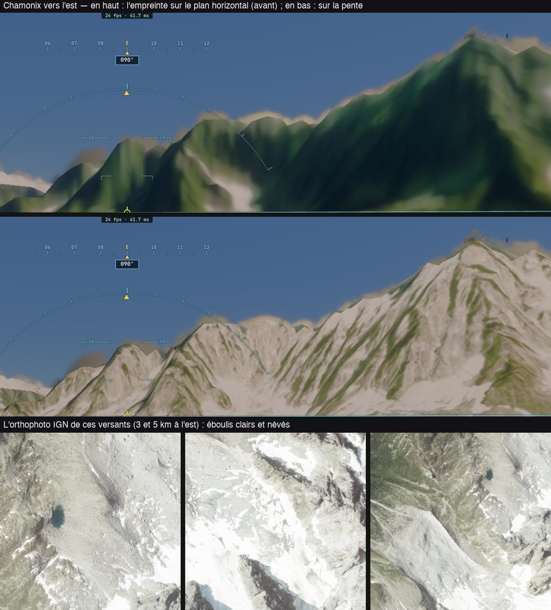
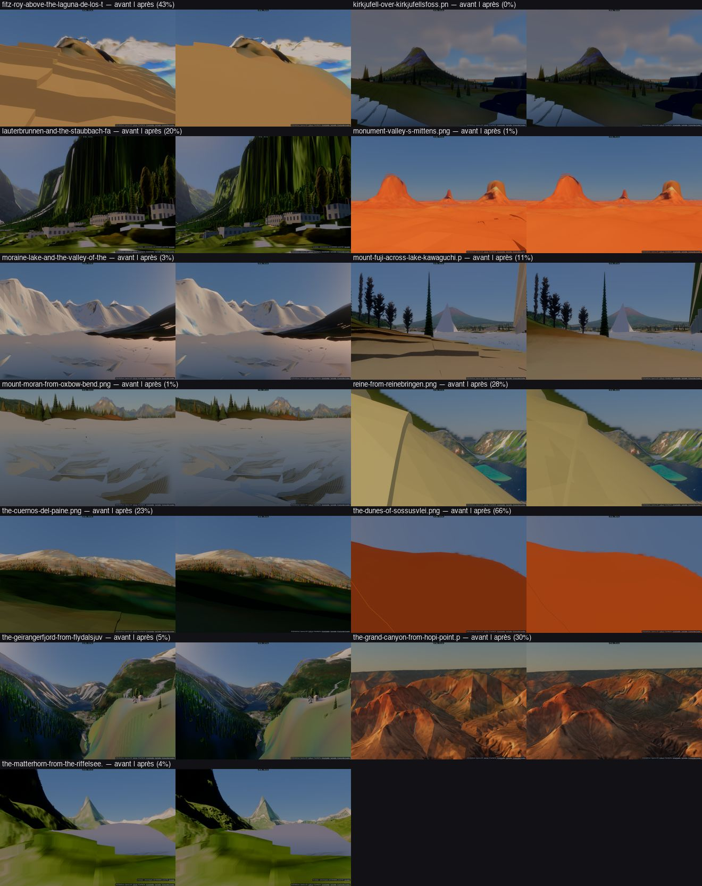
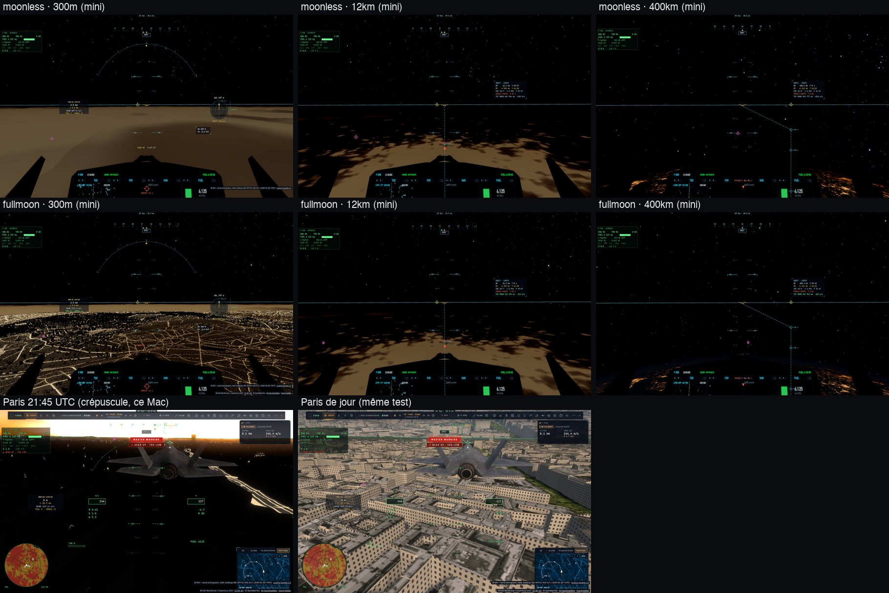

# Q2 — la lumière cohérente (Q2a : la photo ré-éclairée, le ciel, le rebond, l'empreinte sur la pente)

Plan : [PLAN-REFRACTION-HORIZONS.md](../../PLAN-REFRACTION-HORIZONS.md), phase Q2 (décision 29). Les 2 et 3 novembre 2026,
mesuré sur kerr-mini. e2e `tests/e2e/ground-relight.e2e.test.ts` ; données : [Q2/ground-relight.json](Q2/ground-relight.json).

## Fait (Q2a)

- **Le ré-éclairage partiel de la photo** (`photoRelightK`, `photoNdl` ; réglage `groundRelight` : auto, photo, relief — TARS
  l'atteint par le schéma).
  - Les photos aériennes sont déjà éclairées : sans correction, leur relief est ombré deux fois.
  - Le Soleil de chaque source est connu au point : Sentinel-2 et le Blue Marble à 10 h 30 au solaire local, en été ; les
    orthophotos de l'IGN l'été vers midi, mêlées à Sentinel selon leur part dans le pixel.
  - L'éclairage s'écrit `mix(μ₀, n·L, k)`. Le facteur k croît de 0 à 1 quand notre Soleil s'écarte de celui de la photo (de 10°
    à 50°) et quand il baisse (sous 25°).
  - Pas de ré-éclairage (k = 1) pour ce qui n'est pas une photo : les murs, les pistes pavées, la couleur OSM du traceur.
  - La même règle vaut dans le traceur (`earthGround`) et dans le raster (`shadeLite`).
- **L1, le ciel sur une pente** (`skyOnFace`) : le ciel plat ramené à la normale par les harmoniques du ciel de l'image (bandes 0 et
  1), au lieu de ½(1 + n·up). Une face presque plate (n·up > 0,98) garde le ciel plat, sans calcul.
- **L6, le rebond** (`groundAlbedoMean`) : l'albédo moyen du sol sur ~2 km (la carte du jour à un niveau grossier), au lieu de
  0,18. C'est empirique : une seule couleur pour ce que le sol alentour renvoie.
- **L'empreinte des pixels sur la pente** (`earthFootOn`), après la remarque de Sam : « le haut des montagnes est en mauvaise
  qualité ».
  - Avant, l'empreinte d'un pixel était projetée sur le plan horizontal : une face raide vue de face y devenait une plaine rasée,
    étirée jusqu'à 33 fois. L'imagerie y était lue à un niveau très grossier, un dégradé vert lisse au lieu des éboulis.
  - Maintenant, elle est coupée sur le plan de la pente (la normale lisse de T5), puis projetée à la verticale, comme la photo.
  - Sur sol plat, rien ne change.

## Mesuré (kerr-mini)

**Le ré-éclairage** : écart moyen entre « auto » et « relief » sur la bande du sol, en blocs de 16 × 16 pixels. Le bruit est l'écart
entre deux captures « auto ».

| Vue | Midi (le Soleil de l'IGN) | Après-midi | Couchant |
|---|---:|---:|---:|
| Chamonix | **4,84** niveaux (95ᵉ c. 12,2 ; bruit 0,09) | voir plus bas | 0,01 (bruit 0,02) |
| Paris | 0,36 (bruit 0,17) | 0,16 (0,2) | 0,21 (0,24) |
| Beauce | 0,09 (0,09) | 0,08 (0,13) | 0,10 (0,16) |

- **En montagne, près du Soleil des photos**, les versants à l'ombre sur la photo ne sont plus assombris une seconde fois. Sur sol
  plat, rien ne change. **Loin de ce Soleil ou au couchant**, « auto » rejoint « relief », comme voulu.
- **Le ciel et le rebond** (L1, L6) changent Paris d'environ 1 niveau à midi et au couchant, et Chamonix ou la Beauce de 0,1 à
  0,25.
- **Coût** : A/B contre `52dc48f3`, 8 mesures par côté :

  | Vue | A | B (Q2a) |
  |---|---:|---:|
  | Paris bas (médiane) | 34,0 ms | **34,35 ms** (+0,35) |
  | Chamonix, régime bas | 49,0–49,4 ms | 49,9–50,2 ms (+0,8) |

  **Au-dessus du budget de +0,3 ms en montagne.** La passe du sol mesurée à Chamonix : 23,85 ms sans Q2, 24,8 ms avec. Le
  ré-éclairage en prend environ 0,35 ms, le ciel et le rebond environ 0,7 ms (avant leur allègement). À réduire avant la fin de Q2.
- **Les 14 paysages** (planche, contre le run de T3–T5) : aucune régression visible.
  - Les escaliers de Fitz Roy, du Fuji et de Reine ont disparu, grâce à T5.
  - Les défauts connus restent : premiers plans uniformes à Fitz Roy et Reine, lacs en dalles grises, cône blanc du Fuji. Le
    Mont-Blanc n'était pas prêt en 120 s : son décor charge encore, déjà connu.

## En route

- **Le protocole de mesure** a dû être corrigé trois fois :
  - la première capture après un changement d'heure était plus sombre de 4 niveaux, quel que soit le mode : l'image n'avait pas
    convergé ;
  - en France, l'heure témoin est le midi de l'IGN, pas le milieu de matinée de Sentinel-2 ;
  - l'avion, replacé sans être figé, volait pendant l'attente ; et replacé à 450 m au-dessus d'un sol qui s'affine, il changeait
    d'altitude. Il est maintenant posé une fois par lieu.
- **Le décor des e2e** : mes e2e attendaient les tuiles, pas les arbres ni les bâtiments. Ils attendent maintenant le décor
  (`sceneryReady`, 120 s au plus). Sur le mini, il manque parfois encore au bout de 120 s.
- **Ouvert** : à Chamonix l'après-midi, caméra fixe, deux captures « auto » diffèrent de 12 niveaux. Le relief y est recuit sans
  cesse (de 124 à 160 cuissons en 5 s) et les cascades d'ombre sont redessinées entre deux captures. C'est un défaut entre T4 et
  T6, pas de Q2. À reprendre.
- **Ouvert** : les sommets lointains restent en grands triangles (~100 m). Les anneaux du maillage sont choisis à la distance à
  plat, sans tenir compte d'une pente qui fait face à la caméra.

## Le coût en montagne (3 novembre, fait)

Chamonix au Soleil bas depuis le cockpit du F-35, kerr-mini, même build, chaque partie coupée tour à tour (sonde
`zz-q2-cost`, deux tours, la passe « earth lite » ±0,15 ms) :

| Passe du sol (ms) | avant | après |
|---|---|---|
| Q2 entier | 23,81 | 23,00 |
| le ré-éclairage de la photo (coût) | 0,35 | 0,14 |
| le ciel sur la pente + le rebond (coût) | 0,70 | 0,42 |
| l'empreinte sur la pente (gain) | −0,95 | −0,81 |
| **Q2 entier − tout Q2 coupé** | **−0,14** | **−0,35** |

Les changements (`trace.wgsl`) : la normale lisse du relief lue une seule fois (l'empreinte et l'éclairage la lisaient
chacun) ; le ciel sur la pente en une passe sur ses harmoniques pour les deux normales (`skyIrradianceLowPair`) ; le Soleil de
la photo sans trigonométrie (le cosinus et le sinus de la longitude tirés du point, les rampes de `k` sur les cosinus).

## La nuit calibrée (3 novembre)

Avant : la nuit dessinée à 6–11 % du plein jour (le ciel sans lune, la pleine lune), deux gains selon l'altitude de la caméra
(les lumières des villes ×20 de 5 à 300 km, le fond de nuit ÷4 depuis l'orbite), une exposition fixe (EV 16,25 partout) :
la ville vue de près éblouissante, la pleine lune sans effet.

- **Rapports physiques** (sur l'éclairement solaire) : ciel sans lune 10⁻⁷ (5 × le réel, pour deviner le sol), pleine lune
  2,5·10⁻⁶ au zénith, lumières des villes 2·10⁻⁵ de la radiance d'un blanc au soleil (un centre-ville VIIRS) — **les mêmes à
  toute altitude** ; le crépuscule tabulé (400 lux au coucher, 3,4 lux à −6°, 0,008 à −12°) au sol (`twilightGround`) et au
  posemètre.
- **L'adaptation de l'œil** (`renderer.earthSunlight`) : l'exposition suit l'éclairement incident, I/(I + I_œil) avec
  I_œil ≈ 1 lux — le jour inchangé, la pleine lune ~4 EV sous le gris du jour (argentée), sans lune ~8 EV (noire) ; la nuit,
  l'image modère (les 5 % les plus clairs sous 0,6, les 15 % sous 0,15 — une ville éclairée vue de près), au plus 3 EV.
- **Les lumières des villes** : hors des cimes et des bâtiments ; près du sol, portées par les rues OSM (×3 sur une route,
  ×0,15 à côté) ; au-delà du décor la nappe de la carte à 0,4 ; lampes plus chaudes ; Purkinje laissant leur couleur aux
  pixels dès 0,3.
- Les lampes de piste, le disque de la Lune la nuit, les lueurs sur les nuages recalés sur la même échelle.

Reste : la nappe de la carte (500 m) tant que le décor n'est pas là, et vue de haut (12 km) sans structure de rues — les
lampadaires le long des routes (Q8, L10).

## Reste de Q2
- **C9** : `wxVeil`, la transmission directe, la lumière diffuse des nuages et la visibilité du ciel séparées.
- ~~La nuit calibrée~~, ~~les lumières des villes hors des couronnes et des murs~~ : faites (ci-dessus).
- **Les captures à 3 Soleils** sur la planche finale.
