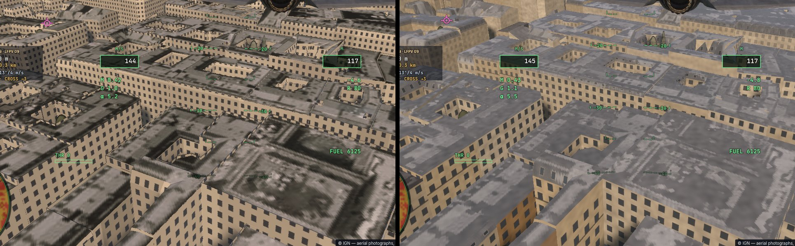
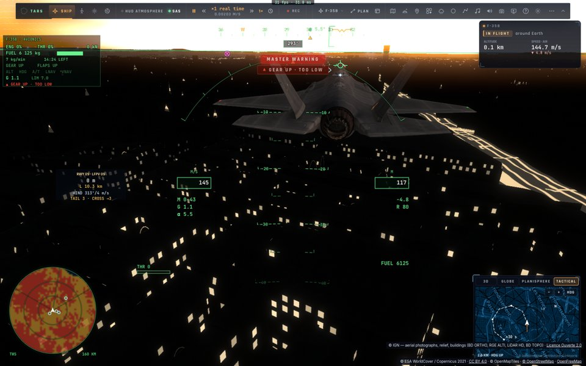
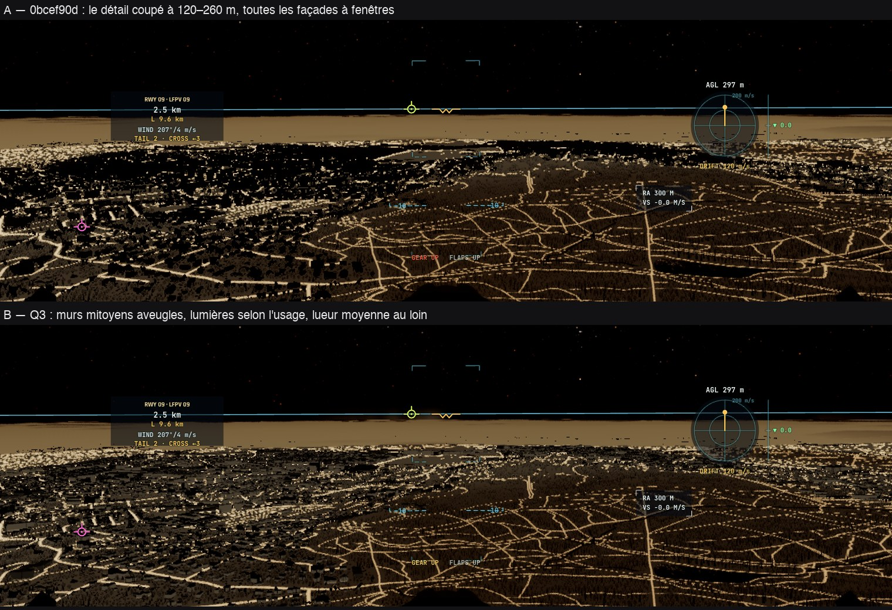
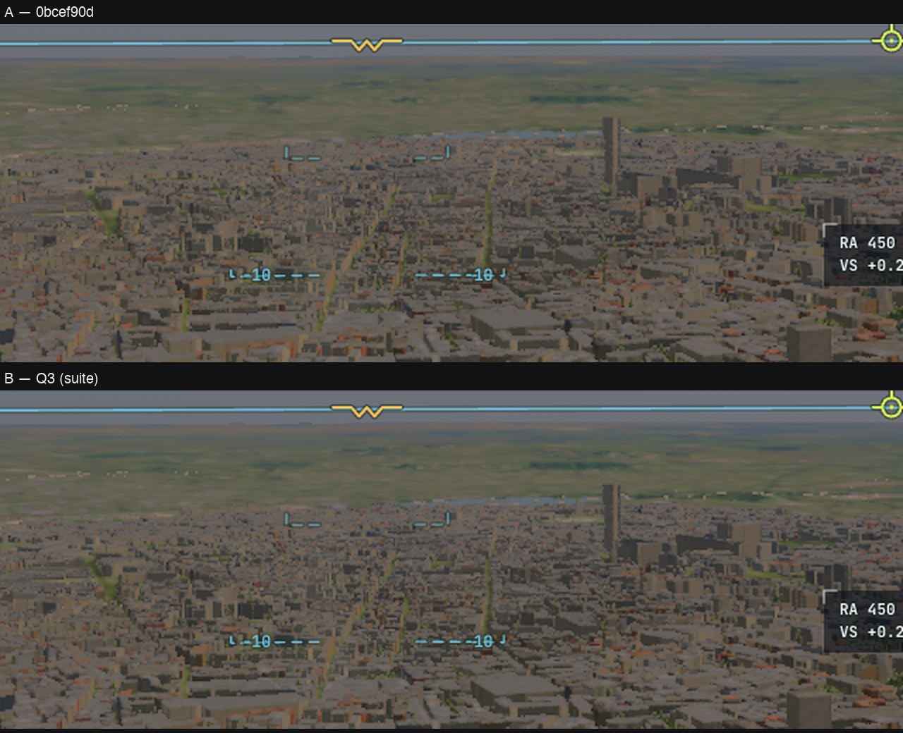

# Q3 — les bâtiments raster au niveau du tracé (première étape)

3 novembre 2026. Analyse : [docs/ANALYSE-PARIS-PIPELINE-2026-11-03.md](../../ANALYSE-PARIS-PIPELINE-2026-11-03.md) §2.

Avant, le raster ne savait pas quel bâtiment il dessinait : un toit était l'orthophoto désaturée, un mur une pierre teintée
par bloc de 25 m avec une grille de fenêtres 3,1 × 2,6 m ancrée sur l'origine de la scène, et rien la nuit. Le tracé, lui,
lit la feuille du bâtiment : matériaux de la BD TOPO, étages et égout, travées de 3,2 m centrées sur chaque mur, commerces,
balcons haussmanniens, tuiles, ardoise, zinc, lucarnes, fenêtres allumées la nuit.

## Ce qui change

- **L'identité dans la visibilité** (C0-10) : `packScenery` range après les triangles une table triangle → feuille ;
  `meshFs` et `boxSolidVs` (`scenery-raster.ts`) écrivent la feuille + 1 dans le canal g (libre pour eux) ;
  `terrainRasterLeaf` la lit, `terrainRasterId` (les arbres) rend 0 sur ces pixels.
- **La face retrouvée** (`buildingFaceAt`, `trace.wgsl`) : au point dessiné, le plan de toit le plus bas au-dessus, ou
  l'arête du contour la plus proche — sa normale vers la caméra, la coordonnée le long du mur — : le `SceneryHit` du
  tracé.
- **Le même matériau** : `shadeLite` appelle `buildingLook`/`roofLook` du tracé ; la normale exacte de la face ; le ciel
  par l'occlusion du bâtiment ; le verre et le zinc en miroir avec l'éclat du Soleil ; les fenêtres allumées la nuit
  (`WINDOW_GLOW`, sur l'échelle de la nuit calibrée — le tracé aussi : ses 30 d'avant étaient pour une nuit à 8 % du jour).
- **Les toits** : la couleur du matériau, la lumière et l'ombre de la photo par-dessus (0,6–1,5 de sa luminosité) —
  verrières, cheminées, terrasses —, le matériau seul donnant un gris uniforme.
- `liteSkip` 262144 : l'ancien matériau, pour comparer.

## Reste

- Le détail s'efface comme dans le tracé (120–260 m de distance) : par l'empreinte du pixel plutôt, et les fenêtres
  allumées gardées au loin en leur lueur moyenne.
- Les murs mitoyens aveugles (le drapeau de mitoyenneté de `convexParts` dans la face).
- Les fenêtres allumées selon l'usage BD TOPO (`usage_1`), la date de construction.
- Les toits du plan avec la médiane de l'orthophoto par toit (C0-11), les lucarnes des mansardes vues de près.

## Suite du 3 novembre : murs aveugles, usage, détail par l'empreinte

- **Les murs mitoyens aveugles** : le drapeau de mitoyenneté des toits (`partyEdges`, `convexParts` — un voisin contre le mur, ou
  une découpe intérieure) descend jusqu'aux plans (`RoofPart.blind`) et, dans les feuilles, dans **le dernier bit de la coordonnée x
  de l'arête** (`markedCoord` : 0,2 mm au plus). Le tracé et `buildingFaceAt` en font un mur de genre 1,25 : `buildingLook` n'y dessine
  aucune fenêtre (le matériau seul).
- **L'usage** (BD TOPO `usage_1`) : le bit 23 du mot du bâtiment dit un lieu de travail (bureaux, commerces, industrie…) — la nuit
  8 % de ses fenêtres allumées (une maison 28 %, une vitrine au rez-de-chaussée 55 %, un mur-rideau de bureaux 15 %).
- **Le détail s'efface par l'empreinte du pixel** (12–26 cm : ~120–260 m au champ habituel, plus loin au téléobjectif) au lieu de la
  distance ; **au-delà, les fenêtres gardent leur moyenne** : le verre sombre (−22 % d'albédo du mur) et la lueur des allumées. La ville
  lointaine n'est plus une suite de silhouettes noires la nuit.
- **Mesuré** (kerr-mini, A/B A B B A contre 0bcef90d) : nuit à 300 m, la ville lointaine éclairée par ses fenêtres (luminance du sol
  +6 % ; écart A/B 7,1 contre un bruit de 3,2) ; jour, les murs lointains un peu plus sombres (92,6 → 91,9) ; **coût +0,3 à +0,7 ms
  (+2 à 3 %) au matériau raster**, mesuré deux fois (la seconde après avoir fusionné les deux blocs de fenêtres) — au bruit des
  passages près (±0,5 ms).
- Reste : la date de construction, la médiane de l'orthophoto par toit (C0-11), les lucarnes vues de près.

## B4 (premier jet) — les routes d'OpenStreetMap sur le sol raster (4 novembre)

Le sol tracé peint par-dessus l'imagerie les surfaces OpenStreetMap (routes, rails, sols), là où il n'y a pas d'orthophoto
nationale : `earthGround`, `scenerySurface`. `shadeLite` ne les lisait que pour l'éclairage nocturne des rues. Q6l l'avait relevé
à La Mancha : une route visible dans le sol tracé, absente du raster.

- **Fait :** `sceneryGround` lit la surface au point dessiné, une seule fois par pixel. Le même résultat sert la peinture du jour
  et les rues éclairées la nuit (`sceneryRoadLight` prend désormais la surface lue). L'eau reste à sa propre passe.
  - De jour, la lecture est limitée aux empreintes de moins de 12 m et aux points à moins de 4 km.
  - La nuit, elle reste complète, comme avant.
  - `liteSkip` 134217728 coupe le tout, pour mesurer.
- **Mesuré** (`raster-roads`, ce Mac en fenêtre, La Mancha à 40 m, pression thermique Moderate, prises alternées) :

  | Lecture | Passe « earth lite » sans les routes | avec les routes | Écart |
  |---|---|---|---|
  | Sur tout pixel de sol | 8,51–8,59 ms | 9,64 ms | +1,1 ms |
  | Limitée (empreinte < 12 m, < 4 km) | 8,78–8,83 ms | 9,47 ms | **+0,66 ms** |

- **Observé :** la route de La Mancha est dessinée (planche `Q3/b4-routes-raster.jpg` : sans, puis avec).
- **Limites :**
  - le coût est celui d'un parcours de l'arbre du décor par pixel ;
  - la passe de décalques prévue en B4 (les routes rastérisées une fois dans une texture au sol) le réduirait : c'est la suite ;
  - le reste de l'écart avec le sol tracé (les rails, les champs) est couvert par la même lecture ;
  - à noter, hors B4 : le sol de La Mancha est orange saturé et les oliviers brun-orangé, déjà le matin même (prises `ghost`), dans la couleur régionale du sol en Espagne.

## B4, second temps : les décalques (4 novembre)

Les surfaces de la carte (routes, rails, sols ; l'eau à part) sont dessinées une fois par le worker du décor
(`scenery-geometry.ts rasterDecals`) :

- deux grilles d'index de palette : 2 m sur ±800 m et 8 m sur ±3,2 km ;
- les rangs du parcours exact sont respectés (un rail sur une route, une route sur un champ) ;
- un chemin plus étroit qu'un demi-texel est quand même tracé ;
- le tout est rangé juste après la carte d'occupation du sol, dans le paquet du décor (+1,3 Mo, aucun champ d'en-tête déplacé).

`shadeLite` les lit (`sceneryDecal`) : quatre texels, avec pour couverture le poids de l'index majoritaire, ce qui donne des
bords lisses. Le parcours exact n'est gardé que sous 0,3 m d'empreinte (bandes, traverses) et la nuit (les rues éclairées). Sous
une orthophoto nationale, ni l'un ni l'autre ne tourne de jour, puisque la photo recouvre la peinture.

**Mesuré** (ce Mac en fenêtre, nominal, passe « earth lite », prises alternées) :

| Variante | La Mancha, 40 m |
|---|---|
| Parcours exact, toutes empreintes sous 12 m (avant) | +0,66 ms |
| Parcours exact sous 2,5 m, décalques au-delà | +0,71 ms (le parcours couvre encore presque tout le sol proche) |
| Décalques seuls, texel le plus proche | +0,20 ms (route en escalier de près) |
| **Retenu :** décalques anticrénelés, parcours exact sous 0,3 m | **+0,50 ms** |

À Paris, à 300 m, sous l'orthophoto : environ +0,15 ms, dans le bruit, avant comme après.

**Observé** (`Q3/b4-decalques.jpg`, en haut le parcours exact, en bas les décalques) : les chemins sont presque identiques, un peu
plus irréguliers.

**Bilan honnête :** le gain est modeste à La Mancha (−25 %), où il y a peu de routes. L'avantage attendu est ailleurs : le coût ne
dépend plus de la densité de la carte. Ce n'est pas mesuré en ville sans orthophoto (hors de France). Le temps du dessin dans le
worker n'est pas mesuré non plus.

### B4 revérifié (le 5 novembre)

- e2e `raster-roads` relancé (ce Mac en fenêtre, La Mancha à 40 m, cockpit, `RR_OUT=remote-results/raster-roads-1105`) :
  - la route est dessinée sur le sol raster quand la lecture des surfaces est active ;
  - elle disparaît avec `liteSkip` 134217728, qui coupe cette lecture ;
  - passe « earth lite » : 10,18 ms sans, 11,16 ms avec (+0,98 ms) ;
  - la route occupe peu de l'image : l'écart global (39,0 dB) reste proche du bruit entre deux prises identiques (39,6 dB).
- L'écart relevé en Q6l (le sol tracé montrant une route absente du sol raster) ne se reproduit pas à cet endroit.
