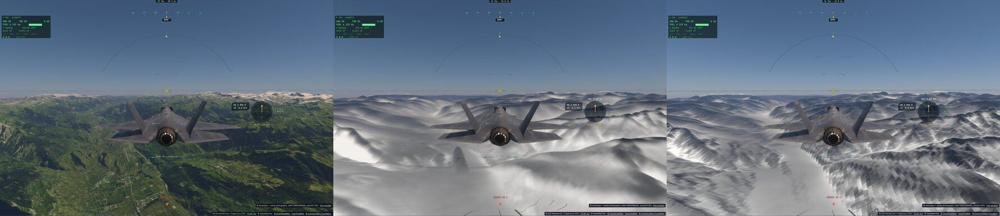
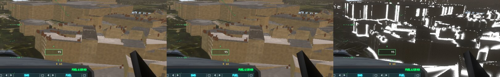

# Q4 — le volume et les reflets (commencé : L2b)

Plan : [PLAN-REFRACTION-HORIZONS.md](../../PLAN-REFRACTION-HORIZONS.md), phase Q4 (après Q6).

## L2b — la part du ciel des vallées, tirée des horizons de H5 (le 4 novembre ; désactivée par défaut)

- **Fait** (`system/earth-horizons.ts earthSkyOpen`, lu par `shadeLite` et `shadeWater`) : en chaque point du sol raster, les 8
  secteurs des horizons de H5 (les 4 nœuds mêlés en tan e, 1/d, h0/d, revus depuis la hauteur du point) ; dans chaque secteur la
  lumière perdue sous l'horizon — sur un sol plat, une part sin² e de la lumière d'un secteur de π/4 —, **seulement ce qui dépasse
  le plan de la face** (sa pente est déjà `skyOnFace`), chaque secteur pesé par la luminance du ciel clair bas dans sa direction
  (`skyMirror`, la pondération directionnelle demandée par le plan) sur leur moyenne. `renderer.skyOpen` (**faux par défaut**) — et **compilée hors des noyaux par défaut** (`EARTH_SKY_OPEN` : ses ~90 lignes inlinées
  passaient `shadeLite` au-dessus du budget des noyaux, 7 223 lignes pour 7 100, et Mars, Titan, Vénus aussi) —,
  `liteSkip` 4194304 le coupe, 8388608 dessine la lumière perdue (× 5 : blanc un cinquième perdu ou plus).
- **Deux leçons en route** :
  - une première version comptait aussi la pente propre de chaque face comme un horizon (le nœud voit sa propre montée) : tous les
    versants perdaient un cinquième de leur ciel — un double compte avec `skyOnFace` ; corrigé (le plan de la face retranché) ;
  - un « assombrissement de la plaine » de 1,7 % n'était qu'une **dérive de la scène** (deux images identiques à 4 % d'écart :
    l'imagerie, l'exposition) prise pour un effet parce que l'image « avec » passait la première ; `sky-open` intercale désormais
    sans / avec / sans.

- **Mesuré** (nouvel e2e `sky-open`, ce Mac, en fenêtre, profil Neutre, avant la correction des pentes) — l'image avec / sans :
  Valais à midi 0,9997 (bruit 1,0024), à 17 h 30 UTC 1,0067 (bruit 0,9973), plaine 0,9985 (bruit 1,0024) — **dans le bruit** ;
  coût du matériau raster +1,0–1,25 ms en fenêtre (+0,3–0,6 ms headless). Le fond de la vallée du Rhône perd bien plus d'un cinquième
  de son ciel, mais le ciel ne pèse que quelques pour cent de la lumière d'un sol au Soleil.
- **Pourquoi désactivée** : effet de quelques dixièmes de pour cent pour ~0,5–1 ms ; et un **damier aux versants** — les horizons à
  l'échelle des nœuds (dizaines à centaines de mètres) contre la normale fine du pixel. **Reste** : le plan de la face pris à l'échelle
  des nœuds ; l'occlusion proche (les vallons, les pieds de murs) est celle de **L2a (GTAO)**, à faire d'abord ; une lecture moins
  chère des horizons avec T9 (textures).

## L2a — le GTAO : la conception, avant de coder (le 4 novembre)

- **Où l'appliquer** : au ciel et au rebond du sol raster (`shadeLite` : `skyOnFace(sky, …) · bldAO + bounce`), jamais au Soleil
  direct (ses ombres sont celles de T6, H5, des cartes du décor).
- **Le conflit avec C0-9** : le contrat dit « GTAO : `moments.y` — jamais b ». Or `moments.y` est écrit **par** les noyaux
  d'ombrage : il n'existe qu'après l'ombrage qui a besoin de l'occlusion. Deux voies :
  - **(A) le contrat à la lettre** : le GTAO après l'ombrage, sur `moments.y`, lu **à l'image suivante** (reprojetée, son
    historique) — un retard d'une image, une reprojection dans `shadeLite` (qui n'a pas la caméra précédente aujourd'hui), les
    désoccultations sans occlusion une image ;
  - **(B) l'intention du contrat** (« jamais b », les proxies d'arbres) : le GTAO **avant** l'ombrage, sur la distance exacte du sol
    et des bâtiments que la visibilité raster écrit en r (`terrainDist`), la même que `moments.y` pour ces pixels — aucune latence,
    aucune reprojection ; C0-9 amendé (« r de la visibilité pour le GTAO, avant l'ombrage »). **Recommandée.**
- **Le stockage** : `moments` (vec2f) n'a pas de place ; un tampon ou une texture de plus dans le noyau d'ombrage, **lié seulement
  quand l'appareil en a la place** (comme la carte d'ombre des arbres : `maxSampledTexturesPerShaderStage`), sinon l'occlusion
  à 1 — les appareils à 8 tampons de stockage gardés.
- **Le noyau** : demi-résolution, 4 directions tournées par pixel et par image (bruit bleu, Q6), 6 pas chacune dans un rayon en
  **mètres** (≈ 4 m, projeté en pixels, borné), la normale reconstruite de la profondeur, l'horizon au-dessus du plan de la face
  (cos² pondéré, comme L2b), une **épaisseur** en mètres (un bloqueur plus près de la caméra que le point de plus que l'épaisseur
  n'occulte pas : les arêtes du terrain contre le ciel lointain), un flou bilatéral sur la profondeur puis l'historique temporel
  de Q6 ; le ciel et le cockpit (dessiné après) hors de son calcul.
- **Mesure prévue** : les pieds de murs et les vallons assombris sans halo (Paris, les Alpes près du sol), aucun anneau autour
  des proxies, le coût mesuré (visé ≤ 0,5 ms à demi-résolution).

## L2a — le GTAO avant l'ombrage : fait, mesuré, désactivé par défaut (le 4 novembre ; décision 41)

- **Décision 41 (Sam)** : la voie (B) — le GTAO **avant** l'ombrage, sur la distance de la visibilité (r : le sol, les bâtiments ;
  jamais b, les proxies d'arbres) ; C0-9 amendé en ce sens.
- **Fait** : `system/gtao.ts` — une passe de calcul à demi-résolution entre la visibilité et l'ombrage : le point et sa normale
  refaits des distances, 6 directions tournées par pixel et par image, 5 pas dans un rayon de 4 m projeté (rien sous 1,5 pixel :
  au loin, la photo porte déjà l'occlusion), l'horizon au-dessus du plan de la face, une épaisseur de 6 m ; `rasterAO` lu par
  `shadeLite` sur le ciel et le rebond seulement ; la texture liée là où l'appareil prend 32 textures (le renderer les demande
  désormais) ; `liteSkip` 16777216 la coupe, 33554432 la dessine (× 5). **`renderer.gtaoOn` faux par défaut** (aucune passe alors).
- **Les e2e soignés en route** : une série a placé le F-35 dans une montagne et dans un immeuble (`flyAt` calcule la hauteur sur le
  relief connu à l'appel, avant les tuiles fines) — l'avion sur le dos, le sol en haut de l'image, des mesures fausses, écartées.
  Nouvelle aide **`tests/e2e/lib/place.ts placeLow`** : placé et figé, le relief fin attendu, replacé, puis **l'assiette et la
  hauteur vérifiées** (une erreur dite, pas une image prise) ; l'exposition posée avant d'être tenue.
- **Mesuré** (`gtao`, nouvel e2e, ce Mac en fenêtre ; avion à plat, à sa hauteur, relief z17) :

| Vue | image avec / sans | bruit | la passe |
|---|---:|---:|---:|
| Paris 60 m, soleil | 0,9983–0,9996 | 0,9998–1,0021 | 0,62–0,89 ms |
| Alpes 38 m, pente boisée | 0,9972–1,0025 | 0,99–1,01 | 1,3 ms |
| Paris 60 m, couvert | 0,9962–0,9988 | 0,998–1,003 | 0,82–0,89 ms |

- **Lu** : l'occlusion se calcule aux pieds des murs, aux angles, dans les cours — mais **invisible dans l'image**, même sous un ciel
  couvert (−0,1 à −0,4 % en moyenne, rien à l'œil sur les recadrages : les bâtiments ont déjà leur `bldAO`, le sol sa photo) ; et des
  **halos** le long des silhouettes (les bords des immeubles contre le sol lointain) que l'épaisseur ne retient pas. Le plan demande
  « assombris sans halo » : **non atteint**. Gardé comme fondation (la passe, la liaison, la mesure), désactivé.
- **Reste** : les halos (une épaisseur relative à la distance, un rejet des bloqueurs derrière une discontinuité), la vue au sol (à
  pied, au roulage : là où le rayon de quelques mètres couvre l'image), le coût (lire r seul, un format plus léger).
