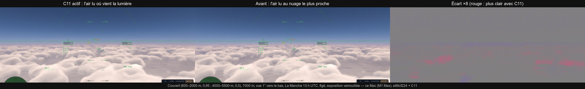
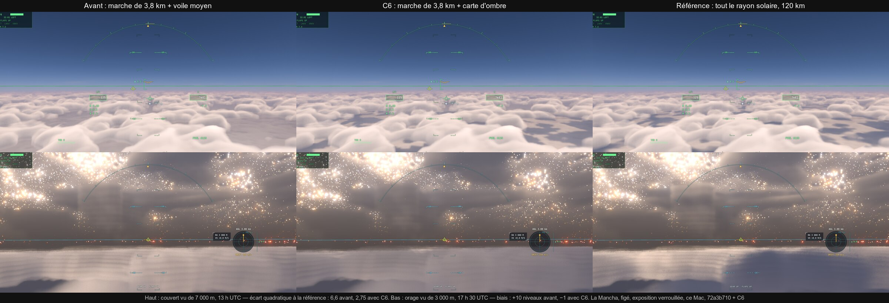
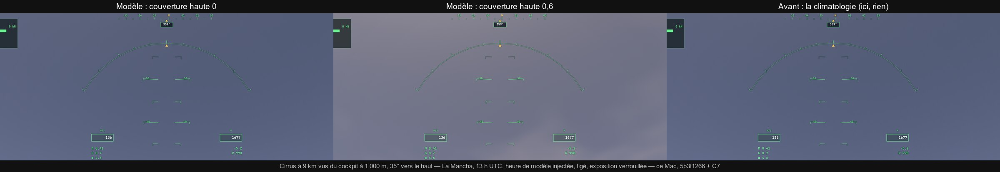
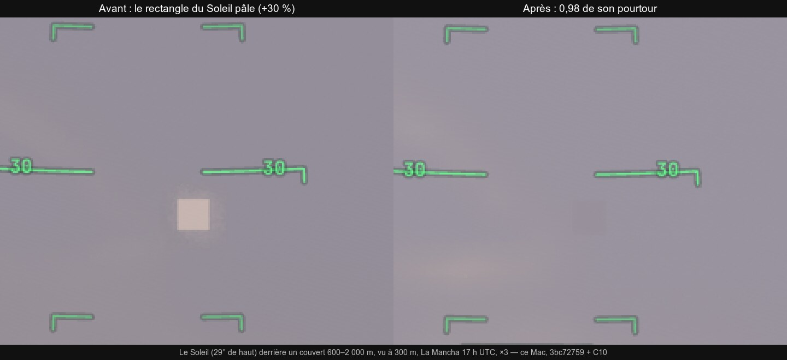
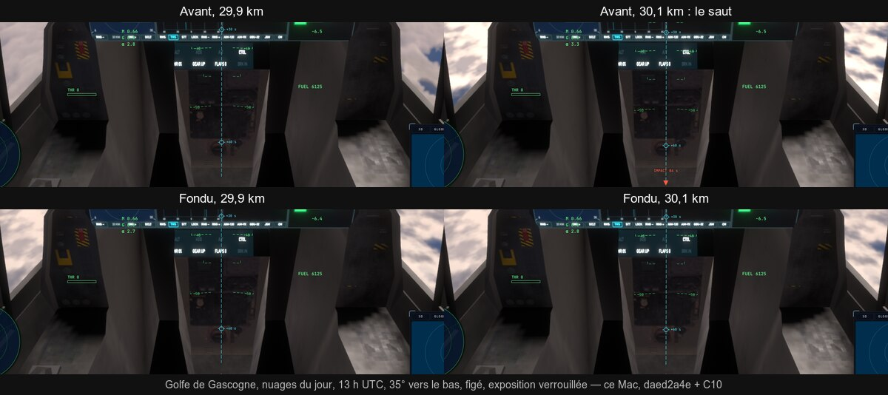
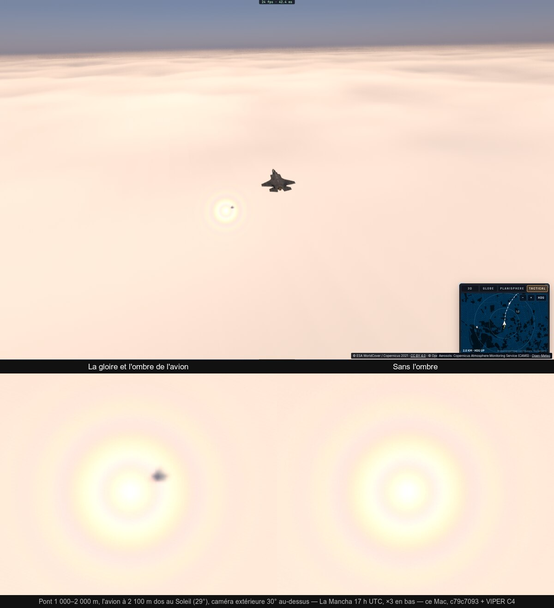
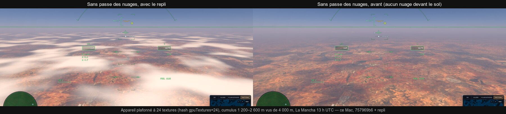

# Q5 — l'atmosphère et les nuages (en cours : C1, premier lot)

Plan : [PLAN-REFRACTION-HORIZONS.md](../../PLAN-REFRACTION-HORIZONS.md), Q5. Ordre retenu pour C1 : les tables de Hillaire
migrées par étapes, la transmittance d'abord, puis la diffusion multiple, le ciel, et enfin le raccord avec la table aérienne
et `skyAmbient`. L'air dessiné reste celui d'aujourd'hui, épaissi d'`AIR_K` = 3 ; son passage à 1 partout est C2.

## C1, premier lot : la table de transmittance (4 novembre)

**Ce qui était faux.** `sunThrough` prenait la colonne d'air du rayon vers le Soleil par la fonction de Chapman
(l'approximation de Schüler). Comparée à l'intégrale exacte pour l'air dessiné (hauteurs d'échelle × 3), elle laissait passer
trop de lumière quand le Soleil est bas, au niveau de la mer :

| Hauteur du Soleil | 30° | 20° | 10° | 5° | 2° | 1° | 0,5° | 0° |
|---|---|---|---|---|---|---|---|---|
| Chapman / exact (vert) | +0,3 % | +2,7 % | +9,1 % | +21 % | +35 % | +34 % | +26 % | +0,4 % |

**Ce qui est fait.**

- `earth-air.ts` : la table de transmittance, 256 × 64 dans le paramétrage de Bruneton (x_mu : la longueur du rayon jusqu'au
  sommet entre sa plus courte et sa plus longue ; x_r = ρ/H). L'épaisseur optique rgb y est intégrée exactement : rayon coupé à
  son point le plus bas, pas resserrés vers lui, 400 pas, convergé à 0,02 % près. Construite par tranches de 2 ms par image
  (`TransmittanceLutBuilder`, ~0,2 s en tout), publiée une fois.
- `gpu-tables.ts TABLE_TLUT` : la table dans le tampon du traceur, sans nouvelle liaison.
- `trace.wgsl sunThrough` lit la table pour l'air de la Terre (`tlutTau`, bilinéaire, ses quatre coins dans une boucle). Les
  autres mondes et l'état sans table gardent Chapman. Sous l'horizon géométrique, la table prend le rayon de l'horizon et
  l'ombre du sol (`groundShade`) éteint le Soleil, comme avant.
- `earth-air.ts sunThrough` (le posemètre) lit la même table une fois publiée : les chiffres du CPU sont ceux de l'image.
- `renderer.tlutOn` coupe la table pour les A/B.

**Vérifié.**

- `tests/earth-air-lut.test.ts` : la table lue contre l'intégrale (4 000 pas) reste à 0,39 % au pire là où T > 1 %, sous
  40 km. Elle va jusqu'à 11,9 % sur les rayons les plus sombres, juste au-dessus de l'horizon (T entre 0,1 et 1 % : une
  épaisseur optique à ~2 % près). Les constantes du shader sont égales à celles de la table.
- e2e `air-tlut-read` : le shader lit la table du renderer comme le CPU, à 10⁻⁴ près, sur six cas du sol à 200 km. Son
  premier passage a trouvé un défaut : le rayon du sommet était lu dans la composante z de l'en-tête (la hauteur de la grille,
  64) au lieu de w, et le ciel devenait orange.
- e2e `air-tlut` (ce Mac, en fenêtre, cockpit, raster, exposition tenue, quatre prises alternées) :
  - **Alpes, Soleil ~4°** : le tiers bas de l'image (les versants) perd 18 % de bleu, 8 % de vert et 3 % de rouge (niveaux
    sRGB 33,6 / 27,8 / 18,0 contre 34,7 / 30,1 / 21,9). Le tiers haut (le ciel) passe de 114 / 115 / 114 à 113 / 111 / 107. L'écart
    entre deux prises identiques est de 0,1–0,4.
  - **Atlantique au couchant** : écart de l'ordre d'un niveau.
  - **Coût** : sol raster 7,03 et 7,19 ms avec la table, 7,06 et 6,91 sans ; trace 3,27 et 3,28 contre 3,26 et 3,21 (Alpes).
    Sur la mer, trace 2,27 et 2,10 contre 1,83 et 2,06. Soit +0,1 à +0,2 ms, à la limite du bruit de ces prises.
- Budgets d'inline : `sunThrough` est copié à 21 endroits ; 17 noyaux relevés de +0,2 à +2,1 % (`tests/kernel-budget.json`).
- Planche : `Q5/transmittance.jpg`.

**Non fait, limites.**

- La diffusion multiple, la table du ciel, le raccord avec la table aérienne et `skyAmbient` : les lots suivants de C1.
- L'air reste épaissi (`AIR_K` = 3) ; C2 le ramène à 1 partout, avec le réétalonnage contre M0b.
- Pas de mesure sur kerr-mini ni sur kerr-pc. La compilation D3D12 n'est pas mesurée après la hausse des noyaux.

## C1, deuxième lot : la table de diffusion multiple (4 novembre)

**Ce qui était approché.** `earthAir` ajoutait à la diffusion simple un terme isotrope : 0,8 fois la diffusion de Rayleigh et
0,3 fois celle des aérosols, multiplié par le rayon direct du Soleil. Il s'éteignait donc avec ce rayon, au terminateur.

**Ce qui est fait.**

- `earth-air.ts multipleScattering` : Ψ_ms de Hillaire (2020, §5.5), soit L₂ / (1 − f_ms).
  - L₂ est le second ordre : l'air éclairé et le sol vus tout autour, diffusés isotropiquement.
  - f_ms est la part qu'une diffusion isotrope renvoie.
  - Calcul sur 64 directions (sphère de Fibonacci) de 24 pas chacune ; la lumière du Soleil à chaque pas est lue dans la table
    de transmittance ; albédo du sol 0,3.
  - Table de 32 × 32 (cosinus zénithal du Soleil, hauteur jusqu'au sommet de l'air), construite à la suite de la
    transmittance, dans la même région du tampon (~0,9 s de CPU en tout, par tranches de 2 ms).
- `trace.wgsl earthAir` : quand la table est là, chaque pas ajoute σ_s Ψ_ms (`msLut`), voilé par les couches de la météo comme
  l'était la part diffuse. L'ancien substitut reste pour les autres mondes et sans table.
- `renderer.msLutOn` coupe la seule diffusion multiple pour les A/B.

**Vérifié.**

- Tests unitaires : Ψ_ms décroît avec le Soleil et reste éclairé au-delà du terminateur (−6°) ; la lecture tombe sur la
  fonction au centre des texels ; les constantes du shader sont celles de la table.
- e2e `air-tlut-read` : le GPU lit Ψ_ms comme le CPU, à 0,1 % près.
- e2e `air-ms` (Chamonix, 1 500 m, cockpit, raster, exposition tenue ; `Q5/diffusion-multiple.jpg`). Moyennes du tiers haut
  (le ciel), en niveaux sRGB R / G / B, avec la table / sans :

  | Hauteur du Soleil | ~30° | ~10° | ~2° | ~−4° |
  |---|---|---|---|---|
  | Avec la table | 109 / 127 / 163 | 106 / 112 / 131 | 96 / 96 / 104 | 163 / 162 / 171 |
  | Sans la table | 115 / 135 / 165 | 114 / 122 / 136 | 110 / 110 / 111 | 196 / 189 / 182 |

  Le crépuscule à −4° est le changement le plus visible : le haut du ciel passe au bleu-violet au-dessus de la lueur du
  couchant, au lieu d'un jaune orangé uniforme. Le ciel de jour devient un peu plus bleu, ~5 % plus sombre. À −8°, les deux
  images sont presque saturées (posemètre grand ouvert) : non conclusif.
- **Coût** (passe `trace`, 2 s par prise) : +0,15 ms en moyenne, dans le bruit ; une prise isolée à +0,9 ms. Le sol raster ne
  bouge pas.
- Budgets d'inline : +30 à +50 lignes par noyau (relevés).

**Limites, suite.**

- La table du ciel (la vue du ciel de Hillaire), puis le raccord avec la table aérienne (`apRead`) et `skyAmbient`. Ceux-là
  gardent encore leurs propres approximations : remplacer, pas doubler.
- L'étalonnage du crépuscule (`twilightK`, `P.earth4.x`) a été fait avec l'ancien substitut. Il est à revoir avec C2
  (`AIR_K` = 1), contre les références de M0b.
- Pas de comparaison à une photographie : le jugement « plus juste » repose sur l'aspect connu du ciel au crépuscule.

## C2, premier lot : une seule atmosphère physique — `AIR_K` à 1, plus d'étalonnage du crépuscule (4 novembre)

**Raccord de C1, constaté avant C2.** La table aérienne (`aerial`) et `skyAmbient` calculent leur lumière par `earthAir`. Elles
suivent donc les deux tables sans doublon : à −4°, le tiers bas d'`air-ms` (les versants éclairés par `skyAmbient`, vus à travers
la table aérienne) change avec elles. Une table de vue du ciel (celle de Hillaire) n'a pas été ajoutée. La marche par pixel porte
la météo locale, les rais d'ombre des nuages et les éclipses, qu'une table symétrique autour du zénith ne rend pas. Elle reste
une piste de coût, à mesurer avec P8.

**La décision 27 appliquée.** L'air était dessiné trois fois plus épais : hauteurs d'échelle × 3, densités / 3, sommet à 300 km.
Son crépuscule tombait trop lentement, et `renderer.twilightK` assombrissait le ciel selon la hauteur du Soleil vue de la caméra :
un air qui changeait avec l'observateur.

**La référence.** Patat, Ugolnikov et Postylyakov (2006), « UBVRI twilight sky brightness at ESO-Paranal » (A&A,
astro-ph/0604128), tableau 1. En V, au zénith : b = 11,84 + 1,518 (ζ − 95) − 0,057 (ζ − 95)² mag/arcsec², pour un Soleil de −5°
à −15°.

**Le modèle CPU** (les deux tables, diffusion simple et multiple au zénith depuis le sol), écart en magnitudes depuis −5° :

| Soleil | −6° | −8° | −10° | −12° | −15° |
|---|---|---|---|---|---|
| Patat (V, mesuré) | 1,46 | 4,04 | 6,16 | 7,83 | 9,48 |
| air réel, k = 1 | 1,41 | 3,26 | 5,90 | 7,18 | 9,52 |
| air épaissi, k = 3 | 0,51 | 1,66 | 3,10 | 4,51 | 6,29 |

L'air épaissi laissait le crépuscule ~20 fois trop clair à −15°. L'air réel suit la mesure à 0,1–0,8 mag près.

**Ce qui est fait.**

- `earth-air.ts AIR_K` = 1 : le traceur le reçoit (`P.earth2.w`), les deux tables sont construites pour lui (sommet à 100 km).
- `renderer.twilightOn` = false : il n'y a plus d'étalonnage. L'interrupteur reste le temps de ce lot, pour l'A/B, et doit
  partir ensuite.
- Un point au-dessus du sommet de l'air (une station à 420 km) prend son rayon vers le Soleil là où il entre dans l'air
  (`tlutTau`, `lutThrough`). La table le ramenait au sommet, à tort, sous la même pente.

**Vérifié.**

- Tests unitaires : la table à 0,52 % de l'intégrale (T > 1 %) ; le rayon d'une station à 420 km à 5 % de l'intégrale sur sa
  corde ; 280 tests du ciel, de l'air et des vols verts.
- e2e `twilight-sky`, **sans étalonnage** : la lumière du ciel sur le sol tombe ×1,41, ×2,26 et ×1,11 par rapport à la table du
  crépuscule (−6,6°, −10,9°, −12,8° ; tolérance 2,5). Elle ne tenait avant que grâce à `twilightK`.
- e2e `air-ms` (`Q5/air-reel.jpg`) : ciel de jour d'un bleu plus profond à 1 500 m, lueur plus étroite autour du Soleil bas, zénith
  violet au-dessus de la bande orangée à −4°. À −8°, les deux images sont saturées par le posemètre grand ouvert : pas de jugement.
- e2e `iss-sunset` : le coucher vu de l'ISS suit toujours le CPU, à 0,1–0,6′ près à l'équateur et jusqu'à +0,7′ (5 px) à 70° N
  sur les tranches les plus minces. La mesure ne retient plus que les pixels chauds et étendus du disque : les étiquettes du HUD
  et une étoile dépassaient le Soleil rougi.

**Limites, suite.**

- **Fait le même jour** : l'étalonnage retiré (`twilightK`, `twilightOn`, le facteur `twi` d'`earthAir` ; `earth4.x` libre).
  `twilight-sky` relancé sans lui, mêmes chiffres (×1,41 / ×2,26 / ×1,11).
- Les autres vues de M0b (Biarritz, les Andes, les mondes) n'ont pas été reprises.
- Le limbe vu de l'orbite est plus mince : il n'est pas encore comparé à une photographie de l'ISS (Q6-ISS).
- L'exposition du crépuscule profond (−8° et au-delà) sature, elle est à revoir avec le posemètre.

## C3 : les aérosols du jour (4 novembre)

**Source vérifiée.** L'API air-quality d'Open-Meteo (https://open-meteo.com/en/docs/air-quality-api) fournit
`aerosol_optical_depth`, l'épaisseur optique des aérosols à 550 nm sur toute la colonne d'air, heure par heure. Les données sont
celles des prévisions et analyses du service Copernicus CAMS (0,4° dans le monde, 0,1° en Europe ; depuis août 2022, jusqu'à 7
jours à l'avance). Elle est gratuite pour un usage non commercial et demande de citer CAMS et Open-Meteo. La requête marche
depuis le navigateur (CORS), vérifié dans le jeu.

**Ce qui est fait.**

- `system/aerosols.ts` : la requête (la maille de 0,4°, un jour UTC), la lecture des heures, l'interpolation à l'instant, et un
  flux qui garde chaque jour pour la session et réessaie un échec au bout de 5 min.
- `earth-air.ts` : les deux tables (transmittance, diffusion multiple) construites pour un facteur d'aérosols, celui du jour
  rapporté à un jour ordinaire (τ 0,028).
- `renderer` : par météo réelle, l'épaisseur du lieu et de l'heure de la caméra. Les tables sont reconstruites quand elle varie
  de plus de 5 % (~1 s de CPU, par tranches). Le facteur est publié au traceur avec elles (`P.earth4.x`) : `setAir` met à
  l'échelle l'extinction et la diffusion des aérosols de la Terre. `aerosolOverride` force une valeur pour les mesures.
- Le crédit « Aérosols : Copernicus Atmosphere Monitoring Service (CAMS) · Open-Meteo » s'affiche tant que l'air en est dessiné
  (français et anglais).

**Vérifié.**

- `tests/aerosols.test.ts` : la requête, la lecture, l'interpolation, le cache et ses reprises, et la table d'un jour brumeux
  (τ 0,3) à 1 % de l'intégrale, le Soleil bas 5 fois moins clair qu'un jour ordinaire.
- e2e `air-aerosols` (Chamonix, 1 500 m, Soleil ~10°, cockpit, raster, exposition tenue ; `Q5/aerosols.jpg`) : τ 0,028 / 0,15 /
  0,4.
  - Le ciel (tiers haut) passe de 81 / 104 / 138 à 105 / 117 / 144, puis 133 / 136 / 153.
  - Les versants (tiers bas) passent de 59 / 66 / 79 à 92 / 87 / 89, puis 117 / 104 / 99.
  - Une auréole s'ouvre autour du Soleil, l'horizon devient laiteux.
  - Par météo réelle, la source passe à CAMS (le 4 novembre au-dessus de Chamonix : τ 0,05), les tables sont reconstruites et
    le crédit s'affiche. Aucune erreur GPU.
- Budgets d'inline : +2 à +8 lignes (relevés).

**Limites.**

- Une seule épaisseur pour toute la planète, celle du lieu de la caméra (comme l'air de la réfraction). Une carte d'aérosols
  serait l'étape suivante si un ciel lointain le demande.
- Le profil des aérosols est fixe (hauteur d'échelle 1 200 m, albédo 0,9, phase de Henyey-Greenstein 0,8) ; seule leur
  quantité est celle du jour.
- Sans météo réelle, c'est un jour ordinaire.

## Les vues de M0b, avant et après Q5 (4 novembre)

Suite partagée `plan-views` (PV_M0B=1, sans les mondes rocheux à part, sans vol) en A/B sur kerr-mini (plein écran,
1600 × 1000), un tour : A = 7c47e6aa (avant Q5), B = 8f97e89d (C1 et C2 : les tables, l'air réel, sans étalonnage). Job
`20261104-171859-q5-m0b-ab`. Le tour s'est arrêté sur une page qui n'a pas chargé en 180 s, vers la fin du côté B ; les vues
mesurées des deux côtés sont ci-dessous. Planches : `Q5/m0b-avant-apres-1.jpg`, `-2.jpg` ; chiffres : `Q5/m0b-ab.json`.

| Vue | A (ms, p95) | B (ms, p95) |
|---|---|---|
| Chamonix, Soleil bas | 67,2 (73,2) | 65,2 (70,6) |
| Biarritz, coucher | 67,9 (74,1) | 66,6 (73,6) |
| Côte à 6 km | 69,8 (81,9) | 57,2 (65,3) |
| Biarritz, télé, Soleil 0,5° | 39,1 (71,9) | 39,1 (76,8) |
| Biarritz, télé, Soleil 2° | 21,4 (52,8) | 21,0 (42,0) |
| ISS, coucher à l'équateur | 15,0 (15,9) | 22,1 (30,9) |

Un seul tour, sans A/A : ces écarts ne sont **pas** des gains ou des pertes établis. L'ISS à +7 ms est à reprendre en tours
A B B A avant toute conclusion.

**Ce que montrent les images.**

- **De l'orbite** (le coucher à l'équateur), c'est le changement le plus visible. Le limbe n'est plus une bande épaisse orange et
  bleue, mais une ligne mince et plus sombre, le Soleil au-dessus. C'est l'air à sa vraie épaisseur : les photos de l'ISS montrent
  une bande mince, mais plus lumineuse et bleue que celle-ci. La comparaison à une photo est à faire (Q6-ISS). La décision 27
  prévoit un réglage artistique du limbe, nommé comme tel, si elle le demande.
- **Au sol** : le ciel de Paris perd sa teinte brune pour un voile neutre ; au crépuscule de Chamonix, le ciel bleuit ; la
  côte à 6 km et la steppe ont un horizon un peu moins clair.

**À faire.** Reprendre en A B B A (deux tours) avec les mondes ; comparer le limbe d'orbite à une photo de l'ISS.

## C5, premier lot : la grille du modèle autour de la caméra (4 novembre)

**Ce qui manquait.** La météo réelle était un seul état, celui de la maille de la caméra. Ses couches gardaient la même
couverture jusqu'à 250–450 km autour d'elle, puis cédaient la place à la carte des nuages de la Terre.

**Ce qui est fait.**

- `system/weather-grid.ts` : une grille de 5 × 5 points tous les 125 km (±250 km, la portée de la météo), centrée sur la
  position de la caméra arrondie au demi-degré. Elle donne les couvertures basse, moyenne et haute et la visibilité à l'heure du
  jeu, interpolées entre les heures. Une seule requête Open-Meteo à 25 coordonnées, en prévision ou dans l'archive ERA5 selon la
  date. Un jour est gardé par centre.
- `weather.ts` / `openmeteo.ts` : chaque couche du modèle porte sa classe (basse, moyenne, haute) ; `weatherGpu` la transmet.
- `gpu-tables.ts TABLE_WXGRID`, `renderer.writeWeatherGrid` : la grille est dans la table du traceur, écrite quand elle change.
- `trace.wgsl wxGridCover` : la couverture de chaque couche au point, lue dans la classe d'où elle vient (bilinéaire), avec les
  règles de `weather.ts` (les hautes à 0,6, rien sous 8 %). `wxLayerA` la prend à la place de la couverture de la caméra.
- `renderer.weatherGridEnabled` coupe la grille pour les A/B.

**Vérifié.**

- `tests/weather-grid.test.ts` : la géométrie, la requête (prévision ou archive), la lecture et l'heure, le cache, les classes,
  l'offset du shader. Plus `weather`, `openmeteo`, `gpu-tables` et les budgets.
- e2e `weather-grid` : météo réelle du 4/11/2026 au-dessus de la Bretagne, depuis 3 000 m (`Q5/meteo-grille.jpg`).
  - La grille arrive et ses 25 points varient beaucoup : couverture basse de 0,13 à 1, moyenne de 0 à 1, haute de 0 à 1.
  - Le ciel change selon le cap, grille active ou coupée : tiers haut 86 / 93 / 112 au nord avec la grille, 76 / 82 / 99 sans
    (moins de nuages hauts au nord dans le modèle) ; à l'est, au sud et à l'ouest, 2 à 3 niveaux.
  - L'effet reste discret dans cette vue : la caméra est au-dessus d'un plafond bas couvert à 100 %.
- `check-wgsl` : 71 shaders sur 71.

**Limites, suite.**

- La forme des couches (base, sommet) reste celle du point de la caméra. Une classe absente de la caméra mais présente ailleurs
  n'est pas dessinée.
- ~~La visibilité~~ : **faite le même jour.** La brume de la météo (`earthAir`, branche météo) prend l'extinction au point lu
  dans la visibilité de la grille (`wxHazeExt`, 3,912 / V − 3,5·10⁻⁵ comme `weather.ts`). Sans visibilité (l'archive ERA5 : −1),
  c'est celle de la caméra. Second passage d'`weather-grid` en Bretagne : visibilités de 6,2 à 50 km sur les 25 points. Avec la
  grille, le ciel (tiers haut) est plus clair au nord (210 / 197 / 211 contre 192 / 180 / 192) et à l'est (235 / 209 / 212
  contre 224 / 198 / 201) ; au sud et à l'ouest, 0,5 à 2,6 niveaux. 71/71 shaders, budgets relevés de +6 à +60 lignes.
- Le voile des couches (`wxVeil`) reste celui de la caméra.
- La mosaïque GIBS et son heure d'acquisition, et la confiance entre mosaïque et modèle : les lots suivants de C5.

## C5, deuxième lot : la mosaïque des nuages datée par son heure de passage (4 novembre)

**Ce qui manquait.** Les nuages du jour venaient de la mosaïque NASA GIBS (VIIRS) du jour UTC de la date du jeu. Chaque région y
est vue vers 13 h 30, heure solaire locale. Le soir, ou de l'autre côté du globe, l'image montrait des nuages vieux de 6 à
30 heures, au lieu de ceux du lendemain s'ils étaient plus proches.

**Ce qui est fait.**

- `day-clouds.ts dayCloudsPair` : les deux jours entre lesquels tombe l'heure du jeu (le second absent s'il n'est pas encore
  publié). `dayMixAt` donne la part du second jour à une longitude : 0 avant le passage du premier jour (13 h 30 locales), 1 un
  jour après.
- Le paquetage (`buildDayClouds`) lit les deux mosaïques et mélange leurs couvertures texel par texel selon cette part. Si une
  seule a des données (nuit polaire, trou entre fauchées), elle sert seule ; si aucune, la carte fixe.
- `renderer` : les mosaïques sont gardées par date (la veille, le jour, le lendemain) et le mélange est refait à chaque
  demi-heure de jeu, sans nouveau téléchargement. `dayCloudsOf` donne la paire et sa clé ; `dayCloudsMixOn` coupe le mélange
  pour les A/B.

**Vérifié.**

- Test unitaire : la paire et la part (Greenwich 5,5 h après son passage : 23 % ; 90° E : 48 %) ; la veille sans lendemain
  publié.
- e2e `day-clouds-mix` (1/11/2026 à 19:00 UTC, 2 000 km au-dessus du golfe de Gascogne ; `Q5/mosaique-datee.jpg`) :
  - les mosaïques des 1er et 2 novembre arrivent ;
  - les nuages du limbe éclairé changent d'avec la seule mosaïque du 1er ;
  - la clé du mélange suit l'horloge (19 h → 20 h) ;
  - aucune erreur GPU.
- Défaut trouvé par l'e2e et corrigé : après un A/B sur un seul jour, le nettoyage du cache jetait la mosaïque du lendemain.

**Limites.**

- L'heure de passage est une approximation (13 h 30 locales pour VIIRS) ; les fauchées réelles s'en écartent d'une heure ou
  deux.
- Pas encore de « confiance » visible (l'âge des nuages au point, pour TARS et la carte).

### Reprise en deux tours A B B A (4 novembre)

Job `20261104-175240-q5-m0b-abba` sur kerr-mini : A = 7c47e6aa (avant Q5), B = b1567ef0 (C1 et C2), deux tours chacun.
Médianes des temps d'image ; `Q5/m0b-abba.json` (vue, A, B, écart, A/A, B/B).

| Vue (A/A et B/B ≤ 2 %) | A (ms) | B (ms) | Écart |
|---|---|---|---|
| Chamonix, Soleil bas | 67,1 | 65,5 | −2,5 % |
| Côte à 6 km | 58,7 | 57,2 | −2,5 % |
| Biarritz, coucher | 67,2 | 66,6 | −0,9 % |
| ISS, coucher par 72° N | 21,4 | 21,9 | +2,3 % |
| Biarritz, télé, Soleil 0,5° | 39,5 | 42,4 | **+7,3 %** |

- **Le seul surcoût net : le Soleil bas au télé (+2,9 ms).** Presque tout le cadre est du ciel près du Soleil. La marche de
  l'air y lit à chaque pas la table de diffusion multiple (quatre lectures), en plus de la transmittance. C'est à réduire avec
  P8 (amortir l'air) ou une table de vue du ciel limitée au ciel clair.
- **Le +7 ms de l'ISS du premier passage était du bruit** : ici −9 %, mais B/B 16,5 %.
- Instables (A/A ou B/B au-delà de 5 %), non conclusives : les Andes, Biarritz au télé à 2°, la Hague, Europe, la Lune éclipsée,
  Cérès, Paris.

### Le surcoût du Soleil bas au télé, repris (4 novembre)

- `air-cost` (nouvel e2e, ce Mac) : dans cette vue, couper la table de diffusion multiple, celle de transmittance, ou les deux,
  ne change la passe `trace` que de ~0,1 ms dans un même tour. D'un tour à l'autre, elle varie de 1,1 à 3,1 ms. Les lectures des
  tables ne sont pas la cause.
- A/B ciblé sur kerr-mini, trois tours A B B A (job `20261104-200021-q5-sun05-ab`, A = 7c47e6aa, B = 048c095a) :
  - **Biarritz au coucher** : A 65,8–67,8 ms, B 65,9–67,6 ms, identiques.
  - **Biarritz au télé, Soleil 0,5°** : A 38,7–39,5 ms sur les six mesures. B est bimodal : quatre mesures à 38,8–39,4 ms,
    deux à 42,7–42,9 ms (p95 ~46, un régime stable, pas des à-coups).
- **Bilan :** pas de surcoût permanent. Un régime à +3,5 ms apparaît dans une mesure sur trois côté B, cause non trouvée.
  Piste : un état qui change pendant la mesure (la reconstruction des tables par tranches, la table aérienne).

## VIPER C1 : un seul bruit bleu pour toutes les gigues (4 novembre)

**Constat de VIPER** : 11 sites tiraient `fract(ign(px) + image · φ)`, un bruit en dégradés diagonaux plutôt que bleu. Deux
semblaient figés dans le temps. Depuis, V6 (PLAN-GEANTES-VOLUME) a posé `blueDraws` : un bruit bleu 128² à quatre canaux
indépendants, chacun avançant dans le temps par sa propre suite de Kronecker. Il ne restait que six sites.

**Ce qui est fait** (`trace.wgsl`) :

- le premier pas des rayons (`rnd`, trois noyaux) prend le canal z de `blueDraws`, déjà calculé à côté ;
- la rotation des suites des images hors ligne prend aussi le canal z, au tirage 0 ;
- la gigue de l'air (`earthAir`) prend le canal w, pour ne pas se corréler aux nuages (y) ni au premier pas (z) : dans le sol
  raster, et dans `skyFill`, où elle était **figée dans le temps** (`ign(centre)` sans terme d'image) ;
- `ign` est retiré : plus d'appelant.

**Vérifié.**

- 71 shaders sur 71, budgets d'inline tenus.
- e2e `air-grain` (Chamonix, 2 500 m, temps nuageux, figé ; quatre passages A B A B, A = 4bc4957e) :
  - scintillement (écart moyen entre deux images, moitié haute) : A 0,012 et 0,048, B 0,008 et 0,033 niveau ;
  - grain (résidu fin de la moyenne de 30 images) : A 0,303 et 0,291, B 0,330 et 0,287.
  - **Aucune différence mesurable au repos.** C'est ce que VIPER prévoyait : le gain attendu se voit en mouvement, quand
    l'historique est rejeté. Cela n'est pas mesuré.

## VIPER C2, premier lot : la marche des nuages amortie, un texel sur quatre par image (4 novembre)

**Ce qui est fait.**

- `trace.wgsl clouds` : sous amortissement, la passe ne lance qu'un quart des texels de la demi-image. Chaque fil marche le
  texel de son damier 2 × 2 tournant de cette image (`P.frame.x & 3`).
- `post.wgsl cloudTemporal` reconstruit un texel non marché depuis l'historique reprojeté, borné par la boîte (moyenne ± 2 σ)
  de ses voisins marchés dans le 5 × 5. Sans historique, il prend leur moyenne. Un texel marché pèse 0,2 dans le mélange au
  lieu de 0,15.
- `renderer` : l'amortissement est actif tant que l'historique tient (sinon tous les texels, par un bit d'exécution) ;
  `cloudAmortize` coupe pour les A/B.

**Deux défauts trouvés en mesurant.**

1. **Sans gain au premier jet.** Les fils sautés rendaient la main, mais chaque groupe attendait son fil le plus lent :
   1,87 et 1,28 ms contre 1,67 et 1,49 ms. D'où un lancement compacté, un quart des fils.
2. **Pointillé dans les voiles hauts**, image figée : la boîte de 3 × 3 ne contient parfois qu'un texel marché, et le poids de
   0,35 moyennait trop peu. La boîte passe à 5 × 5 et le poids à 0,2.

**Mesuré** (e2e `cloud-amortize`, ce Mac, Chamonix 2 500 m, nuageux, figé, prises alternées A B A B ;
`Q5/nuages-amortis.jpg`) :

| Passe | Amorti | Chaque texel |
|---|---|---|
| `clouds (half)` | 0,531 · 0,527 ms | 1,485 · 1,494 ms |
| `clouds' history` | 0,287 · 0,286 ms | 0,135 · 0,136 ms |

Soit −0,96 ms sur la marche (−64 %) et +0,15 ms sur la reconstruction : **−0,8 ms net**. L'image figée est identique à l'œil,
le pointillé corrigé. En virage (30°/s), pas d'artefact visible, mais les deux prises ne sont pas cadrées pareil.

**Limites, suite.** La moitié du plan de VIPER C2 reste à faire : investir le budget libéré (la marche vers le Soleil en temps
réel, 32 à 48 échantillons par couche, le raffinement à l'entrée), les sorties en `rgba16float`, une mesure de la traînée en
mouvement (`ghost`). Pas encore mesuré sur kerr-mini.

### VIPER C2, suite : le drapeau d'amortissement, les échantillons (5 novembre)

- **Le drapeau d'amortissement déplacé.** `liteSkip` arrive au noyau par un nombre flottant (24 bits de mantisse) : un bit 30
  effaçait ses bits bas, ceux des A/B. Le drapeau passe dans les drapeaux de l'image (`P.frame.z`, `FLAG_CLOUD_AMORTISED` = 128).
  Le nombre d'échantillons par couche est porté par leur moitié haute.
- **Les échantillons par couche** (`renderer.cloudSamples`, `trace.wgsl CLOUD_N`) sont réglables sous amortissement. Mesuré
  (e2e `cloud-amortize`, deux prises de chaque) :

  | Réglage | Passe `clouds (half)` |
  |---|---|
  | chaque texel, 16 éch. (avant) | 1,596 · 1,585 ms |
  | amorti, 16 éch. | 0,567 · 0,592 ms |
  | amorti, 32 éch. | 0,809 · 0,787 ms |

  À l'arrêt, les trois images sont presque identiques ; 32 échantillons adoucissent peut-être un peu les bords. **16 restent
  par défaut** (le gain entier) tant qu'une mesure en mouvement n'a pas montré l'apport de 32.
- La marche vers le Soleil tournait déjà en temps réel dans la passe des nuages (`TUNE_CLOUD_LIGHT` = 1), depuis N2a.

### VIPER C2 en mouvement : coupé par défaut (5 novembre)

e2e `ghost` (Q6 I3), lieu `clouds` (nuageux, 900 m), virage de 40°, mode `taau75q`, deux passages de chaque. L'image en mouvement
est comparée à la référence affinée de la même image :

| | PSNR | pixels « fantômes » | pixels trop clairs | GPU |
|---|---|---|---|---|
| chaque texel | 38,0 · 38,2 dB | 13 103 · 13 139 | 7 730 · 6 866 | 20,8 · 27,1 ms |
| amorti | 36,7 · 36,5 dB | 14 607 · 14 713 | 12 751 · 13 876 | 18,6 · 26,4 ms |

**En virage, l'amortissement dégrade l'image** : −1,6 dB, et deux fois plus de traînées claires derrière les nuages (les
texels que le mouvement découvre, reconstruits depuis un historique en retard). La règle du projet interdit de gagner de la
cadence en brouillant l'image : **`cloudAmortize` est coupé par défaut.** Le code, le drapeau et l'e2e restent. Suite : amortir
seulement quand la vue est presque immobile, ou mieux reconstruire les texels découverts (remplir par les voisins marchés là
où l'historique reprojeté sort de la boîte).

### VIPER C2 : l'amortissement réservé à une vue presque immobile, pas encore propre (5 novembre)

- **Ajouté :** `renderer.frameMotionPx`, le mouvement de l'image d'une image à l'autre. C'est le virage depuis l'image
  précédente plus la parallaxe du sol le plus proche, en pixels. Un premier essai en pixels par seconde se trompait sur un vol
  pas à pas : les images y arrivent lentement en temps réel. Le mode `cloudAmortize = "still"` n'amortit que sous un demi-pixel
  par image.
- **Mesuré** (`ghost`, nuages, virage de 40°) : en mode « still », 35,65 dB et 24 696 pixels trop clairs, contre 37,42 dB et
  9 811 pour chaque texel. Mesuré sous une **pression thermique forte** (±40 %), donc peu fiable, mais la dégradation reste
  là. La porte ne semble pas se fermer pendant ce virage pas à pas, ou la dégradation vient d'ailleurs : pas encore trouvé.
- **L'amortissement reste coupé par défaut.** Il faut d'abord journaliser `frameMotionPx` et `cloudAmortizedNow` image par
  image pendant le virage de `ghost`.

### VIPER C2 : la référence de `ghost` était elle-même amortie — mesures refaites (5 novembre)

- **Trouvé :** l'e2e `ghost` affine sa référence à l'arrêt, avec les réglages de la passe. Avec `cloudAmortize` actif, la
  référence était donc amortie, elle aussi : les écarts « en mouvement » mêlaient deux images amorties différemment. L'e2e
  force maintenant `cloudAmortize = false` pour la référence et le remet ensuite. Il journalise aussi, image par image,
  `frameMotionPx` et `cloudAmortizedNow` (`gate` dans `ghost.json`).
- **Ajouté :** `renderer.cloudAmortizeWeight` (0,2), le poids d'une nouvelle marche dans un texel amorti (`CT.w` de
  `cloudTemporal`), pour pouvoir le balayer sans recompiler.
- **Mesuré** (`ghost`, nuages, virage de 40°, `taau75q`, référence non amortie, ce Mac, **pression thermique forte** : ±40 %
  sur les temps, les PSNR plus stables) :

  | | PSNR en virage | pixels trop clairs | PSNR de l'image arrêtée |
  |---|---|---|---|
  | chaque texel | 37,73 · 38,28 dB | 6 652 | 43,99 · 44,23 dB |
  | amorti partout | 37,57 dB | — | 41,68 dB |
  | « still », poids 0,2 | 37,84 · 38,2 dB | 5 850 | 41,62 · 40,35 dB |
  | « still », poids 0,12 | 38,02 dB | 6 838 | 41,75 dB |
  | « still », poids 0,08 | 37,53 dB | 7 342 | 40,14 dB |
  | « still », historique non borné | 38,09 dB | 5 865 | 40,11 dB |

- **Lecture.** En virage, avec une référence juste, l'amortissement ne dégrade presque plus l'image (−0,2 dB au pire) : la
  « dégradation » mesurée plus tôt venait surtout de la référence. **À l'arrêt, il coûte 2 à 4 dB** sur l'image convergée.
  Un texel marché une image sur quatre accumule environ quatre fois moins de tirages : le bruit des nuages converge plus
  lentement. Ni le poids ni un historique gardé entier pour les texels non marchés n'y remédient (dernière ligne : essayé,
  retiré).
- **Décision : l'amortissement reste coupé par défaut.** Il libère 0,8 ms, mais rend l'image arrêtée moins nette, et la règle
  du projet interdit d'acheter de la cadence par une image brouillée. Piste restante : amortir seulement en mouvement (où il
  ne coûte presque rien) et marcher chaque texel à l'arrêt. C'est l'inverse du mode « still » : à mesurer sur kerr-mini, au
  frais.

## C11, premier lot : chaque couche de nuages sous son propre air (5 novembre)

- **Le défaut.** Les couches (le volume de la carte, les trois couches de la météo, les rideaux de pluie, les cirrus) se
  composaient en une seule lumière, puis l'air était lu une fois, à la distance du nuage le plus proche. Un pont lointain vu à
  travers les trouées et les bords minces d'une couche proche recevait l'air de cette couche proche : il paraissait trop net.
- **Réalisé :**
  - Chaque marche (`cloudVolume`, `wxCloud`, `wxRainShafts`) retient `ta` : la distance de ses échantillons, pondérée par la
    lumière que chacun donne.
  - Les couches se composent par `cloudsAdd`, dans leur ordre le long du rayon : lumière prémultipliée sur transmittance,
    distance la plus proche et distance de l'air pondérées de même. Le code est le même pour les quatre sortes de couches, au
    lieu des quatre copies de la composition.
  - `earthLookSky` lit l'air (table aérienne ou `earthAir`) à `ta`. `tc` reste la distance du plus proche : la reprojection
    de l'historique, la texel au-delà d'une crête.
  - La passe des nuages écrit `ta` dans `cloudOutB.w`. `cloudTemporal` le moyenne comme les autres distances, pondéré par la
    lumière, et `cloudsBuffered` le relit de même.
  - `TUNE_GSKIP` 524288 rétablit l'ancienne lecture, pour l'A/B.
- **Mesuré** (e2e `cloud-layers-air`, ce Mac, figé, exposition verrouillée ; chaque vue avec C11 actif, coupé, puis actif de
  nouveau, ce qui donne le bruit de la mesure) :

  | vue | |actif − coupé| | pixels écartés de plus de 4 niveaux | bruit (actif − actif) |
  |---|---|---|---|
  | couvert, 7 000 m, 1° vers le bas | 1,09 | 4,16 % | 0,94 · 0,63 % |
  | couvert, 7 000 m, 4° vers le bas | 0,36 | 0,32 % | 0,39 · 0,35 % |
  | nuageux, 4 000 m, 3° vers le bas | 0,40 | 0,10 % | 0,41 · 0,14 % |

  L'effet est **local** : vers l'horizon, là où le pont bas se voit derrière la couche haute, des sommets lointains plus clairs
  de quelques niveaux et la bande de brume lointaine un peu plus sombre. Plus près, sous un angle plus fort ou avec une seule
  couche, le premier nuage touché est déjà celui qui donne la lumière, et rien ne change au-delà du bruit.
- **Non mesuré :** le coût. L'A/B par `TUNE_GSKIP` ne coupe que la lecture : la marche calcule `ta` dans les deux cas. Par
  échantillon, cela ajoute une luminance et deux additions. Budgets d'inlining relevés de 14 à 198 lignes
  (`tests/kernel-budget.json`).
- **Reste de C11 :** la perspective aérienne par couche reste une lecture unique à une distance moyenne. Des segments
  distincts (radiance et transmittance par tranche de distance) ne viendront que si une vue le demande ; aucune ne l'a encore
  montré.

## C6 : l'auto-ombrage proche et le champ d'ombre large séparés (5 novembre)

- **Le défaut.** La lumière du Soleil sur un nuage d'une couche de la météo venait de deux sources :
  - une marche vers le Soleil, dans sa propre couche seulement, sur 3,8 km (`wxLightTau`) ;
  - un voile moyen pour les autres couches (`wxVeil`) : une couverture statistique, la même partout.

  Il en résultait deux erreurs : un pont bas sous une couche haute fragmentée, uniformément gris au lieu d'être tacheté de
  soleil et d'ombre ; aucune ombre portée par une tour au-delà de 3,8 km.
- **Réalisé :**
  - La marche proche reste. Le champ lointain vient de la carte d'ombre des nuages (`cloudShadowAt`), lue au bout de la marche,
    sur le même rayon solaire. Les deux profondeurs optiques s'additionnent sans compter deux fois le même segment, et le
    voile moyen ne sert plus que hors de la carte (±40 km).
  - La carte d'ombre (`cloudShadow`) marche ses 40 pas entre la base la plus basse et le sommet le plus haut des couches
    présentes (pour l'orage, de 1 à 10 km environ), et non plus de 300 m à 13 km.
  - Ses pas sont décalés par un tirage fixe par texel, compté dans le repère du monde : il reste immobile quand la carte suit
    la caméra.
  - Réglages : `TUNE_GSKIP` 1048576 (champ lointain coupé), 2097152 (ancienne marche de la carte), 4194304 (référence : tous
    les nuages du rayon solaire marchés jusqu'à 120 km, sans carte ni voile) ; `CLOUD_NEAR_N` (le nombre de pas de la marche
    proche, 6 par défaut).
- **Mesuré contre la référence** (e2e `cloud-shadow-c6`, ce Mac, figé, exposition verrouillée ; écart en niveaux 8 bits) :

  | vue | avant | C6 (3,8 km + carte) | C6 avec 900 m de marche |
  |---|---|---|---|
  | couvert, 7 000 m — écart quadratique | 6,61 | **2,75** | 3,00 |
  | orage, Soleil bas — biais | +10,1 | **−1,0** | +14,0 |
  | orage — écart quadratique | 29,1 | **21,2** | 30,4 |

  La marche courte (900 m) avait été essayée pour économiser deux densités par échantillon. Pour l'orage, elle fait pire
  qu'avant : la densité moyenne de la carte, grossière (texels de 210 m, densité sans le détail fin), sous-estime celle d'une
  tour. **6 pas (3,8 km) restent la valeur par défaut.** L'orage reste loin de la référence (écart quadratique de 21) : la
  forme de ses ombres proches n'est pas encore celle d'une marche complète.
- **La nouvelle marche de la carte** ne change pas les ombres au sol mesurées (cumulus vus de 4 000 m, 25° vers le bas :
  écart dans le bruit, 0,05 % des pixels). Elle ne change pas son coût non plus (0,95 à 1,0 ms dans les deux cas).
- **Coût de la passe des nuages, champ lointain actif contre coupé** (même passage, 2 s par mode) :

  | vue | passage à pression thermique nominale | passage sous pression forte (±40 %) |
  |---|---|---|
  | couvert | +0,46 ms | +1,29 ms |
  | orage | +1,0 ms | +2,0 ms |
  | ombres au sol | +0,32 ms | — |

  C'est un gain de qualité payé en temps : il va à l'encontre de l'objectif de −1 à −3 ms des nuages, qui reste à trouver
  ailleurs.
- **Défauts déjà présents, vus pendant ces mesures** (identiques avec C6 coupé) :
  - dans l'orage, un semis d'étincelles blanches sur les nuages ;
  - un rectangle dans l'air, sans doute le bord de la carte d'ombre vu dans les rideaux de pluie.

  Ce sont les prochains à examiner.

### Les étincelles de l'orage : les étoiles en exposition manuelle (5 novembre, 5b3f1266)

- **Trouvé :** les étincelles blanches sur les nuages d'orage, vues pendant C6, sont des **étoiles**.
  - `skyScale` compense le fond du ciel par l'exposition du posemètre en automatique, et le laissait à 1 en manuel.
  - À 17 EV réglés à la main, ce que faisaient les e2e en verrouillant l'exposition, les étoiles sortaient 2¹⁷ fois trop
    fortes. Même à travers un orage, dont les nuages ne laissent passer que (1−α)³ ≈ 10⁻⁶ de la lumière directe, elles
    restaient des points blancs.
  - Le défaut touchait aussi le joueur qui règle l'exposition de jour, et les images à exposition fixe des poses multiples
    (phases d'éclipse, analemme).
- **Corrigé :** en manuel, le fond est compensé par l'exposition réglée. Une même exposition donne la même image, qu'elle
  vienne de la main ou du posemètre. Les scènes réglées à la main à 0 EV (trous noirs) ne changent pas.
- **Vérifié :**
  - Orage, exposition verrouillée contre automatique : écart moyen de 0,48 niveau, le bruit ; plus d'étincelles.
  - `multiexposure.e2e` vert sur kerr-mini (5 tests) ; le composite de l'éclipse a un fond noir sans étoile parasite.
- **Les rectangles soupçonnés dans l'air de l'orage** n'étaient pas le bord de la carte d'ombre. Un fondu du bord, essayé, ne
  change rien de mesurable (écart de 0,5 niveau) et a été retiré. Les bandes verticales sont les rideaux de pluie.
- **Conséquence pour C6 :** ses mesures sur l'orage contenaient ces étincelles, identiques dans tous les modes. Elles gonflent
  un peu les écarts quadratiques à la référence, sans changer le classement des variantes.

## C7 : le cirrus lié à la météo (5 novembre)

- **Le défaut.** Le cirrus à 9 km venait d'une climatologie : des bandes de latitude, autour des courants-jets, et un bruit,
  indépendants de la météo du jour. De plus, ses fibres sont seuillées si haut que, près du sol, une vue d'une vingtaine de
  kilomètres de cirrus tombe souvent tout entière dans un creux : au-dessus de La Mancha à 13 h, il n'en dessine aucun.
- **Réalisé :**
  - La table de la grille météo porte un vec4 de plus : la couverture haute du modèle à la caméra, et l'indication qu'une
    couche de la météo dessine déjà les nuages hauts (pour ne pas les compter deux fois). Elle est écrite seulement pour la
    météo réelle d'Open-Meteo.
  - `wxCirrusCover(q)` : la couverture haute de la grille (sa colonne « haute », bilinéaire), sinon celle du modèle ; 0 si une
    couche les dessine ; −1 si elle est inconnue (préréglages, METAR : la climatologie).
  - `cirrusWeather` : le champ du cirrus (~100 km) seuillé à cette couverture, puis un voile strié par le même bruit que les
    fibres. Ce ne sont pas les seules fibres : sous une couverture pleine, il restait du ciel nu.
  - Dans la portée de la météo (`wxNear`), il remplace la climatologie ; au-delà, la climatologie reste.
  - `TUNE_GSKIP` 33554432 rétablit la climatologie seule.
- **Observé et mesuré** (e2e `cirrus-weather`, heure de modèle injectée, grille coupée, figé, exposition verrouillée ; ciel
  sur la moitié haute) :

  | couverture haute | luminance moyenne | écart-type |
  |---|---|---|
  | 0 | 96,2 · 96,8 | 6,0 |
  | 0,6 | 119,3 | 6,9 |
  | 1 | 119,4 | 6,9 |
  | climatologie | 96,3 | 6,0 |

  Avec 0,6 et 1, ce coin de ciel est entièrement sous le champ du cirrus, d'où la même valeur. Une plus grande portion de
  ciel montrerait la différence de surface couverte : non mesuré.
- **Limites :**
  - Par beau temps réel sans couche, la météo n'est pas active et le cirrus reste celui de la climatologie.
  - Le halo de 22° (phase des cristaux) reste pour plus tard, comme le prévoit le plan.
  - La couleur du voile (grise) n'est pas comparée à une photo.
  - Coût non mesuré : une lecture de table et un bruit par pixel du ciel, dans la portée de la météo.

## C10, premier lot : le Soleil vraiment caché derrière un couvert (5 novembre)

- **Trouvé :** derrière un couvert épais, le Soleil laissait un **carré pâle** de la taille du rectangle de son disque
  (+30 % sur le rouge, +25 % en luminance). La cause n'était pas le plancher de transmittance :
  - un petit disque est tracé par 4 rayons stratifiés par pixel ;
  - après le premier, `earthNear` remettait `CLOUDS_BUFFERED` à −1, car les nuages de la passe valent pour le seul rayon de la
    caméra ;
  - les trois rayons suivants marchaient donc leurs propres nuages, éclairés par la colonne de la couverture et non par la
    marche vers le Soleil de la passe : un pont plus clair et rosé, moyenné dans le rectangle.

  Cette piste a été trouvée par élimination : le carré reste sans le noyau des disques et sans l'historique ; il prend la
  couleur de la marche par pixel quand la passe est coupée.
- **Corrigé :** les nuages de la passe sont mis de côté avant la boucle et rendus à chacun des 4 rayons.
- **Vérifié** (e2e `sun-behind-deck`, avec assertions) : sous le couvert, le rectangle vaut 0,98 de son pourtour, contre
  1,25–1,30 avant. Par beau temps, le disque vaut 1,125 fois son pourtour, déjà pris dans l'auréole.
- **Écart vu en chemin, à résoudre :** quand la passe des nuages est coupée, et pour tous les rayons qui marchent eux-mêmes
  (reflets, sondes, ancien pipeline tracé), le pont est **beaucoup plus clair** que celui de la passe : luminance de 205
  contre 150 sur ce couvert. Sans la vraie marche vers le Soleil (`CLOUD_LIGHT_MARCH`), la colonne de la couverture éclaire
  trop la base. Deux éclairages pour un même nuage : à réunir.
- **Reste de C10 :**
  - le plancher lui-même : la marche s'arrête à Tv < 0,01, et les disques passent par (1−α)³. Ici, le Soleil est caché
    malgré tout (0,98) ;
  - le saut à 30 km (volume ↔ couche plate), à fondre ;
  - la couverture sous-pixel en demi-résolution.

### C10 : un même éclairage pour le couvert, quelle que soit la marche (5 novembre)

- **Contexte :** les rayons qui marchent leurs propres nuages (reflets, sondes, passe coupée) éclairent les couches de la météo
  par la colonne de la couche au-dessus du point, raccourcie d'un facteur 0,4 (la lumière entre par les flancs des nuages).
  La passe, elle, fait la vraie marche vers le Soleil.
- **Mesuré** (e2e `cloud-light-column`, luminance moyenne de la bande des nuages, rapportée à celle de la passe) :

  | vue | K = 0,4 (avant) | 0,7 | 1,0 | après (K selon la couverture) |
  |---|---|---|---|---|
  | base du couvert, 300 m, 30° vers le haut | 1,403 | 1,111 | 0,992 | **0,994** |
  | base des cumulus, 300 m, 30° vers le haut | 0,754 | 0,673 | 0,624 | 0,757 |
  | sommets des cumulus, 4 000 m, 10° vers le bas | 0,792 | 0,788 | 0,788 | 0,814 |

- **Réalisé :** le facteur vaut `CLOUD_COLUMN_K` (0,4) pour une couche fragmentée, 1 pour un couvert (couverture moyenne de la
  couche de 0,6 à 0,95) : un couvert n'a pas de flancs. La base du couvert s'accorde avec la passe ; les cumulus ne changent pas.
- **Reste :** les cumulus marchés par rayon restent 20 à 25 % plus sombres que ceux de la passe, quel que soit K. La cause est
  ailleurs : la carte d'ombre lointaine de C6, la couverture du sol sous le raster, ou l'éclairage des sommets. Pas encore
  trouvée.

### C10 : le saut à 30 km fondu (5 novembre)

- **Le défaut.** Sous 30 km d'altitude de la caméra, les nuages de la carte sont un volume ; au-dessus, une couche plate. Le
  passage était une marche : `P.earth4.w` valait 1 ou 0.
- **Réalisé :**
  - `P.earth4.w` décroît de 1 à 0 entre 25 et 35 km.
  - Dans cette bande, `earthClouds` marche le volume et la couche plate, puis les mélange par ce poids : lumière
    prémultipliée, distance la plus proche.
  - En dessous, rien ne change (le volume seul) ; au-dessus, la couche seule.
  - `renderer.cloudVolumeFade` à false rétablit l'ancienne marche, pour l'A/B.
- **Mesuré** (e2e `cloud-volume-fade`, Golfe de Gascogne, nuages du jour, regard à 35° vers le bas, figé, exposition
  verrouillée ; luminance de la moitié basse de l'image) :
  - entre 29,9 et 30,1 km, **+4,94 niveaux avant, +0,17 avec le fondu** ;
  - avec le fondu, la luminance monte régulièrement de 27 à 36 km (47,2 → 51,7) ;
  - la toute première vue (24 km) est faussée par le verrouillage de l'exposition.
- **Mesure écartée :** un second passage, regard à 12° vers le bas au-dessus du nez, est trop bruité pour conclure (−2,3 contre
  +4,6). L'assiette de l'avion change avec l'altitude et déplace le cadre : d'autres sauts de 7 niveaux apparaissent ailleurs,
  dans les deux modes.
- **Non mesuré :** le coût dans la bande de 25 à 35 km, où le volume et la couche plate sont marchés tous les deux.

## VIPER C4, premier lot : la gloire sur les nuages (5 novembre)

- **Réalisé :** `gloryPhase` ajoute à la diffusion simple des gouttelettes, dans le volume de la carte et dans les couches de la
  météo, les anneaux colorés autour du point antisolaire.
  - Modèle : J₀² + J₂² du paramètre de taille × l'angle (Laven 2005), pour des gouttelettes de 10 µm (x = 97, 114 et 140 à
    650, 550 et 450 nm). Le premier anneau rouge tombe vers 1,5°.
  - Les anneaux s'éteignent au-delà de 4° : c'est l'étalement des tailles.
  - Le centre vaut environ 8 fois le lobe arrière lisse.
  - `TUNE_GSKIP` 67108864 la coupe.
- **Vérifié** (e2e `cloud-glory`, avec assertions) : un pont unique injecté, l'avion à 2 300 m dos au Soleil (8° de haut), la
  caméra extérieure décalée de 10°. Dans la cellule la plus forte de la différence avec et sans gloire, l'écart vaut 8,9
  niveaux, contre 1,65 de bruit dans la même cellule. Elle est visible : une tache claire, un anneau jaune-rouge pâle.
- **Mise en place de la mesure :** le point antisolaire était d'abord masqué par l'avion (caméra dans l'axe), puis la caméra
  n'avait pas bougé : il faut régler la monture « around » avant ses angles.
- **Limites :**
  - L'amplitude et la taille des gouttelettes ne sont pas comparées à une photo de gloire.
  - L'ombre de l'avion sur les nuages (l'autre moitié de C4, au centre de la gloire) n'est pas faite.
  - Coût non mesuré : une fonction de Bessel en trois couleurs, seulement à moins de 8° du point antisolaire.

### VIPER C4, suite : l'ombre de l'avion sur les nuages (5 novembre)

- **Réalisé :** `shipCloudShadow` applique aux échantillons des couches de la météo, dans la passe des nuages, la carte
  d'ombre de l'appareil, c'est-à-dire sa silhouette vue du Soleil.
  - L'ombre est nette près de l'avion et s'efface au-delà de la portée de l'ombre pleine : environ 108 fois sa taille, le
    Soleil faisant 0,53° de diamètre.
  - `TUNE_GSKIP` 134217728 la coupe ; 268435456 noircit toute la colonne de trois rayons autour de son rayon solaire, ce qui
    sert de repère au test.
- **Vérifié** (e2e `cloud-glory`, avec assertions ; Soleil à 29°, caméra extérieure 30° au-dessus de l'avion) :
  - ombre de l'avion : 53 niveaux dans sa fenêtre de 8 px, contre 2,7 de bruit ;
  - gloire : 11,3 contre 0,5.
  - L'ombre tombe dans la gloire, un peu à côté de son centre : la gloire entoure l'ombre de l'observateur, la caméra
    extérieure, et non celle de l'avion. Vu du cockpit, les deux centres coïncident.
- **Écarté :** avec le Soleil à 8°, l'ombre rasante ne laisse qu'une trace minuscule sur le pont ; la mesure n'y était pas
  concluante.
- **Limites :**
  - Seules les couches de la météo reçoivent l'ombre, pas le volume de la carte.
  - L'ombre se lit sur une carte de la taille de l'avion, à travers la demi-résolution de la passe.
  - Coût non mesuré : une lecture de carte de 9 pixels, seulement pour les échantillons dans la colonne.

### C10 : l'écart des cumulus marchés par rayon, expliqué (5 novembre)

Les images de `cloud-light-column` montrent deux causes distinctes ; ce n'est pas un défaut d'éclairage commun.

- **Vus d'au-dessus, sur le sol** (0,79 de la passe) : sans la passe, **les cumulus ne sont pas dessinés du tout** devant le sol
  raster. Les pixels du sol (`shadeLite`) ne marchent pas les couches de la météo ; seule la passe les y apporte. Cela ne
  touche que les appareils où la passe est désactivée (`CLOUD_PASS_TEXTURE_LIMIT`). **Limite à traiter** : un repli moins cher
  pour eux, au moins la couverture plate.
- **Vus d'en dessous** (0,76) : la colonne n'éclaire pas les flancs. La passe dessine les bords argentés tournés vers le
  Soleil, la colonne un modelé uniforme. C'est la limite de l'approximation des rayons qui marchent seuls (reflets, sondes).
  K ne peut pas la corriger : le rendre plus faible éclaircirait tout.

## VIPER C3 : le champ proche dans les nuages — écrit, coupé par défaut (5 novembre)

- **Réalisé :** quand la caméra est dans une couche de la météo, ou à moins de 300 m, et que son rayon y entre avant 900 m, la
  passe marche d'abord finement les 900 premiers mètres : 12 pas de 25 m, puis 4 de 150 m. Elle continue ensuite par les
  échantillons de la couche.
  - Le segment commence à la sortie de la sphère de l'appareil quand la caméra est dedans : pas de nuage dans la coque.
  - Les échantillons proches ont une marche vers le Soleil plus courte (4 pas, la carte au-delà).
- **Mesuré** (e2e `cloud-near-field`, dans la couche de cumulus, figé) :

  | variante | passe des nuages | image |
  |---|---|---|
  | sans (défaut) | 5,0 à 5,7 ms | référence |
  | 28 pas proches, marche complète | 11 à 13 ms | plus claire, plus voilée |
  | 16 pas, lumière de la colonne | 6,2 à 6,3 ms (+1,3) | les trouées grisées : faux |
  | 16 pas, marche courte | 10,5 ms (+4,7) | proche de la référence |

- **Décision : coupé par défaut** (`TUNE_GSKIP` 536870912 l'active). Il coûte +4,7 ms dans une couche, sans gain visible sur une
  image figée. Son apport attendu, la matière qui défile en mouvement, n'est pas mesuré.
- **En chemin :** le premier cliché de chaque e2e en cockpit peut être pris avant le chargement de la cabine : sans le cockpit,
  ce n'est pas un défaut du rendu.

## Mesures sur kerr-mini (M1, 5 novembre)

Lot `20261105-021702` (`--each`), tous verts :

| e2e | kerr-mini | ce Mac |
|---|---|---|
| `sun-behind-deck` : rectangle / pourtour sous le couvert | 0,987 | 0,983 |
| `cloud-glory` : ombre de l'avion / bruit | 31,0 / 1,96 | 53,0 / 2,7 |
| `cloud-glory` : gloire / bruit | 12,8 / 1,3 | 11,3 / 0,5 |
| `cloud-volume-fade` : saut au passage des 30 km, avant → avec le fondu | 3,38 → 0,04 | 4,94 → 0,17 |
| `cloud-shadow-c6` : coût du champ lointain, couvert / orage | +1,5 / +2,1 ms | +0,46 / +1,0 ms |

**À retenir :** sur le M1, la passe des nuages coûte à elle seule **13,7 ms** (couvert) et **29,8 ms** (orage). C'est loin de
tout budget à 60 images/s, et c'est la cible des gains à trouver (VIPER C2 amorti en mouvement, P8).

### VIPER C2 : l'amortissement réservé au mouvement, mesuré sur kerr-mini (5 novembre)

- **Ajouté :** `cloudAmortize = "moving"`. La marche est amortie seulement quand l'image bouge (au moins un demi-pixel par
  image) ; à l'arrêt, chaque texel est marché.
- **Mesuré** (e2e `ghost`, nuages, virage de 40°) :
  - ce Mac, sous forte pression thermique : 37,31 contre 37,92 dB en virage, GPU 25,4 contre 29,2 ms, porte amortie sur 59
    images sur 60 ;
  - kerr-mini, au frais (lot `20261105-023245`) : seuls les derniers passages de chaque mode ont été gardés, le nom de leurs
    dossiers s'étant répété.

  | kerr-mini | chaque texel | « moving » |
  |---|---|---|
  | PSNR en virage | 42,17 dB | 41,20 dB |
  | pixels fantômes | 5 117 | 7 367 |
  | PSNR à l'arrêt | 48,46 dB | 47,74 dB |
  | temps GPU | 52,0 ms | 47,9 ms |

- **Décision : pas adopté.** −4,1 ms (8 %), mais −1 dB et 44 % de fantômes en plus pendant le mouvement : la cadence ne
  s'achète pas par une image brouillée. Le coût de la passe des nuages sur M1 reste donc à réduire autrement : des
  échantillons moins chers loin de la caméra, ou P8.

### Le coût de la passe des nuages : où il va (5 novembre)

- **Essai écarté : le bruit fin coupé au loin.** Au-delà d'une empreinte de 150 m, `wxShape` sans l'érosion fine, remplacée
  par sa moyenne. Mesuré (ce Mac, nominal, cheap / full / cheap) :
  - cumulus : 2,88 / 2,74 / 2,87 ms ; couvert : 4,47 / 4,26 / 4,56 ; orage : 10,92 / 10,42 / 10,94 ;
  - l'image change : 34,7 dB contre 45 dB de bruit pour les cumulus.

  **Plus lent, et visible** : le bruit fin ne coûte presque rien, et la divergence entre texels économes et complets fait
  payer les deux chemins. Retiré.
- **La part de la marche vers le Soleil** (sonde, `TUNE_CLOUD_LIGHT` 0 ; ce Mac sous forte throttling, d'où des temps environ
  3,4 fois plus longs, mais le rapport reste lisible) :
  - couvert : 15,3 → 7,8 ms ;
  - orage : 35,0 → 15,3 ms.

  **La marche vers le Soleil fait environ la moitié de la passe** (6 densités par échantillon, plus la lecture de la carte de
  C6). Les cumulus ne se lisent pas : le réglage coupe toute la passe.
- **Piste retenue pour la suite (P8 ou un lot à part) :** un volume de transmittance solaire autour de la caméra, calculé une
  fois par image (une marche vers le Soleil par texel), que les échantillons lisent en une fois au lieu de 6 densités.
  C'est la méthode des volumes de lumière de Hillaire et Nubis. À concevoir et mesurer ; aucun gain n'est attribué ici.

## Le volume de lumière des nuages (5 novembre)

- **Le constat.** La marche vers le Soleil fait environ la moitié de la passe des nuages : 6 densités par échantillon, plus
  la lecture de la carte d'ombre.
- **Réalisé :**
  - Un volume autour de la caméra : 64 × 64 texels de 1,5 km (±48 km) sur 24 niveaux, entre la base la plus basse et le
    sommet le plus haut des couches de la météo. Son centre est calé sur la grille des texels, en latitude et longitude.
  - Il est calculé une fois par image (`cloudLightVolume`) : chaque texel marche toutes les couches vers le Soleil, de 180 m
    à 7,7 km en 6 pas, puis prend la carte d'ombre au-delà.
  - Il est stocké dans `TABLE_CLV`, recopié depuis une texture de 1 536 × 64.
  - Les échantillons de la passe gardent leurs deux premiers pas propres (180 m : les bords argentés) et lisent le reste du
    volume, en trilinéaire.
  - Hors du volume, et pour la référence, la marche reste comme avant. `renderer.cloudLightVolumeOn` sert à l'A/B.
- **Essai d'abord à ±12 km (375 m) :** la passe ne gagnait que 0,4 ms pour le couvert, rien pour l'orage. Les nuages d'une vue
  sont surtout à des dizaines de kilomètres, hors du volume.
- **Mesuré** (e2e `cloud-light-volume`, ±48 km ; écart quadratique à la référence, celle qui marche tout le rayon solaire) :

  | kerr-mini (M1, nominal) | passe : marche → volume | volume | bilan | écart : marche → volume |
  |---|---|---|---|---|
  | couvert, 7 000 m | 13,6 → 12,9–13,2 ms | 0,95 ms | +0,3 ms | 5,98 → **3,75** |
  | orage, Soleil bas | 31,0 → 26,9 ms | 0,8 ms | **−3,3 ms** | 8,46 → 8,19 |

  Sur ce Mac, sous throttling : même sens (orage −15 % pour la passe ; couvert, écart 10,2 → 5,3).
- **Adopté par défaut :** plus proche de la référence partout, plus rapide dans l'orage, neutre dans le couvert.
- **En chemin :** le groupe de liaison du volume, gardé en cache par cible, est invalidé avec celui de la carte d'ombre. Sinon,
  il retenait des textures remplacées : 10 745 erreurs GPU, image figée.
- **Limites :**
  - Le bord du volume (48 km) n'a pas été examiné en mouvement.
  - Les nuages de la carte (`cloudVolume`) n'ont pas de marche vers le Soleil et ne l'utilisent pas.
  - La passe reste chère sur M1 (13 à 27 ms) : P8 reste à faire.

## Les nuages devant le sol sans passe des nuages : un repli (5 novembre)

- **Le défaut** (trouvé avec `cloud-light-column`) : sur un appareil sans passe des nuages (moins de 25 textures échantillonnées
  par étage), le sol raster n'avait **aucun nuage devant lui**. Seule la passe les y apporte.
- **Réalisé :**
  - `cloudsFallback` : les couches de la météo à plat, chacune à mi-hauteur, avec sa couverture (`wxLayerA`), son opacité
    (selon son épaisseur optique) et la lumière d'une couche plate ; les couches composées par `cloudsAdd`.
  - Il est appelé par `liteFinish` (sol et eau du raster) à travers `cloudsLiteFallback`. Ce stub de `cloud-pass.ts` ne
    contient rien quand la passe existe : les appareils qui l'ont ne compilent pas ce code (budgets d'inlining inchangés).
  - Un plafond de test, le paramètre d'URL `gpuTextures=N`, limite les textures demandées au GPU pour simuler un petit
    appareil.
  - `TUNE_GSKIP` 2147483648 coupe le repli.
- **Vérifié** (e2e `cloud-fallback`, avec assertions ; appareil plafonné à 24, passe « non prise en charge ») : la bande des
  nuages passe de 138,2 à 173,6 de luminance moyenne, et sa dispersion de 14,2 à 35,0. Les nappes de cumulus apparaissent.
- **Limites :**
  - Des nappes plates, pas les formes du volume.
  - Le bord vu de profil et le ciel au-dessus de l'horizon restent ceux des rayons tracés, qui marchent le volume.
  - Coût non mesuré sur un vrai petit appareil.

## P8, premier lot : la carte d'ombre des nuages amortie (5 novembre)

- **Réalisé :** `cloudShadow` rafraîchit une ligne sur `CSM_EVERY` (4) par image, en tournant. Les autres threads sortent
  aussitôt et la texture garde leurs valeurs.
  - Toute la carte est recalculée dès que son repère a bougé (centre de plus d'un dixième de texel, Soleil de plus de 0,02°),
    ou si la carte n'était pas écrite à l'image précédente. Le noyau compare avec l'en-tête de l'image précédente, déjà
    recopié dans la table (`TABLE_CSM_OFF`).
  - `renderer.csmEvery` (1 : comme avant) reconstruit le pipeline quand il change.
- **Mesuré** (e2e `cloud-shadow-amortise` : ombres des cumulus au sol, de 4 000 m) :

  | | une ligne sur 4 | toutes | 1 sur 64 (sonde) |
  |---|---|---|---|
  | ce Mac, à l'arrêt | 1,11–1,31 ms | 1,62 ms | 0,50 ms (contre 2,02) |
  | kerr-mini, à l'arrêt | 3,07–3,19 ms | 3,26 ms | — |
  | kerr-mini, en vol | 3,10–3,24 ms | 3,19 ms | — |

  Image : à l'arrêt, 43,1 dB face à « toutes les lignes », contre 39,1 dB entre les deux images « une sur 4 » (le bruit,
  sans doute les écrans animés du cockpit). Neutre.
- **Lecture :** un gain de 20 à 30 % sur ce Mac, **aucun sur le M1**. Là, l'essentiel du coût précède la marche : chaque
  thread refait le repère de la carte (la lumière, le Soleil incident, le centre). C'est une hypothèse non vérifiée.
- **Suite de P8 :**
  - calculer ce repère une fois, par groupe de travail ou côté processeur, puis remesurer sur M1 ;
  - amortir la table aérienne et le volume de lumière de la même façon ;
  - un réveil sur événement (éclair, changement de météo).

### P8 : par bandes de 8 lignes, mesuré sur M1 (5 novembre)

- **Pourquoi aucun gain sur M1 :** la sonde « une ligne sur 64 » y descend à 0,36 ms, mais « une sur 4 » restait à 3,08 ms.
  Un groupe SIMD couvre 4 lignes de 8 texels : avec une ligne sur 4, chaque groupe gardait une voie qui marche, les autres
  attendant à côté. L'hypothèse du repère recalculé par thread était donc fausse.
- **Corrigé :** le rafraîchissement se fait par bandes de 8 lignes (un groupe de travail entier).
- **Mesuré sur kerr-mini :**

  | | une bande sur 4 | toutes |
  |---|---|---|
  | à l'arrêt | **0,99–1,17 ms** | 3,16 ms |
  | en vol | 3,07–3,27 ms | 3,16 ms |

  Image à l'arrêt : 49,2 dB face à « toutes », contre 42,4 dB entre les deux images amorties : neutre.
- **Non résolu :** en vol, aucun gain. La condition « le repère n'a pas bougé » doit échouer à chaque image, alors que le
  déplacement calculé (environ 5 m par image, contre un dixième de texel de 21 m) est sous le seuil. Il faudra journaliser
  le centre et la direction relus, image par image.
