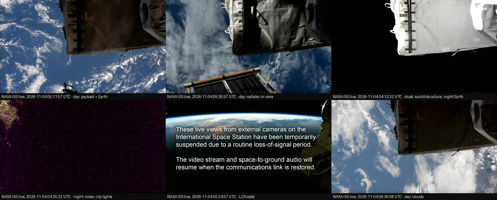
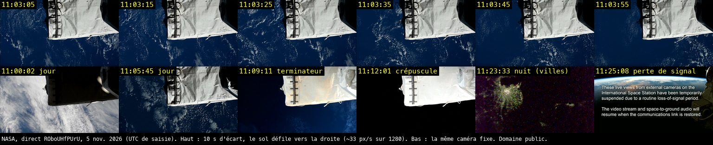
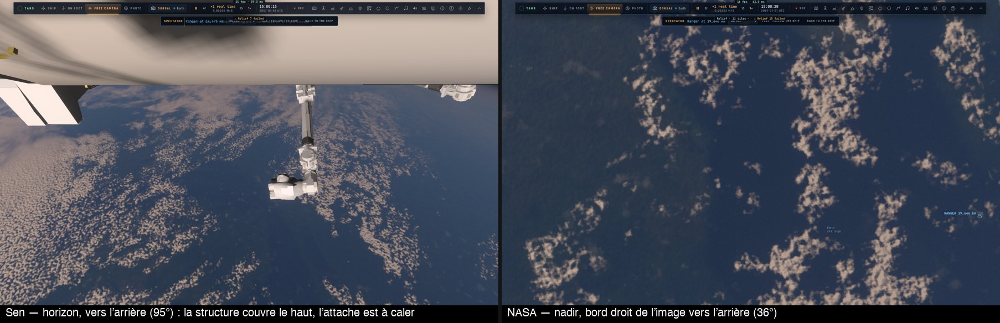
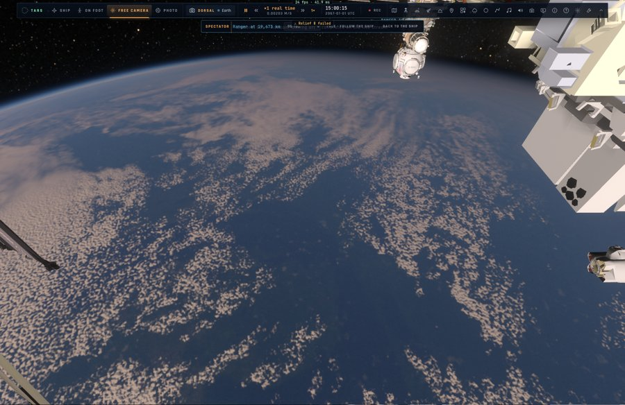
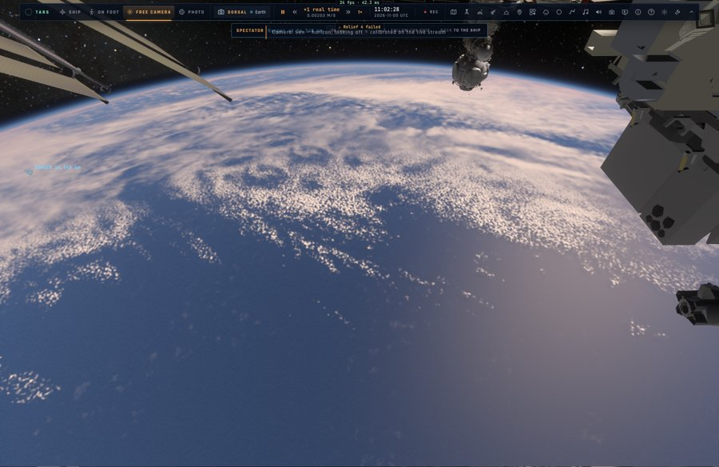
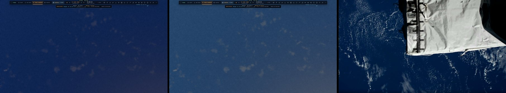
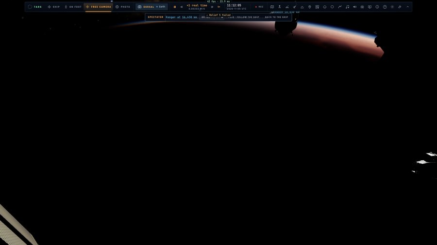
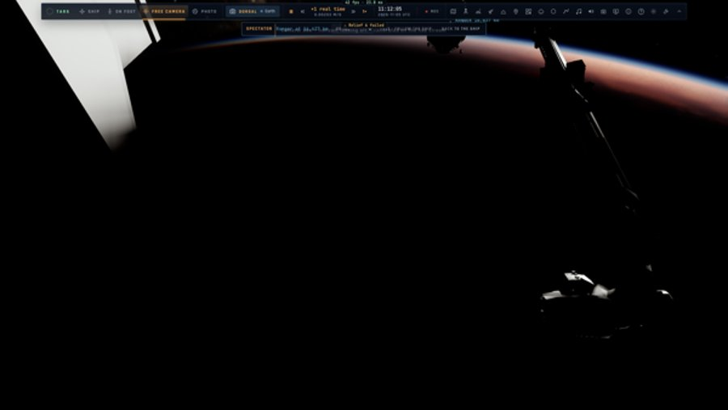
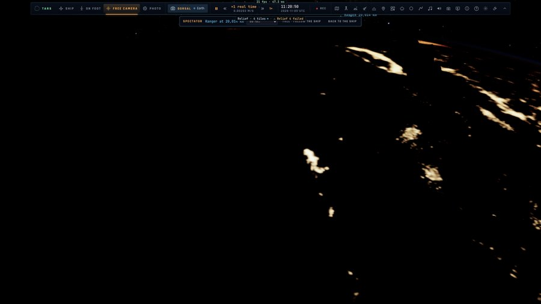
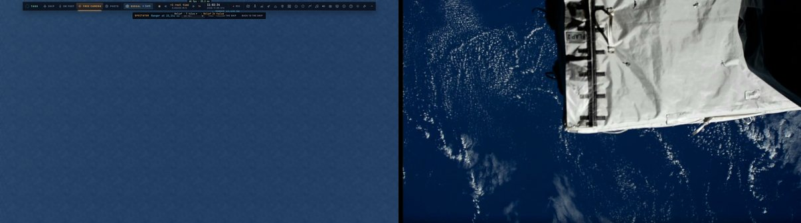

# Q6-ISS — les vraies caméras de l'ISS (en cours : ISS0)

Plan : [PLAN-REFRACTION-HORIZONS.md](../../PLAN-REFRACTION-HORIZONS.md), volet Q6-ISS (décision 39, Sam, 4 novembre). Sources
revérifiées le 4 novembre 2026 ; aucune calibration encore.

## ISS0 — le corpus reproductible (première tranche, le 4 novembre)

### Les sources, revérifiées

| Caméra / famille | Ce que la source établit | Source |
|---|---|---|
| **NASA — externe Harmony** (flux « Live High-Definition Views from the ISS », `ROboUHfPUrU`, en direct depuis le 22 octobre 2026) | « an external camera mounted on the station's **Harmony module** … **looking forward at an angle so that International Docking Adapter 2 is visible** » ; une boucle « Previously Recorded » quand elle n'est pas disponible | description du flux officiel (YouTube @NASA) — l'identifiant cité au plan (`aB1yRz0HhdY`) n'existe plus |
| NASA — « Live Video from the ISS » (`M3HKLzjvKPc`) | l'intérieur quand l'équipage est en service, sinon une caméra extérieure non nommée ; écran bleu aux pertes de signal | description du flux officiel |
| **Sen — SpaceTV-1** (flux 24/7 `fO9e9jnhYK8`, 1080p30 sur YouTube) | trois caméras 4K **à l'extérieur, sur la plateforme Bartolomeo** (fixée au module Columbus — Space.com dit « sur Columbus » : la même chose), « not behind a window » : **Nadir** (droit vers la Terre), **Horizon** (vers le limbe), **Docking** (le long de la structure, le port d'amarrage avant) ; non orientables ; rien sur le champ, la focale ni la cadence | [sen.com/mission/stv-1](https://www.sen.com/mission/stv-1) ; CRS-30, mars 2024 (Space.com) |
| NASA — HDEV (historique) | sur la plateforme externe de Columbus ; actif du 30 avril 2014 au 18 juillet 2019, fin de vie le 22 août 2019 ; la page ne liste pas ses quatre caméras (le rapport final à lire) | [eol.jsc.nasa.gov/esrs/hdev](https://eol.jsc.nasa.gov/esrs/hdev/) |

### HDEV (2014–2019) : ses quatre caméras, selon le rapport final (annexe A)

[Rapport final HDEV, juin 2020](https://eol.jsc.nasa.gov/ESRS/HDEV/files/HDEV-Final-Report_20200715.pdf) : quatre caméras fixes
(ni pan, ni zoom, ni iris), derrière des hublots de quartz fondu, sur la plateforme externe de Columbus (CEPF) ; toutes en 720p
à ~60 images/s ; une caractérisation de la distorsion de chacune faite au sol (Bouguet CCT — ses valeurs ne sont pas publiées
dans le rapport).

| Visée | Caméra | Capteur | Objectif (documenté) | Champ horizontal 16:9 (**dérivé** : capteur 1/3″ nominal, 4,8 mm de large) |
|---|---|---|---|---:|
| **avant** (le vecteur vitesse) | Hitachi HV-HD30 | 1/3″ CMOS × 3 | Fujinon TF4DA-8, 4 mm F/2,2, mise au point à l'infini | ~62° |
| **nadir** | Toshiba IK-HR1S | 1/3″ CMOS | Fujinon TF4DA-8, 4 mm | ~62° |
| **arrière 1** | Panasonic AG-HMC150 | 1/3″ CCD × 3 | Leica Dicomar à 3,9 mm (le plus court du zoom) | ~63° |
| **arrière 2** | Sony FCB-EH4300 | 1/3″ CMOS | intégré, réglé à 4,7 mm | ~54° |

Une famille distincte (plan) : ni les EHDC actuelles, ni SpaceTV-1 ; leurs archives seulement si le corpus en contient.

### Les archives repérées (Sen, mono-caméra d'abord)

Métadonnées lues par `yt-dlp -j` (aucun téléchargement) ; les compilations hebdomadaires de 15 min (« This Week in Orbit »,
« 15 Minutes of Earth From Space ») **mêlent caméras et accélérés** : réservées à l'inventaire, pas à la calibration.

| Vidéo | Date | Durée · format | Caméra probable (à vérifier image par image) | Usage |
|---|---|---|---|---|
| `OjpoaQPp4xM` — Dragon CRS-35 approche (15 oct. 2026) | 2026-10-15 | 234 s · 2160p25 | Docking / Nadir (Dragon 1 km sous la station) | géométrie : un véhicule de taille connue, la structure |
| `ARfNTE-3OPA` — Crew-13, approche et amarrage, 24 min | 2026-10-05 | 1 490 s · 2160p25 | Docking (le port avant) | ISS2 : structure, port, véhicule amarré |
| `eA3wBLdnfIU` — Soyuz MS-29 sous l'ISS (Atlantique, Cap-Vert) | 2026-07-15 | 263 s · 2160p25 | Nadir | ISS2 : côtes (Cap-Vert) + véhicule |
| `sRmsKE-CPu4` — Crew-12 1 km sous l'ISS | 2026-02-14 | 157 s · 2160p25 | Nadir | validation |
| `Q297BuAhqH0` — 90 clips en 30 min | 2026-07-11 | 1 831 s · 2160p30 | mêlées | inventaire seulement |

Les archives n'ont pas d'UTC de prise de vue à la seconde (la date du descriptif seulement) : pour la géométrie fine, préférer
le direct.

### Le direct, horodaté

- **Trouvé** : l'habillage du direct Sen **incruste l'UTC de l'image** (« TIME UTC 03:03:18 » pour une saisie à 03:03:37 —
  **~19 s de retard** du direct), avec le lieu survolé, jour/nuit, la vitesse : chaque image porte son instant. Le jeu propage
  l'ISS par SGP4 sur les derniers éléments CelesTrak (`src/system/iss.ts`, récupérés au lancement) : pour un direct, l'orbite du
  jour même — le meilleur cas de la précaution 1 du plan.
- **Outil** : `scripts/iss-capture.ts` — une image de chaque direct toutes les N secondes pendant M minutes, nommée par l'UTC de
  saisie, un manifeste TSV ; **hors du dépôt** (`~/.kerr-lab/iss-corpus` : les images Sen ne sont pas à redistribuer ; celles de la
  NASA sont du domaine public). Première capture lancée le 4 novembre à 03 h 30 UTC, 60 s × 115 min (au moins un passage de jour).
- **Reste d'ISS0** : identifier la caméra de chaque image Sen (l'habillage ne la nomme pas : nadir / horizon / docking au contenu),
  les coupes et les « Previously Recorded » de la NASA ; choisir les extraits de calibration et ceux réservés à la validation ;
  le rapport final HDEV (ses quatre caméras) ; les droits et crédits notés avant toute image versée au dépôt.

## ISS0 — la première capture classée par caméra (le 5 novembre)

La capture du 4 novembre (`scripts/iss-capture.ts`, une image par minute, 03 h 04 – 06 h 43 UTC, 142 images par source,
`~/.kerr-lab/iss-corpus`, hors du dépôt) a été classée à l'œil sur des planches-contacts. Les heures sont celles de la saisie
(UTC) ; l'incrustation Sen retarde d'environ 19 s.

### Sen (direct `fO9e9jnhYK8`) : au moins quatre vues distinctes

| Vue (identifiée au contenu) | Plages de jour | Plages de nuit / crépuscule | Remarques |
|---|---|---|---|
| **Horizon** : limbe en haut, courbure forte, grand angle | 03:59–04:06, 04:53–04:57, 05:10–05:39, 06:34 | 04:07–04:16, 05:40–05:48 | la vue la plus longue ; terminateur à 04:06 et 05:38 |
| **Nadir** : sol à plat, sans limbe | 04:59–05:04, 05:06–05:09, 06:35–06:43 | — | côtes et nuages nets (Madagascar, l'Afrique à 05:07) |
| **Dragon amarré** : la capsule à gauche, le limbe en bas | 03:21, 04:20, 05:05, 05:26 | idem | plans courts, souvent avec l'étiquette « loss of signal » |
| **Structure et Soleil** : modules en avant-plan, le Soleil qui se lève sur le limbe | 06:22–06:31 | — | reflets, éblouissement, structure en contre-jour |
| Intercalaires | « Switching camera » à 04:15, 04:58, 05:49, 06:20, 06:33 ; studio (entretien) à 05:58 | | |
| Nuit noire | | 03:04, 04:16–04:25, 05:50–06:19 | à peine quelques lumières : peu exploitable |

### NASA (direct `ROboUHfPUrU`) : une seule caméra fixe

Une caméra extérieure fixe regarde vers le bas, le long d'une charge sous housse blanche à sangles noires, avec un radiateur
ou un panneau en bas à gauche. Sa position sur la station n'est pas encore identifiée (ISS1). Elle donne la même
géométrie d'une image à l'autre, ce qui est un bon point pour la calibration.
- **Jour :** 03:21–04:08, 04:53–05:41, 06:26–06:42.
- **Crépuscule** (la structure au soleil, la Terre déjà noire) : 04:09–04:14, 05:42–05:46, 06:21–06:25.
- **Nuit** (bruit, quelques villes) : 04:15–04:26, 05:47–06:20.
- **Pertes de signal** (écran « temporarily suspended ») : 04:19, 04:54, 05:24–05:25, 05:57.

### Choix provisoire des extraits

| Usage | Sen | NASA |
|---|---|---|
| **Calibration** (ISS2 géométrie, ISS3 réponse) | horizon 05:10–05:30 (limbe net, nuages variés) ; nadir 04:59–05:04 | jour 05:10–05:40 (géométrie fixe, océan et nuages) |
| **Validation** (gardée à part) | horizon 03:59–04:06 (jusqu'au terminateur) ; nadir 06:35–06:43 ; structure et Soleil 06:22–06:31 | jour 06:26–06:42 ; crépuscule 05:42–05:46 |

- **Reste d'ISS0 :**
  - attacher à chaque image Sen l'instant de son incrustation (lecture du texte), pour la géométrie à la seconde ;
  - une capture plus dense (toutes les 5 à 10 s) sur les extraits retenus, pour le mouvement ;
  - les « Previously recorded » de la NASA ;
  - les tolérances de calibration.
- **Puis ISS1 :** situer sur le modèle de la station la caméra fixe de la NASA, à partir de la housse et du radiateur, et les
  vues Sen : horizon, nadir et Dragon.

### ISS0 : l'instant de chaque image Sen, lu dans son incrustation (le 5 novembre)

- **Outil :** `scripts/iss-overlay-ocr.swift` lit les champs « TIME UTC » et « ALTITUDE km » de l'incrustation du direct Sen
  avec la reconnaissance de texte de macOS (Vision), dans le bloc en bas à droite de l'image (1920 × 1080). Chaque valeur
  est rattachée à son étiquette par sa ligne, car la troisième ligne n'affiche pas toujours l'altitude.
- **Résultat sur la capture du 4 novembre** (`~/.kerr-lab/iss-corpus/sen-overlay.tsv`, hors du dépôt) :
  - l'heure est lue sur **141 images sur 142** ;
  - **le direct retarde de 17 s en médiane** sur l'heure de saisie (de 10 à 21 s ; une saisie par minute, sans
    synchronisation à la seconde) ;
  - l'altitude est lue sur 18 images, là où elle est affichée : de 419 à 433 km ;
  - un premier essai qui prenait le nombre de la troisième ligne sans son étiquette donnait 550 à 600 km : c'était un
    autre champ.
- **Usage :** pour la géométrie à la seconde (ISS2), chaque image Sen prend l'instant de son incrustation. Le jeu propage
  l'ISS par SGP4 sur les éléments CelesTrak du jour.
- **Reste d'ISS0 :** une capture plus dense (toutes les 5 à 10 s) sur les extraits retenus ; les tolérances.

## ISS1 — les caméras sur la station : le registre (le 5 novembre)

- **Sources :**
  - **Sen** : les trois caméras 4K de SpaceTV-1 sont fixes, à l'extérieur, sur la plateforme Bartolomeo d'Airbus, posée par
    Canadarm-2 (vol CRS-30, mars 2024) ([sen.com](https://www.sen.com/mission/stv-1),
    [space.com](https://www.space.com/astronomy/earth/live-4k-video-from-space-see-earth-from-the-iss-with-sharp-eyed-sen-cameras)) :
    - la nadir regarde droit vers le bas (environ 240 × 180 km au sol) ;
    - la caméra d'horizon, grand angle, montre parfois la structure ;
    - la caméra d'amarrage regarde le long de la station, vers le véhicule amarré au port avant d'Harmony.
  - **Bartolomeo** : sur la face avant de Columbus, fixée au tourillon avant tribord
    ([eoPortal](https://eoportal.org/satellite-missions/iss-bartolomeo),
    [ESA](https://www.esa.int/ESA_Multimedia/Images/2020/04/Bartolomeo_connected_to_Columbus)).
  - **NASA** : le descriptif du direct parle d'une caméra extérieure sur Harmony, qui regarde vers l'avant en biais, avec
    IDA-2 dans le champ (en-tête de `scripts/iss-capture.ts`).
- **Mesuré dans le modèle de la NASA** (`assets/iss/ISS2.glb`, hors dépôt). Boîtes englobantes des pièces nommées, lues par
  Blender et ramenées au repère de la station comme dans `build-iss.py` (mètres ; x vers l'avant, y à tribord, z vers le
  nadir) :

  | pièce | x | y | z |
  |---|---|---|---|
  | `Columbus_BARTOLOMEO` | 13,25–15,61 | 2,59–8,68 | 4,54–6,45 |
  | `Columbus` | 8,47–13,24 | 1,97–8,68 | 2,61–7,10 |
  | `IDA2` (port avant d'Harmony) | 15,46–16,09 | −0,86–1,06 | 4,73–6,46 |
  | `Node2_Details_EHDC_5` (caméra HD externe 5 d'Harmony) | 12,75–14,14 | 1,70–2,42 | 4,70–5,07 |
  | `Node2_Details_CameraPole` | 12,69–14,20 | 1,16–1,82 | 2,88–3,95 |

- **Lecture :**
  - les caméras Sen sont sur Bartolomeo, à 3 à 9 m à tribord d'IDA-2 et à sa hauteur. La caméra d'amarrage regarde donc
    vers bâbord, à quelques mètres d'un Dragon amarré, ce qui explique la capsule plein cadre dans le corpus ;
  - la caméra du direct NASA est très probablement **EHDC-5** sur Harmony, à 2,5 m d'IDA-2. **Ce n'est pas confirmé** : le
    classement d'ISS0 y voyait surtout une charge sous housse et un radiateur, à rapprocher de ce poste.
- **Fait** (`src/system/iss-cameras.ts`, test `tests/iss-cameras.test.ts`) : un registre des quatre caméras (identifiant,
  flux, descriptif, attache dans le repère de la station et sa source, axe de visée, état « estimation »). Pour la caméra
  d'amarrage, la visée va de Bartolomeo vers IDA-2 ; le test vérifie qu'elle tombe à moins d'un mètre du port que la table
  de la station (`iss.ts`) place à cet endroit.
- **Non établi :**
  - la place exacte de chaque caméra sur Bartolomeo ;
  - les champs de vue ;
  - l'axe de la caméra d'horizon (estimé à 35° sous l'avant, puisque le limbe est en haut de l'image) ;
  - la caméra NASA.
- **Suite, ISS2 :** ajuster attache, axe et champ sur les images horodatées d'ISS0. Le limbe donne le tangage et le roulis,
  les côtes la géométrie au sol (nadir), le véhicule amarré la caméra d'amarrage. L'heure lue dans l'incrustation situe
  l'ISS par SGP4.

## ISS0 — la capture dense (le 5 novembre)

La capture a été faite avec `bun scripts/iss-capture.ts --every 10 --for 30`, de 10 h 59 à 11 h 30 UTC, dans
`~/.kerr-lab/iss-corpus/dense-20261105-1059` (hors du dépôt, avec le manifeste et `sen-overlay.tsv`). Elle est allée à son
terme du premier coup. Les heures citées ici sont celles de la saisie (UTC).

### Ce qui a été capturé

- **NASA : 159 images** (1280 × 720), de 10:59:52 à 11:29:45. **Sen : 157 images** (1920 × 1080), de 10:59:54 à 11:29:47.
  On en attendait environ 180 par source.
- **Le pas médian est de 10 s** pour les deux sources, mais il vaut en moyenne 11,4 s (NASA) et 11,5 s (Sen). Pour la NASA,
  129 pas sur 158 font exactement 10 s ; pour Sen, 120 pas sur 156 font de 9 à 11 s. Le script redemande l'URL du flux à
  chaque saisie, et ses saisies lentes allongent le pas : c'est ce qui coûte la vingtaine d'images manquantes.
- **Trous de plus de 30 s**, tous entre 11:18 et 11:21 :
  - NASA : 11:18:24 → 11:18:59 (35 s), 11:19:26 → 11:20:05 (39 s), 11:20:05 → 11:21:08 (63 s), sans erreur dans le journal ;
  - Sen : 11:18:17 → 11:19:05 (48 s), 11:19:05 → 11:20:56 (111 s), avec deux saisies ratées dans le journal (ffmpeg 183,
    à 11:18:27 et 11:19:33).
- **Images noires** (luminance moyenne sous 10 sur 255) : 59 côté NASA et 57 côté Sen. Ce sont des images de nuit, et non des
  défauts de capture.
- **Intercalaires**, repérés par la reconnaissance du texte de toute l'image :
  - NASA : 9 écrans « temporarily suspended due to a routine loss-of-signal period », de 11:24:56 à 11:25:41 et de 11:28:55 à
    11:29:25 ;
  - Sen : 9 images « Replay during loss of signal », de 11:25:03 à 11:25:46 et de 11:29:08 à 11:29:38, plus 3 « Switching
    camera » de 11:15:50 à 11:16:10 et un plan de studio à 11:22:26 (un entretien) ;
  - aucun « Previously recorded » dans le flux NASA.
- **Les deux flux perdent le signal ensemble.** Les deux pertes tombent aux mêmes minutes sur les deux flux, ce qui
  correspond à la même liaison descendante de la station. Les bascules de Sen arrivent de 3 à 13 s après celles de la NASA
  (borne tirée des saisies encadrantes, à 10 s près). Le direct NASA aurait donc quelques secondes de retard de moins que
  celui de Sen ; c'est une estimation, pas une mesure.

### L'heure incrustée de Sen

- `swift scripts/iss-overlay-ocr.swift` lit l'heure sur **156 images sur 157**. La seule image sans heure est le plan de studio.
- **Le direct retarde de 18 s en médiane** sur l'heure de saisie (de 12 à 21 s ; 80 % des images entre 16 et 20 s). Le
  4 novembre, on avait mesuré 17 s (de 10 à 21 s) avec une saisie par minute.
- **L'altitude est lue sur 52 images**. Elle décroît régulièrement, de 426,2 km à 10:59:48 (heure incrustée) à 418,5 km vers
  11:27, ce qui reste dans la plage de la veille (419–433 km).
- **Attention aux reprises :** pendant un « Replay during loss of signal », l'horloge de l'incrustation continue au rythme
  du direct (retard de 15 à 20 s), alors que l'image est une reprise. Il faut exclure ces images de la géométrie à la
  seconde.

### Le classement par plages (heures de saisie)

| Source | Plage | Vue | Remarques |
|---|---|---|---|
| Sen | 10:59:54 – 11:09 | **Horizon**, jour | océan Indien puis mer de Java ; reflet du Soleil sur la mer ; un élément blanc de la structure dans le coin haut gauche |
| Sen | 11:09 – 11:15:40 | **Horizon**, terminateur et coucher | le Soleil descend sur le limbe à droite (reflets, éblouissement de 11:12 à 11:14), puis seul le fin trait du limbe |
| Sen | 11:15:50 – 11:16:10 | « Switching camera » | 3 images |
| Sen | 11:16:20 – 11:24:47, 11:25:54 – 11:28:58 | **Nuit** | presque noire ; des lumières de villes à 11:16:34–11:16:43 et 11:23:05–11:24:15 ; la caméra n'est pas identifiable dans le noir |
| Sen | 11:22:26 | studio | un entretien |
| Sen | 11:25:03 – 11:25:46, 11:29:08 – 11:29:38 | **Reprise** pendant la perte de signal | des vues de jour : ce ne sont pas des images du direct. L'image de 11:29:47 (de jour, sans étiquette de reprise lue) en est probablement la fin |
| NASA | 10:59:52 – 11:08:51 | **caméra fixe**, jour | le sol et les nuages défilent sous la housse |
| NASA | 11:09:11 – 11:14:46 | crépuscule | la housse au soleil, la Terre déjà noire |
| NASA | 11:14:56 – 11:24:43, 11:25:51 – 11:28:45, 11:29:35 – 11:29:45 | nuit | bruit ; des villes de 11:23:03 à 11:24:23 |
| NASA | 11:24:56 – 11:25:41, 11:28:55 – 11:29:25 | perte de signal | |

Les deux captures ne contiennent ni vue nadir de Sen ni vue de Dragon : la vue nadir n'a pas été diffusée pendant ces 30 min,
et Dragon n'apparaît que dans le texte de l'habillage, de 11:00 à 11:02.

**La caméra NASA n'est pas celle du descriptif.** Le flux annonce une caméra sur Harmony, regardant vers l'avant, avec
l'adaptateur IDA-2 visible. Or aucune image ne montre IDA-2. On voit la même charge sous housse blanche à sangles noires que le
4 novembre, avec le même cadrage (la housse et l'échelle de sangles aux mêmes pixels, à l'œil). Le sol se déplace sans
perspective, et la vue est proche du nadir. La position de cette caméra reste à trouver en ISS1.

### Ce que la densité apporte : le mouvement à 10 s

Le mouvement a été mesuré sur les paires d'images consécutives (au plus 12 s d'écart), en appariant des points SIFT et en
estimant le déplacement par RANSAC. Le calcul a été fait par un outil jetable, hors du dépôt.
- **NASA, de jour (49 paires) :** le sol défile **vers la droite de l'image, à 33 px/s en médiane** (de 26 à 51 px/s), soit
  environ **330 px en 10 s, un quart de la largeur**. La vitesse est la même du haut au bas de l'image (31 à 34 px/s par
  bande), ce qui confirme une vue proche du nadir. La station avance donc vers la gauche de l'image.
- **NASA, la caméra ne bouge pas :** sur la housse, la corrélation de phase donne un décalage nul sur les 35 paires de 11:08 à
  11:14. Il n'y a ni panoramique ni zoom.
- **Sen horizon, de jour (49 paires) :** le sol **remonte vers le limbe**, de 3,3 px/s en médiane, avec un gradient de
  perspective : environ 1,4 px/s près du limbe, 3,7 px/s entre 20 et 40 % de la hauteur, 5,7 px/s entre 40 et 60 % et 8 px/s
  entre 60 et 80 %. Le sol s'éloigne vers l'horizon, ce qui indique une vue tournée vers l'arrière de la trajectoire ou une
  image retournée. Il faudra le vérifier en ISS1 sur le modèle.
- **Le limbe de Sen dérive lentement :** au milieu de l'image, il monte de 105 à 90 px (sur 1080) entre 11:00 et 11:12. Cette
  dérive est continue, sans saut, ce qui est cohérent avec une caméra fixe. Elle est trop grande pour venir de la seule baisse
  d'altitude ; l'attitude de la station ou la forme de la Terre sont à examiner avec la géométrie (ISS2).
- **Usage :** ces vitesses apparentes, avec l'instant incrusté et l'orbite SGP4 du jour, contraignent l'orientation et le champ
  de chaque caméra (ISS1–ISS2). Elles fourniront aussi la référence du défilement à reproduire dans les vues ISS du jeu.

### Reste d'ISS0

- Une capture dense de la vue **nadir** de Sen et de la vue **Dragon**, absentes de ces 30 min. Il faut viser une plage où le
  flux les diffuse : la veille, le nadir passait vers 05:00 et vers 06:35 UTC.
- La saisie est plus lente que prévu (11,4 s en moyenne au lieu de 10). Pour un pas de 10 s tenu, il faudrait saisir les deux
  flux en parallèle dans le script.
- Les « Previously recorded » de la NASA, absents des deux captures.
- Les tolérances de calibration ; exclure les reprises de Sen de la géométrie.
- **Puis ISS1 :** situer la caméra NASA (la housse, la direction du défilement) et les vues Sen sur le modèle de la station.

## ISS2 — premier calage : la caméra d'horizon de Sen par le limbe (le 5 novembre)

- **Méthode** (`scripts/iss-limb-fit.py`) :
  - vu de l'altitude h, le limbe est le cône des directions qui plongent de δ = acos(R / (R + h)) sous l'horizontale
    (20,4° à 425 km) ;
  - pour un sténopé de champ horizontal F, incliné de θ sous l'horizontale et tourné de φ autour de son axe, la ligne du
    limbe se calcule colonne par colonne ;
  - les trois nombres sont ajustés sur le limbe trouvé dans l'image : pour chaque colonne, le premier passage du noir de
    l'espace à la clarté de la Terre ou de l'air, sous les incrustations ;
  - recherche sur une grille puis affinage ; on garde le résidu médian en pixels ;
  - aucune distorsion n'est modélisée.
- **Résultat** sur les 20 images de jour de la plage « horizon » du 4 novembre (05:10–05:29 UTC), altitude 425 km, celle de
  l'incrustation :
  - **14 images s'accordent** : champ horizontal **95°** (94,5–95,8°), inclinaison **47,5°** sous l'horizontale
    (47,3–47,5°), roulis **≈ 0°** (−1,8 à 0°), résidu **1 à 2 px** ;
  - 5 images convergent vers 75° et 40° avec un résidu de 4,2 à 4,6 px. C'est sans doute un minimum local, où champ et
    inclinaison se compensent quand le limbe couvre moins de largeur. Une image échoue (18 px, 100 colonnes seulement).
- **Lecture :** la caméra d'horizon regarde **à 47,5° sous l'avant**, et non 35° comme estimé en ISS1, avec un **grand
  angle de 95°**. Le limbe passe donc près du haut de l'image, comme dans le corpus. Le résidu de 1 à 2 px laisse peu de
  place à une forte distorsion, mais ne l'exclut pas sur les bords.
- **Reporté** dans le registre (`src/system/iss-cameras.ts`, `sen-horizon` : visée à 47,5°, champ 95°, état « calibrated »).
  Le lacet (l'azimut par rapport à l'avant) ne se déduit pas du limbe : il reste supposé vers l'avant.
- **Limites :** le limbe détecté est celui de l'air clair, quelques dizaines de kilomètres au-dessus du sol, ce qui donne
  un léger biais ; une seule séquence ; pas de distorsion.
- **Suite d'ISS2 :**
  - le lacet, par les côtes reconnues dans l'image et la trace SGP4 à l'instant incrusté ;
  - la caméra nadir (champ et orientation par les côtes) ;
  - la caméra d'amarrage (par le Dragon) ;
  - la caméra NASA.

## ISS2 — deuxième calage : le lacet de l'horizon et la caméra NASA par le défilement du sol (le 5 novembre)

- **Méthode** (`scripts/iss-flow-yaw.py`) :
  - la station tient son attitude sur la verticale locale (LVLH) ; une caméra fixe voit donc le sol défiler selon sa
    direction par rapport au sens de vol ;
  - entre deux images de la capture dense, environ 10 s d'écart, des centaines de points sont appariés (SIFT, test du
    rapport). On ne garde que ceux sous le limbe, hors incrustations, et on écarte la structure de la station, qui reste
    immobile dans l'image ;
  - pour chaque lacet et chaque sens de l'image (directe ou en miroir), chaque point est ramené à son point au sol (sphère,
    altitude 422 km). La station avance ensuite de ω dt le long de son orbite, en tournant son repère avec elle, et le point
    est reprojeté ;
  - on garde le lacet dont les déplacements prédits suivent le mieux, en direction, les déplacements observés (angle
    médian) ;
  - **option champ** : le champ horizontal qui égale les longueurs prédites et observées (rapport médian de 1) ;
  - la rotation propre de la Terre n'est pas modélisée : au plus 0,46 km/s contre 7,66 km/s, soit quelques degrés de
    direction.
- **Caméra horizon de Sen**, sur 9 paires de jour de 10:59 à 11:08 UTC (inclinaison 47,5° et champ 95° repris du limbe) :
  - **lacet 180,7°** (177,3–182,7°) : la caméra **regarde vers l'arrière** ;
  - les directions prédites suivent les observées à **1,1° près** (médiane, de 0,8 à 1,4° selon la paire) ;
  - les longueurs se rapportent à 0,91 (0,59–1,11). C'est cohérent compte tenu de l'intervalle des saisies, lu dans les
    noms de fichiers à ±1–2 s près ;
  - cela confirme la lecture d'ISS0 : le sol s'éloigne vers le limbe. À 180°, une image en miroir donne le même
    défilement ; les deux sens ne se distinguent pas.
- **Caméra NASA**, sur 9 paires de 10:59 à 11:08 UTC (`--tilt 90`, la vue supposée au nadir) :
  - le sol défile vers le **bord droit de l'image, et ce bord droit pointe vers l'arrière** (89,0° ; un appariement en miroir
    à 270,7°, équivalent). Les directions concordent à **0,2° près** ;
  - **champ horizontal 36°** (écart-type 3,6°, de 34,8 à 39,4° sur 8 paires ; la paire de 20 s donne 46,8°). La principale
    incertitude vient de l'intervalle entre images : une seconde d'erreur sur 10 s fait 10 % sur le champ ;
  - le nadir est supposé, parce que le défilement est égal du haut au bas de l'image. Une légère inclinaison le long de la
    trace n'est pas exclue ;
  - **ce n'est pas la vue vers l'avant sur IDA-2** que décrit le direct. L'attache EHDC-5 reste une place provisoire, le
    vrai support est inconnu.
- **Reporté** dans le registre (`src/system/iss-cameras.ts`) :
  - `sen-horizon` regarde vers l'arrière, à 47,5° vers le bas ;
  - `nasa-harmony` regarde le nadir, avec le bord droit de l'image vers l'arrière, un champ de 36° et l'état
    « calibrated ».
  - Tests : `tests/iss-cameras.test.ts`.
- **Reste d'ISS2 :**
  - la caméra nadir de Sen (absente de la capture dense ; Sen la diffuse vers 05:00 et 06:35 UTC) ;
  - la caméra d'amarrage, par le Dragon ;
  - le sens direct ou miroir de l'horizon, par une côte reconnue ;
  - l'intervalle exact des images NASA, pour resserrer le champ.

## ISS4 — premier palier : les caméras des directs dans le jeu (le 5 novembre)

- **Fait :**
  - **une seule action**, `issCameraView` dans `src/main.ts`, partagée par trois accès :
    - le panneau Caméra, section « Les caméras du direct de l'ISS » quand l'ISS est la cible ;
    - TARS, par le paramètre `issCamera` de l'outil `camera` ;
    - l'API, par `__bh.issCamera(id | "back")` et `__bh.issCameras()` ;
  - **la vue** (`camera/subjectcam.ts`, `issCameraFrame`) :
    - l'œil est placé sur l'attache de la caméra, dans les axes LVLH de la station ;
    - il regarde selon la ligne de visée du registre, avec le haut de l'image tiré du bord droit calé en ISS2 ;
    - le champ horizontal du registre est conservé, et le champ vertical suit la forme de la fenêtre ;
    - un glisser tourne la tête, en mode exploration ; rechoisir la caméra rend son cadrage natif ;
  - **le réglage de scène `issView`** est sauvegardé avec la scène, donc rejouable ;
  - **« Revenir à la vue d'avant »** : autour de l'ISS si la vue d'avant la visait déjà, sinon à la vue tenue (`viewHold`) ;
  - l'horloge de la scène n'est pas modifiée par l'action. Un appareil piloté continue de voler : la vue est celle du
    spectateur (F3).
- **Vérifié** (e2e `iss-cameras`, ce Mac, clics réels dans le panneau) :
  - l'œil est sur l'attache (0,00 m), la visée à 0,00° et le haut de l'image à moins de 0,01° de ceux du registre ;
  - le champ horizontal est de 95,0° pour l'horizon de Sen et de 36,0° pour la NASA ;
  - l'outil de TARS mène au même état ; après le retour, `issView` vaut « off » et la vue est à 105 m de l'ISS ;
  - aucune erreur de page. Unitaires et i18n FR/EN : passent.

- **Constat :** l'œil de l'horizon de Sen est au centre de la boîte de Bartolomeo. Les modules de la station y couvrent le
  quart haut de l'image, là où le direct montre le limbe et seulement un coin de structure en haut à gauche. **L'attache de
  Sen est à caler** sur la structure visible dans ses images (reste d'ISS2) ; aucune correction n'a été devinée.
- **Reste d'ISS4 :**
  - afficher la source et la qualité du calage dans la vue elle-même (aujourd'hui dans le panneau et le message) ;
  - rendre la vue accessible depuis la vue du vaisseau sans passer par F3 ;
  - la caméra d'amarrage (champ inconnu : 60° par défaut).

## ISS2 — troisième calage : l'attache de la caméra d'horizon de Sen par la structure visible (le 5 novembre)

- **Constat d'ISS4 :** avec l'œil au centre de la boîte de Bartolomeo, il se trouvait dans une pièce de la station. Les
  modules couvraient le haut de l'image, là où le direct montre le limbe.
- **Méthode** (`scripts/iss-mount-fit.ts`) :
  - au-dessus du limbe, l'espace est noir : une cellule claire est de la structure ;
  - les cellules de ciel, c'est-à-dire les rayons de la caméra qui passent au-dessus du limbe (inclinaison 20,4° à 422 km),
    sont comparées sur une grille de 96 × 54. D'un côté, les cellules claires dans au moins 60 % de 50 images de jour
    (10:59–11:08 UTC le 5 novembre, logo et badge exclus). De l'autre, celles que le maillage de la station du jeu (pièces au
    repos) couvre à moins de 80 m, vu depuis chaque attache candidate ;
  - on garde le meilleur IoU (intersection sur union), image directe ou en miroir. Une attache noyée dans une pièce est
    écartée.
- **Résultat :**
  - 404 cellules de ciel, dont 93 claires, toutes dans le coin haut-gauche ;
  - l'ancienne attache, au centre de Bartolomeo, obtient un IoU de 0 (noyée dans une pièce) ;
  - **le meilleur ajustement est [13,5 ; 12,0 ; 5,5] m, image en miroir, avec un IoU de 0,78**. Les dix meilleurs vont de
    0,72 à 0,78, tous à tribord au-delà de la boîte de Bartolomeo (y entre 8,5 et 14,5 m), et neuf sur dix sont en miroir ;
  - **l'ajustement est lâche, à 2–3 m près** : seule une bande de ciel étroite le contraint.
- **Reporté :**
  - `sen-horizon` reçoit cette attache et un bord droit vers tribord, c'est-à-dire une image en miroir ;
  - `issCameraFrame` garde le haut de l'image du côté du zénith pour une image en miroir, et le signale par `mirrored`. Le
    jeu dessine la vue sans miroir.
  - Tests unitaires ; e2e `iss-cameras` repassé : l'œil sur l'attache, et la visée comme le haut à moins de 0,01°.
- **Vu dans le jeu :** le limbe et l'espace en haut, la structure à droite. C'est le reflet du coin haut-gauche du direct.

## ISS3 — premier palier : la réponse mesurée, jeu contre direct au même instant (le 5 novembre)

- **Méthode :**
  - l'e2e `iss-cameras` avec `ISS_AT=2026-11-05T11:02:00Z` met la scène à cet instant : horloge du jeu et « maintenant » de
    l'ISS (SGP4), profil d'image Neutre. Il prend les vues Sen horizon et NASA ;
  - `scripts/iss-response.py` les compare aux images du direct de 11:01 à 11:04 UTC. Les nuages du jeu ne sont pas ceux du
    jour, donc chaque image est réduite à deux populations dans une zone de Terre : l'océan (la moitié la plus sombre) et les
    nuages (les 3 % les plus clairs). On compare leur couleur sRGB moyenne, leur luminance linéaire et la chroma de l'océan.
- **Mesuré (profil Neutre) :**

  | | Sen horizon : direct | Sen horizon : jeu | NASA nadir : direct | NASA nadir : jeu |
  |---|---|---|---|---|
  | océan, sRGB | (18, 51, 72) | (58, 74, 106) | (35, 64, 102) | (52, 69, 101) |
  | océan, luminance | 0,030 | 0,068 (×2,27) | 0,050 | 0,059 (×1,17) |
  | océan, R/G · B/G | 0,35 · 1,40 | 0,78 · 1,44 | 0,54 · 1,58 | 0,76 · 1,46 |
  | océan, chroma | 54 | 48 | 67 | 49 (×0,72) |
  | nuages, sRGB | (217, 218, 204) | (225, 202, 191) | (180, 183, 186) | — (presque aucun nuage dans le jeu) |
  | contraste nuage / océan | 23,1 | 9,1 (×0,40) | 9,4 | non comparable |

- **Lecture :**
  - **l'océan du jeu, vu de l'orbite, est trop rouge et trop gris** dans les deux vues (R/G de 0,76–0,78 contre 0,35–0,54).
    En vue oblique, il est aussi **deux fois trop clair**, ce qui réduit le contraste avec les nuages à 40 % du direct ;
  - les nuages sont au même niveau mais **plus chauds** (rouge +8, bleu −13 sur l'horizon) ;
  - ces écarts ressemblent davantage à un défaut de rendu, dans la couleur de l'eau vue de haut ou dans la lumière diffusée
    par l'air sur le trajet, qu'à la réponse d'une caméra. **Aucun profil de caméra n'est appliqué** : il masquerait l'écart
    sans le corriger.

- **Suite d'ISS3 :**
  - chercher la cause de l'océan trop clair et trop rouge vu de l'orbite : albédo de l'eau, réflexion du ciel, lumière de
    l'air sur le trajet. Comparer à la même mesure faite sur le sol tracé ;
  - ensuite seulement, un profil par caméra pour ce qui reste (exposition, balance des blancs) ;
  - mesurer les nuages là où le jeu en a, ou avec la météo réelle du jour.
- **Deuxième essai (même jour) : d'où vient l'océan trop clair et trop rouge ?**
  - **Pas de la carte** : l'océan de la carte de jour (`assets/earth/day-med`) est d'un bleu très sombre, (1, 3, 11) en sRGB,
    avec un R/G de 0,35 comme le direct ;
  - **pas du reflet du ciel sur la mer** : avec `ISS_TUNE={"TUNE_GSKIP":18944}` (512 + 2048 + 16384 : le reflet du ciel
    clair, le Fresnel des pentes fines et les nuages reflétés coupés), l'océan ne bouge pas : (53, 69, 99) au nadir contre
    (52, 69, 101), R/G 0,78 ;
  - **l'excès croît avec l'épaisseur d'air traversée** : luminance ×1,17 au nadir, ×2,05–2,27 en vue oblique. Et il est trop
    rouge pour une diffusion par les molécules, qui serait bleue : R/G 0,78 contre 0,39–0,54 ;
  - **hypothèse** : la lumière de l'air sur le trajet, vue de l'orbite, est trop forte et trop grise (part des aérosols ou de la
    diffusion multiple). Elle se corrige dans le modèle d'air commun, qui sert aussi les ciels vus du sol (PLAN-CIEL, Q5) :
    rien n'est changé ici sans mesure sur ces vues-là ni décision de Sam ;
  - **à faire** : séparer le transport de l'air du sol vu de l'orbite en coupant tour à tour aérosols et diffusion multiple, puis
    comparer aux mêmes mesures sur les vues du sol (T7, références photo).
- **Troisième essai (même jour) : la cause trouvée, et c'était la mesure.**
  - **Ni l'air ni la mer** : sans aérosols (`aerosolOverride = 0,001`), l'océan baisse à peine (×2,00 contre ×2,10 sur Sen),
    avec un R/G toujours à 0,75 ; sans diffusion multiple (`msLutOn = false`), il est même un peu plus clair. L'hypothèse de la
    lumière de l'air sur le trajet est **réfutée** ;
  - **la chaîne d'affichage de ce Mac** : son écran est HDR, et l'image y passe par `hdrMap` (`display.wgsl`). AgX, AgX punchy
    et ACES y donnent exactement les mêmes chiffres, et seul Film a sa propre courbe HDR. Les captures PNG de ce Mac montrent
    donc une autre réponse que celle d'un écran SDR ;
  - **mesuré sur kerr-mini** (écran SDR, courbe AgX normale), même instant, profil Neutre :

    | | NASA, direct | NASA, jeu | Sen, direct | Sen, jeu |
    |---|---|---|---|---|
    | océan, sRGB | (35, 64, 102) | (15, 37, 80) | (21, 53, 75) | (22, 43, 86) |
    | océan, luminance (jeu/direct) | | ×0,40 | | ×0,79 |
    | océan, R/G · B/G | 0,54 · 1,58 | 0,42 · 2,19 | 0,39 · 1,41 | 0,52 · 2,01 |
    | nuages, sRGB | (180, 183, 186) | — | (236, 236, 219) | (147, 134, 133) |
    | contraste nuage / océan | 9,4 | (presque aucun nuage) | 25,7 | 9,8 |

  - **lecture corrigée** : sur un écran SDR, l'océan du jeu n'est **ni trop rouge ni gris**. Il est **un peu trop bleu**
    (B/G 2,0–2,2 contre 1,4–1,6), l'image est **plus sombre** (océan ×0,4–0,8, nuages de Sen ×0,3) et **moins contrastée**
    (9,8 contre 25,7). Ces écarts relèvent bien de la **réponse de la caméra** : exposition, balance des blancs, courbe. Le
    profil par caméra d'ISS3 est donc justifié, et **aucune correction de l'air n'est à faire** ;
  - **leçon** : les mesures de couleur se font sur un écran SDR (kerr-mini), pas sur les captures HDR de ce Mac.
- **Suite d'ISS3** :
  - le profil de la vue ISS : exposition, gain par canal, contraste, ajustés sur ces chiffres par caméra ;
  - puis ISS5 : la comparaison en mouvement, aux transitions d'éclairage.

## ISS3 — premier profil par caméra (le 5 novembre)

- **Fait** :
  - le registre (`src/system/iss-cameras.ts`) porte une réponse par caméra (`response`) : une exposition (× avant la courbe), des
    gains par canal (espace d'affichage linéaire), un contraste (courbe en S en gamma d'affichage) et une saturation ;
  - `display.wgsl` (`Display.iss`, `issB`) l'applique quand la vue passe par une caméra ISS (`renderer.issViewNow`, posé par
    l'action commune `issCameraView`), sauf en profil Neutre (mesures) ;
  - le profil Caméra des vols (grade d'images de chasseurs) n'est pas appliqué à une caméra ISS, comme le plan le demande ;
  - les ajustements ont été faits sur kerr-mini (écran SDR), au même instant que le direct (11:02 UTC le 5 novembre), en trois
    passes. Un premier écrit à 320 au lieu de 304 dans le tampon n'avait aucun effet.
- **Mesuré (kerr-mini, jeu profilé contre direct)** :

  | | NASA, direct | NASA, jeu neutre | **NASA, jeu profilé** | Sen, direct | Sen, jeu neutre | **Sen, jeu profilé** |
  |---|---|---|---|---|---|---|
  | océan, sRGB | (35, 64, 102) | (15, 37, 80) | **(37, 66, 102)** | (21, 53, 75) | (22, 43, 86) | **(36, 55, 97)** |
  | océan, luminance (jeu/direct) | | ×0,40 | **×1,04** | | ×0,79 | **×1,23** |
  | océan, R/G · B/G | 0,54 · 1,58 | 0,42 · 2,19 | **0,56 · 1,55** | 0,39 · 1,41 | 0,52 · 2,01 | 0,65 · 1,78 |
  | nuages, sRGB | | | | (236, 236, 219) | (147, 134, 133) | (198, 195, 194) |
  | contraste nuage / océan | | | | 25,7 | 9,8 | 13,9 |

  - **NASA** : l'océan est calé à quelques niveaux près (exposition 1,9, gains 0,93 · 1,04 · 0,78) ;
  - **Sen** : océan et nuages se rapprochent (exposition 2,1, balance sur les nuages blancs, contraste 1, saturation 0,6). Mais
    les nuages restent plus sombres (×0,66) et le contraste moindre (×0,54). Une partie de cet écart tient au contenu : les
    nuages de la météo du jeu ne sont pas ceux du jour, plus minces.

- **Limites** :
  - un seul instant (jour, océan) ; pas encore de nuit ni de terminateur ;
  - pas de vignette, de grain ni de compression mesurés ;
  - la saturation est un réglage global.
- **Suite** : ISS5, la comparaison en mouvement et aux transitions d'éclairage, avec les séquences de contrôle.

## ISS5 — premier palier : le mouvement et le terminateur contre les directs (le 5 novembre)

- **Outils** :
  - e2e `iss-cameras` : `ISS_FLOW=1` reprend chaque vue 10 s plus tard ;
  - `ISS_OMM` ou un téléchargement chez CelesTrak, puis `__bh.iss.setElements`, donnent les éléments orbitaux du jour. La page
    de test n'a pas de réseau et gardait sinon les éléments embarqués du 1er octobre, vieux de 35 jours ;
  - le journal note la hauteur du Soleil au-dessus du limbe vue de la station du jeu, son sens (coucher ou lever) et l'angle
    entre la visée de la caméra et le Soleil.
- **Le mouvement (kerr-mini, 11:02 UTC, profil de caméra)** : défilement du sol, appariement SIFT entre deux images à 10 s,
  ramené à la largeur et à l'intervalle du direct.

  | | jeu | direct |
  |---|---:|---:|
  | NASA, vers la droite [px/s sur 1 280 px] | **31,7** | **31,3** |
  | Sen, haut de l'image (20–40 % de la hauteur), vers le haut [px/s sur 1 920 px] | 3,0 | 3,5 |
  | Sen, milieu (40–60 %) | 6,7 | 5,5 |
  | Sen, bas (60–85 %) | 8,6 | 9,0 |

  Le défilement concorde (NASA à 1 %, Sen à 10–20 % par bande). C'est la vérification indépendante du lacet, du champ et de
  l'attache calés en ISS2.
- **Le terminateur (11:12 UTC)** :
  - **éléments orbitaux** : avec ceux du 1er octobre, le jeu montrait encore le plein jour à l'instant où le direct montre le
    coucher sur le limbe. Avec ceux du jour, la nuit au sol concorde : la vue NASA est noire des deux côtés ;
  - **géométrie** : à 11:12:05, le Soleil est à **7,64° au-dessus du limbe** vu de la station du jeu. Un calcul indépendant
    (SGP4 sur les éléments du jour et Soleil de la NOAA) donne environ 7,9°, et l'entrée dans l'ombre à **11:14:35**, que le
    compte à rebours de Sen annonce à 11:14:31. Dans le jeu, la station s'éloigne du Soleil (coucher : v·soleil = −0,79), son
    axe x est sa vitesse (x·v = 1,000), et la caméra d'horizon regarde à 46° du Soleil ;
  - **cadrage** : le Soleil est à environ 35° au-dessus de l'axe de la caméra. Le direct le montre tout en haut, à moitié coupé ;
    le jeu le laisse juste hors du cadre, puisque son demi-champ vertical, en sténopé, est de 31,5°. Il manque quelques degrés au
    bord de l'image, **sans doute la distorsion en barillet du grand angle réel**, que le calage sténopé d'ISS2 ignore.

- **Reste d'ISS5** :
  - la distorsion de la caméra d'horizon (un modèle de grand angle ajusté sur le limbe en entier, bords compris) ;
  - la nuit (villes, aurores) ;
  - la vue nadir de Sen et la caméra d'amarrage, une fois capturées et calées ;
  - le coût de la vue ISS sur kerr-mini.

## ISS5, deuxième palier : la caméra d'horizon recalée par le Soleil (le 5 novembre)

- **La distorsion n'était pas la cause** (`scripts/iss-limb-fit.py --distort 1`, projection entre sténopé et fisheye
  équidistant). À champ horizontal fixé, un barillet réduit le demi-champ vertical (31,5° → 26,7°) au lieu de l'élargir, et il
  dégrade l'ajustement du limbe (2,1 px en sténopé contre 4,9 à 7,5 px avec barillet). Le limbe seul laisse en outre champ et
  inclinaison se compenser : 95° et 47,5° le 4 novembre, 103 à 105° et 49 à 50° vers 11:07 le 5.
- **Le Soleil comme mire** :
  - pendant le coucher (11:10:48 à 11:14:13, heures incrustées par Sen), il est visible sur 23 images, en haut à droite.
    L'e2e en relève le cœur saturé, hors du logo de Sen ;
  - sa direction dans le repère de la station à chaque instant vient de SGP4 sur les éléments du jour et du Soleil de la
    NOAA : à bâbord et vers l'arrière, 8 à 9° sous l'horizontale ;
  - **le Soleil seul** donne un champ de 92°, une inclinaison de 41,5°, un lacet de 176°, un roulis de −7°, **image directe**
    (résidu médian 10,8 px). Le registre en miroir le plaçait à 1 470 px ; en image directe, à 65 px ;
  - **le Soleil et le limbe ensemble** (10 images de 11:05 à 11:10) donnent un **champ de 91°, une inclinaison de 45,5°, un lacet
    de 179° et un roulis de 0°** : limbe à 2,9 px, Soleil à 19,6 px.
- **Le miroir était une erreur** : à l'arrière, bâbord est à droite de l'image, et c'est là que le Soleil apparaît. Le choix du
  miroir venait de l'ajustement de l'attache sur la structure, mal contraint. Il est refait en image directe : près de
  Bartolomeo, le meilleur point est [12,5 ; 7,5 ; 7,0] (bord arrière et extérieur, recouvrement 0,49). Un point à bâbord,
  [9,5 ; −2 ; 8,5], recouvre davantage (0,78), mais Sen place sa caméra sur Bartolomeo ; ce choix reste lâche.
- **Reporté au registre** : `sen-horizon` avec un champ de 91°, une visée à 45,5° sous l'horizontale, un lacet de 179°, une
  image directe (bord droit à bâbord) et cette attache. Tests mis à jour ; l'e2e lit maintenant le champ dans le registre.
- **Vu dans le jeu (kerr-mini, 11:12:05, éléments du jour)** : la structure en haut à gauche, éclairée, au même endroit que sur
  le direct ; le limbe au couchant en travers du haut de l'image. Le Soleil se projette en (1 749 ; 1), au bord haut, sous la
  barre d'interface du jeu ; dans le direct, son cœur est en (1 722 ; 67).

- **Reste** :
  - la nuit ;
  - la vue nadir de Sen et la caméra d'amarrage, une fois capturées ;
  - le coût de la vue ISS ;
  - l'attitude réelle de la station (tangage de quelques degrés) n'est pas modélisée, le jeu suppose la LVLH exacte.

## ISS5, troisième palier : la nuit et le coût de la vue (le 5 novembre)

- **La nuit, 11:20 UTC** (kerr-mini, éléments du jour, profil de caméra ; le Soleil à 18° sous le limbe vu de la station) :

  | | jeu : moyenne · 99ᵉ centile | direct : moyenne · 99ᵉ centile |
  |---|---|---|
  | Sen, horizon | 2,5 · 123 (des taches claires : les villes de Luçon ou des nuages éclairés) | 1,7 · 1,0 (noir ; incrustation « Night ») |
  | NASA, nadir | 0,1 · 1,0 (noir) | 11 · 42 (le bruit du capteur, violacé : son gain poussé) |

  - **Sen** garde son exposition de jour : la nuit est noire, et les lumières au sol ne s'y voient pas. Le jeu, lui, adapte son
    exposition et fait sortir les lumières ;
  - **la NASA** pousse son gain : un voile de bruit coloré de niveau 11 apparaît. Le jeu reste noir ;
  - **à faire** dans la réponse par caméra :
    - pour Sen, une exposition fixe, celle du jour, au lieu de l'exposition automatique ;
    - pour la NASA, un plancher de bruit coloré qui monte quand la scène s'assombrit.
- **Le coût** (kerr-mini, 1080p, images GPU terminées sur 3 s) : la vue autour de l'ISS à 35,1 ms, **la vue Sen à 46,9 ms, la vue
  NASA à 45,5 ms** (+10 à +12 ms). Le grand champ sur la Terre vue d'orbite et la station toute proche coûtent ; les passes ne
  sont pas encore séparées.

- **La réponse de nuit, faite (même jour)** :
  - **Sen** tient son exposition (`response.fixedEV` : 14,26 EV, lue par l'exposition automatique à 11:02 UTC dans sa vue, celle
    de l'ajustement de jour) au lieu de suivre l'exposition automatique (`renderer.ev`) ;
  - **la NASA** a un plancher de bruit dans le noir (`response.noise`, `display.wgsl` : un bruit magenta, nouveau à chaque image,
    qui ne monte que dans les zones sombres) ;
  - **mesuré (kerr-mini, 11:20 UTC)** :
    - Sen : jeu 0,0, direct 1,7 (noir) ;
    - NASA : jeu (13,7 ; 0,1 ; 7,5) en sRGB moyen, direct (19,6 ; 1,2 ; 14,4). Les essais à 0,045 et 0,27 donnaient 1,8 et
      (51 ; 0 ; 34) ;
  - **de jour**, l'exposition fixe de Sen redonne la valeur ajustée. Mais avec les éléments du jour, l'ISS de 11:02 est à sa vraie
    place, au-dessus d'une zone que la météo du jeu couvre de nuages : les statistiques d'océan de l'ajustement, faites à
    l'ancienne position sur de l'océan dégagé, ne se comparent plus. **À refaire** : l'ajustement à la vraie position, avec une
    météo du jeu sans nuages ou celle du jour.
- **Le coût, deux autres mesures** (kerr-mini) : de jour 24,3 ms pour Sen et 23,6 ms pour la NASA, contre 24,8 ms autour de
  l'ISS ; dans une autre série de jour, 53,7 et 60,2 ms contre 61,6. Le coût des vues ISS suit celui de la scène (nuages, Terre),
  pas la vue elle-même : le +11 ms de la mesure de nuit ne se retrouve pas. **Non conclu** sur une seule série par cas.
- **L'ajustement de jour refait à la vraie position (même jour)** : éléments du jour, nuages du jeu coupés, l'océan seul pour
  l'exposition et la balance, et pour Sen les nuages du direct contre le limbe et la structure du jeu pour le contraste. Trois
  passes sur kerr-mini à 11:02 UTC :

  | | NASA : jeu | NASA : direct | Sen : jeu | Sen : direct |
  |---|---|---|---|---|
  | océan, sRGB | **(33, 62, 98)** | (35, 64, 102) | (28, 44, 76) | (21, 53, 75) |
  | océan, luminance (jeu/direct) | **×0,92** | | ×0,81 | |
  | océan, R/G · B/G | **0,54 · 1,59** | 0,54 · 1,58 | 0,63 · 1,72 | 0,39 · 1,41 |
  | contraste clair / océan | | | **25,7** | 25,7 |

  - **NASA** : exposition 3,1, gains 1,07 · 1,00 · 0,74, sans contraste. L'océan est calé à quelques niveaux près ;
  - **Sen** : exposition 2,3, contraste 0,4, saturation 0,6, balance sur ses nuages et non sur l'océan. Le contraste est calé ;
    la teinte de la mer en oblique reste plus rouge que celle du direct, ce qui relève du rendu de la mer, pas de la caméra.

