# Q6 — l'image : la reconstruction temporelle, le profil Caméra, le GoPro

Plan : [PLAN-REFRACTION-HORIZONS.md](../../PLAN-REFRACTION-HORIZONS.md), phase Q6 (décision 30 : avant Q4). e2e
`tests/e2e/motion-quality.e2e.test.ts` ; données : [Q6/](Q6/).

> **Correction (4 novembre)** : les e2e et A/B de ces fiches présentés comme « ce Mac, headless » (à partir de T8c) ont tourné
> **dans une fenêtre visible** : la config de ce Mac (`~/.kerr-lab/config.json`, `"chrome": "window"`, depuis le 3 novembre 01 h 26)
> l'emportait, rien ne forçait `E2E_HEADED=0`. Les comparaisons A/B (mêmes conditions de part et d'autre) restent valables ; les
> images par seconde ont pu être plafonnées par l'écran (120 Hz). Désormais `E2E_HEADED=0` sauf demande contraire.

## Synthèse (le 4 novembre)

| Item du plan | État | Où, preuves |
|---|---|---|
| **I2** suréchantillonneur temporel | **fait en partie** : le TAAU en mouvement par défaut (netteté en mouvement ~0,74 → ~0,95 de la référence, +4,9 dB à Tarifa), son noyau élargi sur l'eau (grain −8 %), sa passe allégée (−10 %) ; la fusion des deux historiques écartée sur mesure (le temporel natif 0,5 ms, le TAAU 1,5 ms) | Q6a–Q6d ; `motion-quality` |
| **I3** objets mobiles, mer, nuages | **fait** : les appareils hors de l'historique (par construction) ; l'ombre de l'appareil au sol raster (ajoutée) sans traînée ; la mer et les nuages sans traînée, en ligne droite et en virage ; deux défauts trouvés en mesurant et corrigés (les cascades du relief en retard sur les maillages et sur les recuits) | Q6l–Q6o ; `ghost` |
| **I5** exposition locale | **pas de besoin établi** sur mesure | Q6e |
| **I6** profil Caméra / Neutre | **implémenté, qualité des rayures rouverte** : A1 étalonnage ajusté sur deux vidéos retenues par Sam ; A2 grain, vignette et aberration ; A3 exposition qui respire ; A4 flou de pose à temps fixe, désactivé par défaut. **Rayures Q6t non acceptées par Sam : AAA apportant du photoréalisme ou retrait**, décision 40 du plan | Q6g–Q6k, Q6p, Q6t ; les contrôles techniques ne prouvent pas l'acceptation visuelle |
| **I7** cadence | **fait** : le plafond compté en rafraîchissements ; le calage automatique écarté sur mesure | Q6f ; `cadence` |
| **I8** GoPro | **fait** (décision 38) : objectif 100°, bandeau, HUD minimal en option, rangées utiles seules (−24 % de pixels), sélection au pointeur | Q6j, Q6q–Q6s ; `gopro`, `lens.test` |
| **I4 complet** | **mesuré** : sous 75 %, les scènes critiques perdent trop (Alpes −5 dB à 62,5 %) ; l'échelle tenue à 75 % en mouvement, aucun palier en vol | Q6u ; `motion-quality` (profil Neutre) |
| **Q6-ISS** | ISS0 commencé | [Q6-ISS.md](Q6-ISS.md) |

Hors de Q6, relevé en mesurant : les routes OSM absentes du sol raster (Q3 B4) ; un damier quand le flou de pose est actif.

## Q6a — la mesure de l'image en mouvement (le 3–4 novembre)

- **Le chemin actuel** : en mouvement, le raster rend à 75 % du canvas (`earthRasterScale`) et n'ombre qu'un pixel sur quatre par
  image ; l'historique natif (`post.wgsl temporal`) reconstruit à cette échelle, puis l'affichage agrandit (Catmull–Rom + RCAS,
  `display.wgsl`). Un essai de suréchantillonnage temporel (`post.wgsl taau`, `renderer.taauOn`) existe, **éteint** depuis le
  21 octobre (« à ⅛ ou ¼ d'ombrage, trop peu d'échantillons pour battre le Catmull–Rom, pour 2–3 ms de plus »).
- **L'outil** : `motion-quality` — la simulation figée et avancée de 1/30 s avant chaque image : **le même mouvement par image
  pour chaque mode** (`raster-motion` volait en temps réel : un mode plus lent allait plus loin par image, son virage 14 à 37 px
  d'un passage à l'autre, ses PSNR incomparables) ; chaque mode part de l'état sauvegardé du lieu (`game.snapshot` →
  `importSave`) ; 90 images de virage, la dernière tenue (**premier instant**), 30 images immobiles (**après accumulation**),
  puis **sa propre référence** raffinée à l'échelle du canvas, prise aussitôt (une référence partagée dérivait de 50 px : un
  regard qui s'adoucit). Mesures dans la vue de la verrière (x 380–1220, y 120–700), HUD coupé (sa symbologie est dessinée
  dans l'image au cockpit : identique partout, elle noyait le laplacien) : PSNR et **rapport de netteté** (énergie du
  laplacien sur celle de la référence : 1 aussi net, en dessous plus flou, au-dessus bruité).
- **Mesuré** — ce Mac, headless, **pression thermique Heavy**, réseau lent ; références non convergées en 90 s (raffinées) :

| Tarifa bas (700 m, 240 m/s, virage) | PSNR mouvement | netteté mouvement | PSNR immobile | netteté immobile | GPU |
|---|---:|---:|---:|---:|---:|
| défaut (75 %, ¼, agrandi à l'affichage) | 39,55 | **0,74** | 39,93 | 0,98 | 16,7 ms |
| **TAAU** (75 %, ¼, `taauOn`) | **44,44** | **0,95** | **45,19** | 1,09 | 18,5 ms |
| natif (100 %, ¼) | 40,87 | 1,63 | 39,52 | 2,59 | 28,9 ms |

  Les Alpes : TAAU 39,4 dB / 0,94 en mouvement ; le défaut faussé (140 tuiles encore en chargement pendant son vol). Le natif à
  ¼ n'est pas une référence : un pixel sur quatre ombré par image à pleine échelle laisse un bruit fort (netteté 2,5 immobile).

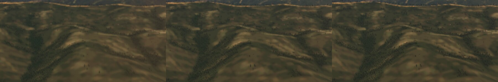

- **Constat** : à mouvement égal, **le TAAU existant bat le chemin par défaut en mouvement** — +4,9 dB, la netteté 0,74 → 0,95
  (les arbres, le modelé presque ceux de la référence, l'image par défaut empâtée) — pour **≈ +1,8 ms** (Heavy). La conclusion
  d'octobre venait d'une mesure à mouvement inégal.
- **Limites** : un seul lieu propre (Tarifa) ; références non convergées ; machine chaude ; aucune mesure de fantômes (mer,
  avions) ni du changement de palier.
- **Suite (Q6b)** : le TAAU en mouvement par défaut, mesuré (netteté, coût, fantômes sur la mer et un avion) ; puis I2 : fondre
  l'historique natif et le TAAU en une seule reconstruction à la taille de sortie (le coût rendu).

## Q6b — le TAAU en mouvement par défaut (le 4 novembre)

- **Fait** : `renderer.taauOn = true` — le suréchantillonnage temporel là où l'image en direct est rendue sous le canvas (en
  mouvement : `earthRasterScale` 0,75) ; `taauWanted(t)` : l'albédo accumulé du sol (`RASTER_DETAIL`) n'est plus coupé que là où
  il tourne (avant, `taauOn` le coupait aussi pour la vue tenue à pleine échelle).
- **Mesuré** — `motion-quality`, cache Chrome chaud (`MQ_CHROME_PROFILE`, nouveau : aucune tuile encore en chargement), ce Mac
  headless, **Heavy** :

| | PSNR mouvement | netteté mouvement | PSNR immobile | netteté immobile | GPU |
|---|---:|---:|---:|---:|---:|
| Tarifa, défaut → TAAU | 38,22 → **44,17** | 0,74 → **0,96** | 46,28 → 45,23 | 0,92 → 1,09 | (défaut faussé : 81 ms, une compilation en vol) → 22,2 |
| Alpes, défaut → TAAU | 36,30 → **41,04** | 0,68 → **0,92** | 37,18 → 42,15 | 1,00 → 1,03 | 19,1 → 19,7 |
| Détroit (mer, 300 m), défaut → TAAU | 45,29 → 42,98 | 0,93 → 1,25 | 46,12 → 43,06 | 1,02 → 1,33 | 26,7 → 31,0 |

  Sur le relief, la netteté en mouvement passe de ~0,7 à ~0,94 de la référence (+4,7 à +6 dB). Sur la mer, **aucun fantôme**
  visible ; l'eau proche égale la référence (laplacien 2,88 contre 2,81 ; le défaut la floute : 2,01) ; mais **la bande des
  vagues lointaines, rasante, est 10 % plus granuleuse que la référence** (18,3 contre 16,6 ; le défaut la floute : 15,9) — le
  PSNR −2,3 dB vient de là. Le coût : +0,6 ms (Alpes) à +4,3 ms (mer), sous pression thermique.

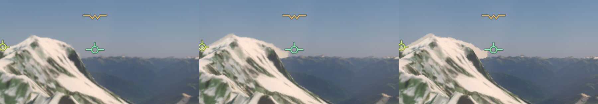

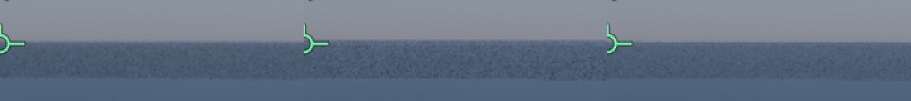

- **Reste** (I2) : le grain des vagues rasantes (un masque réactif de l'eau, une variance d'écrêtage adaptée) ; le coût sur la
  mer à remesurer machine froide ; un avion qui traverse l'image (fantômes) ; fondre l'historique natif et le TAAU en une seule
  reconstruction.

## Q6c — un protocole reproductible ; la passe TAAU allégée (le 4 novembre)

- **Le protocole** (`motion-quality`, à la demande de Sam : « tout chargé, compilé, avion stable ») : avant chaque vol, la
  variante du traceur prête et rien en compilation (`app.settled`), les tuiles (3 s sans attente), le décor entier ; l'avion
  stable — **pilote automatique** (altitude et cap tenus), **auto-manette** (`SPEED`, 140 m/s), **train sorti** — puis
  `STEADY` (60) images de vol droit avant les images mesurées ; vol droit par défaut (`TURN` 0). Deux défauts trouvés en route
  par l'état de l'avion relevé au départ de la mesure (`state`) : le pilote automatique **ne s'engageait pas** juste après le
  chargement de la sauvegarde (`jetToggle` refuse avant que l'appareil vole en avion — réengagé jusqu'à tenir) ; l'altitude
  de départ **dépendait du relief chargé** au moment du placement (`flyAt` : la hauteur au-dessus du sol connu — 4 581 contre
  2 439 m ; placé, figé jusqu'à 3 s sans tuile en attente avec un z 12, placé à nouveau, sauvegardé). `pending === 0` est vrai
  aussitôt après `flyAt`, avant ses fenêtres : une attente qui n'attendait rien.
- **A/A** (deux lancements de Chrome, Alpes, TAAU) : altitude 4 203 / 4 203 m, cap 110,09 / 110,08°, virage 12,9 / 13,3 px,
  passe TAAU 1,69 / 1,67 ms ; **bruit de la mesure ±0,5 dB, ±0,05 de netteté** (références raffinées 90 s, non convergées).
- **L'allègement** : la traction de l'historique vers l'image native (2 % par image) lue d'un échantillon bilinéaire au lieu du
  Catmull–Rom à 9 lectures, gardé là où il n'y a pas d'historique. A/B A B B A contre 29a88b9e, les quatre vols identiques
  (4 203–4 206 m) : **passe TAAU 1,69 · 1,60 → 1,51 · 1,45 ms (−10 %)** ; PSNR en mouvement 37,1 · 38,6 → 38,0 · 38,4 dB, netteté
  0,94 · 0,92 → 0,93 · 0,92 — l'image la même dans le bruit. (Un premier A/B au protocole non reproductible concluait l'inverse :
  ses vols différaient d'un lancement à l'autre.)
- **Pourquoi pas la fusion des deux passes (I2)** : le temporel natif ne coûte que 0,5–0,6 ms ; la passe TAAU 1,5 ms — c'est elle
  qui coûte.

## Q6d — le noyau du TAAU élargi sur l'eau seule (le 4 novembre)

- **Le constat** (Q6b) : sous le TAAU, la bande des vagues lointaines, rasante, plus granuleuse que la référence. Le noyau des
  échantillons (`taauSigma`, σ 0,5 px de sortie) mesuré à 0,5 / 0,6 / 0,7 : la mer 1,33 / 1,14 / 1,05 de la netteté de la
  référence, les Alpes 0,90 / 0,82 / 0,75 — un réglage global échange l'un contre l'autre.
- **Fait** : la marque des pixels raster porte l'eau — `rasterMark(a, eau)` : `RASTER_MARK × (4 + a)` sur l'eau (au-delà de
  3,5·10³⁰), `× (1 + a)` ailleurs ; `liteFinish(…, water)` — vrai depuis `shadeWater` quand l'eau couvre plus de la moitié du
  pixel ; `LAST_OCEAN` pour le chemin `shade` ; `post.wgsl rasterAlb` lit les deux plages ; la passe `taau` prend σ
  `TU.s.y` (`renderer.taauSigmaWater`, **0,7**) sur l'eau, `taauSigma` (0,5) ailleurs. Aucun autre lecteur de la valeur de la
  marque (les autres tests sont des seuils, > 10²⁹). Vérifié : 114 unitaires (noyaux, budgets, tables GPU, tranches WGSL).
- **Mesuré** (`motion-quality`, protocole reproductible, ce Mac, Moderate) :

| | netteté mouvement | netteté immobile | passe TAAU |
|---|---:|---:|---:|
| Détroit, eau à σ 0,5 → **0,7** | 1,25 → **1,15** | 1,36 → **1,20** | 1,41 → 1,63 ms |
| Alpes (pas d'eau), idem | 0,92 → 0,91 | 1,08 → 1,06 | 1,77 → 1,67 ms |

  La mer plus proche de la référence (−8 % de grain en mouvement), la terre inchangée. **En partie seulement** : σ 0,7 partout
  menait la mer à 1,05 — une part de la bande lointaine échappe au masque (une couverture d'eau sous la moitié, des pixels
  rebâtis entre les échantillons). Le PSNR des Alpes varie ici de 2,3 dB entre deux modes identiques sur la terre : les
  références raffinées 90 s ne convergent pas ; la netteté est la mesure retenue.
- **Reste** : le seuil de couverture (une marque graduée plutôt qu'un bit), les pixels rebâtis ; une référence convergée.

## Q6e — l'exposition locale (I5) : mesurée avant d'être faite, pas de besoin établi (le 4 novembre)

- **La question** (plan : « le cockpit et le paysage lisibles ensemble ») : l'exposition globale écrase-t-elle le cockpit ou le sol ?
- **Mesuré** sur des captures de ce Mac (exposition réglée, `app.exposureSettled`) : de jour au cockpit (Tarifa, Alpes) — le
  tableau de bord 40–46 de luminance moyenne sur 255 contre 103–117 au dehors, 15–26 % de pixels sous 12 (les cadres noirs des
  écrans, noirs en vrai ; les écrans émissifs lisibles) ; à contre-jour, le Soleil bas devant (Tarifa, 19 h 10 UTC en juillet, cap
  285°, **vue extérieure** — `viewReset` a remis la vue par défaut, pas le cockpit) : le sol 21 de moyenne, 0,1 % sous 12, l'avion
  lisible.
- **Décision** : pas d'exposition locale tant qu'une vue ne montre pas son besoin — elle changerait l'image partout (et le
  cockpit, composé à part dans `display.wgsl`, n'est pas dans l'image d'où elle se calculerait : il faudrait sa luminance propre).
  **Reste à mesurer** : le cockpit à contre-jour, une nuit éclairée (villes), une sortie de nuage.

## Q6f — la cadence (I7) : le plafond compté en rafraîchissements ; le calage automatique écarté (le 4 novembre)

- **L'outil** : `tests/e2e/cadence.e2e.test.ts` — dans une fenêtre visible (le headless n'a pas de vsync : le test le dit et
  s'arrête), le F-35 bas sur Tarifa en pilote automatique, 15 s par plafond (`fpsCap` 0, 60, 30) : l'intervalle entre images
  nouvelles (`renderer.completedFrames` relevé à chaque `requestAnimationFrame`), sa médiane, son 95ᵉ centile, la part régulière
  (à un quart de rafraîchissement de la médiane), les à-coups (deux intervalles consécutifs à plus d'un demi-rafraîchissement).
- **Le constat** (ce Mac, écran 120 Hz, fenêtre) : sans plafond, le GPU ne tenant pas 120, les images à 1 puis 2
  rafraîchissements (285 et 739 sur 1 036 ; 55 % d'à-coups) ; **le plafond ne régularisait pas** — compté en millisecondes moins
  un quart de rafraîchissement, à 60 les images à 1, 2 ou 3 rafraîchissements (186 / 524 / 181), à 30 à 3, 4 ou 5.
- **Fait** : le plafond compté en rafraîchissements entiers une fois le rafraîchissement mesuré (une image tous les
  round(1000 / (plafond × rafraîchissement)) ; une demi-période de marge) — `main.ts`.
- **Mesuré** :
  - ce Mac (fenêtre, mesures isolées avant / après, pas d'A/B propre — la machine passée en Heavy, l'A/B suivant faussé) :
    plafond 60, la part régulière 0,585 → 0,826, les à-coups 0,587 → 0,286 ; plafond 30 : 0,595 → 0,655.
  - **kerr-mini** (plein écran, A/B A B B A contre 2233dfc1, Nominal) : son écran rafraîchit toutes les 20 ms (50 Hz) et son GPU
    tient ~24 images/s (2 rafraîchissements) — le plafond n'y freine presque jamais : **neutre** (plafond 30 : régularité A 0,80 ·
    0,85, B 0,87 · 0,87 ; plafond 60 : A 0,79 · 0,90, B 0,78 · 0,91 ; images par seconde égales).
- **Écarté** : « Écran » calé d'office sur le plus petit nombre de rafraîchissements que le GPU tient (90ᵉ centile de ses durées)
  — A/B sur ce Mac : les images toujours étalées sur 3 à 5 rafraîchissements, 31–33 images/s : la durée du travail GPU varie trop,
  et WebGPU présente une image dès qu'elle est finie ; retenir la boucle ne règle pas la présentation.
- **Reste** : un A/B propre à 120 Hz (machine froide) ; la présentation elle-même (le moment où l'image s'affiche) n'est pas
  mesurée — l'achèvement GPU en tient lieu.

## Q6g — le profil Caméra et le profil Neutre (I6, décision 32 — première tranche, le 4 novembre)

- **Fait** : `settings.lookProfile` — `auto` (défaut : **Caméra** dans les vues de vol du jeu — un appareil piloté, l'image en
  direct —, **Neutre** ailleurs : le Labo, la science, les photos, les rendus hors ligne), `camera`, `neutral` ; réglage Rendu ›
  Image « Profil d'image », aide FR + EN. `display.wgsl cameraLook`, après la courbe de tons, en espace d'affichage : noirs
  relevés de 1,4 %, un S doux (12 %), saturation −6 %, ombres vers le bleu et hautes lumières vers le chaud (quelques millièmes),
  une vignette (les coins −12 % au plus), un grain triangulaire nouveau à chaque image, plus fort dans les tons moyens ; au-delà
  du blanc d'un écran HDR, la part au-dessus laissée telle quelle. `renderer.flightView` (main.ts) ; l'uniforme `Display` passe à
  17 vec4 (`look`, tampon de 512 octets).
- **Mesuré** (`look-profile`, nouvel e2e, headless, Tarifa au cockpit, figé) : luminance moyenne 76,7 → 74,5 (−3 %), le centre
  +0,9 %, les coins −7,6 % — discret ; `auto` donne Caméra en vol.

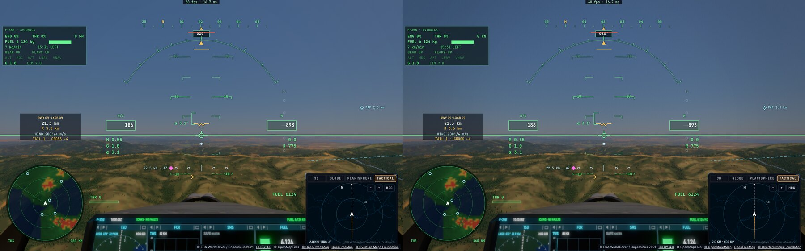

- **Pas encore** : la LUT « footage » **ajustée sur des vidéos de référence publiques** (décision 32) — ici une forme
  paramétrique, chaque terme petit ; l'exposition qui respire (A3), l'aberration chromatique et les rayures de verrière (A2), le
  flou de mouvement à temps de pose fixe (A4) ; le mode GoPro (I8).

## Q6h — l'exposition qui respire, profil Caméra seul (I6 A3, décision 32 (2), le 4 novembre)

- **Fait** (`renderer.readMeter`) : en profil Caméra, de jour dans l'air de la Terre, hors du spot du télescope, la cible du
  posemètre incident reçoit un tiers d'un posemètre de caméra — la médiane de l'image menée à un gris moyen (0,18), l'écart borné
  à ±1,5 EV : **±0,5 EV au plus** ; le posemètre incident reste la base (décision 32 (2)), la vitesse d'adaptation inchangée ; le
  profil Neutre inchangé (`lookCamera`, posé par `writeDisplay` pour l'image en direct).
- **Mesuré** (`look-profile`, headless, Tarifa au cockpit, figé ; la cible du posemètre réglée à chaque vue) : regard 25° vers le
  sol puis 25° vers le ciel — Neutre 14,580 / 14,580 EV (écart **0,000**), Caméra 15,080 / 14,700 (écart **−0,38 EV**). Vers le
  sol, la Caméra va à sa borne (+0,5 EV) : la médiane de l'image est l'intérieur sombre du cockpit — le dehors un peu surexposé,
  comme une caméra embarquée.
- **Reste** : la mesure de la respiration dans le temps (sa vitesse en virage) ; l'aberration et les rayures de verrière (A2) ; le
  flou de pose (A4) ; le mode GoPro (I8).

## Q6i — l'aberration chromatique du profil Caméra (I6 A2, le 4 novembre)

- **Fait** (`display.wgsl`) : en profil Caméra, une aberration chromatique latérale — le rouge et le bleu lus le long du rayon un
  peu vers l'extérieur et vers l'intérieur, ~0,7 px aux coins d'une image de 1 600 px, rien au centre ; deux lectures de texture de
  plus dans la passe d'affichage, sur l'image HDR avant la courbe de tons.
- **Vérifié** : `look-profile` vert (aucune erreur GPU ; luminance et vignette comme en Q6g, la respiration comme en Q6h).
  Visuellement sous le pixel au centre, à peine visible aux coins — voulu discret ; pas de mesure dédiée de la frange.
- **Reste** : les rayures de verrière (une texture), le flou de pose (A4), le mode GoPro (I8), la LUT ajustée sur des vidéos.

## Q6j — le mode GoPro hors du cockpit (I8, VIPER A5, décision 38, le 4 novembre)

- **Fait** : `settings.cameraLens` — « Rectiligne » (défaut) ou **GoPro** (Rendu › Image « Objectif extérieur », FR + EN) ; actif
  hors du cockpit et de la cabine, l'appareil montré, hors rendu hors ligne et banc. `src/lens.ts` : le profil — rectiligne
  dans 28°, les angles comprimés au-delà (0,75), **100° de champ en sortie**, un bandeau **2,39:1** ; le rendu rectiligne couvre
  les coins du bandeau (**104,6°**) et se fait **1,2 × plus grand** (le centre ~0,84 pixel source par pixel affiché : « presque
  net », décision 38) ; `main.ts` donne au renderer les réglages au champ élargi (`goproRenderFov`) et l'image à cette taille,
  cache le canvas du HUD (ses marques ne tomberaient pas sur le monde courbé) ; `display.wgsl` relit chaque point de sortie
  là où le rendu tient sa direction (la même fonction que `lensSource`), noir hors du bandeau.
- **Vérifié** : `tests/lens.test.ts` (le bord à 50°, la continuité à 28°, les coins dans le rendu, l'échantillonnage du centre
  ~0,84) ; `gopro` (nouvel e2e, headless) : marges du bandeau noires (0,5 et 0), l'image entre elles, le HUD masqué, aucune
  erreur GPU ; **coût mesuré 0,94 et 1,14 × la vue rectiligne** sur deux passages (rendu 1 152 × 648 contre 960 × 540 — l'échelle
  de mouvement 0,75 × 1,2), sous le ~1,5 × visé.

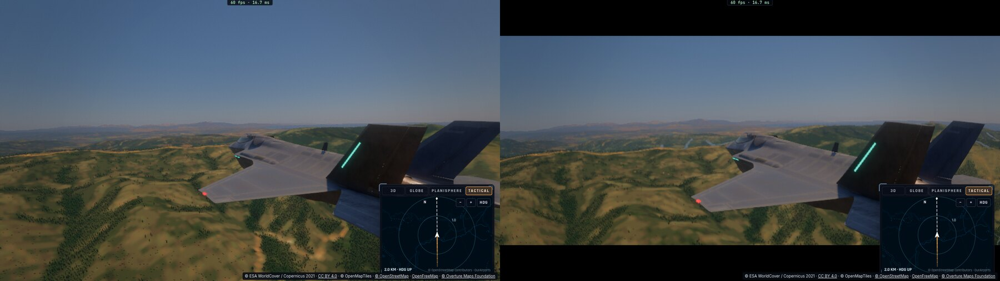

- **Reste** : le HUD minimal en option (décision 32 (6)) ; le rendu limité aux rangées du bandeau (−26 % de pixels) ; la
  sélection au pointeur dans la vue courbée ; un A/B de coût en vol.

## Q6k — l'étalonnage Caméra ajusté sur deux vidéos de référence (I6 A1, décision 38 (4), le 4 novembre)

- **Les références** (proposées par Claude, **retenues par Sam** : [Q6-references-LUT.md](Q6-references-LUT.md)) : *RAF Typhoon
  Flight Over the UK* (ministère de la Défense britannique, OGL v3, Commons, 1080p) et *Inside the F-35 cockpit, 2020 Ocean City Air
  Show* (US Air Force, domaine public, DVIDS, 1080p). Téléchargées hors du dépôt (`/tmp/lut-refs`, 245 et 125 Mo) ; 43 et 39 images
  fixes extraites ; aucune image redistribuée.

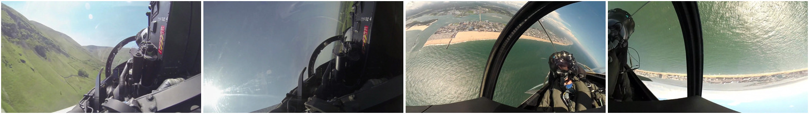

- **La mesure** (espace d'affichage, la même pour les deux côtés) : nos images Neutres du cockpit sans HUD (Tarifa, Alpes, détroit)
  contre les références. Leurs traits de caméra communs : les ombres presque grises, moins de saturation partout, le ciel pâle,
  les hautes lumières plus hautes et un peu froides. (Une part des écarts tient aux scènes — le vert anglais, le sec de Tarifa,
  plus de cockpit dans les références ; d'où un ajustement **à mi-chemin**, discret.)
- **Fait** (`display.wgsl cameraLook`) : saturation par luminance (ombres × 0,62, tons moyens × 0,85, hautes lumières × 0,80),
  les hautes lumières relevées vers le blanc (15 %), un S de 18 %, les hautes lumières un peu froides (l'inverse du premier jet).
- **Rejoué sur nos images Neutres** (sans grain ni vignette) :

| | Neutre | Caméra Q6g | **Caméra Q6k** | Références (Typhoon · F-35A) |
|---|---:|---:|---:|---:|
| saturation des ombres | 0,093 | 0,090 | **0,066** | 0,022 · 0,021 |
| saturation des tons moyens | 0,188 | 0,184 | **0,169** | 0,117 · 0,128 |
| saturation des hautes lumières | 0,243 | 0,231 | **0,175** | 0,098 · 0,133 |
| 99ᵉ centile de luminance | 0,763 | 0,776 | **0,789** | 0,856 · 0,956 |
| écart bleu des hautes lumières | −0,122 | −0,119 | **−0,085** | +0,019 · +0,009 |

- **Vérifié** : `look-profile` vert (luminance moyenne 76,7 → 77,2, les coins −6 %, la respiration inchangée).

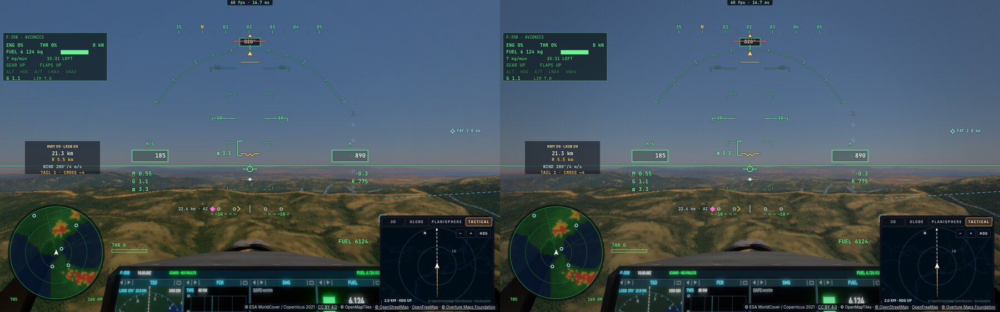

- **Reste** : une LUT 3D (33³) si la forme paramétrique ne suffit pas ; un vol de ligne de jour comme troisième référence.

## Q6l — les objets mobiles et l'historique (I3, le 4 novembre)

- **Constat dans le code** : les appareils (le nôtre, les autres, le trafic, les ailiers) sont dessinés **après** les passes
  temporelles (`ship.encodeShip` après `encodeTemporal`) : ils n'entrent jamais dans l'historique, aucune traînée possible
  par construction. Le reflet de l'appareil sur la mer (`shipSea`) est dans la même passe. Ce qui bouge **dans** l'image tracée et
  traverse l'historique : l'ombre de l'appareil sur le sol, les vagues.
- **Trouvé en mesurant : l'appareil n'avait aucune ombre au sol dans le pipeline raster** (le défaut sur Terre). `liteSun`, la
  lumière du sol et de l'eau raster, ne lisait pas sa carte d'ombre (`shipShadow`), seul le sol tracé le faisait. **Fait** :
  `liteSun` la lit (le point repassé aux axes du monde, `fromBody`) — l'ombre du F-35 sur le sol et sur la mer, au même endroit
  que sur le sol tracé ; celle du porte-avions sur la mer du même coup. `liteSkip` 2097152 la coupe (une mesure).
- **Nouvel e2e `ghost`** (headless) : le F-35 à 40 m, vu d'au-dessus et de derrière (vue « autour », 55°, 70 m), soleil haut ;
  **le monde entier chargé avant chaque mesure** (cartes hautes, tuiles de relief et d'imagerie, surface, décor — 3 s sans rien en
  attente ; ici 96 370 arbres et 267 à 591 bâtiments, z14), simulation figée et avancée de 1/30 s par image ; 60 images de vol,
  la dernière capturée, puis 30 images immobiles, puis la référence (pleine échelle, sans historique). La traînée comptée : les
  pixels plus sombres que la référence de 12 niveaux hors de ses propres ombres.

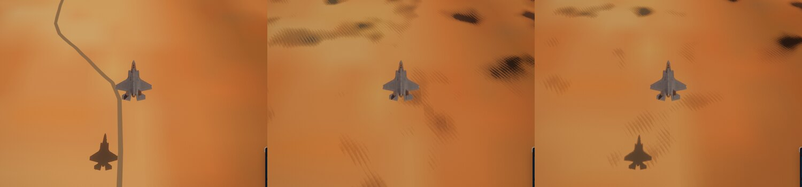

| Lieu · mode (décor complet) | PSNR en mouvement | PSNR immobile | pixels plus sombres en mouvement | immobile |
|---|---:|---:|---:|---:|
| détroit · spatial 75 % | 37,7 dB | 38,8 dB | 6 907 (les reflets des vagues) | 86 |
| **détroit · TAAU 75 %** | **40,5 dB** | 40,1 dB | **296** | 63 |
| détroit · natif 100 % | 38,2 dB | 41,3 dB | 10 949 (les reflets des vagues) | 2 004 |
| La Mancha · TAAU 75 % (ombre de l'appareil, run « décor ») | 39,4 dB | 40,2 dB | **53** | 65 |

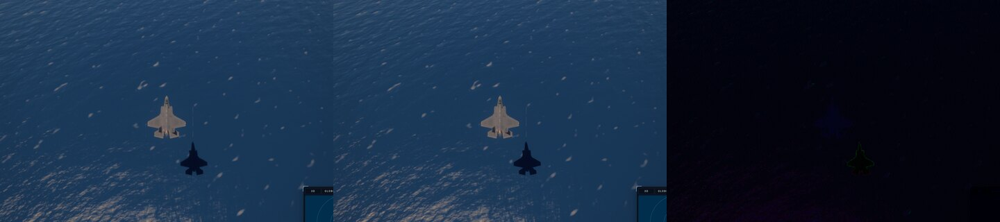

- **Lu** : **aucune traînée derrière l'ombre de l'appareil** ni sur la mer — l'ombre en mouvement tombe au même pixel que dans la
  référence (un liseré d'un pixel à son bord) ; sur la mer, le TAAU est même le plus proche de la référence (les reflets du
  soleil sur les vagues, qui bougent, y sont moyennés au lieu de scintiller).
- **Trouvé en mesurant, hors I3 — des ombres sans rien qui les porte** (*corrigé en Q6m : ce n'étaient pas des ombres d'arbres mais
  le relief s'ombrant lui-même, sa carte vue du Soleil restée en retard sur les fenêtres des maillages*) : sur La Mancha, certaines séries montrent en mouvement des
  ombres en peigne là où rien ne se dresse (65 000 à 85 000 pixels, **dans tous les modes, natif sans historique compris** — ce
  n'est pas l'historique) ; à l'arrêt elles disparaissent. Instrumenté : le décor sans changer de révision, la carte des arbres
  redessinée ~2 images sur 3 en vol (son centre suit la caméra le long du Soleil), lue à chaque image ; la redessiner de force à
  l'arrêt ne les fait pas apparaître ; un vol de 30 images au lieu de 60 non plus. **Cause non trouvée**, intermittente ; une
  enquête à part (la carte d'ombres des arbres et des bâtiments, `tree-shadow.ts`, `scenery-raster.ts`).

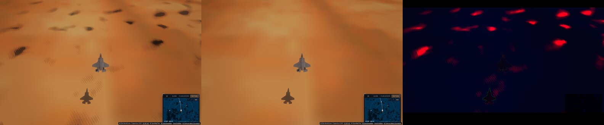

- **Non mesuré** : le coût de la lecture de la carte dans `liteSun` (un test de sphère par pixel, la carte lue seulement dans
  l'ombre de l'appareil) — sous chaleur Heavy, l'écart 24,8 / 25,7 ms d'une même série est dans le bruit. **Vérifié** :
  `kernel-budget` vert, aucune erreur GPU.
- **Reste d'I3** : les transformations précédentes des objets mobiles ne servent pas tant qu'ils restent hors de l'historique ;
  les nuages dans leur propre historique (non mesuré ici, nuages coupés) ; l'enquête sur les ombres sans arbre.

## Q6m — les ombres en peigne au sol en vol : la carte du relief vue du Soleil en retard (le 4 novembre)

- **Correction de Q6l** : les ombres en peigne « sans arbre » n'étaient pas celles des arbres. La vue de débogage des ombres du
  décor (`liteSkip` 8192) restait blanche là où elles tombaient ; mes coupes de Q6l (bits 2, 32) avaient conclu sur des séries
  où le défaut, intermittent, n'était simplement pas apparu.
- **Trouvé** : elles disparaissent avec l'ombre du relief coupée (bit 4 : 0 série sur 3, contre 5 sur 6 sans). Instrumenté
  (`ghost` journalise les redessins des cascades et `dzOff`) : les cascades du relief vues du Soleil (T6) ne sont redessinées
  qu'au pas de leur grille (150 m pour la proche) ou aux recuits des hauteurs (au plus deux par seconde), **les fenêtres des
  maillages laissées hors de leur clé** (« une fenêtre recentrée dessine le même relief »). C'est faux : le géomorphisme (T3)
  suit le bord de la fenêtre, et un lieu passe d'un anneau à un niveau plus fin. Entre deux redessins, la carte gardait un relief
  jusqu'à quelques mètres au-dessus de celui de l'image dans les creux, au-delà de la portée de 2,25 m (3 texels) : le sol s'y
  ombrait lui-même, en peigne (l'acné à la portée). À l'arrêt, le dernier recuit redessinait la carte et l'image redevenait juste.
- **Fait** (`renderer.sunRevision`) : la clé des cascades porte le niveau et la fenêtre du patch et de chaque anneau.
  `renderer.sunWindowsInKey = false` remet l'ancienne clé (pour la mesure) ; `sunBakesEvery` (500 ms) garde le pas des recuits.

| La Mancha, F-35 à 40 m, 60 images à 1/30 s, décor complet | séries avec taches | pixels plus sombres (par série) | redessins / 60 images |
|---|---:|---|---:|
| ancienne clé (contre-épreuve, même session de code) | **2 / 3** | 456 · 90 980 · 25 212 | 6–8 |
| **nouvelle clé** | **0 / 6** | 635 · 1 317 · 446 · 460 · 75 (TAAU) · 485 | 8–11 |
| avant (séries Q6l, ancienne clé) | 5 / 6 en natif | 65 000 à 85 000 quand elles apparaissent | 6–7 |

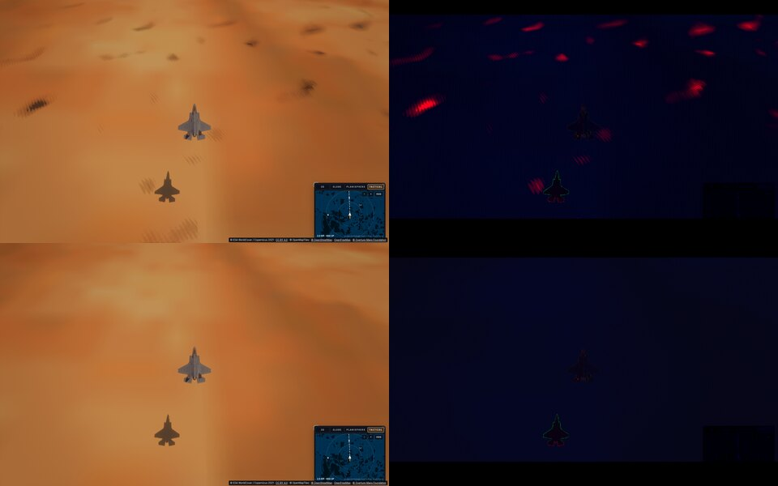

- **Coût** : la passe « terrain from the Sun » mesurée à 0,7–1,2 ms par redessin (chaleur Heavy, moyenne glissante du
  profileur), ~9,5 redessins par 60 images au lieu de ~6,5 : **estimé** +0,05 ms par image en moyenne ; non visible dans le temps
  d'image total (le bruit sous Heavy le dépasse). **Non mesuré** à froid ni sur kerr-mini.
- **Vérifié** : tests `terrain*`/`raster*` verts (40), `tsc`, `biome`. **Reste** : les recuits des hauteurs toujours au plus deux par
  seconde (un relief fin arrivé en vol peut encore laisser la carte en retard un demi-seconde) — pas observé dans ces séries.

## Q6n — les recuits des hauteurs suivis à chaque fois par les cascades du relief (le 4 novembre)

- **Le reste de Q6m** : la clé des cascades ne prenait un recuit des hauteurs qu'une fois par demi-seconde. Mesuré (`ghost`, La
  Mancha, décor complet, 60 images, mode natif, `sunBakesEvery` à 500 puis 0 ms, même code) :

| `sunBakesEvery` | séries avec taches | pixels plus sombres | recuits / 60 images | redessins / 60 images | passe « terrain from the Sun » |
|---|---:|---|---:|---:|---:|
| 500 ms (avant) | **2 / 5** | 14 625 · 471 · 26 375 · 444 · 462 | 5–6 | 8–11 | 0,69–1,08 ms le redessin |
| **0 (chaque recuit)** | **0 / 5** | 489 · 571 · 672 · 439 · 468 | 5–6 | 7–9 | 0,67–0,83 ms le redessin |

- **Lu** : les mêmes peignes, plus rares (la carte au plus une demi-seconde en retard sur un recuit) ; suivre chaque recuit ne
  redessine pas plus — en vol bas sur un monde chargé, ~3 recuits par seconde, ceux des fenêtres qui bougent déjà.
- **Fait** : `renderer.sunBakesEvery` 0 par défaut (une fois par image au plus, par construction de la clé).
- **Non mesuré** : pendant l'arrivée des tuiles (un recuit à presque chaque image possible : jusqu'à ~1 ms par image le temps du
  chargement, chaleur Heavy). `sunBakesEvery` le borne si besoin.
- **Mesuré ensuite (le 4 novembre, `bakes-loading`, kerr-mini)** : pendant l'arrivée des tuiles. L'avion est posé à 40 m sur La
  Mancha sans rien de chargé (page rechargée à chaque passage), puis tenu en palier : pilote automatique, manette automatique,
  train sorti. Avant ça, Sam l'a vu se cabrer sans pilote ; l'assiette est désormais consignée (0,3–7,6°) avec la hauteur (21–47 m,
  le relief arrivant sous lui). Le vol dure 150 images au pas de 1/30 s :

  | `sunBakesEvery` | recuits | redessins | passe « terrain from the Sun » (somme) | moyenne / pire redessin |
  |---|---:|---:|---:|---|
  | 0 | 58 | 42 | 100,0 ms | 2,38 / 3,37 ms |
  | 500 | 80 | 37 | 67,9 ms | 1,84 / 2,75 ms |
  | 0 | 85 | 49 | 79,0 ms | 1,61 / 2,30 ms |

  Suivre chaque recuit coûte 5 à 12 redessins de plus en 5 s, soit environ +0,07 à +0,2 ms par image en moyenne pendant le
  chargement, sur le M1 du mini. Le pire redessin reste du même ordre ; l'écart entre les deux passages à 0 est de la même
  taille. **`sunBakesEvery` reste à 0** : les ombres en peigne disparaissent pour ce prix.

## Q6o — les nuages dans leur propre historique, mesurés (I3, le 4 novembre)

- **Mesuré** (`ghost`, nouveau lieu `clouds` : La Mancha nuageuse — `weather` cloudy, couverture 1 —, 900 m, vue presque à
  l'horizontale derrière l'appareil, décor complet ; 60 images à 1/30 s ; en ligne droite puis `TURN=40` — le cap tourné de 40° au
  départ, l'appareil incliné, l'image qui roule) : le décalage des bords des nuages entre l'image en mouvement et sa référence,
  par recalage de trois zones.

| | PSNR en mouvement | PSNR immobile | décalage des bords (3 zones) |
|---|---:|---:|---|
| ligne droite · spatial 75 % | 33,7 dB | 38,3 dB | (0, −2) · (−3, −3) px |
| ligne droite · TAAU 75 % | 36,4 dB | 38,7 dB | du même ordre |
| ligne droite · natif 100 % | 37,4 dB | 38,5 dB | du même ordre |
| virage 40° · spatial 75 % | 37,4 dB | 38,8 dB | (1, −1) · (−5, −1) · (0, 0) px |
| virage 40° · TAAU 75 % | 37,6 dB | 37,8 dB | (0, −1) · (−3, −2) · (0, 0) px |

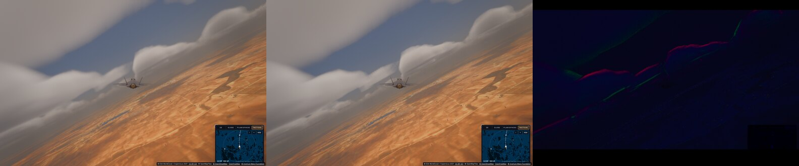

- **Lu** : les nuages en retard de 1 à 3 px environ sur leur place exacte (l'image immobile elle-même à ±1 px de la référence),
  le même dans tous les modes (c'est leur passe propre, `encodeCloudHistory`, pas le TAAU) ; aucune traînée visible, liseré fin
  à leurs bords. **Rien à corriger.** (Ligne droite en spatial : 33,7 dB, l'écart surtout au sol, pas aux nuages.)

- **La route du sol tracé absente du sol raster** (vue en Q6l, La Mancha) : examinée — le sol tracé peint par-dessus l'imagerie les
  surfaces OpenStreetMap (`earthGround` : `scenerySurface`, routes, rails, eaux), `shadeLite` ne les lit que pour l'éclairage
  nocturne des rues (`sceneryRoadLight`). En raster, les routes ne sont que celles de la photo — ici floue (pas d'orthophoto
  nationale en Espagne). **Écart connu, déjà au plan : Q3 B4** (« les routes là où la sémantique est fiable : un `scenerySurface`
  allégé ou une passe de décalques », ANALYSE-TERRE-UNREAL §B4) ; non commencé. Hors de Q6.

## Q6p — le flou de pose à temps de pose fixe, désactivé par défaut (I6 A4, décision 38 (3), le 4 novembre)

- **Avant** : `motionBlur` 0,5 par défaut (actif) et compté en **part de l'image** : le flou valait la moitié du déplacement d'une
  image — deux fois plus long à 30 images/s qu'à 60, autre chose à chaque cadence.
- **Fait** : `motionBlur` **0 par défaut** (décision 38 (3) : une option pour les replays et les vidéos) ; sa valeur est une **pose
  fixe** — cette part d'une image à 30 images/s (0,5 : 1/60 s, l'obturateur à 180°) : `renderer.shutterShare` passe T/dt à la passe
  (au plus 2), le flou vaut vitesse × T à toute cadence (un à-coup ne s'étale pas plus). L'aide du réglage dit la pose (FR + EN).
- **Vérifié** (nouvel e2e `motion-blur`, headless, en temps réel : la vue tournant autour du F-35 à 60° par seconde) : le défaut à
  0 ; la netteté du sol 464 sans flou, **302 à 0,5 et 60 images/s, 251 à 0,5 et 30 images/s** — un écart de 17 % entre les cadences
  (la part d'image aurait doublé la longueur du flou à 30). Les vues des trois prises ne sont pas exactement les mêmes (temps réel).

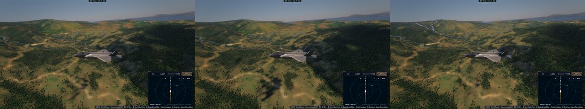

- **Vu, non traité** : un fin damier sur le sol quand le flou est actif (la marge de rendu de 40 px qu'il ajoute ?) — relevé sur une
  prise en vol pas à pas, à examiner si l'option sert.

## Q6q — le HUD minimal du mode GoPro (I8, décision 32 (6), le 4 novembre)

- **Fait** : `settings.goproHud` (Rendu › Image « HUD GoPro », visible avec l'objectif GoPro ; FR + EN) — **Désactivé par défaut**,
  **Minimal** en option : une ligne — vitesse sol, altitude au-dessus de la mer (`geoNow`), cap — dans les unités du joueur
  (`unitsFor`), **dans la marge basse du bandeau**, comme la bande de données d'une caméra embarquée : jamais sur l'image (le HUD
  du cockpit reste masqué, ses repères ne tomberaient pas sur le monde courbé). Écrite cinq fois par seconde (`main.ts`
  `goproStrip`, `#gopro-hud`).
- **Vérifié** (`gopro`, headless) : absent par défaut ; demandé, « 189 M/S 892 M 020° » centré dans la marge basse (y 674 px,
  sous le bandeau qui finit à 628 px) ; le coût de l'objectif, ce passage : 1,22 × la vue rectiligne (14,0 contre 11,5 ms).

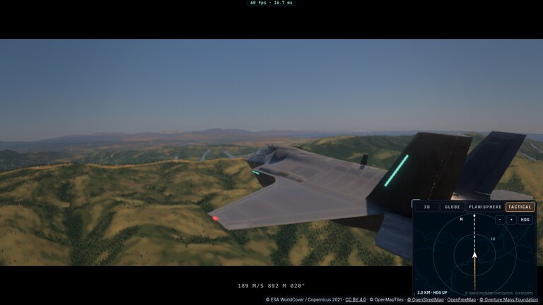

- **Reste du GoPro** : le rendu limité aux rangées du bandeau ; la sélection au pointeur dans la vue courbée.

## Q6r — le mode GoPro ne rend que les rangées du bandeau (I8, le 4 novembre)

- **Constat** : les coins du bandeau tombent au bord du rendu par construction (`GOPRO_SRC_TAN`) ; la vue courbée ne lit que les
  rangées à ±(aspect / 2,39) du milieu — 74 % de la hauteur à 16:9, 98 % à 21:9 (`tests/lens.test.ts` le vérifie, quatre formats).
- **Fait** : `lens.ts goproRowShare` (cette part, 2 % de plus pour le filtre de l'affichage) ; `main.ts` rend une cible de cette
  hauteur, le champ vertical réduit d'autant (`goproRenderFov` sur l'aspect du rendu) ; `display.wgsl` relit la source avec
  l'aspect du rendu (`lensB.y`).
- **Vérifié** (`gopro`, headless) : le rendu GoPro 1 152 × 491 au lieu de 1 152 × 648 (**−24 % de pixels**), l'image identique
  (même géométrie, planche ci-dessous : Q6j à gauche, Q6r à droite), marges noires, HUD minimal en place ; **le coût de ce passage
  1,03 × la vue rectiligne** (12,2 contre 11,9 ms) — 1,22 × au passage précédent de Q6q, 0,94–1,14 × en Q6j : des passages isolés
  sous chaleur, pas un A/B.

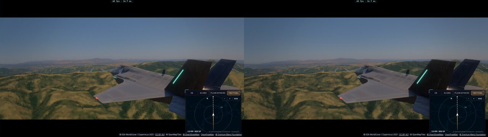

- **Reste du GoPro** : la sélection au pointeur dans la vue courbée.

## Q6s — la sélection au pointeur à travers l'objectif GoPro (I8, le 4 novembre)

- **Avant** : un clic dans la vue courbée (choisir un astre, l'ISS) lisait le rayon par la projection rectiligne du canvas — à
  côté de ce que montre l'image dès qu'on s'écarte du centre (100° de champ comprimés au bord).
- **Fait** : `lens.ts goproLook` — le point du canvas ramené au point du rendu rectiligne que l'affichage y montre (la même
  `lensSource`, les rangées `goproRowShare`), avec le champ et l'aspect du rendu ; `controller/rotation.ts canvasLook` le prend
  quand l'objectif courbe la vue (`camera.lensOn`, posé par `main.ts`) : `pickAt` et `pickIss` ; rien hors du bandeau.
- **Vérifié** : `tests/lens.test.ts` — le centre au centre, le coin du bandeau au bord du rendu, rien au-dessus du bandeau,
  rectiligne près de l'axe (le décalage × 1 / (f · tan)) ; `tsc`. **Non vérifié en e2e** (cliquer un astre dans la vue courbée).
- **Le mode GoPro de la décision 38 est complet** : objectif, bandeau, HUD minimal, rendu des seules rangées utiles, sélection.

## Q6t — les rayures de la verrière du profil Caméra (I6 A2, le 4 novembre)

> **Réouvert sur retour de Sam (4 novembre, décision 40 du plan)** : les rayures ne paraissent pas réalistes et
> n'apportent rien. L'implémentation et les mesures ci-dessous sont conservées comme historique ; elles ne constituent
> plus une acceptation de qualité. Conserver seulement une version AAA au bénéfice photoréaliste démontré sur des
> références et en mouvement ; sinon retirer l'effet. Le plan prévoit la désactivation par défaut en attendant cette
> preuve. **Aucun changement runtime n'est effectué par cette note.** Voir le volet Q6t du plan pour les critères.

- **Fait** (`display.wgsl canopyScratches`) : les fines rayures de l'acrylique, visibles seulement là où une lumière forte passe
  derrière elles — l'éblouissement du Soleil, un nuage au soleil (les niveaux larges du bloom, comme la poussière de l'objectif) :
  des traits fins en cellules de ~26 px, chacun son angle, sa longueur, son intensité ; rien ailleurs (aucun trait parcouru là où
  rien ne les éclaire). **Profil Caméra en cockpit seulement**, et seulement à travers la verrière (là où l'image du cockpit ne
  cache pas l'extérieur) ; `renderer.canopyScratches` (1) leur force, 0 les coupe.
- **Vérifié** (nouvel e2e `canopy-scratches`, headless : le cockpit du F-35 face au Soleil, Tarifa 10 h UTC, figé, exposition
  posée ; mesuré sur des blocs de 8 × 8 — le grain moyenné) : 638 blocs éclaircis de plus d'un niveau, **+0,69 niveau en moyenne
  dans le dixième le plus clair (autour du Soleil), +0,09 ailleurs** ; en Neutre, aucun (1 bloc, le bruit).
- **Non mesuré** : leur coût (la passe d'affichage ; les traits parcourus seulement sous l'éblouissement).

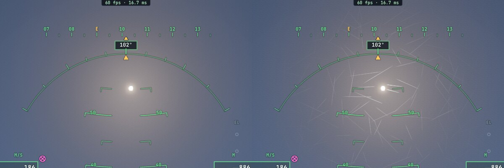

## Q6t (suite) — comment rendre les rayures de verrière photoréalistes : l'analyse (décision 40, le 4 novembre)

**État** : le code de Q6t gardé, **désactivé par défaut** (`renderer.canopyScratches = 0`, décision 40) ; l'e2e `canopy-scratches`
le pose lui-même. Ce qui suit est une analyse, rien n'est encore fait.

### Pourquoi la version actuelle ne peut pas l'être

- **Collée à l'écran** : des traits en cellules de 26 px de l'image (`display.wgsl`), pas sur le verre. Ils ne bougent pas avec la
  tête, ne changent pas de taille avec la distance du verre, se répètent en grille, changent d'échelle avec la résolution.
- **Mauvaise physique d'allumage** : allumés par le halo du bloom autour de tout ce qui est clair. Une vraie rayure ne s'allume que
  si **son orientation** satisfait la géométrie Soleil–œil ; d'où l'aspect réel : **des arcs concentriques centrés sur le Soleil**
  (le « halo de rayures de polissage » des verrières et des pare-brise), pas un semis de traits uniformément éclairés.
- **Pas de référence** : nos deux vidéos (F-35A Ocean City, Typhoon RAF) montrent face au Soleil un voile laiteux, les reflets de
  l'intérieur et des salissures ; **pas de rayures nettes**. Il en faut d'autres (ci-dessous).

- **Constaté en mesurant (I4)** : actives par défaut de `326a7b00` à `7f71ab24`, elles ont **pollué les campagnes d'échelle I4**
  (`motion-quality`, au cockpit) — des traits clairs collés à l'écran, allumés par le ciel et la neige **loin du Soleil** (les
  Alpes) : les rapports de netteté incohérents (0,4 à 3,5 sur des images immobiles). Ces campagnes sont écartées et refaites.

### La physique à reproduire

Une rayure fine de l'acrylique (quelques dizaines de µm) est un **diffuseur linéaire** : la lumière qui la traverse ressort sur un
**cône autour de sa tangente t**, de même angle que la lumière incidente. Le pilote voit donc la rayure briller là où
**t · (v + l) ≈ 0** (v vers l'œil, l vers le Soleil, au point du verre) ; la largeur du lobe dépend du profil de la rayure. Pour des
rayures d'orientations variées, les points qui vérifient la condition dessinent **des arcs autour de la direction du Soleil** — ce
que montrent les photos de cockpit au soleil. Loin de cette condition, la rayure reste presque invisible ; un ciel couvert ne la
montre que faiblement (une diffusion large) ; la nuit, les phares et les feux de piste allument les leurs.

### La chaîne proposée (sur le verre, pas à l'écran)

1. **Une carte de rayures dans l'espace du verre** : une texture précalculée sur l'UV de la verrière du F-35 (`fsJetGlass`, matériau
   32), à une **échelle déclarée en mètres** (la verrière ~1,5 × 3,5 m) : par texel, la **direction moyenne** des rayures et sa
   **cohérence**, et leur **couverture**. Population réaliste : surtout des **tourbillons de polissage** (arcs de 5–30 cm de rayon,
   le chiffon de nettoyage), quelques **rayures droites longues**, plus denses là où l'on essuie (devant le pilote, au bas du verre).
   Générée hors du jeu (un script, déterministe), mipmappée **en moyennant les directions** : la cohérence baisse aux mips grossiers,
   le lobe s'élargit, l'énergie se conserve (l'idée du LEAN/Toksvig) — **pas de scintillement ni de changement de taille** avec la
   résolution ou la distance.
2. **L'éclairage au point du verre** : `rayures = couverture × lobe(t · normalize(v + l), largeur(cohérence)) × E_soleil` — la
   lumière clé de la sonde (`sh[11]`, sa direction `sh[9]`), transmise par le verre, nulle si le Soleil est caché par la structure
   ou derrière le pilote ; plus un terme faible de ciel (la sonde moyenne) pour le ciel couvert. Ajouté dans `fsJetGlass` à la
   lumière du verre, **dans le monde** : ancré au verre, il bouge juste avec la tête et l'appareil, il est dans la profondeur, il passe
   par le TAAU comme le reste de l'appareil (dessiné après : pas d'historique, donc net et stable).
3. **Retirer la version d'écran** une fois la nouvelle acceptée (`display.wgsl canopyScratches`, son uniforme, son e2e) : une seule
   responsabilité, le verre de l'appareil.
4. **Ensuite seulement** : le pare-brise de l'A320, le verre du Ranger — la même carte, leurs UV.

### Les références et la porte (décision 40)

- **Références à chercher** (Claude propose, Sam valide, comme la décision 38 (4)) : 2–3 extraits publics (DVIDS, domaine public ;
  OGL) de **GoPro de cockpit face au Soleil où les rayures se voient** — le halo en arcs —, plus un extrait sans Soleil (couvert) et
  un de nuit si possible. Mesurer : rayon angulaire et étendue du halo, contraste rayures/ciel, densité visible.
- **Comparaisons** : sans / candidat / référence à exposition et cadrage tenus ; Soleil de face, de côté, couvert, nuit ; tête qui
  tourne et appareil qui roule ; deux résolutions. HUD et instruments lisibles. Coût complet mesuré (estimé : un accès texture et
  quelques opérations par pixel de verre au cockpit, ~0,05–0,1 ms visé ; à mesurer).
- **Porte** : Sam juge l'apport sur ces comparaisons et en mouvement ; sinon retrait.

### Ce qui se réutilise

La verrière et son UV (`fsJetGlass`), la lumière clé et la sonde (`sh[9]`, `sh[11]`, `envSpec`), la profondeur et le masque du
cockpit ; de Q6t, l'idée de n'allumer qu'en lumière forte et l'e2e (à refaire contre la condition t · (v + l), pas contre le bloom).

### Le prototype sur le verre (le 4 novembre, désactivé par défaut — décision 40)

- **Fait** (`ship.wgsl canopyScratchLight`, dans `fsJetGlass`, la verrière du F-35 vue de l'intérieur ; `renderer.canopyScratches`,
  0 par défaut ; l'essai d'écran gardé pour comparer sous `canopyScratchesScreen`, 0) :
  - **sur le verre, à son échelle** : trois projections du repère de la pièce [m] (le dessus, les côtés, le pare-brise), choisies par
    la normale ; dans chaque cellule de 6 cm, **8 tourbillons de chiffon** (des arcs de cercles de 2 à 10 cm, chacun une part de son
    tour) et une rayure droite ; leur largeur (20 µm) sur l'empreinte du pixel sur le verre — l'énergie juste à toute résolution ;
  - **allumés par la physique** : la tangente de chaque rayure ramenée au repère de la caméra par les dérivées de l'écran (la
    transformation de la pièce, quelle qu'elle soit), allumée où t · (v + l) ≈ 0 (σ 0,015), diffusée vers l'avant
    (½(1 − v·l))¹⁰ ; **un voile** en 1/|v + l| — la somme des rayures trop fines pour être vues une à une —, le Soleil (la lumière
    clé de la sonde) seul.
- **Une erreur corrigée en route** : la tangente passée par la matrice de l'appareil (`S.model`) seule — même image, la transformation
  de la pièce était donc déjà dedans ; les dérivées gardées (plus sûres). Lu d'abord à tort comme des traits rayonnants : ce sont bien
  des segments tangents aux cercles autour du Soleil.
- **Observé** (`canopy-scratches`, cockpit face au Soleil, Tarifa, figé) : des **fragments d'arcs fins rangés autour du Soleil**,
  serrés près de lui, éteints au loin ; le profil Neutre, rien.

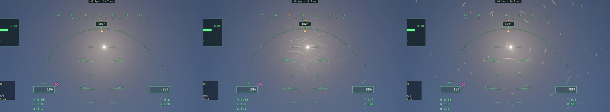

- **Non établi** : leur crédibilité face à des références (aucune vidéo où les rayures se voient : YouTube refuse le téléchargement,
  HTTP 403 ; DVIDS à essayer) ; **le mouvement** (tête qui tourne, appareil qui roule — scintillement ?) ; **le coût** (le GPU de ce
  passage 11,3 ms avec, 13,7 sans, deux prises Neutre 10,0 et 13,2 : le bruit domine — un A/B à faire) ; le Soleil caché par la
  structure (non testé : il les allumerait encore). **La porte de la décision 40 reste à Sam.**

## Q6u — I4 complet : l'échelle en mouvement tenue à 75 % (mesuré, le 4 novembre)

- **La question** (plan : « l'échelle n'est abaissée que si les scènes critiques le permettent ») : avec le TAAU (son historique à la
  taille de sortie), le gouverneur pourrait-il descendre sous les 75 % du raster en mouvement quand l'image dépasse son budget ?
- **Mesuré** (`motion-quality`, kerr-mini au frais, le même vol pour chaque mode, 90 images pas à pas, le monde chargé ;
  `taau625q`, `taau50q` ajoutés) — **après deux campagnes écartées** : les rayures d'écran de Q6t alors actives, puis le **grain du
  profil Caméra** (automatique en vol depuis Q6g, un grain neuf à chaque image) brouillaient la mesure ; `motion-quality` et `ghost`
  posent maintenant le profil Neutre. Données : [Q6/q6u-i4-mini.json](Q6/q6u-i4-mini.json).

| kerr-mini | 75 % | 62,5 % | 50 % |
|---|---:|---:|---:|
| Tarifa bas — PSNR / netteté en mouvement | 43,8 / 0,92 | 41,9 / 0,87 | 39,4 / 0,71 |
| **Alpes** | 43,9 / 0,97 | **38,9 / 0,91** | 33,4 / 0,85 |
| Détroit | 48,5 / 1,06 | 47,3 / 1,05 | 46,5 / 1,02 |
| GPU Tarifa / Alpes / détroit [ms] | 50,5 / 39,6 / 57,3 | 38,6 / 31,5 / 44,0 | 29,7 / 25,0 / 33,0 |

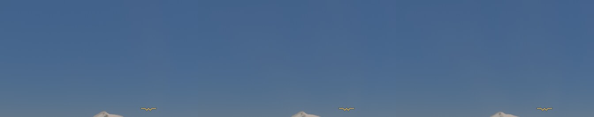

- **Lu** : 62,5 % gagne 20 à 24 % du GPU mais **coûte 5 dB aux Alpes** (le relief, la scène critique) et passe Tarifa sous 0,9 de
  netteté ; 50 % beaucoup plus. **Les scènes critiques ne le permettent pas** : l'échelle en mouvement reste à 75 % avec le raster
  (le gouverneur l'y tient déjà, `main.ts` : `rasterLiteActive` → `rasterTop`) — **aucun palier ne change en vol, donc aucune
  impulsion de flou**. Aucune modification du code.
- **Pour les 60 images/s** : le mini est à 40–57 ms à 75 % — loin du budget ; le gain doit venir du coût des passes (Q1, Q9), pas
  d'une échelle qui retire du détail. (L'immobile refine à pleine échelle, comme avant.)
