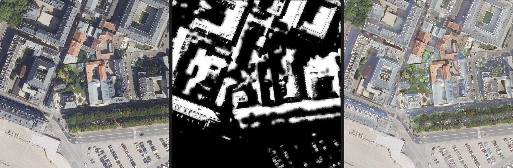
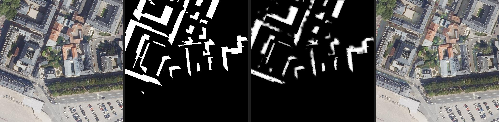
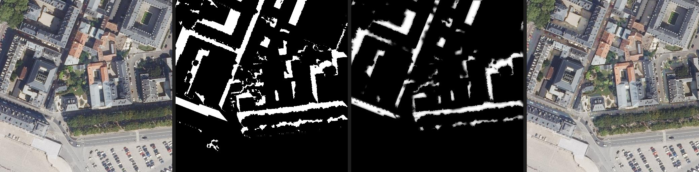
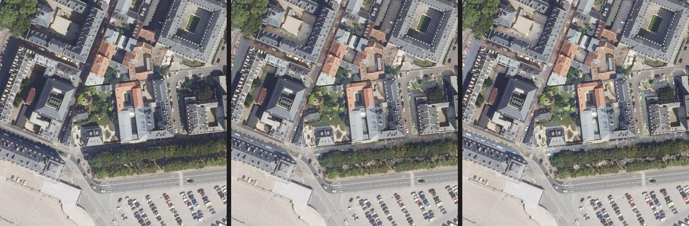
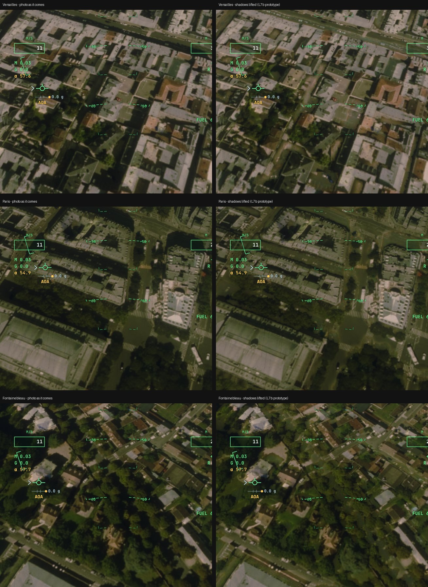
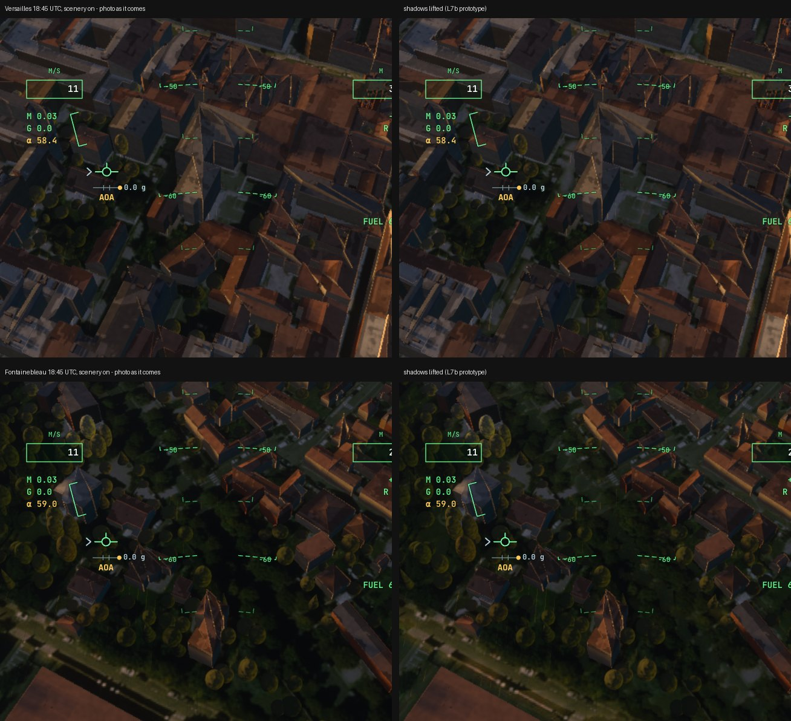
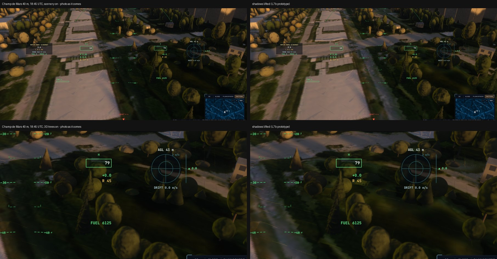
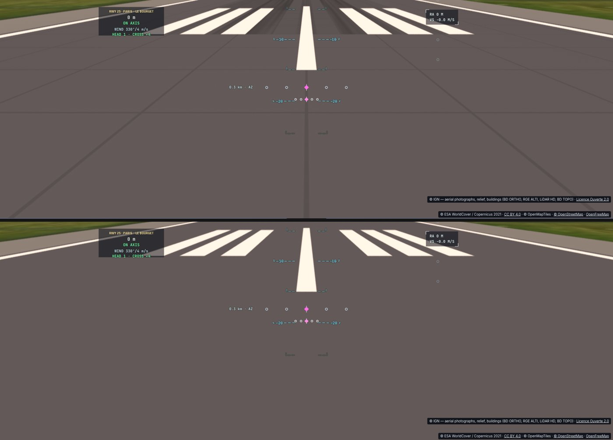
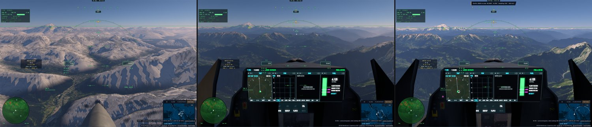
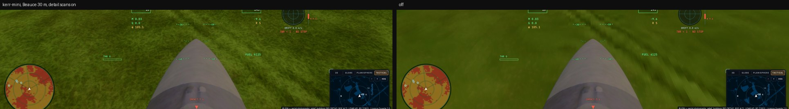

# Q7 — les photos et le sol de près

## L7b, l'étude (décision 19) : première phase, l'image seule (5 novembre)

Le go/no-go chiffré de la décision 19 : un halo inférieur à 1 m, le bruit des zones relevées inférieur à 1,5 fois celui des
zones au soleil, plus aucune double ombre au couchant.

**La méthode essayée** (`scripts/l7b-study.py`, hors du jeu) : les étapes 3 à 5 du §9 de l'analyse Unreal, **sans**
l'étape 2, la prédiction des ombres par notre décor.
- Le masque d'ombre : une luminance basse (seuil d'Otsu sur son logarithme) et un rapport bleu/rouge au-dessus de la
  médiane, nettoyé (médian 3 × 3), adouci (gaussienne de 1 px), puis guidé par l'image (filtre guidé, r = 3).
- k par couleur : la médiane soleil/ombre dans des anneaux de 2 à 5 px de part et d'autre des bords, borné entre 2 et 10.
- Le relèvement : I′ = I · (1 + (k − 1) α).

**Sur 4 tuiles IGN z18** (Versailles, 512 × 512 px à 0,39 m) :

| | mesuré | critère |
|---|---|---|
| k (rouge, vert, bleu) | 5,18 · 4,95 · 3,79 | 3–8, plus au rouge (§9) : conforme |
| ombre/soleil avant → après | 0,10 → 0,47 | 1 si l'ombre a disparu |
| bruit des zones relevées / zones au soleil | 1,16 | < 1,5 : tenu |
| halo au bord des ombres | 0,4 m | < 1 m : tenu |

**Le verdict de cette phase : no-go pour l'image seule.**
- Le masque prend pour des ombres les **toits d'ardoise gris-bleu** et une partie des arbres : sombres et bleutés comme
  une ombre. Le relèvement les éclaircit et bleuit les feuillages.
- Les ombres vraies ne sont relevées qu'à moitié (0,47) : la pénombre et le masque trop large diluent k.

C'est exactement le faux positif que le §9 attribuait à l'image seule : **la porte de la prédiction par le décor (étape 2)
est nécessaire.**

**La phase suivante de l'étude (encore 1 à 1,5 jour) :**
- le Soleil de la prise de vue : la date du graphe de mosaïquage de la BD ORTHO, ou la recherche sur une vingtaine de
  Soleils candidats ;
- les ombres prédites, rendues depuis ce Soleil par les bâtiments BD TOPO et la canopée MNH que le jeu a déjà, projetées
  sur la tuile ;
- le masque = prédit (ou voisin d'un prédit) **et** sombre-bleuté ;
- les mêmes mesures, puis une prise au couchant en jeu pour la double ombre.

Le go/no-go final se prendra là.

## L7b, l'étude : deuxième phase, la prédiction par les bâtiments (5 novembre)

**La méthode** (`scripts/l7b-bdtopo-footprints.ts`, `scripts/l7b-study-decor.py`) : les étapes 1 à 5 du §9, avec les seuls
bâtiments.
- Les emprises et les hauteurs de la BD TOPO (la tuile z15 du jeu, `bdtopoHeight` : 680 bâtiments) sont rastérisées sur la
  grille de l'orthophoto.
- Leurs ombres sont projetées pour 104 Soleils candidats (azimut 120–240°, élévation 30–65°), puis affinées. On garde celui
  dont les ombres recouvrent le mieux les pixels sombres et bleutés hors des toits.
- Le masque = prédit à l'ombre (ou à moins de 3 px d'une ombre prédite) **et** sombre-bleuté, hors des toits. k et le
  relèvement comme en phase 1.

| | image seule (phase 1) | avec la prédiction (phase 2) | critère |
|---|---|---|---|
| toits pris pour des ombres | oui (ardoises) | **0 %** | aucun |
| bruit des zones relevées / zones au soleil | 1,16 | **0,57** | < 1,5 |
| halo au bord des ombres | 0,4 m | 0,53 m | < 1 m |
| ombre/soleil avant → après | 0,10 → 0,47 | 0,11 → 0,41 | 1 si l'ombre a disparu |
| k (rouge, vert, bleu) | 5,18 · 4,95 · 3,79 | 4,13 · 3,98 · 2,39 | 3–8 |

- **Le Soleil retrouvé :** azimut 140°, élévation 52° (IoU 0,49 entre ombres prédites et pixels sombres). C'est plausible
  pour un vol IGN d'été en fin de matinée. La date du graphe de mosaïquage n'a pas encore été consultée.
- **Ce qui tient :** les toits ne sont plus touchés, le bruit et le halo respectent leurs critères. Les cours et le pied
  des façades au nord-ouest sont relevés sans tache.
- **Ce qui ne tient pas encore :**
  - les ombres ne remontent qu'à 0,41 du soleil : k est sous-estimé. Les paires de bord mêlent des matériaux (façades,
    pavés, pelouse) et la pénombre ; il faut des paires par matériau ;
  - **les ombres des arbres** (l'avenue de platanes) ne sont pas prédites : il faut la canopée MNH, que le jeu a déjà (I4) ;
  - la BD TOPO et l'orthophoto se décalent d'un à deux mètres par endroits : l'ortho n'est pas « vraie », les bâtiments
    penchent. La marge de 3 px le couvre en partie.
- **Recommandation, à confirmer par Sam :** un **go pour la suite de L7b** — la canopée, k par matériau, puis un prototype
  dans le jeu (un compute à l'arrivée des tuiles) et la prise au couchant pour le critère de la double ombre. Le no-go reste
  acquis pour l'image seule.

## L7b, l'étude : troisième phase, la canopée du LiDAR (5 novembre)

- **Réalisé** (`scripts/l7b-study-canopy.py`) :
  - les occultants sont pris dans la MNH du LiDAR HD de l'IGN (`IGNF_LIDAR-HD_MNH…`, la couche que le jeu charge déjà en I4),
    sur la même emprise : arbres et bâtiments en géométrie vraie, de 0 à 27 m ici. La BD TOPO complète là où elle est plus
    haute ;
  - seuls les pixels au sol peuvent être relevés (MNH < 1,5 m, hors emprises) : jamais les couronnes ni les toits ;
  - k est mesuré sur des paires de bord au sol seulement.

| | bâtiments seuls (phase 2) | canopée (phase 3) | critère |
|---|---|---|---|
| recouvrement prédit / sombre (IoU) | 0,49 | **0,68** | — |
| Soleil retrouvé | 140°, 52° | 140°, 50° | cohérent |
| toits, couronnes touchés | 0 % | 0 %, 0 % | aucun |
| bruit relevé / soleil | 0,57 | 0,61 | < 1,5 |
| halo | 0,53 m | 0,53 m | < 1 m |
| k (rouge, vert, bleu) | 4,13 · 3,98 · 2,39 | 5,15 · 4,59 · 2,93 | 3–8 |

- **Ce qui s'ajoute :** les ombres de l'avenue de platanes et celles des jardins sont prédites et relevées.
- **Une mesure à refaire :** le rapport ombre/soleil après correction (0,35) compare l'asphalte à l'ombre à tout le sol au
  soleil, y compris le sable clair de la place : il confond les matériaux. Il faut un test sur des paires de même matériau,
  tenues hors de l'estimation de k.
- **Pour le go/no-go final :**
  - ce test par paires ;
  - plusieurs zones (village, forêt, centre-ville) ;
  - un prototype dans le jeu (un compute à l'arrivée des tuiles d'ortho, la MNH et la BD TOPO déjà chargées) ;
  - la prise au couchant pour le critère de la double ombre.
- **Le test sur paires tenues à l'écart** : k est estimé sur les paires de bord au sol de la moitié gauche (4,28 · 4,06 · 2,37),
  puis éprouvé sur celles de la moitié droite (3 044 paires au soleil, 3 375 à l'ombre). Le rapport ombre/soleil d'un même
  bord passe de **0,15 · 0,17 · 0,27 à 0,66 · 0,70 · 0,65** (1 : l'ombre effacée). La moitié droite demanderait un k
  d'environ 6,5 · 5,8 · 3,6.

  **k varie dans l'espace**, avec les matériaux et la part de ciel vue. Un k par tuile ne suffit pas : il faut un k local
  (par région de quelques dizaines de mètres, ou par classe de matériau), lissé. C'est la prochaine étape de l'étude, avant
  le prototype dans le jeu.
- **Le k local, essayé :** un k par cellule de 64 px (25 m), tiré des paires de la cellule (au moins 20 de chaque côté),
  lissé sur les cellules voisines, le k global là où il n'y en a pas. Il est estimé sur un damier de blocs de 8 px et
  éprouvé sur l'autre couleur du damier.
  - En moyenne sur l'image, les deux reviennent à environ 1 (global 1,02 · 1,00 · 1,04 ; local 1,06 · 0,99 · 1,01), contre
    0,20 · 0,22 · 0,35 avant correction.
  - **Cellule par cellule** (au vert, |log| du rapport ombre relevée/soleil sur les paires éprouvées, 32 cellules) : le k
    global se trompe d'une médiane de 0,45 (un facteur 1,57) et d'un 90ᵉ centile de 1,23 ; **le k local fait pire**
    (0,58 et 1,43). Les cellules ont trop peu de paires.
  - Le bruit des zones relevées reste à 0,67 de celui du soleil.
- **Ce que cela dit :** la géométrie tient (le masque ne touche ni toits ni couronnes), **mais la quantité de relèvement
  n'est pas fiable d'un endroit à l'autre**. Les paires de bord mêlent des matériaux : une ombre portée sur la chaussée,
  face à de l'herbe au soleil. Relevées avec un k faux d'un facteur 1,5, les ombres deviendraient des taches claires ou
  sombres, ce qui est pire qu'une double ombre.
- **État du go/no-go L7b :** pas encore décidable. Il faut apparier les matériaux de part et d'autre du bord : des pixels de
  même chroma, une fois corrigée la teinte bleue de l'ombre, le long de la normale au bord. Ou se limiter à un relèvement
  partiel, l'ombre adoucie d'une fraction sûre, plus robuste à l'erreur de k. Les deux sont à mesurer avec ce même test
  cellule par cellule.

## L7b, l'étude : quatrième phase, les matériaux appariés de part et d'autre du bord (5 novembre)

- **La méthode :**
  - pour chaque pixel du bord d'ombre au sol, un point 3 px à l'intérieur et un 3 px à l'extérieur, le long de la normale
    au bord (le gradient du masque) ;
  - la paire est gardée si les deux points sont au sol et ont **la même chromaticité**, à 0,04 près, une fois ôtée la
    teinte bleue de l'ombre (le point intérieur multiplié par le k global), et si k est plausible (1,5 à 15) ;
  - k est la médiane des paires gardées.
- **Mesuré** (mêmes 4 tuiles, mêmes paires tenues à l'écart par le damier) : 312 paires appariées sur 462 bords.

| k | médiane de l'erreur par cellule (au vert, \|log\|) | 90ᵉ centile |
|---|---|---|
| ordinaire, global (phase 3) | 0,436 (facteur 1,55) | 0,616 |
| apparié, global : **7,51 · 6,80 · 4,47** | **0,117 (facteur 1,12)** | 0,229 |
| apparié, local par cellule | 0,105 | 0,176 |

  Le test ne porte que sur les 6 cellules qui ont au moins 10 paires éprouvées. Le bruit des zones relevées vaut 0,88 de
  celui du soleil (critère < 1,5).

- **Lecture :** apparier les matériaux divise l'erreur par près de 4. Le k apparié (7,5 · 6,8 · 4,5) est plus élevé, comme la
  théorie le veut quand l'ombre ne mêle plus les matériaux. Les cours et le pied des façades sont relevés presque au niveau
  du sol au soleil, sans tache visible ici.
- **État du go/no-go :** les trois critères mesurables hors du jeu sont tenus sur cette zone (halo 0,53 m, bruit 0,88, aucun
  faux positif sur toits et couronnes), et la quantité de relèvement devient fiable à ~12 % près. **Recommandation : go pour
  un prototype dans le jeu**, avec la décision finale après :
  - plusieurs zones (village, forêt, centre dense) ;
  - la prise au couchant pour le critère de la double ombre.

  La décision revient à Sam.

## L7b, le prototype dans le jeu (décision 42, 5 novembre)

- **Fait** (`src/system/ortho-delight.ts`, `earth-tiles.ts delightLater`, `tile-decode.ts`, réglage **Ombres retirées des
  photographies (prototype)**, `settings.orthoDelight`, éteint par défaut) :
  - chaque orthophoto IGN de z 17 et z 18 s'affiche d'abord telle qu'elle arrive ;
  - le jeu demande ensuite le MNH du LiDAR sur sa propre grille de pixels, avec une marge de 96 px (une requête WMS-R de plus
    par tuile, à 6 par seconde) ;
  - un worker à part (pour ne pas retarder le décodage des autres tuiles) refait la méthode de l'étude : le Soleil de la photo
    retrouvé par l'IoU entre les ombres prédites et le sol sombre et bleuté, d'abord autour de celui de la zone puis sur tout
    le ciel ; le masque guidé ; k par paires appariées ; la tuile relevée remplace l'autre ;
  - le Soleil et k sont mémorisés par zone (la tuile z 13). k est la médiane des tuiles de la zone, pour que des tuiles
    voisines soient relevées pareil : avec un k par tuile, une couture était visible à Paris ;
  - différence avec l'étude : l'emprise des bâtiments de la BD TOPO n'est pas utilisée. Le MNH contient déjà les bâtiments, et
    son sol (< 1,5 m) protège les toits.
- **Vérifié :**
  - unitaires (`tests/ortho-delight.test.ts`) : sur une scène construite, le Soleil retrouvé (180° · 42,5°, IoU 0,96) et k
    retrouvé (7,05 · 6,01 · 4,51 pour 7 · 6 · 4,5 posés), l'ombre relevée à ±15 % du sol au soleil, le toit intact ; sans le
    relevé, la tuile reste inchangée ;
  - e2e `ortho-delight` (ce Mac, en fenêtre, raster, 200 m, cockpit à 50° vers le bas, avion masqué, décor 3D coupé pour
    juger la photo seule, 17 h UTC en juillet, figé, exposition tenue) :

  | zone | tuiles relevées | Soleil de la photo (az · haut · IoU) | k | PSNR relevée / telle quelle | PSNR telle quelle / telle quelle |
  |---|---|---|---|---|---|
  | Versailles | 32 / 32 | 144° · 46,5° · 0,74 | 6,6 · 5,3 · 3,1 | 23,4 dB | 38,4 dB |
  | Paris (centre dense) | 32 / 32 | 182° · 49° · 0,45 | 6,0 · 4,8 · 3,2 | 28,2 dB | 43,1 dB |
  | Fontainebleau (arbres) | 32 / 32 | 229° · 45° · 0,67 | 9,1 · 7,2 · 3,9 | 25,9 dB | 41,5 dB |

  Coût : 70 à 110 ms par tuile dans son worker, hors du fil de la page ; ~3 à 5 s pour les 32 tuiles d'une fenêtre. Le temps
  d'image n'a pas été mesuré, mais le travail se fait dans un worker.

- **Lecture :**
  - à Versailles, les rues et les cours noires de la photo laissent voir leur sol, sans toucher aux toits ;
  - à Fontainebleau, le sol sous les ombres des arbres est relevé ; l'image paraît plus plate ;
  - à Paris, l'IoU est plus faible (0,45) : les cours profondes des îlots restent en partie sombres. Leurs ombres dépassent
    sans doute la marge de 96 px (37 m à 0,39 m par pixel) quand le Soleil est bas ;
  - les zones relevées tirent un peu vers l'olive : k bleu est plus faible que k rouge.
- **La prise au couchant, première tentative** (18 h 45 UTC, Soleil du jeu ~12° à l'ouest, décor 3D allumé, mêmes vues) :

  | zone | Soleil de la photo | PSNR relevée / telle quelle | PSNR telle quelle / telle quelle |
  |---|---|---|---|
  | Versailles | 142° · 47,5° · IoU 0,73 | 32,9 dB | 38,1 dB |
  | Fontainebleau | 233° · 44° · IoU 0,66 | 34,5 dB | 45,8 dB |

  **Non concluante pour la double ombre :** vu de 200 m à 50° vers le bas, les bâtiments 3D et les ombres longues du jeu
  cachent presque tout le sol de la photo. La version relevée a des cours et des pelouses un peu plus claires et moins tachées,
  mais la vue ne permet pas de dire si une double ombre a disparu. Il faut une vue au ras d'une pelouse ou d'un parc avec des
  arbres isolés, au roulage ou à 30–50 m.
- **La prise au couchant, au ras d'une pelouse** (Champ-de-Mars, 40 m, regard à 25° vers le bas, cap 150°, 18 h 45 UTC, arbres
  3D du jeu allumés) : 31 tuiles relevées, 1 laissée (Soleil non trouvé) ; Soleil de la photo à 195° · 47° (IoU 0,64) ; PSNR
  29,5 dB contre 42,5 dB de bruit.

  **Observé :**
  - dans la photo telle quelle, l'allée et le gazon entre les arbres portent les ombres sombres de la photo, orientées vers le
    nord, en plus des ombres longues du jeu vers l'est : c'est la double ombre ;
  - relevée, l'allée réapparaît claire et le gazon est uni ; seules restent les ombres du jeu ;
  - ce constat porte sur une vue ; ni le halo ni le bruit n'ont été mesurés dans le jeu.
- **Défaut corrigé en chemin :** à Sceaux, un Soleil à 17° de hauteur avait été accepté (IoU 0,46), alors que le point visé
  tombait dans une rangée d'arbres. La hauteur cherchée est désormais bornée à 28–70° (les vols IGN, du printemps à la fin de
  l'été, près de midi).
- **Pas encore fait, pour le go/no-go final :**
  - un village ;
  - le halo et le bruit mesurés dans le jeu (mesurés seulement hors du jeu dans l'étude) ;
  - le coût d'image sur M1.
- **Limites connues :** une seule marge (les ombres plus longues que 37 m à z 18 sont coupées) ; pas de z 15–16 ; le Soleil
  d'une zone dépend de ses premières tuiles ; la photo relevée remplace la première quelques secondes après son arrivée (un
  changement visible en vol bas).

## G1/G2 : chaque source déclare ce qu'elle est (5 novembre)

- **Réalisé :** `src/system/sources.ts` déclare les 14 sources du sol de la Terre, chacune avec : projection, datum
  vertical (au-dessus de la mer, de l'ellipsoïde, du sol, ou aucun) et son nom (NGF-IGN69, LHN95, EGM96…), modèle (MNT, MNS,
  MNH), résolution, date, masque de validité, repli, lecteur et licence.
  - Les sources : Terrarium, ETOPO 2022, EOX Sentinel-2 2021, Blue Marble, BD ORTHO, RGE ALTI et LiDAR HD (MNT, MNS, MNH),
    SWISSIMAGE, swissALTI3D, BD TOPO, OSM/Overture, WorldCover, EGM2008.
  - Les sources nationales (`NationalSource.declares`) renvoient à leurs déclarations.
  - `overEllipsoid` porte la seule frontière de conversion de la règle WGS84 : max(H, 0) + N pour les hauteurs au-dessus de
    la mer, le sol plus la hauteur pour une canopée.
- **Vérifié** (`tests/sources.test.ts`, 3 tests) : chaque déclaration est complète ; chaque repli est connu, sans boucle ;
  les sources nationales pointent sur leurs déclarations ; la conversion est vérifiée. `earth-tiles` passe (19 tests).
- **Limites :**
  - les lecteurs ne lisent pas encore ce registre : c'est un contrat documenté et testé, pas un aiguillage ;
  - la date de chaque pièce de la BD ORTHO (graphe de mosaïquage) n'est pas lue ;
  - quelques dates sont des périodes approximatives, tirées des commentaires du code et des documents des fournisseurs.

## VIPER B4 : la piste usée (5 novembre)

- **Réalisé** (`trace.wgsl runwayShade`, pistes revêtues), chaque élément estompé quand l'empreinte du pixel le dépasse, la
  moyenne gardée :
  - **la gomme**, en stries le long des traces des trains principaux (2,5 à 7 m de l'axe) et de la roue avant (au centre),
    sur les zones de toucher (150 à 1 300 m de chaque seuil) ; le reste de la zone légèrement assombri ;
  - **des réparations** : dans des cellules de 40 × 15 m, une sur quatre porte un rectangle de revêtement plus neuf ou plus
    vieux ;
  - **les joints des dalles**, tous les 5 m dans les deux sens, des lignes de 10 cm assombries de 12 % ;
  - **un vieillissement inégal** (±8 % sur quelques dizaines de mètres).

  `TUNE_SC_SKIP` 512 rétablit l'ancien assombrissement uniforme (l'A/B).
- **Vu** (e2e `runway-wear`, ce Mac, F-35 aligné sur la 25 du Bourget à 120 m du seuil, cockpit, 6° vers le bas) :

  

  En haut, les joints des dalles, la trace de la roue avant au centre, la gomme en stries vers la zone de toucher. Les
  joints, d'abord assombris de 20 %, étaient trop marqués de près : ramenés à 12 % (pas reprise après ce changement).
- **Trouvé en chemin** : `patch` est un mot réservé de WGSL. Le premier jet ne compilait pas, ce que Sam a vu
  dans un diagnostic ; la variable est renommée.
- **Non mesuré :** le coût. La lecture de l'A/B était invalide : le noyau se recompilait pendant la fenêtre de mesure de
  la prise « ordinaire ».
- **Limites :** les joints sont dessinés sur toutes les pistes revêtues, alors que beaucoup sont en enrobé et non en
  dalles : il faudrait le revêtement par piste. Les éclats et les traces de freinage ne sont pas faits.

## L9, premier lot : la neige de saison sur le sol proche (5 novembre)

- **Réalisé** (`trace.wgsl seasonSnow`), une même fonction pour le sol tracé (`earthGround`) et le sol raster (`shadeLite`),
  qui n'avait jusqu'ici aucune neige :
  - **la saison** vient de la déclinaison du Soleil, lue dans sa direction sur les axes du corps, que les deux chemins ont
    déjà : aucun paramètre ajouté. C'est l'hiver quand le Soleil est du côté de l'autre hémisphère ;
  - **la ligne de neige** glisse de celle d'été (`snowLineAt`) vers celle d'hiver (`snowWinterAt` : 900 m vers 46°, le
    niveau de la mer vers 60°). Elle est déchiquetée, et la neige ne tient pas sur les pentes raides ;
  - **seule la neige de saison s'ajoute** : la neige permanente est déjà dans les photographies, prises en été. Elle se pose
    aussi sur les orthophotos ;
  - **la forêt** (sombre et verte dans la photographie) n'en garde qu'un tiers : ses couronnes en tiennent peu, et la neige
    du sol y est à demi cachée. Les arbres en 3D ne sont pas enneigés ;
  - **les routes et les pistes** sont dessinées après la neige : elles restent dégagées.

  `TUNE_SC_SKIP` 1024 coupe la neige de saison (l'A/B).
- **Vu** (e2e `season-snow`, ce Mac, cockpit au-dessus du bassin d'Annecy et des Bornes à 2 500 m, 20° vers le bas, midi) :

  

  En janvier, le relief au-dessus d'environ 900 m est enneigé, les forêts plus sombres, le fond de la vallée vert. En
  juillet et sans la fonction, rien ne change. Luminance moyenne du sol : 0,323 en janvier avec la neige, 0,171 sans,
  0,190 en juillet.
- **Limites :**
  - la première prise n'a pas le même cadrage (le tableau de bord du cockpit n'y est pas) : le chiffre de janvier compte
    plus de sol ;
  - pas de décalage saisonnier : le manteau du printemps fond comme la déclinaison remonte ;
  - les cartes lointaines (Blue Marble) ne suivent pas la saison ;
  - les toits, les arbres en 3D et l'herbe ne sont pas encore enneigés ;
  - aucune observation de la neige réelle n'est encore utilisée (prochaine étape de L9).
- **Non mesuré :** le coût.

### L9, deuxième lot : la neige sur les toits et les couronnes (5 novembre)

- **Réalisé** (`shadeLite`) : la même neige de saison (`seasonSnow`, prise à plat) sur ce qui se dresse. Les toits tournés
  vers le ciel la portent entière (selon leur inclinaison) ; le sommet des couronnes d'arbres en porte au plus 60 %.
  `TUNE_SC_SKIP` 1024 la coupe avec celle du sol.
- **Mesuré** (e2e `season-snow`, au-dessus d'Annecy, `SS_LON` 6,13) : luminance moyenne du sol 0,302 le 15 janvier, 0,180
  sans la neige, 0,199 le 15 juillet. Aucune erreur GPU.
- **Non vérifié de près :** à 2 500 m, toits et couronnes ne font que quelques pixels.

## L8 (VIPER B3), premier palier : les scans de détail du sol (5 novembre)

- **Fait :**
  - **assets** (`scripts/build-detail-scans.py` → `assets/detail/*.ktx2`, Git LFS) : cinq matériaux CC0 d'ambientCG — herbe
    (Grass004), terre (Ground054), gravier (Gravel022), roche (Rock035), asphalte (Asphalt012) —, en 512², linéaires, avec
    leurs mips. R porte le rapport de luminance à la moyenne du scan, remise à 1 après plafonnement ; G et B la normale
    (x, y). Environ 340 Kio chacun, 1,7 Mo en tout ;
  - **GPU** (`src/system/detail-scans.ts`, `withDetailScans`) : un tableau de textures en liaison 49, là où l'appareil
    accepte 33 textures (sinon un stub neutre). Lecture en mélangeant deux niveaux de mip : le noyau de calcul n'a pas de
    dérivées ;
  - **dans `shadeLite`** (`groundDetail`, `detailMaterial`) :
    - l'albédo de la photo est multiplié par le rapport du scan à trois échelles (4 m, 32 m tournée de 37°, 512 m tournée de
      71°), chacune estompée quand ses texels passent sous l'empreinte du pixel ;
    - la normale est légèrement inclinée par celle du scan ;
    - le matériau suit la couleur de la photo (vert : herbe, brun : terre, beige clair : gravier, gris clair : roche, gris
      foncé ou route : asphalte), avec une force par matériau ;
  - **coordonnées monde continues** : le repère local du décor, plus son origine modulo 4 096 m (`P.scenery[6]`, calculée
    en double précision côté CPU) ; le motif ne saute pas quand le repère se recentre ;
  - **réglage** « Détail du sol » (`earthDetail`, allumé par défaut), traduit, et crédit ambientCG.
- **Mesuré** (e2e `detail-scans` : la Beauce à 30 m, cockpit à 25° vers le bas, figé, exposition tenue, avec, sans, avec) :

  | | avec | sans | avec (bis) |
  |---|---|---|---|
  | kerr-mini (M1), temps d'image | 66,7 ms | 65,3 ms | 67,0 ms |
  | ce Mac, temps d'image (1ʳᵉ série) | 25,9 ms | 25,4 ms | 25,7 ms |

  - **coût : +1,4 à +1,7 ms sur M1 (+2,3 %)**. Sur ce Mac, la seconde série (34,5 / 30,7 / 32,7 ms) était bruitée par une
    capture vidéo en parallèle ;
  - **l'image change nettement** : 31,7 dB entre avec et sans, contre 40,6 dB entre deux prises identiques (M1) ;
  - la luminance affichée baisse de 10 % de près, de 2,6 % en bande intermédiaire et de 1,2 % au loin. L'albédo moyen est
    conservé par construction. Hypothèse non vérifiée : la courbe de rendu des tons, concave, abaisse la moyenne affichée
    quand on ajoute de la variance. Une première version, avant la renormalisation et avec une normale deux fois plus
    inclinée, donnait −8 % au même endroit.

- **Lecture :** de près, l'herbe a une texture au lieu d'une photo étirée et floue. C'est l'effet recherché en vol bas, au
  roulage et à pied.
- **Deuxième lot (même jour) :**
  - **le matériau par la classe WorldCover** quand elle est connue (`surface.cover`) : prairie, zone humide et mousse donnent
    l'herbe ; le bâti, l'asphalte ; le sol nu, le gravier ou la roche selon la clarté ; la neige et l'eau, aucun détail ;
    forêt, broussailles et cultures suivent la couleur de la photo ;
  - **la répétition cassée à 4 m** (technique 3 d'Íñigo Quílez) : un bruit lisse d'environ 20 m choisit deux décalages parmi
    huit et les mélange ;
  - **remesuré sur kerr-mini** : 67,5 et 67,4 ms contre 65,7 ms, soit **+1,7 à +1,8 ms** (avant ce lot : +1,4 à +1,7) ;
    32,0 dB entre avec et sans, contre 45,2 dB entre deux prises identiques. Les budgets des noyaux `earth-raster` sont
    relevés à 7 960 lignes.
- **Limites et suite :**
  - la roche (Rock035) est très sombre et très contrastée, sa force est réduite à 0,35 ;
  - pas d'estompage par `fwidth` en mouvement (le scintillement n'est pas mesuré) ;
  - pas d'humidité sur le détail.
- **Troisième lot (même jour) : la neige de saison.**
  - **Le détail est coupé sous la neige de saison.** La neige (`seasonSnow`) était posée avant les scans, qui la texturaient comme
    de la roche claire. Le matériau se lit désormais sur l'albédo du sol nu, et le contraste comme l'inclinaison de la normale
    reculent avec la part de neige.
  - **Un défaut de L9 corrigé au passage.** La neige de saison prenait pour une forêt toute prairie sombre et verte de la photo
    d'été, et ne la couvrait qu'au tiers. Aux Saisies en janvier, les pâturages restaient gris-brun. Là où WorldCover connaît la
    classe, seule la classe 10 (arbres) compte désormais comme forêt ; ailleurs, la couleur décide comme avant.
  - **Mesuré** sur kerr-mini (e2e `detail-scans`, `DS_SITE=45.7580,6.5330`, `DS_ISO=2026-01-15T11:00:00Z`) :
    - les pâturages sont entièrement blancs ;
    - avec et sans détail, les images sont à 44,9 dB, au niveau du bruit entre deux prises (45,9 dB). Ici, avant la
      correction, l'écart était de 36,7 dB contre 43,1 dB ;
    - quelques taches grises à bords droits restent : probablement des pixels de 10 m que WorldCover classe en arbres, non
      vérifié.
