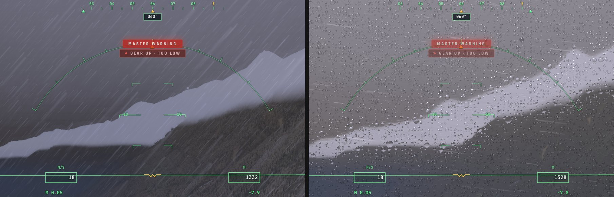
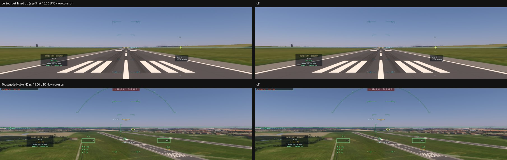
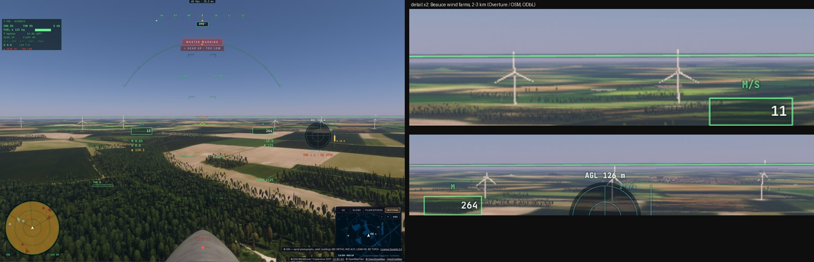
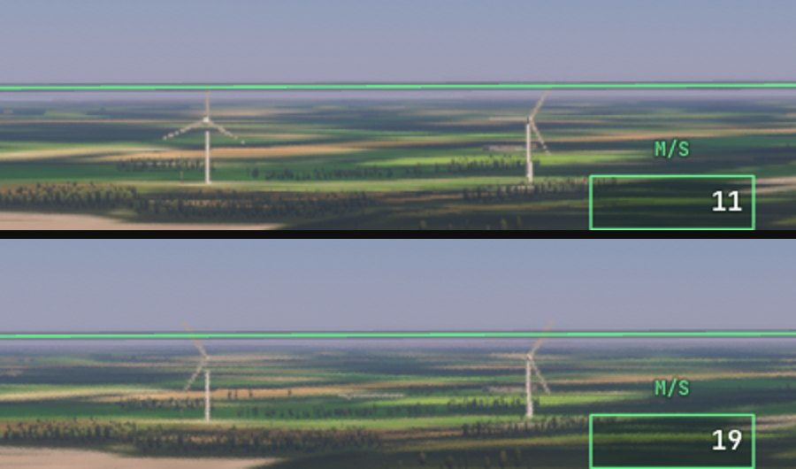
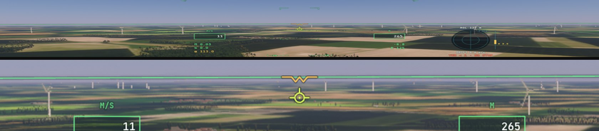
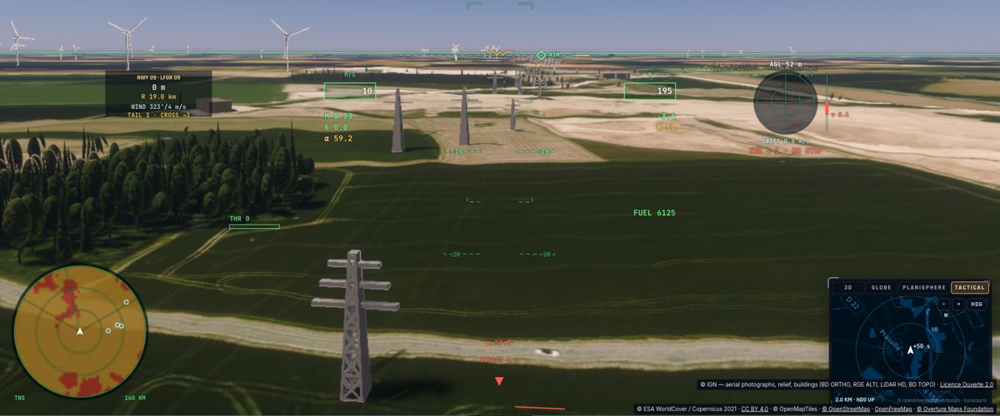
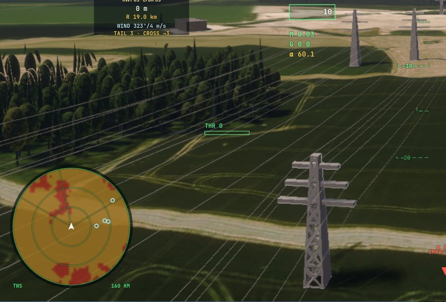
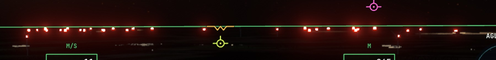
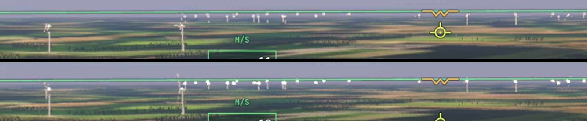

# Q8 — le monde habité et la nuit

## C8, premier lot : la neige qui tombe (5 novembre)

- **Réalisé :**
  - `controller/piloting.ts rainView` : il neige au lieu de pleuvoir quand l'air à la caméra est sous 1 °C. Les flocons
    tombent à environ 1 m/s, au lieu de 6 à 8 m/s pour les gouttes ;
    - avec la météo réelle, la température du METAR ou du modèle, refroidie de 6,5 °C par km de hauteur au-dessus du sol ;
    - sinon une climatologie au niveau de la mer (`weather.ts climateT2m` : environ 12 °C l'an à Paris et ±9 °C de saison,
      6 °C et ±11 °C à Helsinki), refroidie sur la hauteur au-dessus de la mer (le géoïde : `seaAltitudeOver`) ;
  - `display.wgsl rainStreaks` : un troisième mode après la pluie et la poussière de Mars, codé par bits. Les flocons sont
    blancs, éclairés par le ciel et la scène, sans reflet ; environ 5 mm, ronds quand ils tombent lentement ;
  - la verrière et l'objectif ne se couvrent pas de gouttes sous la neige.
- **Vérifié :**
  - `tests/climate-t2m.test.ts` : des températures plausibles (Paris en janvier entre −6 et 8 °C, en juillet entre 15 et
    28 °C ; l'équateur sans saison ; les saisons inversées au sud ; 60° N sous zéro en janvier) ; `weather` passe (10 tests) ;
  - e2e `snowfall`, ce Mac : météo « pluie » au-dessus de Chamonix, à 300 m du sol. Le 15 juillet, de la pluie (intensité
    0,6), et des gouttes sur la verrière. **Le 15 janvier, de la neige** (intensité 0,6), la verrière sèche :

  
- **Limites :**
  - l'avion glissait encore à 18 m/s : les flocons s'étirent en traits dans l'exposition de 1/60 s. Les flocons ronds d'une
    caméra immobile ne sont pas encore vus ;
  - au-delà de 40 m/s, rien ne tombe à l'image, comme pour la pluie (choix existant) ;
  - la climatologie ignore la continentalité (Baïkonour trop doux en hiver) ;
  - pas d'accumulation liée à la chute (la neige au sol est celle de la saison, L9) ;
  - dans l'e2e, le premier lieu placé ne reçoit jamais de précipitation, quelle que soit la date. La cause n'est pas
    trouvée : un premier passage de chauffe n'est pas mesuré.

## C8, deuxième lot : les traînées persistantes (5 novembre)

- **Réalisé** (`contrails.ts`, `controller/computer.ts`) : la traînée d'un moteur vivait 150 s quel que soit l'air. Dans un
  air sursaturé par rapport à la glace, elle persiste et s'étale en cirrus.
  - Les modèles ne donnent pas cette humidité ; le cirrus qu'elle fait naître en est le signe. `contrailPersistence` (0 à 1)
    suit donc la couverture des nuages hauts du modèle avec la météo réelle, sinon celle des couches basées au-dessus de
    6 000 m. Plausible, jamais mesuré.
  - La vie de la traînée va de 150 s (air sec) à 30 min (persistante). Dans le ciel réel, c'est des heures.
  - Sur la Terre seulement.
- **Vérifié** (`tests/contrails.test.ts`, 6 tests) :
  - ciel clair, nuages bas seuls : 0 ; cirrus du modèle à 0,9 : 1 ;
  - à 10 min, la traînée a disparu en air sec ; persistante, elle est toujours là, large de 285 m.
- **Non vérifié en image :** il faudrait un vol de plus de 150 s en altitude sous du cirrus. La loi d'étalement existante
  (3,2 · âge^0,7) donne 285 m à 10 min et environ 600 m à 30 min, plus étroit que le kilomètre ou plus observé, cisaillé par
  le vent : le cisaillement n'est pas modélisé.

## L10, les lampadaires : un premier essai retiré (5 novembre)

- **Essayé :** dans `shadeLite`, la nuit, sur une route proche, la lumière de la ville rassemblée en flaques. Des lampadaires
  sur une grille de 32 m, déplacés de ±8 m par un hachage (plausibles, pas à leur vraie place), une flaque de σ 7 m ; la
  lumière de la rue devait rester la même au total. `TUNE_SC_SKIP` 2048 pour l'A/B.
- **Mesuré** (e2e écrit pour l'occasion : au-dessus de Versailles à 400 m, 22 h UTC en décembre, 35° vers le bas, figé) :
  luminance moyenne 0,304 avec les flaques, contre 0,363 sans, soit −16 %, et coefficient de variation du dixième le plus
  clair 0,24 contre 0,13. La lumière totale n'était donc pas conservée.
- **La vue ne permet pas de juger :** un sol brun uniforme, sans rue lisible ; l'essai ne se valide pas.
- **Retiré.**
- **À reprendre avec :**
  - une vue où les rues se lisent (plus bas, au téléobjectif) ;
  - une moyenne de motif calculée sur les 4 cellules réellement sommées ;
  - la tête lumineuse des lampadaires, qui demande la géométrie des routes (leur axe et leur sens), et pas seulement la
    surface.

## VIPER B5, premier palier : le couvert bas près des pistes (5 novembre, décision 42)

- **Fait** (`src/character-renderer.ts` `COVER`/`prepareCover`, `src/shaders/character.wgsl` `coverGrow`/`coverVs`/`coverFs`,
  `src/system/grass-ground.ts` généralisée, réglage **Couvert bas vu d'en l'air (prototype)**, `settings.earthLowCover`) :
  - sous 300 m du sol, une grille de sol à part (129 × 129 cellules de 4 m, recentrée par 32 m), construite par le même code
    que celle du gazon (hauteurs, végétation WorldCover, exclusions OSM et pistes) ;
  - sur elle, un treillis fixe au monde (un point tous les 4 m jusqu'à 240 m). Chaque point porte une touffe, un buisson ou un
    massif de roseaux selon la végétation : beaucoup de touffes et un buisson de temps en temps sur un pré ou l'herbe d'un
    aérodrome, des buissons sur la lande, des roseaux en zone humide, rien sur les cultures ;
  - aucun sous un pixel et demi ; la forme vient des cailloux, plus ronde et feuillue ; la couleur mêle feuillage et image
    satellite ; l'éclairage est celui des cailloux, enroulé comme un feuillage.
- **Défaut trouvé et corrigé en chemin** (`scenery-worker.ts`) :
  - les polygones `aeroway` d'OpenMapTiles devenaient tous des surfaces revêtues, y compris le contour entier de l'aérodrome
    (`class=aerodrome`, `heliport`) ;
  - toute l'herbe d'un aérodrome était donc exclue : le gazon du marcheur, les cailloux et le couvert bas. Au seuil du
    Bourget, la grille du couvert ne trouvait que 473 points végétalisés dans sa portée (des cultures, à 180–240 m) ;
  - seuls les vrais revêtements restent (piste, voie de circulation, aire de trafic, hélisurface, poste) ; on trouve
    maintenant 8 023 points ;
  - non vérifié en image : l'effet de cette correction sur le matériau du sol des aérodromes, hors couvert.
- **Mesuré** (e2e `low-cover`, ce Mac, en fenêtre, raster, figé, exposition tenue ; images terminées par le GPU) :

  | vue | touffes et buissons | avec | sans | avec (bis) |
  |---|---|---|---|---|
  | Le Bourget, aligné (œil à 3 m) | 580 | 20,8 ms | 18,8 ms | 20,2 ms |
  | Toussus-le-Noble, 40 m | 782 | 24,3 ms | 23,4 ms | 24,7 ms |

- **Lecture :**
  - **presque rien ne se voit.** Les prises avec et sans couvert sont quasi identiques. Au roulage, la piste et ses
    accotements exclus (±37 m) repoussent le couvert près de l'horizon. À 40 m, des touffes de moins d'un mètre tous les 4 m,
    vues à 100–300 m, ne font que quelques pixels épars ;
  - avec un diagnostic (tailles × 6, sans tri), le couvert se voit bien en bande sur les accotements : le chemin de dessin
    est correct, ce sont les tailles et la densité qui ne portent pas ;
  - le coût mesuré est de +1 à +2 ms sur ce Mac pour ce peu d'effet.
- **Décision prise ici :** le réglage reste **éteint par défaut** (prototype). Le temps d'image ne s'achète pas sans gain
  visible.
- **Pistes pour un palier utile, à décider par Sam :**
  - un anneau proche dense (1 à 2 m d'espacement jusqu'à 80 m) avec des touffes plus hautes, quand l'œil est à moins de 10 m ;
  - des buissons de 1,5 à 3 m au loin, dans le système des arbres (le type `shrub` de `forest.ts`) plutôt qu'en instances
    rondes ;
  - ou laisser au détail du sol (L8, scans de détail) l'impression de vitesse au roulage, qui tient plus à la texture qu'à
    des objets épars.

## D1 : les données des lignes HT, des pylônes et des éoliennes (5 novembre)

- **Trouvé** (`scripts/overture-infra-probe.ts`, lecture par plages HTTP, sans téléchargement entier) :
  - le `base.pmtiles` d'Overture (release 2026-10-21, 192 Go, zooms 0 à 13, CORS ouvert, même bucket que les bâtiments
    Overture déjà lus par le décor) porte une couche `infrastructure` ;
  - on y trouve les éoliennes (`subtype=power`, `class=generator`, avec `generator:source=wind` dans `source_tags`), leur
    hauteur totale (`height`), la hauteur du moyeu (`height:hub`) et le diamètre du rotor (`rotor:diameter`) ;
  - on y trouve aussi les lignes (`power_line` pour la haute tension, `minor_line`), les pylônes (`power_tower`) et les
    poteaux (`power_pole`).
- **Vérifié sur trois carreaux z 13 :**
  - en Beauce (48,24° N, 1,83° E), 4 éoliennes. Exemple : Nordex N117/3000, moyeu à 91 m, rotor de 117 m, 149,5 m au total,
    mise en service le 21 novembre 2018 ; données Géorisques par OSM (ODbL) ;
  - à 48,30° N, 1,75° E, 3 lignes HT, 1 pylône, 7 poteaux, 1 ligne mineure ;
  - en Picardie (49,88° N, 2,95° E), rien d'électrique dans ce carreau.
- **Conception proposée** (non commencée) :
  - **la source :** le worker du décor lit les carreaux z 13 de `base.pmtiles` par le même `PmTiles` que les bâtiments
    Overture, sous le budget fournisseur commun. Pour les éoliennes, la portée doit aller jusqu'à ~30 km, car elles se voient
    de loin. Pour les lignes et les pylônes, la portée du décor suffit ;
  - **les éoliennes :**
    - un mât (cône tronqué), une nacelle et trois pales en maillage, dimensionnés par `height:hub` et `rotor:diameter` ;
    - l'orientation suit le vent de la météo, le rotor tourne (une vitesse de bout de pale de ~70 m/s, coupée au-delà de
      25 m/s de vent) ;
    - le flash rouge de balisage la nuit, avec les lampes existantes ;
    - le rendu passe par le chemin des bâtiments maillés du raster (cible de visibilité et identifiant), avec un matériau
      blanc mat ;
  - **les lignes :**
    - les pylônes en instances (un treillis simplifié, la hauteur selon la tension `voltage` quand elle est connue) ;
    - les câbles en caténaires entre pylônes consécutifs, d'un pixel au plus loin, avec une couverture sous-pixel pour éviter
      le scintillement ;
  - **le budget :** à mesurer par palier, d'abord les éoliennes (peu d'objets, très visibles), puis les pylônes et les câbles.
- **Licence :** ODbL (OSM par Overture), à créditer comme les bâtiments Overture.

### D1 : le chemin d'intégration des éoliennes dans le raster (relevé le 5 novembre)

Une passe directe à part (comme les cailloux) a été écartée. Elle n'a pas le modèle d'air, et des éoliennes vues à 10 ou
30 km sans voile seraient fausses. Le bon chemin est celui des bâtiments maillés : une surface finale commune, ombrée par
`shadeLite` avec l'air, le Soleil et les ombres partagés. Relevé dans le code :

- **Les données :** le worker du décor (`scenery-worker.ts`) lit les carreaux z 13 de `base.pmtiles` et produit, pour chaque
  éolienne, ses triangles : mât en cône tronqué, nacelle, trois pales effilées. Ils sont dimensionnés par `height:hub` et
  `rotor:diameter`, et rangés après ceux des bâtiments et des ponts. `packScenery` (`scenery-data.ts:312-365`) range les
  maillages : positions, indices, puis une étiquette par triangle.
- **La marque :** `meshFs` (`scenery-raster.ts:535`) écrit A = code × 2¹⁸ ; les codes 57 et 58 sont libres
  (`terrain-raster-hint.ts`). Un code « éolienne » doit être reconnu par `rasterLiteTakes` (`trace.wgsl:14338`) et par les
  tests `≥ 62` (`terrainRasterMesh`, l'exclusion de `terrainRasterId`), à revoir ensemble.
- **Le matériau :** une branche dans `shadeLite`, près du bloc `mesh && leaf == 0u` (`trace.wgsl:14921-14939`), donne un blanc
  mat (albédo ~0,7, rugueux) avec la normale reconstruite (`rasterNormal`), sans les fenêtres procédurales des murs.
- **L'ombre :** `meshShadowPipe` dessine déjà tous les triangles maillés dans la carte des bâtiments et dans les cascades du
  relief, donc l'ombre portée vient sans travail de plus.
- **La rotation :** la géométrie du décor est statique (aucun temps par image dans `scenery-raster.ts`). Il faudrait une
  étiquette « rotor » par triangle (le moyeu et l'axe dans un petit tableau d'éoliennes), et une rotation dans `meshVertex`
  et `meshShadowVs` à partir d'un temps uniforme. Ce serait la première géométrie animée du décor, à mesurer.
- **La portée :** l'ombrage du décor s'arrête à `o[7]` (3,5 km, `scenery.ts:378`). Pour voir les éoliennes de loin, il
  faudra une portée à part, ou un imposteur au-delà.
- **Le balisage :** rien n'existe pour les feux d'obstacle du décor. Les lampes de piste (`runwayLights`) et le phare de tour
  (`BEACON`) montrent la façon de faire.
- **Paliers proposés :** (1) les éoliennes à rotor fixe dans la portée du décor, avec le matériau et l'ombre ; (2) la rotation
  orientée au vent ; (3) la portée lointaine ; (4) le balisage de nuit ; puis les pylônes et les câbles.

### D1, premier palier : les éoliennes dans le décor (5 novembre)

- **Fait :**
  - `src/system/turbines.ts` lit les éoliennes d'Overture (`turbineOf`) et construit leur maillage (`turbineMesh`) : un mât
    effilé à 12 faces, une nacelle, un moyeu, trois pales effilées dans le plan du rotor, l'une vers le haut. Les dimensions
    viennent de `height:hub` et `rotor:diameter`, ou de la hauteur totale ;
  - le worker du décor lit les carreaux z 13 de `base.pmtiles` (la dernière release qui répond) dans un rayon de 3,5 km, et
    garde les 64 éoliennes les plus proches, posées sur le sol WGS84 du décor ;
  - `packScenery` étiquette désormais tous les triangles maillés : bâtiments (leur feuille), ponts (0) et éoliennes
    (`TURBINE_TAG`) ;
  - `meshFs` code les éoliennes `RASTER_CODE.turbine` (57, un code libre jusqu'ici). `terrainRasterMesh` le prend, et
    `shadeLite` les peint en blanc mat sans fenêtres ;
  - l'ombre suit le chemin existant (`meshShadowPipe`, carte des bâtiments et cascades du relief).
- **Vérifié :**
  - unitaires `tests/turbines.test.ts` : la N117 de Beauce lue (moyeu 91 m, rotor 117 m), les replis, la pointe de la pale
    haute à 149,5 m au-dessus du pied ;
  - les tests du décor et du raster, et les budgets des noyaux (`titan shadeLite` relevé de 42 540 à 42 680 lignes, selon la
    règle) ;
  - e2e `wind-turbines` (ce Mac, raster, 150 m au-dessus de la Beauce, cap à l'est, 13 h UTC) : **7 éoliennes chargées**,
    vues à 2 à 3 km, blanches, rotor orienté au sud-ouest ; aucune erreur GPU.

- **Non mesuré :** le coût d'image (64 éoliennes au plus, ~150 triangles chacune, dans le même dessin que les bâtiments) ;
  leur ombre au sol vue de près.
- **Limites, et paliers suivants :**
  - le rotor est fixe et orienté au 240° ; il faut le faire tourner, face au vent de la météo ;
  - la portée s'arrête au décor (3,5 km), alors qu'une éolienne se voit à 20–30 km : il faudra une portée lointaine ;
  - pas encore de balisage rouge la nuit ;
  - le sol tracé (le pipeline `trace`) ne les montre pas ;
  - ensuite, les pylônes et les câbles.

### D1, deuxième palier : les rotors tournent (5 novembre)

- **Fait :**
  - `turbineMesh` rend aussi le moyeu, l'axe (le cap, à l'horizontale), une vitesse de rotation (bout de pale à ~60 m/s, soit
    ~10 tours/min pour 117 m) et une phase tirée de la position ;
  - `packScenery` étiquette les triangles des pales `TURBINE_BLADE | numéro`, et range après les étiquettes une table de deux
    vec4 par éolienne ;
  - `meshVertex` (`scenery-raster.ts`) fait tourner les sommets des pales autour de l'axe (formule de Rodrigues), selon
    l'horloge du jeu (`renderer.rainClock`, arrêtée quand le jeu est figé) passée dans `sc.north.w`, une place libre de
    l'uniforme ;
  - l'ombre (`meshShadowVs`) tourne de la même façon, mais la carte n'est redessinée que quand le repère ou le décor change.
- **Vérifié :** les unitaires (36 triangles de pales, le moyeu, 8 à 12 tours/min) ; l'e2e `wind-turbines`, avec deux prises à
  une seconde d'écart, où les pales ont changé d'angle.

- **Limites :**
  - en mouvement, les pales sont pâlies par l'historique temporel. Le décor n'a pas de vecteurs de mouvement : il faudrait
    marquer les pales comme réactives (Q6 I2/I3) ;
  - l'ombre des pales ne suit pas leur rotation entre deux redessins de la carte.

### D1, troisième palier : les éoliennes face au vent (5 novembre)

- **Fait :**
  - la nacelle et le moyeu (`TURBINE_HEAD`) et les pales tournent autour de l'axe du mât pour faire face au vent de surface de
    la météo (`windFromAt` au centre du décor, `renderer.ts`). La rotation se fait dans `meshVertex`, l'angle passant par
    `sc.up.w`, une autre place libre de l'uniforme. Le mât reste fixe ;
  - la table compte maintenant trois vec4 par éolienne, la troisième pour l'axe du mât.
- **Vérifié :** les unitaires et les budgets (75 tests) ; l'e2e `wind-turbines`, avec un vent du 322° : 7 éoliennes, des
  rotors vus plus obliques depuis l'ouest qu'avec l'orientation fixe à 240°, aucune erreur GPU.
- **Reste à D1 :** le balisage rouge de nuit, les pales marquées réactives pour l'historique, puis les pylônes et les câbles.

### D1, quatrième palier : la portée lointaine (5 novembre)

- **Fait :** le worker lit les éoliennes dans 15 km (et non plus 3,5) et en garde jusqu'à 160, les plus proches. Les carreaux
  z 13 sont chargés six à la fois. Les maillages se dessinent à toute distance, et `shadeLite` les peint en blanc sans avoir
  besoin des données du décor ; l'air commun les voile au loin.
- **Vérifié** (e2e `wind-turbines`, ce Mac) : **160 éoliennes** (la limite, atteinte en Beauce). Celles de 5 à 15 km
  s'alignent sur l'horizon, plus pâles avec la distance. Le crédit Overture s'affiche. Aucune erreur GPU.

- **Non mesuré :** le coût (~160 × 200 triangles, un seul dessin) ; le temps de chargement des carreaux (~40 dans 15 km).
- **Limites :** la limite de 160 coupe les parcs les plus lointains dans les régions denses ; au-delà de 15 km, rien.

### D1, cinquième palier : les pylônes des lignes HT (5 novembre)

- **Fait** (`src/system/pylons.ts`, le worker, `packScenery`, `scenery-raster.ts`, `shadeLite`) :
  - les lignes `power_line` de 63 kV et plus lues dans le `base.pmtiles` d'Overture, dans 5 km (400 pylônes au plus) ;
  - la hauteur suit la tension : 25 m à 63–90 kV, 38 m à 225 kV, 50 m à 400 kV ;
  - les lignes de ce niveau de zoom sont **simplifiées**, et les pylônes ponctuels presque absents (1 dans un carreau traversé
    par trois lignes). Les pylônes sont donc posés aux sommets des lignes, puis le long de chaque segment à la portée usuelle
    de la tension (250, 350 ou 450 m). **Ces places sont plausibles, pas relevées** ;
  - le maillage : un fût en tronc de pyramide et trois consoles en travers de la ligne ;
  - la marque est `RASTER_CODE.pylon` (58). `meshFs` ajoure le treillis (montants, ceinture tous les 4 m, croix dans chaque
    travée, membrures de ~0,3 m) tant qu'une membrure couvre au moins un pixel ; au-delà, la silhouette reste pleine, sans
    scintillement. `shadeLite` les peint en acier galvanisé ;
  - une table par pylône (pied, hauteur, cap) suit celle des éoliennes, après un vec4 d'en-tête qui donne leur nombre.
- **Défaut corrigé en chemin :** la nacelle et les pales des éoliennes recevaient le code des ponts (matériau pierre) depuis
  le deuxième palier. Elles ont maintenant toutes le code « éolienne ».
- **Vérifié :**
  - unitaires `tests/pylons.test.ts` : la tension lue, la hauteur, la console la plus large en travers ;
  - e2e `wind-turbines` près d'une ligne de 225 kV (`WT_SITE=48.2790,1.7200 WT_HDG=315 WT_ALT=60`) : **126 pylônes**,
    145 éoliennes. Le pylône proche montre son treillis ajouré et ses consoles ; les suivants s'alignent le long de la ligne.

- **Limites :**
  - pas encore de câbles ;
  - à moyenne distance, le fût plein fait un peu obélisque ;
  - l'ombre au sol est celle du fût plein, pas du treillis ;
  - les places sont interpolées.
- **Suite :** les câbles en chaînette entre pylônes consécutifs, avec une couverture sous-pixel.

### D1, sixième palier : les câbles (5 novembre)

- **Fait :**
  - `cableMesh` (`pylons.ts`) tend six conducteurs entre deux pylônes consécutifs d'une même ligne (les bouts des trois
    consoles), en chaînette avec une flèche de 2,5 % de la portée, 8 segments chacun. Chaque point est une paire de sommets
    confondus ;
  - le worker garde l'ordre des pylônes de chaque ligne et ne tend une portée qu'entre deux pylônes dessinés, à moins de
    2,5 km du centre (200 portées au plus) ;
  - `packScenery` les étiquette `CABLE_TAG` et aligne chaque paire sur un sommet pair ;
  - `meshVs` ouvre la paire le long de la verticale jusqu'à un pixel au moins, et passe la part réellement couverte par un
    fil de 4 cm. `meshFs` garde cette part des pixels par un tirage neuf à chaque image : sa graine est le numéro d'image du
    renderer, dans un nouveau `sc.misc`. L'historique temporel en fait la moyenne, d'où un trait fin et pâle au lieu d'un
    trait d'un pixel ;
  - les câbles sont peints comme l'acier des pylônes.
- **Défauts trouvés en chemin :**
  - une première version lisait `sc` dans `meshFs`, une liaison visible au seul vertex shader. Le pipeline était invalide et
    aucun maillage n'était dessiné (ni bâtiments, ni éoliennes, ni pylônes), **sans erreur comptée** par `gpuErrors`. L'e2e
    doit donc juger l'image, pas seulement ce compteur ;
  - la graine prise du décalage sous-pixel ne changeait pas, car le raster n'est pas décalé par défaut. Le motif restait
    figé en pointillés.
- **Vérifié :** les unitaires (6 conducteurs, paires confondues, flèche) ; l'e2e près de la ligne de 225 kV : **59 portées**.
  Les câbles forment des traits fins et continus, accrochés aux consoles ; vue de dessus, ils suivent la ligne.

- **Limites :**
  - le ruban est vertical, donc vu d'en haut presque de profil, plus fin qu'il ne devrait ;
  - pas de câble de garde au sommet, pas de chaînes d'isolateurs ;
  - la flèche est la même par tous les temps ;
  - le coût n'est pas mesuré.

### D1, septième palier : le balisage de nuit des éoliennes (5 novembre)

- **Fait :**
  - un bloc de 60 cm sur le toit de la nacelle, dans l'axe du mât, étiqueté `TURBINE_LAMP`. Il tourne avec la tête ;
  - `meshVs` l'élargit autour de son centre (la table de l'éolienne porte maintenant sa hauteur) à au moins 1,5 pixel, et
    écrit 3 dans son canal G ;
  - `terrainRasterLamp` le reconnaît. `shadeLite` l'allume en rouge la nuit (le même facteur `dark` que les feux de piste),
    à 40 éclats par minute (0,5 s allumé sur 1,5 s), tous les parcs en phase. L'horloge est celle des feux de piste,
    désormais écrite même sans piste proche ;
  - l'intensité vaut ~1 % de celle d'un feu de piste par pixel. Deux premiers essais (×20, puis ×4 plus forts) donnaient un
    grand halo rouge, puis des points brûlés en blanc.
- **Vérifié** (e2e `wind-turbines` à `WT_ISO=2026-07-10T22:00:00Z`, ce Mac) : l'horizon de nuit de la Beauce piqué de
  points rouges sur les nacelles, avec un léger halo.

- **Limites :**
  - aucun feu sur les pylônes ;
  - l'éclat n'est pas vérifié en mouvement (l'historique peut l'étaler) ;
  - au-delà de 15 km, aucune éolienne, donc aucun feu.
- **Le feu blanc de jour** (ajouté ensuite) : de jour, le même feu éclate en blanc au même rythme, à environ 8 fois la
  luminance d'une surface blanche. Un premier essai à 0,8 se confondait avec la peinture de la nacelle. Vérifié (e2e de
  jour) : sans éclat dans la première prise, des points blancs sur les nacelles dans la seconde, une seconde plus tard ; un
  peu gros, avec leur halo.

