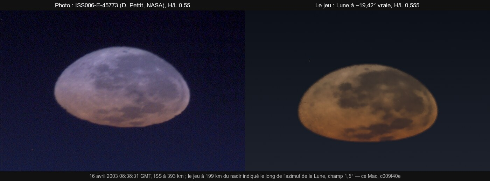

# R2 — la réfraction de la Terre au GPU (premier lot : le format des tables et sa précision, 4 novembre)

`src/system/refraction-gpu.ts` rééchantillonne les tables de R1 sur des grilles régulières, qu'un shader indexe sans recherche :

| Table | Grille | Lecture |
|---|---|---|
| B_haut | 128 hauteurs h = 80 km (i/127)² × 128 élévations e = 90° (j/127)² | logarithme, bilinéaire |
| B_limbe | 4 096 hauteurs tangentes ht = 120 km (k/4095)² | linéaire |
| N | la réfractivité tous les 500 m jusqu'à 120 km | sert à trouver le point tangent d'un rayon sous l'horizon (invariant de Bouguer, six pas de point fixe) |

Le tout tient en 20 728 flottants (`REFR_VEC4S` vec4), construits en 0,68 s : c'est le travail d'un worker. `gpuBending` lit ces
tables exactement comme le shader le fera (`airBend`) :

- au-dessus de l'horizon : B_haut dans l'air, rien depuis l'orbite ;
- sous l'horizon : la corde entière B_limbe, moins la partie derrière la caméra B_haut(h, |e|) ; depuis l'orbite, B_limbe entier ;
- `null` si le rayon touche la mer.

Les chiffres du CPU et ceux de l'image viendront ainsi des mêmes nombres. C'est la condition « GPU = CPU » de C0-7, au télé et
au télescope.

**Mesuré contre l'intégrale** (l'oracle indépendant de R1), la part de la table et de l'interpolation dans les budgets de C0-7 :

| Rayons | Erreur maximale |
|---|---|
| Montants, de 0 à 30 km, au-dessus de 2° | 0,95″ |
| Montants, sous 2° | 1,58″ |
| Plongeant sous l'horizon, depuis 200 m à 20 km | 2,92″ |
| Tangents vus de l'orbite | moins de 3″ |

`tests/refraction-gpu.test.ts`, 4 tests verts.

**Ce que les mesures ont corrigé :**

- le point tangent trouvé en deux pas de point fixe était faux de 60 m, car la suite ne se contracte que de 0,22 par pas : 40″
  d'erreur. Six pas ramènent l'écart au décimètre ;
- 64 rangées de hauteur laissaient 9,9″ juste au-dessus de la tropopause ; 128 rangées donnent 2,9″.

**Pas encore :** la table dans `gpu-tables.ts` (`TABLE_REFR`), son worker et son écriture à chaque changement d'air, `airBend`, les
étoiles et l'anneau de lumière de l'éclipse, `refraction.ts` branché sur `gpuBending`, et les contrôles d'image (trace-ab,
Soleil couchant au télé, coucher de l'ISS).

## Deuxième lot : les tables dans le GPU et le CPU (4 novembre)

- `TABLE_REFR` (gpu-tables.ts) prend place après les distances au rivage.
- `RefrTableBuilder` construit la table par tranches d'environ 2 ms par image, ce qui remplace le worker du plan. Aucune image ne
  tient plus longtemps, et la table est prête en une à deux secondes après un changement d'air.
- `renderer.airState` donne l'air en vigueur (le modèle Open-Meteo ou le METAR par temps réel, sinon l'air standard).
  `stepRefrTable` publie la table d'un coup au GPU (`bodies`) et au CPU (`refraction.ts setRefractionTable`). `renderer.refrPublished`
  indique pour quel air.
- `trace.wgsl airBend` lit les tables quand elles sont là (`refrBend` : B_haut, B_limbe, le point tangent en six pas), sinon
  l'ancienne estimation exponentielle. La hauteur de la caméra vient de `P.sky`.
- `refraction.ts bending` lit les mêmes tables quand on l'interroge avec l'air dessiné. Un autre air (la date future d'une photo)
  garde son propre calcul.

**Vérifié :**

- tests verts : les constantes du shader égales à celles de la table, le constructeur par tranches identique au calcul d'un bloc,
  le CPU égal à la lecture du GPU, les budgets d'inline tenus (88 tests) ;
- dans le jeu (e2e `coast-refs` 012 et 069), la table est publiée (« 10133|15.0|0.50 »). Le Soleil apparent de TARS vaut 3,607°,
  la même valeur que le modèle en couches. L'image du coucher au Raz est inchangée à l'œil (`R2/couchers-avant-apres.jpg`) : à
  3,4° de hauteur, les deux modèles s'accordent.

**Non mesuré :**

- le coût GPU de `airBend` avec ses lectures de table (pas de trace-ab) ;
- les contrôles d'image du plan : le Soleil couchant à 0,82 au télé, le coucher de l'ISS, l'éclipse de Danjon ;
- les étoiles (`shadeStars`) et l'anneau de lumière de l'éclipse, qui gardent l'ancien modèle.

## Contrôle : le Soleil couchant au télé, sur les tables (4 novembre)

`refraction-wgs84` (e2e du plan pour R2), relancé ici en fenêtre visible avec les tables publiées. Le cas : le Soleil couchant au
nord-ouest, au-dessus de la mer au large de la Hague (49,75° N, 21 juin 2026), champ de 1,5°, l'œil à 249 m. Le télescope vise le
centre réfracté que calcule le CPU.

- **L'image et le CPU s'accordent à 0,126′** (le seuil est 0,2′) : le milieu des bords du disque est à −0,308′, le CPU l'attend à
  −0,434′. Le disque est décalé de −2,67 px en travers.
- **Aplatissement mesuré : 0,838**, le centre du Soleil étant à 0,385° de hauteur, donc son bord inférieur à ~0,12° au-dessus de
  l'horizon. Les 0,82 du plan valent pour le bord inférieur posé sur l'horizon, où le disque est un peu plus aplati : c'est
  cohérent. Le modèle CPU seul donne 0,820 dans ce cas limite (test de R1).
- Image : `R2/soleil-couchant-tele.jpg`.

## Le coût GPU des tables (4 novembre)

`refr-cost` (nouvel e2e, en fenêtre ; pression thermique Moderate) : un coucher sur l'Atlantique depuis 300 m, beaucoup de ciel,
la vue figée. Quatre prises alternées, tables actives puis coupées (`renderer.refrTablesOn`) :

| Passe | Tables actives (deux prises) | Tables coupées (deux prises) |
|---|---|---|
| `trace` | 0,928 · 0,978 ms | 1,023 · 1,027 ms |
| `trace (discs)` | 0,682 · 0,665 ms | 0,666 · 0,670 ms |

**Aucun surcoût mesurable**, dans le bruit, voire un peu moins : la lecture de la table remplace le calcul de la fonction de
Chapman. Le total de l'image varie beaucoup d'une prise à l'autre, mais à cause des passes du vaisseau, sans lien avec les
tables.

## La Lune éclipsée sur les tables (4 novembre)

`earthRingLight` (la lumière que l'air de la Terre courbe dans son ombre) lit maintenant B_limbe dans son Newton, à la place
de l'exponentielle de C3 « doublée ». Il en lit aussi la pente, pour la défocalisation `1 − α′R/ρ`. Son jumeau CPU
(`eclipse/shadows-gpu.ts earthRingY`, qui baisse la lumière de la Lune sur la Terre pendant l'éclipse) lit les mêmes tables
(`refraction.ts drawnRefractionTable`, `refraction-gpu.ts gpuLimbSlope`). Les tables sont construites dès que la réfraction
est active, quel que soit le corps proche : l'éclipse vue de la Lune ou de l'espace les a aussi. Sans tables (A/B, début de
partie), l'ancien modèle reste en place.

Les étoiles (`shadeStars`) passent déjà par `airBend` : elles lisent les tables depuis le deuxième lot.

**Essai rejeté : la pente du segment.** Le premier essai prenait la pente du segment de table lu (18 m de large vers 11 km).
B_limbe a un coude réel à la tropopause, où cette pente remonte. Le dénominateur de défocalisation tombe alors jusqu'à −1 270.
Résultat : des caustiques, de fins arcs blancs concentriques sur la Lune éclipsée (`R2/eclipse-lune.jpg`, à droite), avec les
tables comme sans, parce que la lecture partagée était en cause. L'état d'avant (5e93b550) n'en avait pas. Le disque du Soleil
étale ces caustiques sur des kilomètres de hauteur tangente (±rs de déviation ≈ ±7 km vers 11 km). La pente est donc prise
sur ±1 km (trois lectures, un seul site inliné). Avec elle, B_limbe décroît partout et le dénominateur reste ≥ 1 sur 0–80 km
(test unitaire).

**Ce que change l'air en couches (CPU, air standard 15 °C, 1 013 hPa, 50 % ; Lune à 363 000 km) :** la part de lumière vaut
2,49·10⁻⁵ au cœur de l'ombre (1,76·10⁻⁵ avant, +42 %), 8,56·10⁻⁵ à mi-ombre (6,37·10⁻⁵, +34 %) et 2,75·10⁻² au bord
(inchangé). C'est l'ordre que le plan prévoyait (« 15–20 % de courbure en plus aux hauteurs 2–10 km : le cœur plus clair »),
soit environ +0,3 à +0,4 magnitude au cœur. Les épaisseurs optiques (Rayleigh, poussières, ozone de Chappuis) sont des
valeurs physiques : elles n'ont **pas** été retouchées pour compenser (challenge §6.7).

**Vu dans le jeu** (e2e `lunar-eclipse-ring`, en fenêtre ; Bangalore, 1 000 m, télescope 1,2°, raster, cockpit, exposition
tenue) : 18:12 UTC (mi-totalité) et 17:35 UTC (5 min après C2), tables actives, coupées, réactivées. Pas d'arcs, pas
d'erreur GPU. L'écart dans l'image est sous le bruit A/A : centre du disque 44,7 / 44,1 / 43,8 (niveaux sRGB, rouge) à
mi-totalité. À l'exposition que choisit le posemètre, la lueur du ciel domine le cadre, si bien que l'écart calculé ne se
voit pas dans cette vue.

**Danjon : non fait.** Deux recherches n'ont pas trouvé de valeur L publiée pour le 07/09/2025 (ni Sky & Telescope, ni BAA,
ni IMO dans les résultats). Le contrôle reste ouvert : il faudra relever une estimation L d'observateurs, ou une magnitude
mesurée à mi-totalité, et la comparer à la part calculée.

**Limites :**

- un seul air pour tout le limbe, celui du lieu de la caméra (la météo réelle, sinon l'air standard), alors que l'anneau réel
  mêle tous les airs du terminateur ;
- le coût GPU de l'anneau n'est pas mesuré : il ne s'exécute que pendant une éclipse (bit HAS_SHADE) ;
- neuf budgets d'inline relevés de 10 à 70 lignes (`tests/kernel-budget.json` : `earth-raster env`/`-wx`, `game-space env`,
  `moon main`/`env`, `mars main`, `earth-only env`, `general main`/`lut`). La lecture de B_limbe est inlinée dans chaque noyau
  qui dessine une ombre de corps.

## Contrôle : le coucher vu de l'ISS, à l'équateur et à 70° N (4 novembre)

`iss-sunset` (nouvel e2e, en fenêtre ; ~4 min). La caméra libre est à 420 km au-dessus de l'équateur (20 mars 2026, le Soleil
se couche plein ouest) puis au-dessus de 70° N (25 octobre, sa course oblique). Champ de 2,5° sur le Soleil, monde figé,
exposition fixe (le Soleil non saturé), ni bloom ni reflets. À chaque pas, le disque est mesuré dans l'image : sa hauteur et sa
largeur, sur ses pixels au-dessus du quart du plus brillant. Le CPU calcule le même disque sur les mêmes tables
(`gpuBending`, point tangent sur la sphère du repère aplati), la hauteur du Soleil prise par rapport au limbe WGS84 dans son
azimut. Puis la réfraction est coupée : c'est le contrôle géométrique, le disque coupé par le limbe dessiné.

**Trois défauts trouvés et corrigés en route :**

- **`viewAt` en spectateur** (`main.ts cameraAt`) : le champ demandé allait à l'objectif du vaisseau, pas à celui de la vue.
  Un deuxième `viewAt` ne déplaçait pas la caméra libre déjà placée, qui gardait son décalage : la vue de 70° N était dessinée
  depuis l'équateur, l'horizon tourné de 80°. Corrigé : le champ va à la vue (`viewController().setFov`) ; la pose est une
  coupe, et le rig repart de la pose donnée, comme `viewBack`.
- **La verticale des vues en altitude** (`our-side.ts bodyView`) était le rayon géocentrique. Sur la Terre, c'est maintenant la
  normale WGS84 (0,19° d'écart à 45°).
- **Le point tangent de `refrBend`** (`trace.wgsl`) était pris sur la sphère des tables (6 371 km) à la hauteur géodésique. La
  Terre dessinée est la sphère du repère aplati (a = 6 378 km), la caméra à sa distance dans ce repère. Il y est maintenant,
  côté GPU comme côté CPU (`gpuBending(…, R, r0)`, `refraction.ts` avec WGS84 a). Et un rayon que l'air courbe dans la mer, dans
  la bande de ~2,6′ entre le limbe géométrique et le limbe apparent, ne montre plus le Soleil derrière (`REFR_SEA`) : il en
  montrait une tranche de trop.

**Résultats (dernier passage, `R2/iss-coucher.jpg`) : hauteur visible du disque, image / CPU [′], aplatissement = hauteur /
largeur dans l'image**

| Pas (s avant le centre sur le limbe apparent) | −240 | −150 | −90 | −45 | 0 | +30 |
|---|---|---|---|---|---|---|
| **équateur** | 11,29 / 11,33 (0,352) | 8,60 / 8,69 (0,268) | 6,93 / 7,09 (0,216) | 5,52 / 5,43 (0,172) | 3,08 / 2,99 (0,097) | 1,80 / 1,54 (0,069) |
| **70° N** | 6,67 / 6,80 (0,207) | 5,65 / 5,57 (0,175) | 4,49 / 4,49 (0,140) | 3,85 / 3,73 (0,120) | 3,21 / 3,00 (0,100) | 2,69 / 2,53 (0,086) |

- **L'image suit le CPU à 0,26′ près aux deux latitudes**, sur tout le coucher. Le Soleil s'écrase de 1/3 à 1/14 et reste posé
  sur le limbe, à 70° N comme à l'équateur : le contrôle du plan est tenu. Avant les corrections, à 70° N, il restait 2,5′ trop
  haut en fin de coucher (la bande sous le limbe apparent).
- **Le contrôle géométrique** (réfraction coupée, le disque coupé par le limbe et éteint en bas) donne les mêmes chiffres aux
  deux latitudes : 13,5′ et 14,2′ visibles, le centre du Soleil sur le limbe ; 6,4′ et 6,8′, le centre 0,15° dessous.
- **Fausse piste écartée, un défaut du test.** Un passage précédent semblait montrer une extinction rasante trop faible près des
  pôles : 6,3′ visibles à l'équateur contre 14,2′ à 70° N, puis 35° N et 50° N comme l'équateur, 70° S et 80° N comme 70° N.
  Le rendu n'était pas en cause. Un jumeau CPU de la marche d'`earthAir` donne la même transmission à toutes les latitudes.
  Une sonde de la transmission du shader l'a montrée identique pixel par pixel à l'équateur et à 70° N. Le défaut était dans la
  caméra du test : posée puis laissée tourner avec le monde avant que l'horloge soit ramenée et gelée, la caméra libre dérivait.
  Mesuré : 417,1 km au lieu de 420 au-dessus de l'équateur, ce qui remonte le limbe de ~0,07° et fait passer les rayons plus bas
  dans l'air ; 419,1 km et 0,17° de latitude à 70° N. Le test repose maintenant la vue une fois l'horloge gelée : 420,000 km
  aux deux lieux.
- **Non contrôlé** : une photo réelle de coucher depuis l'ISS à date et heure connues ; la couleur du disque.

## Contrôle de Danjon : la magnitude de la Lune éclipsée (5 novembre)

- **La référence.** Aucune valeur L publiée n'a été trouvée pour l'éclipse du 07/09/2025, ni pour celle du 14/03/2025
  (recherches du 5 novembre). Une **magnitude mesurée** existe en revanche pour l'éclipse totale des 15-16 mai 2022 :
  −0,8 ± 0,3 à mi-totalité, selon l'équipe d'amateurs avancés citée par Sky & Telescope
  ([Gauge the Darkness and Color…](https://skyandtelescope.org/stargazing-and-observing/useful-projects-for-a-lunar-eclipse/)).
  C'est un contrôle plus objectif que l'échelle de Danjon.
- **Le modèle.** `moonLightShare` (anneau d'air stratifié de R2, air de Bennett) au 16/05/2022 à 04:11:28 UTC :
  - part de lumière de 5,4·10⁻⁵ (3,6·10⁻⁵ sans la table) ;
  - pleine Lune à −12,86 à 361 726 km ;
  - soit une Lune éclipsée à **−2,19**.
- **L'écart :** 1,4 magnitude, le modèle 3,6 fois trop clair. Causes probables, non corrigées :
  - l'air du limbe est clair jusqu'au sol, alors que les nuages du terminateur coupent les rayons tangents bas ;
  - la stratosphère n'a pas les aérosols volcaniques de 2022 (Hunga Tonga) ;
  - une seule mesure, à ±0,3.

  Le plan veut Danjon comme contrôle et non comme réglage : **pas de recalage sur une seule éclipse.**
- **Figé :** `tests/eclipse-magnitude.test.ts` tient la magnitude calculée entre −2,5 et −1,9 et l'écart au-dessus de 1
  magnitude. Toute modification de l'anneau s'y verra.
- **Suite possible :** une couche de nuages moyenne sur le terminateur (la couverture de la climatologie) dans
  `earthRingLight`, puis une seconde éclipse mesurée pour vérifier, avant de toucher au modèle.

## Contrôle sur photo : la Lune couchante vue de l'ISS (5 novembre)

- **La référence :** la photo ISS006-E-45773 de Don Pettit (NASA, domaine public), prise le 16 avril 2003 à 08:38:31 GMT
  depuis l'ISS à 393 km, au-dessus du point 21,1° S 20,6° W, au téléobjectif de 400 mm (champ horizontal d'environ 3,95°). Métadonnées de
  [Gateway to Astronaut Photography](https://eol.jsc.nasa.gov/SearchPhotos/photo.pl?mission=ISS006&roll=E&frame=45773).
  - **Mesuré sur la photo**, contour au niveau rouge 130/255 : largeur de 0,538° (le diamètre de la Lune), hauteur/largeur
    **0,55** (0,55 à 0,63 selon le niveau), plus grande largeur à **0,56** de la hauteur depuis le haut.
- **La géométrie :** l'éphéméride du jeu (`azAltAt`, latitude et longitude en radians) place la Lune à −21,4° depuis ce
  point, à 1,8° sous le limbe géométrique (−19,6°). Le Soleil y est à 13,7° au nadir ; la NASA indique 14°. Le décalage
  représente environ 26 s du mouvement de l'ISS, un écart plausible d'horloge d'appareil. Le test place donc la caméra libre
  le long de l'azimut de la Lune, là où elle touche le limbe (199 km plus loin), puis par pas de 10 km.
- **Mesuré dans le jeu** (e2e `iss-moonset`, champ de 1,5°) : le rapport hauteur/largeur va de 0,34 (Lune à −19,87° vraie) à
  0,93 (−18,89°). **Il vaut 0,555, avec la plus grande largeur à 0,57, pour la Lune à −19,42° vraie** : la forme de la
  photo, rapport et dissymétrie compris.
- **Ce que cela montre :** la famille de formes que donne l'anneau d'air stratifié contient celle de la photo, à une hauteur
  vraie plausible (0,2° au-dessus du limbe géométrique). Le moment exact n'est pas vérifié, l'horloge étant incertaine.
- **La couleur, examinée** (rapports rouge/vert et bleu/vert, en linéaire, sur le tiers haut et le tiers bas du disque) :

  | | haut | bas | bas / haut |
  |---|---|---|---|
  | photo | 1,12 / 1,72 | 1,64 / 1,17 | ×1,46 / ×0,68 |
  | jeu | 1,59 / 0,63 | 2,47 / 0,44 | ×1,55 / ×0,70 |

  - **Le rougissement différentiel**, qui ne dépend pas de la balance des blancs, est le même : à 6 % près sur le rouge, 3 %
    sur le bleu.
  - **La couleur d'ensemble** diffère, mais la photo est elle-même plus bleue que la Lune (bleu/vert 1,6 au centre) : la
    balance des blancs de l'appareil n'est pas neutre. **Une seule correction de balance** (rouge ×0,70, bleu ×2,73 par
    rapport au vert) amène le haut du jeu sur la photo, et le bas aussi, à 5 % près (1,73 / 1,20 contre 1,64 / 1,17).
  - La couleur du jeu est donc compatible avec la photo. Le constat « trop rouge » de la première lecture était prématuré.
- **Un écart réel, indépendant de l'exposition et de la balance :** le ciel juste à côté de la Lune, à la même hauteur
  tangente, vaut **17 %** de la Lune en vert dans le jeu, contre **3,8 %** sur la photo. Soit le ciel du limbe, du côté opposé
  au Soleil, est trop lumineux, soit la Lune est trop atténuée. C'est la piste à suivre, avec l'écart de Danjon (une Lune
  éclipsée 1,4 magnitude trop claire, qui va dans l'autre sens) : calculer la transmittance et la luminance du limbe à
  cette hauteur tangente, puis les comparer à un modèle de référence.
- **En chemin :** `azAltAt` attend des radians. Mon premier essai, en degrés, plaçait la Lune 8,5° sous le limbe et laissait
  croire à une erreur des métadonnées.

### Le ciel du limbe à côté de la Lune : premières pistes (5 novembre)

- **La géométrie, calculée :** au point tangent du rayon vers la Lune, à 19,4° d'arc de la caméra (−24,5°, −43,3°), le Soleil
  est à **−7,4°**. L'ombre de la Terre y monte jusqu'à environ 54 km : l'air du point tangent est à l'ombre, d'où le limbe
  sombre de la photo (3,8 % de la Lune). Mais le rayon traverse aussi, du côté de la caméra, de l'air à 15–30 km encore
  éclairé (Soleil vers −3° à −5°) : une part de lumière est attendue.
- **La diffusion multiple tabulée n'est pas la cause.** Sur la même vue, ciel/Lune vaut 0,172 avec la table, et 0,234 sans
  elle (l'ancien substitut isotrope est plus clair encore).
- **Restent à examiner :**
  - la rétrodiffusion des aérosols : le Soleil est dans le dos de la caméra, avec 183° d'écart d'azimut ;
  - l'absorption de l'ozone le long du limbe ;
  - l'intégration de la lumière diffusée sur un trajet de limbe vu de l'orbite (pas, ombre de la Terre point par point).
- **Le test corrigé en chemin :**
  - il attend que les tables d'air stratifié soient publiées ;
  - il fait une prise de chauffe non mesurée, car le premier cliché après le démarrage montrait une Lune non aplatie (0,995).
    La série précédente en avait gardé la trace, avec une première étape aberrante (0,63).
  - Valeurs stables depuis : 0,557 et 0,563 à l'étape 0.
