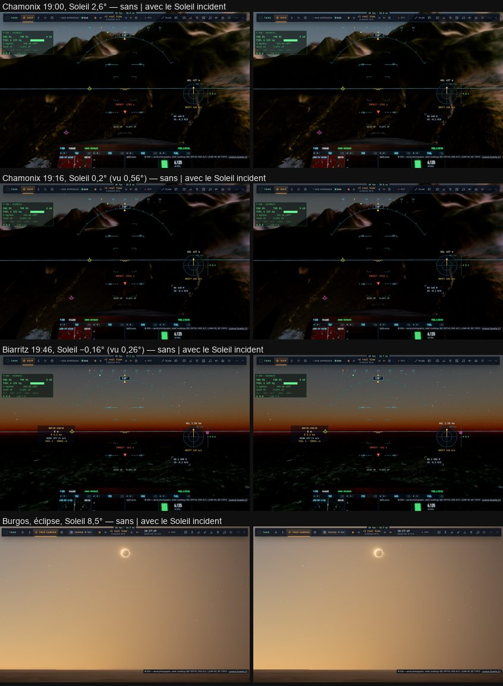

# R3 — les deux Soleils

Plan : [PLAN-REFRACTION-HORIZONS.md](../../PLAN-REFRACTION-HORIZONS.md), phase R3 (contrat C0-5, décision 22). Le 2 novembre
2026, sur ce Mac (M1 Max, sans écran), e2e `tests/e2e/sunset-incident.e2e.test.ts`. Données :
[R3/sunset-incident.json](R3/sunset-incident.json).

## Fait

- **Le Soleil géométrique** (`near.light`) reste celui du disque, des éclipses (`sunSeen` → `sunSeenPhysical`), de l'air et du
  ciel, des lumières de la nuit.
- **Le Soleil incident** : la direction géométrique relevée par la réfraction au sol sous la caméra.
  - Le relèvement est entier à l'horizon et en dessous, puis fondu jusqu'à 10° (5′ là) :
    `refraction.ts incidentAltitude`, le modèle du traceur.
  - Le renderer le calcule une fois par image (`incidentSun`) et l'écrit dans une sixième ligne de la table du Soleil
    (`TABLE_SUN + 5`, `SUN_SHADOW_VEC4S` 5 → 6, les décalages qui suivent recalés et vérifiés par `gpu-tables.test.ts`).
  - Le traceur le lit par `incidentSun(Lp)`.
- **Ce qui le prend** :
  - `shadeLite` : n·L, la transmittance `sunThrough`, le rebond, la lumière à travers les arbres, et `liteSun` ;
  - les cartes d'ombre orientées sur lui : le relief (`encodeSunShadow`), les arbres et les bâtiments
    (`treeShadowFrame`), les nuages (la carte de transmittance).
- **Ailleurs** (une autre planète, le pipeline tracé), la ligne est remise à zéro : le Soleil géométrique, comme avant.
- **TARS « sky »** donne la hauteur d'éclairage : `skyInfo().sun.lightAltDeg`.
- Un interrupteur sert aux comparaisons : `renderer.incidentSunOn`.

## Mesuré

Au couchant, vue cockpit tournée vers l'est (les versants face au Soleil couchant), sans nuages, l'heure avancée par pas,
chaque pas dessiné avec et sans le Soleil incident ; la luminance de la bande au-dessus du cockpit :

| | Biarritz, 21 juin (pas de 30 s) | Chamonix, 10 juillet (pas de 60 s) |
|---|---|---|
| Soleil géométrique | 0,76° → −3,1° | 7,2° → −1,8° |
| Le sol | 59,8 → 9,6, sans saut (le plus grand pas 1,5) | 16,5 → 6,0, sans saut (2,9) |
| Avec / sans l'incident | ±0,3 (le sol plat, lumière rasante) | **+4 à +7 %** sous 2,5° (les versants face au couchant) |

- Le disque disparaît (Soleil vu à −0,27°) quand le Soleil géométrique est à −0,8° : c'est jusque-là que le sol garde la
  lumière directe, et non plus jusqu'à la disparition du centre géométrique.
- L'éclipse basse de Burgos (Soleil à 8,5°) sort à 0,9 % près avec et sans, dans le bruit de l'accumulation.
- Unitaires : `refraction.test.ts` (nouveau test : le relèvement entier à l'horizon, nul à 10°, continu, jamais au-dessus de
  l'apparent), `gpu-tables`, budgets des noyaux, `tracer-kernels` : verts. WGSL : 68 sur 68.
- Le pipeline tracé n'est pas touché : seuls `shadeLite` et la carte des nuages lisent l'incident.

## Reste

- T6 : les cascades d'ombre prendront le Soleil incident à leur tour.
- R1 et R2 passeront la courbure aux tables.
