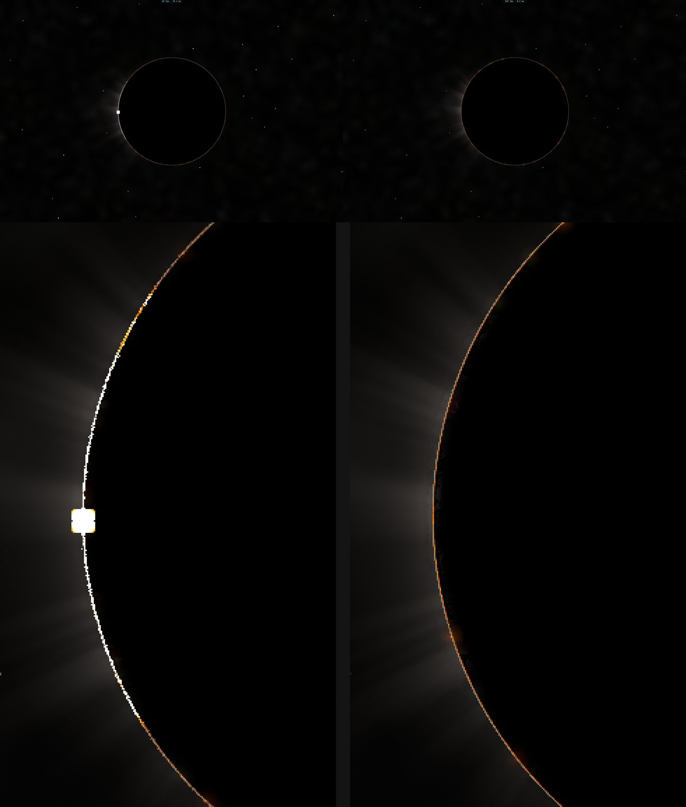

# R5 — Vénus et Titan d'orbite : leurs airs réfractent

But du plan : `airBend` pour le corps proche qui a une table, avec les réfractivités et dispersions propres au CO₂ et au
N₂/CH₄ (pas celles de l'air terrestre à même densité) ; leur lentille pour l'auréole de Vénus (et l'anneau rouge de la Terre
vu de la Lune éclipsée). Coût nul hors de la bande du limbe.

## Premier lot : les airs et la déviation au limbe, au CPU (5 novembre)

- **Réalisé** (`src/system/refraction-planets.ts`) :
  - deux profils de température illustratifs, tirés des références, la pression intégrée en équilibre hydrostatique
    (g en 1/r²) :
    - **Vénus** : VIRA (Seiff et al. 1985), 735 K et 92 bar au sol, environ 170 K vers 90–100 km ;
    - **Titan** : la descente de Huygens (HASI, Fulchignoni et al. 2005), 93,7 K et 1 467 hPa au sol, tropopause à 70 K
      vers 44 km ;
  - leur réfractivité à partir de celle de leurs gaz aux conditions standard : CO₂ 4,49·10⁻⁴ et N₂ 3,5 % pour Vénus, N₂ et
    1,5 % de CH₄ pour Titan. La dispersion suit une forme de Cauchy par gaz ;
  - la déviation d'un rayon rasant le limbe par l'intégrale d'Abel (`planetLimbBending`), la singularité ôtée par
    r = r_t + x².
- **Vérifié** (`tests/refraction-planets.test.ts`, 4 tests) :
  - Vénus : 1,07 bar à 50 km et 38 mbar à 70 km (VIRA : 1,07 bar et 37 mbar) ;
  - la hauteur de réfraction critique de Vénus, où r dN/dr = −1 et où un rayon fait le tour de la planète, tombe entre 28 et
    40 km (environ 33 km dans la littérature) ;
  - Titan : 119 hPa vers 44 km (Huygens : environ 115 hPa) ;
  - la déviation suit l'estimation exponentielle N √(2πr/H) à 25 % près dans l'air mince ;
  - le bleu est dévié davantage que le rouge.
- **Valeurs :**

  | | 50 km | 60 km | 70 km | 80 km | 90 km |
  |---|---|---|---|---|---|
  | Vénus, déviation au limbe | 92′ | 31′ | 5,8′ | 0,88′ | 0,09′ |

  Pour Titan : 15,5′ à 44 km et 0,44′ à 100 km. Sous environ 100–200 km, la brume y est de toute façon opaque.
- **Limites :**
  - sous la hauteur critique de Vénus, les rayons sont piégés et l'intégrale n'a plus de sens ;
  - les profils sont illustratifs : ils ne décrivent aucun jour mesuré.
- **Reste :**
  - la table au GPU pour le corps proche, et la bande du limbe déviée par `airBend` généralisé, d'orbite ;
  - la lentille de l'auréole de Vénus (le Soleil vu en arc à travers la couche transparente, vers 70–90 km), avec la
    transmission du même trajet ;
  - l'anneau rouge de la Terre vu de la Lune éclipsée ;
  - Titan sous sa brume.

## Deuxième lot : la bande du limbe déviée au GPU, d'orbite (5 novembre)

- **Réalisé :**
  - `planetRefractionTable` : pour le corps proche (Vénus, Titan), ln B par hauteur tangente, 512 hauteurs quadratiques
    jusqu'au sommet du profil. L'en-tête porte l'indice du corps, son rayon, le sommet, la hauteur critique (Vénus :
    31,3 km) et la dispersion du rouge et du bleu relative au vert. Calcul en 41 ms dans le worker des tables.
  - `TABLE_PREFR` (`gpu-tables.ts`) ; `renderer.prefrOn` (vrai par défaut, avec le réglage `refraction`) et `prefrNow`. La
    table est demandée une fois par visite du corps.
  - `trace.wgsl planetBend` : depuis l'extérieur du profil, un regard dont le rayon droit rase le limbe devant lui est
    tourné vers le corps de B(ht). Sous la hauteur critique, le rayon est piégé : rien ne passe. Les couleurs suivent la
    dispersion des gaz (`REFR_DR`, `REFR_DB`, lus par le disque du Soleil).
  - `discRects` : le Soleil n'a plus de rectangle de disque quand une table est en place ; ses images déviées sont tracées
    par les rayons du ciel.
- **Vérifié :** `tests/refraction-planets.test.ts` (5 tests : la table relue à 3 % de l'intégrale, piégée sous la hauteur
  critique) ; `gpu-tables` (l'emplacement `PREFR_OFF`).
- **Observé** (e2e `venus-aureole`, ce Mac) : caméra libre à 600 000 km de Vénus, en deçà de 300 rayons pour qu'elle reste le
  corps proche (à 1 million de km, le Soleil prend sa place), champ de 2,4° :

  

  - **La géométrie du deuxième contact d'un transit** (`VA_PHASE` 179,817° : le Soleil 11′ à côté du centre de Vénus, son
    bord 2′ à l'intérieur du limbe, entièrement caché). Avec la déviation, **un arc de lumière solaire sur le limbe côté
    Soleil, orangé à ses extrémités** ; sans elle, la seule lueur de la couronne.
  - Côté Soleil (±30°) : luminance moyenne 80,7 et 55,4 (574 et 213 pixels saturés) avec, contre 40,5 (aucun pixel
    saturé) sans. Le limbe opposé ne change pas (15,0 · 15,1 contre 16,8).
  - Les sondes (`VA_BOOST`, quatrième composante du deuxième vec4 de la table) ont d'abord montré que `planetBend` tourne
    bien pour Vénus. Dans les premières géométries, la bande utile (70–160 km, au-dessus de la couche de nuages) n'a que
    4 px, et l'éblouissement du Soleil la masquait.
- **Défaut vu, non corrigé :** un carré blanc d'environ 6 px qui change de place d'une prise à l'autre sur l'arc. C'est
  probablement un échantillon isolé tombé sur le Soleil (radiance énorme) puis étalé par la reconstruction. L'arc lui-même
  est à la radiance du Soleil (conservée par la réfraction), ce qui est juste. Son épaisseur dépend de la loupe : vers
  75 km, elle comprime le Soleil d'environ 86, soit un arc de quelques pixels ici. Elle n'est pas encore rendue par une
  couverture de pixel.
- **Reste :**
  - corriger ce carré : la couverture du disque à travers la loupe, l'étirement radial de l'empreinte du pixel ;
  - l'anneau rouge de la Terre vu de la Lune éclipsée ;
  - Titan sous sa brume ;
  - le coût, nul hors de la bande par construction mais non mesuré.
