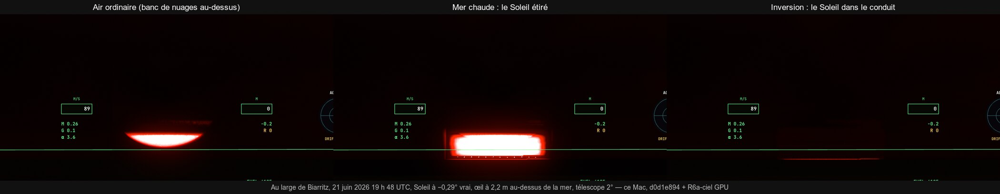
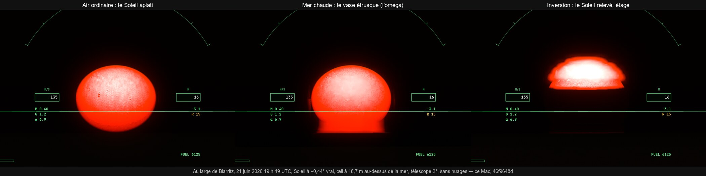

# R6 — les mirages

## R6a-ciel, premier lot : les rayons de l'œil tracés à travers les points de retournement (5 novembre)

- **Réalisé :** `src/system/mirage.ts`.
  - **Profils forcés**, illustratifs et jamais présentés comme observés :
    - `standard`, l'air du modèle stratifié ;
    - `warmSea`, une mer plus chaude que l'air : +6 K à la surface, qui s'éteint sur 4 m ;
    - `inversion`, de l'air frais sous 20 m puis 8 K de plus sur les 30 m suivants.
  - **Réfractivité** : celle de Ciddor, la pression hydrostatique, tous les 0,25 m jusqu'à 2 km.
  - **`mirageRay`** : un rayon de l'œil intégré en RK4 sur l'abscisse curviligne. État (r, θ, ψ) ; dr/ds = sin ψ,
    dθ/ds = cos ψ / r, dψ/ds = cos ψ (1/r + n′/n). Il est suivi à travers ses points de retournement jusqu'à 2 km ou jusqu'à
    la mer. Son élévation vraie est celle de sortie, ramenée au repère de l'œil (−θ), moins la courbure de l'air au-dessus,
    calculée par le modèle stratifié (`bendingUp`).
  - **`mirageTable`** : la table de l'œil, élévation vraie pour chaque élévation apparente de la bande (NaN : la mer).
  - **`imagesOf`** : les élévations apparentes d'un astre, une seule ou plusieurs (les images d'un mirage).
- **Vérifié** (`tests/mirage.test.ts`, œil à 10 m, 20 °C) :
  - **air standard** : à moins de 0,02° de la réfraction du modèle stratifié (0,1°, 0,3°, 1°) ; table monotone, une seule
    image ;
  - **mer chaude** : la ligne de mer descend de 0,1° ; les rayons visés entre −0,2° et −0,05° remontent ; un astre à −0,45° vrai
    est vu deux fois, l'image du bas sous l'horizon standard. C'est le **vase étrusque** ;
  - **inversion** : un conduit ; les rayons rasants retombent sur la mer, l'horizon se relève de plus de 0,1°.
- **Coût CPU** : 0,3 s pour 161 rayons (standard, mer chaude), 2,2 s pour l'inversion, dont les rayons piégés courent loin au
  ras de l'eau. C'est le travail d'un worker, une fois par profil et par hauteur d'œil.
- **Reste de R6a-ciel :**
  - le worker et la table par couleur (trois longueurs d'onde) ;
  - le GPU : chaque pixel de ciel de la bande lit sa vraie direction. La mer raster au ras de l'horizon doit céder la place
    au ciel ou au Soleil inversé là où le rayon remonte, ce qui la croise avec T7 et R6a-terrain ;
  - le réglage et TARS ;
  - la planche du Soleil en vase étrusque au téléobjectif.

## R6a-ciel, deuxième lot : les tables hors de l'image, publiées pour le GPU (5 novembre)

- **Réalisé :**
  - `mirageTables` : trois couleurs (650, 550 et 450 nm), 256 élévations apparentes sur ±0,6°, la mer marquée −10 ; un
    en-tête (actif, hauteur de l'œil, bande).
  - Le plus petit pas au ras de l'eau est porté de 0,1 à 0,5 m : 0,9 s pour la mer chaude, 7 s pour l'inversion (ses rayons
    piégés), les tests inchangés.
  - `src/system/mirage-worker.ts`, servi par `server.ts` (`/mirage-worker.js`) et construit pour Pages
    (`scripts/build-pages.ts`).
  - `renderer.mirageProfile` (coupé par défaut) et `updateMirage` : la hauteur de l'œil prise au-dessus de la mer
    (ellipsoïde moins N du géoïde) ; une nouvelle demande quand le profil change ou que l'œil bouge de 2 m ou d'un dixième
    de sa hauteur ; la réponse recopiée dans `TABLE_MIR` (`mirageNow`).
- **Vérifié :**
  - `tests/mirage.test.ts` : 4 tests, dont la dispersion (le bleu plus courbé que le rouge) ;
  - `tests/gpu-tables.test.ts` ;
  - e2e `mirage-tables` : publié en 0,9 s pour un œil à 16,8 m au-dessus de la mer, puis effacé ; aucune erreur GPU.
- **Reste :** la lecture au GPU, le réglage et TARS, la planche.

## R6a-ciel, troisième lot : les mirages dessinés (5 novembre)

- **Réalisé** (`trace.wgsl`) :
  - `mirageTrue` lit la table de l'œil (canal vert) : l'élévation vraie pour chaque élévation apparente de la bande, ou la
    mer.
  - `airBend` : dans la bande, la courbure devient l'écart entre élévations apparente et vraie, et le rayon qui finit dans la
    mer est marqué comme tel (`REFR_SEA`).
  - `earthNear` : un rayon que l'air forcé fait remonter avant la mer n'a pas de sol (`mirageEscapes`).
  - `shadeWater` laisse ces pixels au traceur, et `main` ne les saute plus.
  - `discRects` (renderer) : sous un mirage, le Soleil n'a plus de rectangle de disque. Ses images, au-dessus et au-dessous de
    sa place ordinaire, étaient coupées au rectangle calculé pour l'air ordinaire. Les rayons du ciel le dessinent.
  - Profil coupé : rien ne change, tout passe par l'en-tête de la table.
- **Observé** (e2e `mirage-sun`, au large de Biarritz le 21 juin 2026 à 19 h 48 UTC, Soleil à −0,29° vrai, télescope à 2°) :
  - **air ordinaire** : le Soleil couchant aplati, son haut caché par un banc de nuages lointain ;
  - **mer chaude** : le Soleil étiré en bande rectangulaire, de la largeur de son diamètre (≈ 300 px à 585 px/°). C'est le
    « Soleil carré » des fortes réfractions : les élévations apparentes proches du repli de la table tombent toutes sur sa
    corde centrale ;
  - **inversion** : le Soleil presque perdu dans le conduit, réduit à un trait rouge.
- **Limites :**
  - Pas de comparaison avec une photo.
  - L'avion s'est posé sur la mer : l'œil n'était qu'à 2,2 m, au lieu des 10 m prévus.
  - Les rayons épars du ciel laissent une rangée pointillée sous la bande.
  - Une seule couleur pour la direction : pas de bord vert.
  - Le réglage joueur et TARS restent à faire, ainsi qu'un vrai vase étrusque, avec l'œil plus haut et le Soleil plus bas.

## R6a-ciel, quatrième lot : le réglage du joueur et TARS (5 novembre)

- **Réalisé :**
  - `settings.mirage` (`"off"`, `"warmSea"`, `"inversion"`, coupé par défaut, portée « pref »).
  - Dans le menu : Ciel › La Terre › Mirages, un choix segmenté avec ses explications. Les profils y sont dits illustratifs,
    et non l'air du jour.
  - Traduction française.
  - TARS y accède par `set_settings` et `find_settings`, comme à tout réglage.
  - Le moteur lit le réglage ; `renderer.mirageProfile` reste une surcharge de test.
- **Vérifié :**
  - `settings-costs`, `settings-menu`, `i18n`, `tars-tools`, `tars-agent` verts (37 tests) ;
  - e2e `mirage-tables` : par le réglage, les tables d'une inversion publiées pendant le vol (7 s de calcul), puis effacées.
- **Reste :** les trois couleurs à l'image (le rayon vert : une direction par canal dans la bande), un vrai vase étrusque
  (œil plus haut, Soleil plus bas) comparé à une photo, R6a-terrain, R6b.

## R6a-ciel : le vase étrusque (5 novembre)

- **La vue choisie par le calcul :** sur mer chaude, les élévations vraies doublées s'étendent de −0,41° à −0,33° pour un œil
  à 5 m, et de −0,62° à −0,39° pour un œil à 30 m. Le Soleil (0,53°) est placé à −0,45° vrai, l'œil à 30 m. L'avion vole à
  140 m/s pour tenir son altitude ; à 10 m, il s'était posé sur l'eau. Les nuages de la carte sont coupés, car un banc
  lointain coupait le haut du disque.
- **Observé** (e2e `mirage-sun`, `MS_ALT` et `MS_SUN` réglables ; œil à 18,7 m au-dessus de la mer) :
  - **air ordinaire** : le Soleil entier, aplati en ovale ;
  - **mer chaude** : son bas prolongé par un pied à flancs droits, l'image renversée qui le rejoint au repli. C'est la
    silhouette en **oméga du vase étrusque** ;
  - **inversion** : le Soleil relevé, écrasé et étagé en couches, comme dans un mirage supérieur.
- **Limites :**
  - La ressemblance aux photos d'oméga est jugée à l'œil, sans comparaison chiffrée.
  - Une couleur pour la direction (pas de bord vert).
  - Le pied montre quelques irrégularités, venues des rayons épars du ciel.
