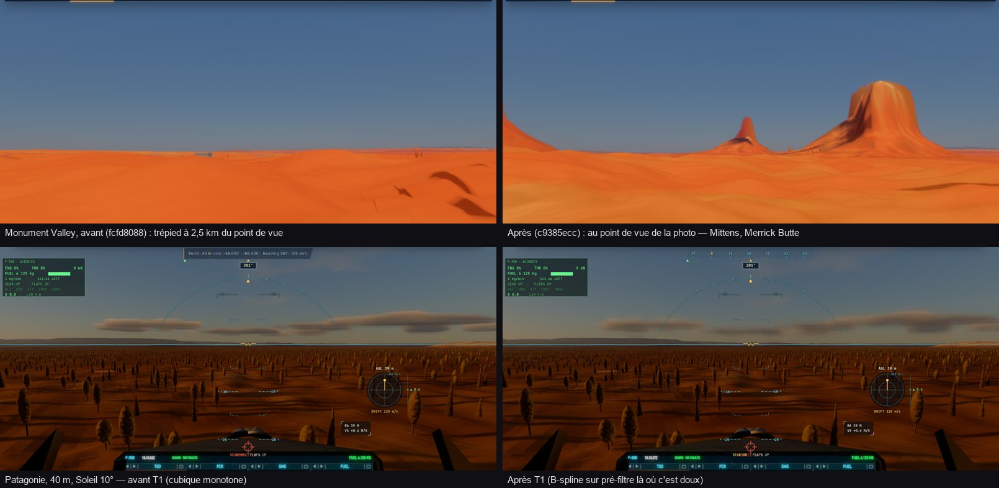

# T1, T2, T8a — et deux régressions trouvées en route

Plan : [PLAN-REFRACTION-HORIZONS.md](../../PLAN-REFRACTION-HORIZONS.md). Le 2 novembre 2026, sur `main` : `fcfd8088` (les
vraies pistes), `c9385ecc` (Monument Valley, le z 14), `ebf41198` (T1, T2, T8a), puis la suite de T8a (deux passes IGN).

## T1 — les escaliers

- **Cause mesurée sur les données** : les tuiles Terrarium jusqu'au z 12–13 sont arrondies au mètre (SRTM), avec des paliers de
  2 à 4 texels ; le z 14 est rééchantillonné (lisse), sauf par endroits (Kazakhstan). La cubique monotone dessinait chaque
  palier plat et chaque marche raide.
- **Fait** : la cubique hybride — B-spline sur un pré-filtre binomial 3 × 3 là où le relief est doux (pente < 0,3 m/m), monotone
  là où il est raide (> 0,8) ou relevé (marque IGN/swisstopo) ; le poids par nœud, continu (saut ≤ 0,1 mm aux bords de cellule) ;
  seuls les nœuds doux floutés (le haut d'une butte non abaissé par son pied). CPU (`sampleLevel`) = GPU (`tileSample`).
- **Mesuré** (rampe de 1,5 % arrondie au mètre, texels de 26 m) : la pente rendue de 0,64 à 1,28 × la vraie (avant : 0 à 1,9 × —
  des plats et des contremarches) ; les falaises de 150 m sans lèvre ni creux, le sommet à sa hauteur.
- **Décision 12** : le pré-filtre était à décider par Sam après les captures ; la sonde a montré que la B-spline seule laissait
  des plats sur les paliers de trois texels — il est en place, à confirmer par Sam.
- Les facettes (triangles éclairés à plat) restent : c'est T5.

## T2 — les coutures

Chaque anneau du relief porte son rang dans la marque de la cible (½^pas × (1 − rang/64)) : `rasterNormal` s'arrête aux six
coutures (deux seulement avant : les quatre anneaux plus fins que le patch de référence avaient tous le pas 0). La tolérance du
traceur est inchangée (le pas arrondi).

## T8a — le chargement (tranche avancée à la demande de Sam)

- Terrarium d'abord partout, le relief IGN par-dessus dans sa propre file (14 à la fois, les plus proches et les plus fins d'abord) ;
  puis, en deux passes, le sol de chaque tuile avant les surfaces lointaines (silhouettes z 11–13).
- Toutes les tuiles manquantes classées ensemble, les plus proches d'abord dans les tuiles de leur niveau, menées dans le sens du vol.
- Fenêtres de 8 tuiles jusqu'au z 14 (z 6–10 compris, sans mémoire GPU de plus : le z 10 porte à 312 km).
- Un halo préchargé autour des fenêtres (6 anneaux, 640 tuiles en « très loin »), qui attend le relief IGN des fenêtres et oublie
  d'abord ce qui est derrière ; tout passe par le Service Worker (gardé pour le vol suivant).

| Aubrac, kerr-mini, Service Worker | Terrarium z 14 | IGN z 15–17 | IGN z 11–14 | Requêtes |
|---|---:|---:|---:|---:|
| A avant (`fcfd8088`), à froid | 68,3 s | 71,3 s | 68,3 s | 1 547 |
| B `ebf41198`, à froid | 73,9 s | 77,4 s | 118,2 s | 3 019 |
| A avant, à chaud | 24,2 s | 26,2 s | 26,2 s | 721 |
| B `ebf41198`, à chaud | **5,8 s** | **6,8 s** | 49,1 s | 856 |

À chaud, le relief proche quatre fois plus tôt ; à froid, la limite est le débit du WMS-R de l'IGN (20 requêtes/s) — d'où la
passe en deux temps :

| Aubrac, ce Mac (M1 Max), Service Worker | Terrarium z 14 | IGN z 15–17 | tout | Réseau |
|---|---:|---:|---:|---:|
| `ebf41198`, à froid | 42,7 s | 45,4 s | 49,6 s | 2 460 |
| deux passes, à froid | 24,8 s | **26,3 s** | 83,6 s | 4 427 |
| deux passes, à chaud | 17,2 s | 18,3 s | 29,7 s | 11 (4 126 du cache) |

Le relief proche à froid presque deux fois plus tôt ; les silhouettes lointaines après (voulu). Reste à T8 : **le service
depuis le cache du Service Worker** (~35 tuiles/s : la décompression du relief, l'index IndexedDB — à chaud 17 s pour le z 14
alors que rien ne vient du réseau), **le volume du halo** (4 427 requêtes), et **la variance de kerr-mini** (le même commit
68 puis 103 s à froid : son réseau ; plusieurs passages par mesure).

## Deux régressions des planètes en raster (29–31 octobre), trouvées en route

1. **Monument Valley sans ses buttes** : le trépied d'une scène se fixait là où la caméra était tombée pendant les ~9 s du
   démarrage (plus long depuis les noyaux des planètes) — 2,5 km du point de vue, les buttes derrière la vue. Il prend
   maintenant le point au sol que la scène lui donne (`rig.pin`). Score des buttes 0,002 → 0,183.
2. **Le z 14 de toute la Terre** : la portée du raster des corps (P7) écrite dans `P.tileL[17].x` — la largeur de la fenêtre z 14
   de la Terre —, remise à 0 à chaque image : le traceur sans le niveau le plus fin des données mondiales.

## Tests

- Unitaires : tuiles, zones, relief IGN, raster, noyaux (budgets), pistes, caméra — verts.
- e2e : `monument-relief` passe (145 s ; ses attentes plafonnées, le géoïde compté), `ellipsoid` réparé (2/2), `ign-relief` vert.
- Échecs **antérieurs** (identiques sur `fcfd8088`), à une séance de réparation : `landscapes`, `multiexposure`, `camera-travel`,
  `observatory`, `zones` (« realtime »), `ortho` (le crédit IGN).
