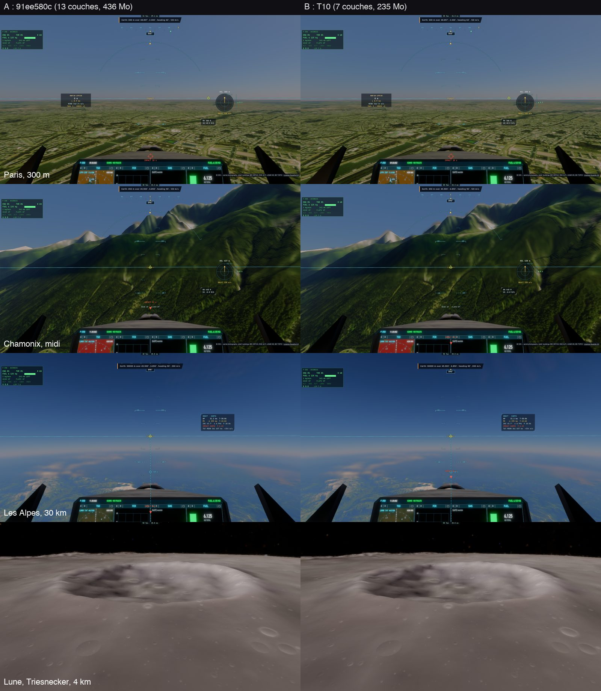

# T10 — la mémoire des tuiles

Plan : [PLAN-REFRACTION-HORIZONS.md](../../PLAN-REFRACTION-HORIZONS.md), phase T10 (§3.6). Le 2 novembre 2026.
e2e `tests/e2e/tile-memory.e2e.test.ts` ; données : [T10/compare.json](T10/compare.json),
[T10/tile-memory-A1.json](T10/tile-memory-A1.json) (avant), [T10/tile-memory-B2.json](T10/tile-memory-B2.json) (après).

## Avant

À la portée « très loin » (le défaut), la texture des tuiles de la Terre faisait 2048² × 13 couches × 8 octets = **436 Mo**
(416 Mio) : une couche par niveau (z 6 … 17) plus une pour les orthophotos. Or 8 des 12 niveaux (z 6–10, z 15–17) n'ont
que 4 × 4 tuiles quelle que soit la portée : chacun n'occupait qu'un quart de sa couche.

## Fait

- **Le rangement** (`tileLayout`, `earth-tiles.ts`) :
  - un niveau aussi large que la texture garde sa couche (z 11–14, 8 × 8 tuiles) ;
  - les niveaux à 4 tuiles prennent chacun un quart de couche (1024²), à la suite ;
  - les orthophotos suivent de la même façon.
  - Résultat : **7 couches** au lieu de 13. À la portée normale (1024²), rien ne change : une couche par niveau.
- **La lecture** (`trace.wgsl tileAt`) : une seule fonction lit tous les texels de tuile (`tileTexel`, `tileFine`,
  `tileImage`, l'imagerie anisotrope). La place d'un niveau est rangée dans ses paramètres :
  - le coin de son quart de couche, dans les bits au-dessus du masque de sa fenêtre (`P.tileL[2l].zw`) ;
  - sa couche, au-dessus de 2¹⁶ dans `P.tileL[2l + 1].w`.
  - Les tuiles de la Lune et de Mars passent par les mêmes paramètres : `moon-tiles.ts` y écrit sa couche de la même façon.
- **La mémoire** suivie dans `earthTiles.textureBytes` et `peakBytes`. Le pic compte l'ancienne texture, gardée le temps
  que le travail soumis avec elle soit fini.
- **Coût du shader** : +0,4 à +2,7 % de lignes inlinées. Six budgets de noyaux sont relevés de 0,2 à 0,8 %
  (`tests/kernel-budget.json`), et les 68 shaders compilent.

## Mesuré

| | Avant (`91ee580c`) | T10 |
|---|---:|---:|
| Texture « très loin » | 13 couches · **436 Mo** | 7 couches · **235 Mo** |
| Texture « normale » | 16 couches · 134 Mo | 16 couches · 134 Mo |
| Pic au passage normale → très loin | 570 Mo (calculé : 134 + 436) | **369 Mo** (mesuré) |
| Jauge GPU du jeu (`#vram`), Paris bas | 1 578 Mio | **1 386 Mio** (−192) |
| Jauge GPU du jeu, Chamonix | 1 450 Mio | **1 258 Mio** (−192) |

- **Le gain : 201 Mo (192 Mio)**, comme prévu par le plan (~200 Mo).
- **Le pic** est atteint au démarrage : la texture normale vit encore quand la très lointaine est créée.
- **Les images** (kerr-mini, A B B A, part des pixels qui changent) :

  | Vue | A/A | B/B | A/B |
  |---|---:|---:|---:|
  | Paris, 300 m | 0,68 % | 0,89 % | 0,67 · 0,91 % |
  | Chamonix, midi | 1,13 % | 10,4 % | 2,47 · 9,53 % |
  | Les Alpes, 30 km | 0,85 % | 0,06 % | 0,85 · 0,06 % |
  | La Lune, Triesnecker | 0,40 % | 0,44 % | 0,40 · 0,44 % |

  - Chaque écart A/B est du même ordre que l'écart entre deux tours du même code.
  - Les grands écarts suivent une tuile arrivée dans un tour et pas dans l'autre. À Chamonix, B3 est le seul tour où la
    dernière tuile était là : il s'écarte autant de B2 (le même code) que de A4. Aux Alpes, c'est A1 qui en avait une en
    attente.
  - Les vues sans tuile en retard s'accordent à 0,06 % (les Alpes) et 0,4 % (la Lune).
- **Le temps d'image** (kerr-mini, plein écran, la suite partagée en A B B A dans quatre tours, 8 mesures par côté) :

  | Vue | A, médiane | B, médiane |
  |---|---:|---:|
  | Paris bas | 33,7 ms | 33,5 ms |
  | Chamonix, Soleil bas (le régime de 49 ms) | 49,0–49,4 ms | 48,8–49,4 ms |

  - Aucun coût mesurable.
  - Chamonix retombe des deux côtés dans ses deux régimes, 49 ou 59 ms (vu en T6, toujours à expliquer).

## Tests

- **Unitaires** : `earth-tiles.test.ts` a un nouveau test. Les tuiles y sont posées dans une texture simulée, puis relues comme
  le traceur les lit depuis `params()`, aux deux portées. Chaque niveau est relu entier et à sa place ; les 7 couches, les
  octets et le pic sont vérifiés. `ortho.test.ts` est passé à `tileLayout`. Tuiles, terrain, Lune, noyaux, tables : 286 tests
  sur 290 passent.
  - Deux échecs de `lola-tiles` (délai de 5 s, sous la charge) passent seuls.
  - Les deux autres, dont `chrome-lock` (un faux processus d'un tour précédent encore vivant), n'ont rien à voir avec T10.
- **e2e** `tile-memory` : seul ici, puis en A/B sur kerr-mini, avec le premier tour et les 4 vues vérifiés.
  - Le premier lancement A/B s'était arrêté sur A : une tuile de Paris restait en attente après 60 s sur le réseau du mini.
    Le test en tolère maintenant deux.
  - Le critère compare la meilleure paire A/B à 3 × le plus grand écart entre deux tours du même code. Le tour 4 du job a été
    jugé sur l'ancien critère (l'écart A/B le plus grand) et a échoué à cause de B3 ; ses images, rejugées sur le nouveau, passent
    les 4 vues.

## Vu en route

- **Les cascades de T6 gardées pendant l'arrivée des tuiles** : dans une sonde, une carte gardée s'écartait de 49 % d'une carte
  redessinée, pendant l'arrivée des niveaux.
  - Une fois les tuiles arrivées, l'écart retombe à 0,07–0,24 %, avec ou sans un redessin de plus une seconde après les
    cuissons.
  - Ce correctif n'est donc pas démontré et n'est pas gardé. À surveiller avec T4.
- **L'iPad** (`e2e iPad` du plan) : pas d'appareil ici. La texture très lointaine passe de 416 à 224 Mio, sous le refus de
  256 Mio d'un iPad : il pourrait maintenant garder la portée « très loin ». C'est à vérifier sur un vrai iPad.
