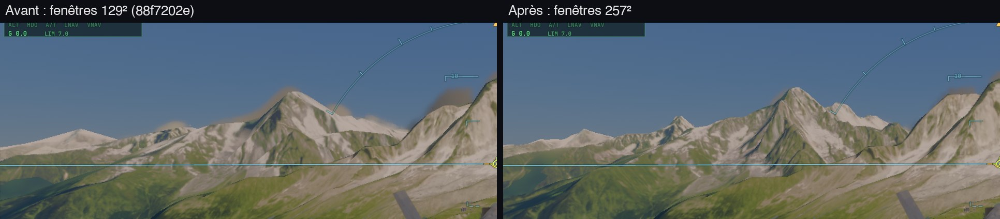
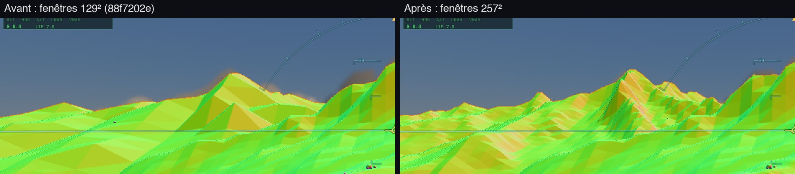

# Les fenêtres du cache du relief à 257² nœuds — les sommets lointains

3 novembre 2026. Sam : « La forme des sommets lointains reste en grands triangles d'environ 100 m … pas acceptable ».

## Ce qui change

- `TERRAIN_CACHE_N` passe de 129 à 257 (`src/system/terrain-cache-layout.ts`). Le pas de chaque niveau ne change pas
  (`TERRAIN_CACHE_ROUNDS`), donc chaque fenêtre couvre deux fois plus loin : le patch ±153 m, le dernier anneau ±312 km.
  Une distance donnée est donc dessinée par un niveau **deux fois plus fin** : les facettes sont divisées par deux.
- Les adresses de la table GPU qui suivent le cache sont décalées de +98 816 vec4 dans `trace.wgsl` (`SUNI_OFF`… `ORTHO_OFF`).
- Le maillage du patch autour des pistes, construit sur le CPU à chaque déplacement de fenêtre, aurait coûté 22–28 ms au lieu
  de 8–10 ms (`terrain-raster-mesh.ts`). Il revient à son coût d'avant :
  - les bords de piste ne testent que les cellules qu'ils croisent, rangée par rangée (le rectangle englobant d'un bord en
    diagonale, c'était toute la fenêtre) ;
  - les sommets et les indices sont écrits en place (plus de petit tableau par sommet) ;
  - la grille sans piste (les anneaux) est faite une fois par niveau et partagée.

| Maillage, une piste (ce Mac) | 129² | 257² avant | 257² après |
|---|---|---|---|
| niveau 0 | 10,5 ms | 27,6 ms | 9,0 ms |
| niveau 2 | 8,0 ms | 22,2 ms | 10,5 ms |
| niveau 4 | 4,5 ms | 13,3 ms | 6,8 ms |
| grille sans piste (un anneau) | ~1,5 ms | 4–6 ms | 0 (en cache) |

Les triangles coupés restent les mêmes (1 002, 2 118, 440) ; le maillage reste étanche (`tests/terrain-raster-mesh.test.ts`).

### Le maillage des pistes préparé à l'avance (worker)

Même accéléré, le maillage d'un patch de 257² coupé autour d'une piste se calculait dans l'image : dans Chrome, une image
de ~27 ms (contre 8 ms) à chaque déplacement de fenêtre, environ une fois par seconde en vol bas sur une piste. Désormais :

- le cache décide la **prochaine fenêtre** de chaque niveau un peu avant le bord (`terrainWindowNext` : là où la caméra le
  franchira, avec l'avance de 24 nœuds) et la garde au moment de bouger si elle contient encore la caméra
  (`upcomingWindow`, `upcomingTaken` / `upcomingMissed`) ; en vol droit, chaque déplacement est prévu (test unitaire, huit
  directions) ;
- `TerrainRaster.prepare` fait faire le maillage de cette fenêtre au worker `terrain-mesh-worker.js` (5–7 ms, hors du fil
  principal) ; quand la fenêtre bouge, il est pris tout fait (`meshAhead`) ; sinon il est fait dans l'image comme avant
  (`meshInFrame`).

| Vol stabilisé sur piste, 12 s (`runway-mesh`) | 129² | 257², maillage dans l'image | 257² + worker |
|---|---|---|---|
| Kennedy, ce Mac : image avec reconstruction (méd.) | 17,4 ms | 26,6 ms | 12,2 ms |
| Le Bourget, ce Mac | 15,7 ms | 27,7 ms | 12,0 ms |
| maillages faits dans l'image en vol | tous | tous | **0** (8/8 et 13/13 du worker) |
| images avec le maillage coupé le long de la piste | 84–92 % | 100 % | 100 % |

Image médiane du vol : 8,1–8,3 ms ici ; sur le mini (M1) 19,8 ms, ses images avec reconstruction ~25 ms au Bourget (l'envoi
des ~2,4 Mo du maillage au GPU).

## Mesures

- **Les images** (kerr-mini, `zz-peaks-probe`, A = 88f7202e, B = 257²) : les crêtes lointaines dessinées, les sommets
  secondaires visibles, les halos sombres au-dessus des crêtes disparus.

  
  

- **Le coût du rendu** (kerr-mini, `plan-views`, A B B A, `20261103-010902-n257-cost`) : Paris 34,9 → 35,15 ms (+0,25 ms,
  dans le bruit) ; Chamonix au soleil bas bimodal (49 ou 58 ms) dans les deux builds, sans écart dû au build.
- **Vol bas à Chamonix** (ce Mac, en fenêtre, `terrain-bakes`, TB_TAG n257) : 8,3 ms médian, 11,7 ms au 95ᵉ centile,
  5,7 cuissons/s, 0,37 ms de GPU de cuisson, aucune erreur GPU.

## Reste

- Les facettes restent visibles de près sur les pentes raides lointaines : un découpage par erreur projetée (CDLOD, « T11 »)
  irait plus loin si besoin.
