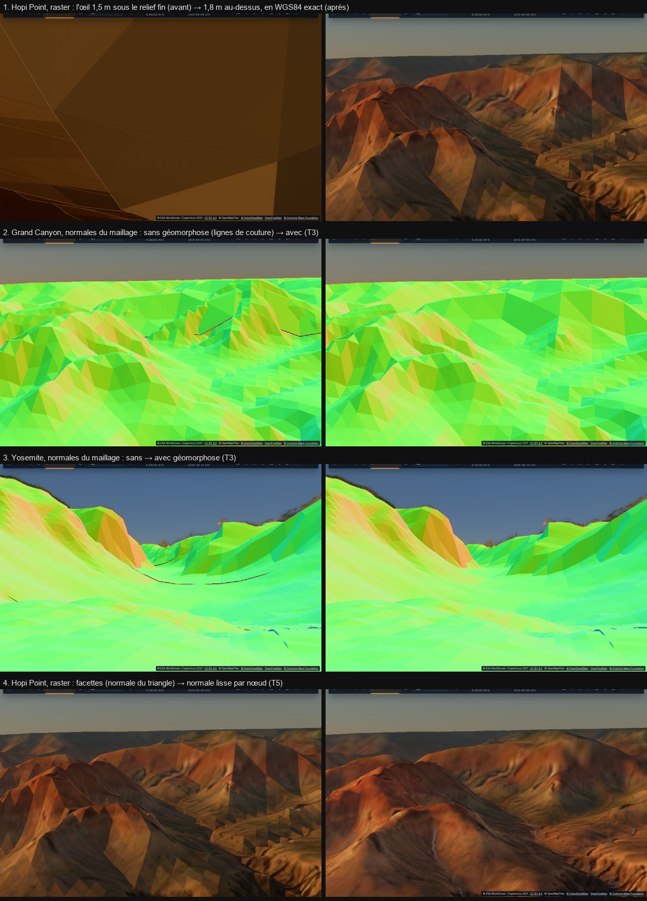

# T3, T5 — et l'œil sous le relief (le WGS84 du traceur)

Plan : [PLAN-REFRACTION-HORIZONS.md](../../PLAN-REFRACTION-HORIZONS.md). Le 2 novembre 2026, sur `main`. Vue de référence :
le Grand Canyon depuis Hopi Point (36,074414° N, 112,15494° O, 2 121 m), au vrai point de vue. Mesures sur ce Mac (M1 Max,
sans écran) et sur kerr-mini (plein écran).

## D'abord : les grands triangles de Hopi Point n'étaient pas des coutures

En raster, à Hopi Point, l'image n'était qu'une poignée de triangles géants, sans ciel. Ce n'étaient ni le décor ni les anneaux :
coupés, rien ne changeait. Le patch le plus fin (nœuds de 1,2 m) était vu **par en dessous** : l'œil du raster se trouvait
1,47 m sous le relief fin, alors que pour le traceur il était 1,8 m au-dessus.

- **La cause** : le traceur marche le relief dans un « espace écrasé » (z × a/b, l'ellipsoïde y est la sphère unité). Il y
  lisait le relief à la direction géodésique du **rayon** écrasé d'un point. Or un point à h au-dessus de l'ellipsoïde, le long
  de sa normale, est sur un rayon écrasé dont la direction géodésique est h·e′²·sinφ·cosφ / N plus près du pôle. La hauteur est
  juste au centimètre près, mais le relief était lu au mauvais endroit.
- **L'ampleur** :

  | Lieu | Altitude | Glissement |
  |---|---:|---:|
  | Paris | 35 m | 0,1 m |
  | Grand Canyon | 2 120 m | 6,8 m |
  | Cervin | 2 600 m | 8,7 m |
  | Fuji | 3 776 m | 12 m |
  | Everest | 8 848 m | 25 m |

  Le maillage raster, lui, est en WGS84 exact (`terrainPoint`), comme le décor (repère local tangent). Les deux ne
  coïncidaient donc plus avec le relief du traceur en montagne. Au bord d'une falaise, le trépied (posé par le CPU, qui suit
  le traceur) finissait sous le relief exact.
- **Fait** :
  - `geoQ` corrige la direction géodésique de la hauteur du point (`GEO_H`). Cette hauteur est celle de la dernière lecture
    du relief, c'est-à-dire la hauteur du point au croisement du sol ; dans les noyaux raster, c'est la hauteur du point
    lui-même (`geoH`).
  - Le CPU fait la même correction : `squashedHeight` → `geodeticDirAt`, utilisé par le trépied, le train d'atterrissage et
    la marche. L'ancre des tuiles près de la caméra (`anchorTileCoord`) aussi.
  - Il reste au plus 5 cm jusqu'à 9 km d'altitude (test `ellipsoid.test.ts`).
- **Mesuré** : l'œil du raster passe à 1,8 m au-dessus du sol fin (2 123,2 m contre 2 121,4 m). Dans l'A/B contre HEAD
  (`trace-ab`), le Grand Canyon et l'Everest traçaient 0,11 ms : il n'y avait pas de ciel, le patch couvrait tout. Ils
  tracent maintenant 1,1 à 2,6 ms, et leur ciel est revenu. À Yosemite et dans les Cévennes, pas de surcoût (−8 à −19 %,
  sous pression thermique).
- **Le trépied d'une scène** gardait encore sa dérive une fois sur deux. Son épingle s'éteignait après 30 pas comptés dès le
  démarrage ; un démarrage lent (noyaux recompilés, 29 s) faisait ensuite repartir la clé du contrôleur, et le trépied était
  refixé là où la caméra avait glissé (500 m au sud, dans la forêt). L'épingle est maintenant gardée jusqu'au premier
  mouvement du joueur, et reprise à un changement de clé seulement à moins de 5 km. Résultat : 6 sur 6 au bon point.

## T3 — la géomorphose

Sur les 16 derniers nœuds avant le bord de sa fenêtre (entièrement sur les 8 derniers), chaque sommet glisse vers la surface
**triangulée** du niveau suivant. C'est une interpolation barycentrique dans son vrai triangle, avec la diagonale du maillage,
(1,0)–(0,1), pour les rapports 2 et 4. La passe d'ombre du Soleil prend la même surface (même uniforme). La profondeur de
chaque anneau est reculée d'un cheveu (1e-5 par rang) : là où les deux niveaux se recouvrent, devenus une seule surface, le
plus fin gagne sans conflit de marques. Un interrupteur sert aux comparaisons : `renderer.rasterMorphOn`.

**Écart au bord des fenêtres sans géomorphose** (hauteurs du cache relues, projetées depuis la caméra, 95ᵉ centile) :

| Niveaux | Grand Canyon (22°) | Yosemite | Mont-Blanc |
|---|---:|---:|---:|
| 1,2 → 2,4 m | 0,9 m · 24 px | 0,8 m · 10 px | 0,7 m · 7 px |
| 2,4 → 9,6 m | 3,2 m · 44 px | 1,5 m · 9 px | 2,4 m · 14 px |
| 9,6 → 38 m | 10 m · 33 px | 6,6 m · 10 px | 7,0 m · 9 px |
| 38 → 153 m | 108 m · 96 px | 28 m · 10 px | 27 m · 9 px |
| 153 → 611 m | 121 m · 25 px | 79 m · 7 px | 142 m · 11 px |
| 611 m → 2,4 km | 271 m · 14 px | 200 m · 5 px | 394 m · 8 px |

Avec la géomorphose, le bord du niveau fin **est** le triangle du niveau suivant : l'écart est nul (à l'arrondi flottant près,
moins du millimètre). Il est donc sous le critère de 0,25 px. À l'image, les lignes de couture disparaissent de l'inspecteur
des normales (planche, 2 et 3).

## T5 — les normales lisses

- La normale de chaque nœud vient des pentes de son niveau, par différences centrées de `levelHeight` (géomorphose comprise).
  Le rasterizer l'interpole.
- Elle est écrite dans le canal `a` de la cible, sans nouvelle texture. `a` porte un entier exact (< 2²⁴) : le code de ce qui
  a dessiné le pixel × 2¹⁸ (le sol : 1 + rang + 8 × pas ; puis nuage, boîte, marque de pont, maillage, pont maillé), plus
  l'octaèdre de la normale sur 2 × 9 bits (≈ 0,3°).
  - **Écart au plan** : 9 bits et non 12. La cible est en `rgba32float` (et non `rgba32uint`) et garde sa marque dans le même
    canal ; 0,3° ne se voit pas à l'éclairage.
- `shadeLite` éclaire avec la normale lisse. Il garde celle du maillage pour décoller le point de ses triangles dans les
  ombres du décor.
- Sur une piste nivelée, sur un bâtiment, sur une autre planète : pas de normale lisse, celle du maillage comme avant.
- Le détail fin de l'IGN près de la caméra (`earthSlopeFine`) reste par-dessus.
- **Coût** (A/B contre HEAD, ce Mac, A B B A) : le shader des sommets a été allégé (un seul `runwayGrade` par sommet, une
  seule lecture par nœud). Visibilité à Yosemite : 1,09–1,10 ms des deux côtés. Au Mont-Blanc : 0,27–0,40 contre
  0,35–0,48 ms, des plages qui se recouvrent, donc au plus +0,08 ms.
- Les facettes ont disparu (planche, 4). Le tracé garde des falaises plus nettes : c'est la résolution du maillage lointain,
  pas l'éclairage.

## Tests

- **Unitaires** : ellipsoïde (nouveau test : le pied WGS84 d'un point en hauteur), tuiles, noyaux et leurs budgets, cache,
  maillages raster, pistes, atterrissages : verts. Les deux dépassements de `landing-flight.test.ts` (5 s) existent aussi
  à HEAD.
- **WGSL** : 67 sur 67 compilent (`check-wgsl`).
- **e2e** : `monument-relief` et `ellipsoid` sont verts sur kerr-mini, `runway-placement` vert ici. `landscapes` sur kerr-mini
  donne 13 paysages sur 14 ; le Mont-Blanc n'est pas prêt en 120 s, son décor charge encore (déjà connu).

## Vu en route, à faire

- **L'eau en raster** : les lacs sortent en dalle grise ou blanche (Moraine, Oxbow Bend, Riffelsee, Kirkjufell), le tracé
  les rend juste. C'est T7.
- **Fuji** : un cône blanc au premier plan en raster seulement.
- **Reine, Fitz Roy** : des marches et une dalle claire au premier plan en raster.
- **Mont-Blanc** : des bandes sans raster (orange dans l'inspecteur) sur la pente, avec ou sans géomorphose.
