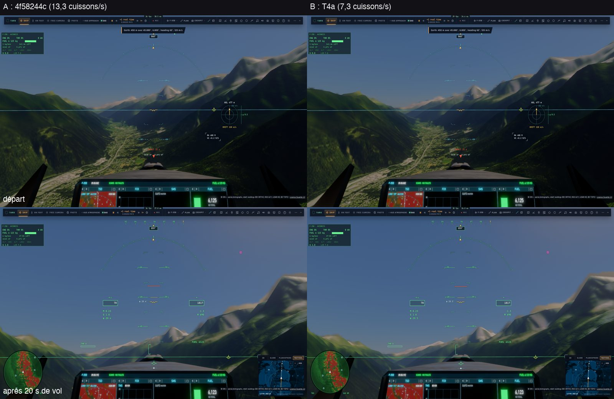
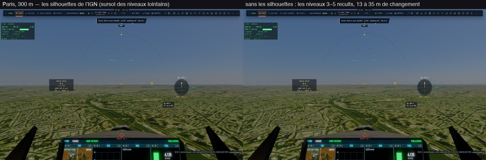

# T4 — les cuissons cohérentes

Plan : [PLAN-REFRACTION-HORIZONS.md](../../PLAN-REFRACTION-HORIZONS.md), phase T4 (contrat C0-1). Le 2 novembre 2026.
e2e `tests/e2e/terrain-bakes.e2e.test.ts` (vol bas de 20 s au-dessus de Chamonix, l'autopilote à 450 m et 120 m/s, les cuissons
comptées par niveau et par cause) ; unitaires `tests/terrain-cache-changes.test.ts`.

## T4a — moins de cuissons

**Avant**, chaque nouvelle tuile (le `stamp` des tuiles) marquait les 8 niveaux du cache à recuire, à raison d'un niveau par
image. Les fenêtres des niveaux fins se recentraient tous les quarts de largeur : 38 m pour le niveau le plus fin, environ 3 fois
par seconde à 120 m/s.

**Fait** :
- **Le journal des changements** (`earthTiles.changes`) : chaque changement de ce qu'un niveau de tuiles dessine y est noté,
  avec sa boîte en longitude et latitude.
- **Le tri par anneau** (`changeInRing`) : pour chaque niveau du cache, un changement tombe soit dans l'anneau qu'il dessine (sa
  fenêtre, moins celle du niveau plus fin, rétrécie de 17 nœuds : la bande de géomorphose et le recouvrement des anneaux), soit
  dessous, caché par les niveaux fins, soit hors de sa fenêtre.
  - **Visible** : recuit, mais groupé. Il attend que les changements se calment (150 ms sans nouveau, 500 ms au plus).
  - **Caché** : recuit au plus tard 10 s après, pour que rien ne vieillisse.
  - **Hors de la fenêtre** : rien.
- **Les générations** : les niveaux dus sont recuits ensemble, dans la même image. Aucun niveau n'est dessiné contre un voisin
  tiré d'un état plus ancien des tuiles.
- **L'avance des fenêtres** : une fenêtre qui se déplace est posée 24 nœuds en avant le long du mouvement
  (`TERRAIN_CACHE_LEAD`), au lieu d'être centrée sur la caméra. La caméra traverse 56 nœuds avant le déplacement suivant, au
  lieu de 32. Le détail reste devant elle.

**Mesuré** sur kerr-mini (plein écran, A B B A contre `4f58244c`, la même fenêtre de vol) :

| | A (avant) | B (T4a) |
|---|---:|---:|
| Cuissons par seconde | 13,35 · 13,2 | **7,35 · 7,24** (×0,55) |
| … fenêtres déplacées, niveaux 0 à 3 | — | 1,95 · 1,0 · 0,25 · 0,05 |
| … tuiles plus récentes, niveaux 0 à 7 | — | 0,5 · 0,8 · 0,85 · 0,9 · 0,6 · 0,2 · 0,15 · 0,1 |
| Changements de tuiles par seconde (visibles · cachés) | — | 7,4 · 5,6 |
| Temps d'image (médiane · 95ᵉ centile) | 19,3 · 26,7–27 ms | 19,4 · 26–26,5 ms |
| Temps GPU des cuissons par image | 0,23–0,35 ms | 0,29–0,31 ms |

- **Les étapes**, mesurées sur ce Mac, d'un vol à l'autre :
  - avant : 9,9 cuissons/s ;
  - avec le tri par anneau : 10,9/s, mais avec des tuiles plus rapides (celles du cache du navigateur), donc pas comparable.
    Sur le mini, en A/B, le tri seul fait 13,4 → 10,9 ;
  - avec le groupement : 8,75/s ;
  - avec l'avance : 7,05/s.
- **Les niveaux grossiers** (4 à 7) recuisent maintenant 0,1 à 0,6 fois par seconde au lieu de 0,6 environ.
- **Les images** sont les mêmes au départ et après 20 s (planche).

## T4b — le fondu des cuissons

**Avant**, une recuisson remplaçait les hauteurs d'un niveau d'un coup. Au sol lointain, ça fait des sauts de forme de plusieurs
dizaines de mètres : 13, 23 et 35 m d'une image à l'autre, mesurés ci-dessous, quand le sursol de l'IGN arrive ou part.

**Fait** :
- **Les hauteurs précédentes** de chaque niveau sont gardées dans une région ajoutée à la fin de la table
  (`TABLE_TERRAIN_PREV`, 533 Ko). Aucun décalage codé en dur n'a bougé.
- **Avant chaque recuisson sur la même fenêtre**, une petite passe de calcul écrit dans « précédent » ce qui était à l'écran :
  mix(actuel, précédent, part). Un fondu déjà en cours repart donc de l'état affiché, sans saut.
- **La part de l'ancienne cuisson** passe de 1 à 0 en 250 ms (`fadeMs`). Elle est publiée dans l'en-tête du niveau (`s.w`) et
  lue par tous les lecteurs du cache : le maillage raster (`cacheNode` : patch, anneaux, géomorphose, cascades du Soleil) et le
  traceur (`terrainCacheNode`).
- **Une fenêtre déplacée n'a pas de fondu** : ses anciennes hauteurs sont ailleurs, et le relief qu'elle redessine est le même.
- **Pour l'e2e** : `renderer.terrainCacheLevel(k)` relit un niveau tel que le GPU le tient (la table a reçu l'usage
  `COPY_SRC`).

**Mesuré** sur kerr-mini (`tests/e2e/terrain-fade.e2e.test.ts`, données : [T4/terrain-fade.json](T4/terrain-fade.json)). Paris
depuis 300 m, la vue figée, les silhouettes de l'IGN coupées puis remises ; les niveaux 3 à 5 du cache sont relus image après
image :

| | Changement des cuissons (niveaux 3 · 4 · 5) | Plus grand pas d'une lecture à la suivante |
|---|---|---|
| Avec fondu (allongé à 1 s, lectures toutes les 124 ms) | 13,4 · 19,9 · 20,5 m | **2,0 · 2,8 · 2,9 m** (≈ 15 %) |
| Sans fondu (`fadeMs` 0, comme avant) | 13,4 · 35,2 · 23,4 m | **13,4 · 35,2 · 23,4 m** (le tout) |

- **La part de l'ancienne cuisson** relevée descend linéairement : 1 → 0,88 → 0,76 → … → 0,04.
- **Au réglage par défaut** (250 ms, 60 images/s), un saut de 35 m devient environ 2,3 m par image, sur 15 images.
- **Coût** (A/B sur kerr-mini contre `8e3ccae3`, le même vol bas que T4a) : temps d'image 19,3 · 19,5 ms (A) contre
  19,3 · 19,4 ms (B), cuissons 7,1–7,2/s contre 6,9–7,0/s. Rien de mesurable.
- **Erreurs GPU** : aucune.

**En route**, sur ce Mac : trois Chrome de test restés orphelins sur le GPU faussaient les mesures locales. Leur cause est
corrigée dans le harnais (`8e3ccae3`), et les mesures de T4 viennent toutes du mini.

## Reste

- **L'historique temporel rejeté localement**, là où la surface a bougé. Ce n'est pas fait : avec le fondu, la surface glisse en
  250 ms et le TAA la suit ; aucun traînage n'a été vu.
- **Le contact apparent des arbres, des pistes et des bâtiments** pendant le fondu. Ce n'est pas fait : le décor est posé par les
  hauteurs du CPU, qui changent d'un coup, alors que le sol raster glisse en 250 ms. Pendant un quart de seconde, un pied peut
  flotter ou s'enfoncer.
