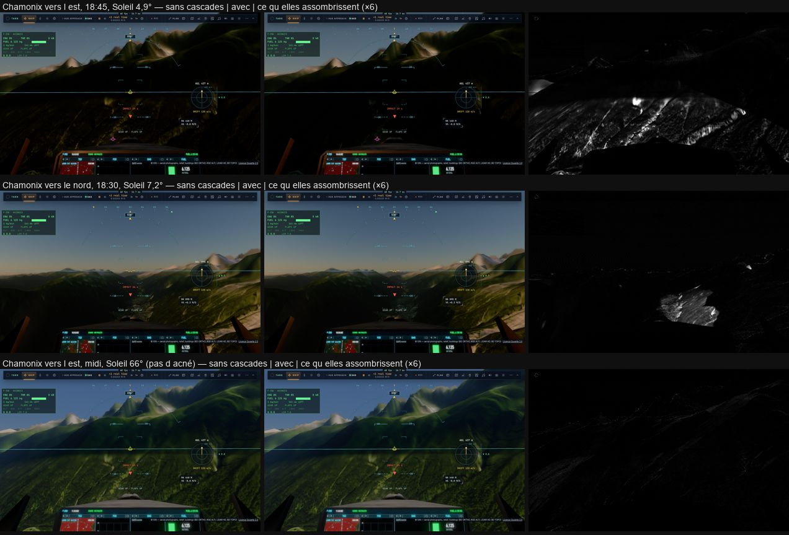

# T6 — les ombres du relief en cascades

Plan : [PLAN-REFRACTION-HORIZONS.md](../../PLAN-REFRACTION-HORIZONS.md), phase T6 (avec R3, décision 23). Le 2 novembre 2026.
e2e `tests/e2e/relief-shadows.e2e.test.ts` ; données : [T6/relief-shadows.json](T6/relief-shadows.json).

## Avant

La carte du relief vue du Soleil couvrait ±10 km, mais on n'y dessinait que le patch, soit 154 m autour de l'œil.
`liteSun` la lisait avec une portée de biais de 300 m. Résultat : presque aucune ombre portée du relief sur la Terre raster.

## Fait

- **Deux cascades** dans un atlas de 4096 × 2048 (`depth32float`, 32 Mo) : ±1,5 km (texels de 1,46 m) et ±10 km (9,8 m).
  - Chacune dessine le patch et les anneaux de l'image, avec leur géomorphose (T3).
  - La cascade 0 dessine du patch à l'anneau de 611 m. La cascade 1 commence au niveau de 38 m : les plus fins sont lus dans
    la cascade 0, qui couvre leur fenêtre.
  - L'anneau de 2,4 km n'est dessiné dans aucune : il est au-delà de la portée en profondeur (±20 km le long du Soleil).
  - Les deux cascades sont orientées sur le Soleil incident (R3).
- **Leur cache** : elles ne sont redessinées que quand une donnée change :
  - le Soleil a tourné de plus de 5·10⁻⁵ rad (0,7 s de sa course) ;
  - un centre a franchi un pas de sa grille (un dixième de la demi-largeur, en texels entiers) ;
  - les hauteurs ont été recuites, et au plus deux fois par seconde : en vol bas, 16 cuissons par seconde (M0b) les
    relanceraient à chaque image. Le recentrage d'une fenêtre du maillage n'y entre pas : le relief dessiné est le même,
    seul son bord fin bouge.

  Entre deux dessins, chaque image réécrit dans la table (`TABLE_SUN` + 6, + 7) le centre de chaque cascade vu de la caméra
  actuelle, et le pas que la caméra a fait vers le Soleil depuis le dessin : la carte est lue là où elle a été dessinée.
- **La lecture** (`sunShadowFarAt`) :
  - la cascade la plus fine qui couvre le point, fondue dans la suivante sur son dernier sixième, en 3 × 3 texels ;
  - la portée de biais prend pour plancher 3 texels de la cascade (4,4 m dans la cascade 0) plus le terme de pente (la
    normale du maillage). `liteSun` n'a pas de marche proche ; les noyaux tracés gardent la leur, à 300 m.
- **Les ombres de contact** (`rasterContactShadow`) prennent les derniers mètres sous cette portée : 12 pas le long du Soleil
  (4 à 24 m), projetés à l'écran et comparés à la profondeur raster. Elles ne s'appliquent qu'aux surfaces éclairées
  tournées vers le Soleil, à moins de 1,5 km, le Soleil sous 25°. Bit de comparaison : `liteSkip` 16384. Les faces à
  contre-jour ne lisent pas les cascades.
- **La couverture** : hors des cascades, la carte ne répond pas (« inconnu »), et le point est éclairé, en attendant la carte
  d'horizon H5.
- **Le décor au Soleil rasant** : les ombres des arbres et des bâtiments tiennent jusqu'à 0,3° (elles étaient coupées sous
  1,7°).
- **Les autres planètes** dessinent dans la cascade 0 seule, la 1 étant marquée non dessinée. Le cache de la Terre est vidé à
  leur passage.

## Mesuré

**Ce Mac** (M1 Max, 1280 × 800), Chamonix depuis le cockpit :

| Vue | Ombré par les cascades | Par le contact |
|---|---:|---:|
| Vers l'est, Soleil 4,9° | **3,96 %** de l'image | 0,019 % |
| Vers le nord, Soleil 7,2° | **2,05 %** | 0,036 % |
| Vers l'est, midi (66°) | 0,02 % (pas d'acné) | 0,024 % |

- **En vol** (8 s à 120 m/s) : les cascades se redessinent sur 25 images sur 478 (5 %). Avant l'allègement du cache, c'était
  100 sur 452, à cause des fenêtres recentrées et des cuissons. Une vue figée ne les redessine jamais.
- **Une carte gardée après 10 m** s'écarte de 0,02 % des pixels d'une carte redessinée. Deux images gardées successives
  s'écartent de 3 % (l'accumulation) : pas d'ombre qui glisse.
- **La passe `terrain from the Sun`** prend 0,5 à 0,7 ms sur une image où elle dessine (1,1 à 1,2 ms sur kerr-mini).

**kerr-mini** (M1, plein écran), A/B contre R3 (`b303e724`), suite partagée, tours A B B A :

| Vue | A (R3) | B (T6) | Écart |
|---|---|---|---:|
| Paris bas | 32,6 / 32,8 / 33,4 ms | 32,9 / 32,9 / 33,7 | +0,2 ms (0,6 %) |
| Chamonix, Soleil bas | 48,6 / 58,5 / 59,7 | 48,8 / 59,4 / 59,5 | +0,2 à +0,3 ms |
| Chamonix, 30 s de vol | 46,9 / 58,4 / 59,5 | 47,6 / 59,2 / 59,9 | +0,4 à +0,8 ms |

- T6 coûte de 0,2 à 0,8 ms, autour du budget de 0,5 ms (atteint en vue posée, un peu au-dessus en vol).
- Chamonix tombe des deux côtés dans l'un de deux régimes, 48–49 ou 58–60 ms : ce n'est pas T6. Il faudra trouver la cause
  (le gouverneur, les nuages ?) avant les A/B suivants sur cette vue.

## Reste

- Les deux régimes de Chamonix (48 ou 59 ms) à expliquer.
- Le décor (S1) dans les mêmes cascades : Q4.
- La carte d'horizon pour l'état « inconnu » : H5.
- Moins de redessins en vol : avec moins de cuissons (T4).
