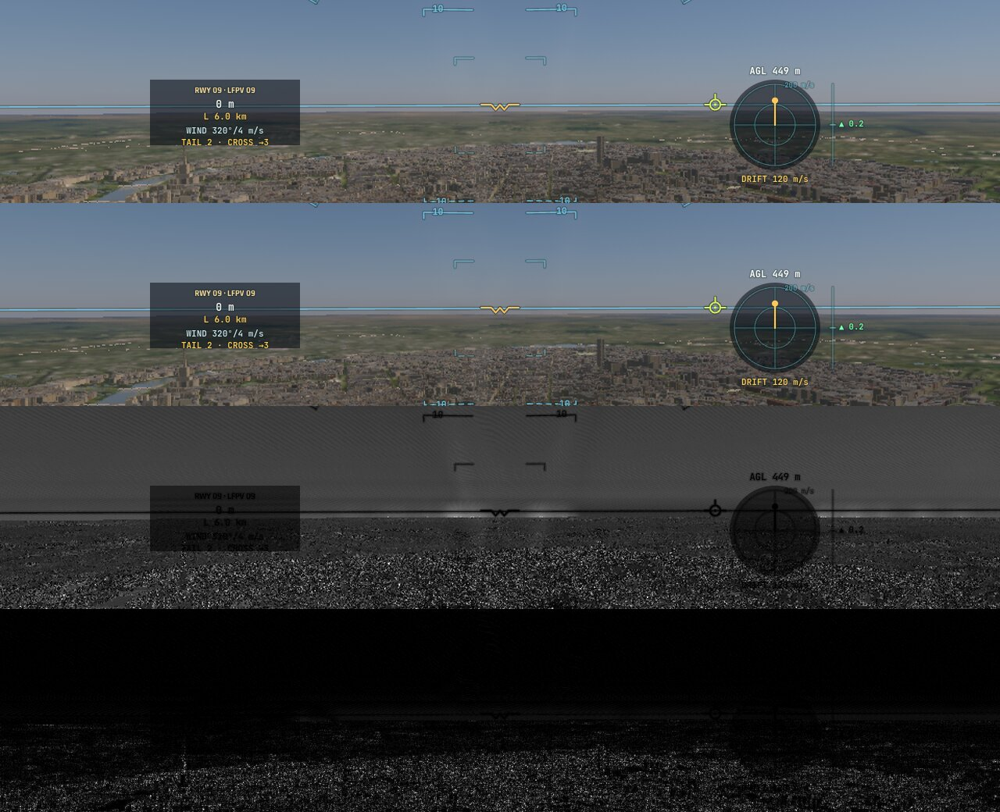
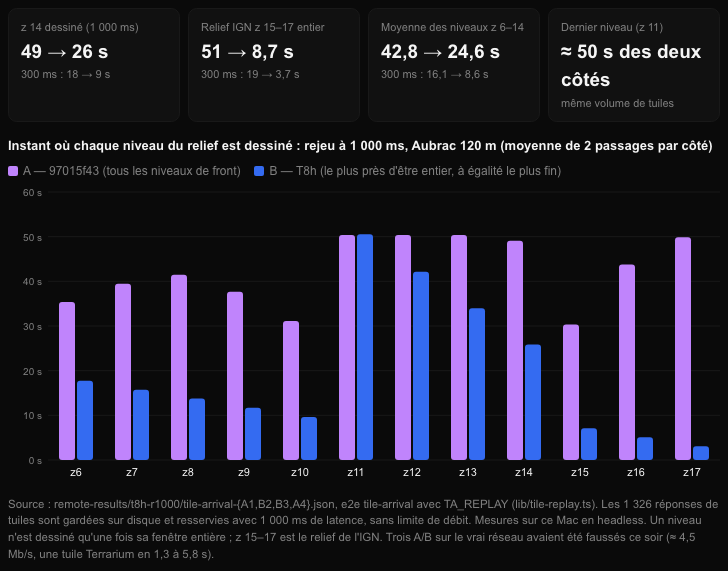

# T8 — le chargement des tuiles et le budget CPU de la boucle (T8a–T8j, clos le 3 novembre 2026)

Plan : [PLAN-REFRACTION-HORIZONS.md](../../PLAN-REFRACTION-HORIZONS.md), phase T8 (« le décodage en worker », « aucune longue tâche du
fil principal due aux tuiles »). Le 3 novembre 2026, kerr-mini, A/B A B B A contre cc754242. e2e `tests/e2e/tile-cpu.e2e.test.ts` ;
unitaires `tests/ortho.test.ts` ; données : [T8/](T8/).

## Synthèse — T8 clos (3 novembre 2026)

| Objectif du plan (T8) | État | Preuve |
|---|---|---|
| Le temps jusqu'à une qualité visible définie, divisé par 2 à 5 | **Atteint en rejeu** : la vue à 90 % du détail voulu en 8,1 s au lieu de 26 (T8h → T8j), à 99 % en 11,2 au lieu de 34 ; le relief IGN entier 51 → 8 s depuis l'ordre d'avant T8h | `tile-arrival` en rejeu à 1 000 ms (A/B A B B A) ; T8h, T8i, T8j |
| Aucune longue tâche du fil principal due aux tuiles | **Atteint** : décodage en worker (T8a), spécialisation WGSL en worker (T8b) ; une longue tâche par vol reste, d'une autre origine | `tile-cpu` + profil CPU (T8a–T8c) |
| Une priorité selon l'aire visible, l'erreur projetée, le mouvement | **En partie** : centre mené selon le mouvement, niveaux nationaux d'abord, anneaux, le plus fin d'abord ; jugée sur la qualité de la vue (384 rayons) — l'aire visible et l'erreur projetée ne sont pas dans la clé de tri elle-même | T8h, T8j |
| La validité par tuile | **Réduite à un rectangle** autour du centre (T8i) ; pas de masque par tuile ni du voisinage 4 × 4 de la cubique | T8i |
| `ORTHO_SPAN = 8` pour z 15–16 | **Désactivé sur mesure, décision de Sam** (aucun changement d'image mesurable, +45 Mo) | T8e, T8g |
| Le décodage en worker | **Fait** | T8a |
| Le budget CPU de la boucle (§8.3, ~4 ms p95) | **Proche, non atteint** : p95 ≈ 4,6–4,7 ms machine froide (T8d) | `tile-cpu` `loopCpu` |
| Outils de preuve | `loopCpu`, profil CPU brut, cache Chrome commun (`TC_/OF_CHROME_PROFILE`), exposition réglée avant capture (T8f), **rejeu des tuiles** (`lib/tile-replay.ts`), qualité de la vue | T8c–T8j |

**Reste hors de T8 clos** (à reprendre si une mesure le justifie) : `put` hors du fil principal (~0,3 ms par image) ; un masque de
validité par tuile ; le cache chaud du Service Worker et un vol en mouvement mesurés avec le nouvel ordre ; une qualité de vue qui
compte la source des hauteurs et l'imagerie ; les files séparées par hôte au parallélisme mesuré.

## Fiche (§20.8 de l'analyse de stratégie)

| Champ | Réponse |
|---|---|
| Destination | §7.6 et §19.7 : préparer les données hors de l'image ; §8.3 : pas de blocage du fil principal à l'arrivée des données ; l'observabilité du coût CPU. |
| Bénéfice courant | Le décodage des tuiles (bitmaps relus, hauteurs Terrarium) et leurs couleurs (ajustements EOX et orthophotos, lumières) ne prennent plus rien au fil de la page : ~1,25 s de travail en 25 s de vol bas sur Paris, jusqu'à 9 ms d'un seul tenant par tuile, partent dans un worker. |
| Réutilisation | Les requêtes, leurs portillons (Géoplateforme) et leurs annulations restent où elles étaient ; seuls les blobs passent au worker. Les fonctions pures (`tile-decode.ts`) servent aussi au repli dans la page (tests). |
| Dépendance retirée | Les boucles de couleur allouant un tableau et une fermeture par pixel ; le `pow` par pixel des orthos (une table de la courbe de ton). |
| Acceptation | Décodage et couleurs à 0 ms sur le fil principal en vol ; images inchangées (les ajustements identiques, testés) ; aucune erreur. |
| État de preuve | **Mesuré** (kerr-mini, A/B, e2e `tile-cpu`) ; **vérifié statiquement** (typage, tests unitaires dont l'équivalence des mots de tuile). |
| Transition restante | `put` reste sur le fil principal (~280 ms en 25 s, 2,4 ms au plus) ; une ou deux longues tâches (51–103 ms) par vol, présentes avant comme après — leur cause n'est pas le décodage des tuiles, à chercher ailleurs ; le reste de T8 (priorités, files, validité par tuile, fenêtres d'imagerie à 8 tuiles). |

## Fait

- **`src/system/tile-decode.ts`** : `pixels`, `terrariumHeights`, `imageryWords` (le jour dans les couleurs de la Blue Marble — orthos par
  l'ajustement de leur source, EOX par le sien, GIBS tel quel —, les lumières nocturnes en alpha), `orthoWords` ; les ajustements sans
  allocation par pixel, la courbe de ton tabulée (4096 pas). `orthoColour`, `eoxColour` réexportés par `earth-tiles.ts`.
- **`src/system/tile-decode-worker.ts`** (`tile-decode-worker.js` : `server.ts`, `scripts/build-pages.ts`, `package.json`) : une requête
  par tuile, les tableaux rendus sans copie. Repli dans la page s'il n'y a pas de worker ou s'il échoue (les tuiles en attente refusées,
  redemandées).
- **L'observabilité** : `earthTiles.cpu` (`TILE_CPU`) — décodage, couleurs, écritures sur le fil de la page (total, plus long morceau,
  nombre) et le temps du worker.

## Mesuré (kerr-mini, 25 s de vol bas sur Paris, pilote automatique)

| | A (cc754242) | B (T8a) |
|---|---:|---:|
| Images dessinées en 25 s | 783 / 801 | 812 / 867 (**+6 %**) |
| Décodage + couleurs sur le fil de la page | ~1,25 s, jusqu'à 9,1 ms d'un tenant (mesure de référence) | **0** |
| Écritures (`put`) | ~325 ms | 274 / 281 ms, 2,4 ms au plus |
| Travail du worker | — | 1,75 / 2,17 s (≤ 22 ms une tuile) |
| Longues tâches > 50 ms | 1 (75 / 70 ms) | 2 (78, 51 ms) / 1 (103 ms) |

## T8b — la spécialisation WGSL des variantes dans un worker (le 3 novembre)

- **Le constat** (profil CPU de Chrome sur le vol, `TC_PROFILE=1`, bundle non minifié `E2E_NODE_ENV=development`) : dans les
  longues tâches restantes, **40 ms sur 217 venaient de la spécialisation d'une variante du traceur** (`specialisedModule` →
  `WgslSpecialiser.specialise` : les constantes repliées, les fonctions mortes retirées — du texte, sur le fil de la page, au moment
  où le vol demande une variante) ; le reste : la simulation du vol (`step`, `flyShip`, les hauteurs sous le train, 26 ms),
  `writeParams` (16 ms), le dessin de l'image.
- **Fait** : `src/system/wgsl-specialise-worker.ts` (`wgsl-specialise-worker.js`) reçoit une fois la source composée du traceur, puis
  une demande par variante ; `mkVariant` attend la source spécialisée avant de lancer la compilation (déjà asynchrone) ; repli dans
  la page sans worker. `renderer.specialiseCpu` : le temps de spécialisation hors du fil (14 variantes en vol : 1,3 s, jusqu'à 174 ms
  chacune — autant de moins sur le fil de la page).
- **Mesuré** (ce Mac en headless — la consigne de Sam —, sous pression thermique « Heavy » : les temps à prendre avec prudence ;
  A/B A B B A contre edf215a7, e2e `tile-cpu`) :

| | A (T8a) | B (T8b) |
|---|---:|---:|
| Longues tâches (> 50 ms) en 25 s | 2 (160 ms) / 2 (141 ms) | 1 (58 ms) / 2 (131 ms) |
| Images en 25 s | 1653 / 1886 | 1864 / 1778 |

  Temps de longues tâches **−37 %** (94 contre 150 ms par vol) ; un passage profilé sans aucune longue tâche. Celles qui restent
  viennent de la simulation et de la préparation de l'image — la prochaine tranche.

## T8c — le budget CPU de la boucle principale (le 3 novembre)

- **La mesure** (commit 871e1b8f) : `game.perf().loopCpu`, le temps CPU de la boucle principale sur ses 600 dernières itérations
  (médiane, 95ᵉ et 99ᵉ centiles, pire) ; l'e2e `tile-cpu` le rend avec les sections CPU, et avec `TC_PROFILE=1` garde le profil brut
  de Chrome (`.cpuprofile`) et les temps inclusifs de tout le vol. Le §8.3 de l'analyse vise ~4 ms au 95ᵉ centile.
- **Le constat** (profil du vol, bundle lisible) : le même calcul refait des dizaines de fois par image — le nivellement des pistes
  (`runwayGrade`, appelé par chaque échantillon du relief sous le train, 1,3 s sur 25 s : il testait les ~30 pistes à chaque appel,
  avec une allocation par piste), la bouche du trou de ver (`mouth()` → deux bissections `ellOfR` de 80 pas à chaque appel, 1,4 s),
  les sphères d'influence (`referenceBody` : toutes recalculées à chaque appel, la recherche linéaire du parent comprise) ; et une
  lecture de mise en page (`getBoundingClientRect` de la barre du haut) juste après l'écriture des compteurs, deux fois par seconde :
  ~6 ms de mise en page forcée chaque fois.
- **Fait** (les mêmes nombres rendus — un test compare `runwayGrade` à l'ancien parcours complet sur 8 000 points, avant et après un
  changement des pistes) :
  - `sites.ts` : la liste des pistes proches d'une cellule de 8 km, refaite quand le point en sort ou quand les pistes changent
    (`setWorldRunways`) ; plus d'allocation par piste ;
  - `wormhole.ts` : les dernières réponses d'`ellOfR` gardées (4) ;
  - `our-side.ts` : les sphères d'influence gardées pour le dernier instant et la dernière version des éphémérides ;
  - `main.ts` : les bas de la barre du haut et du compteur de compilation lus dans un `ResizeObserver` (la mise en page faite), plus
    dans la boucle ; `style.top` écrit seulement s'il change.
- **Mesuré** — profil CPU du vol (ce Mac, bundle de développement, profileur actif) :

| Fonction (inclusif, 25 s de vol) | Avant | Après |
|---|---:|---:|
| `runwayGrade` | 1 313 ms | 40 ms |
| `ellOfR` | 1 405 ms | 33 ms |
| `flightInfo` | 2 448 ms | 939 ms |
| boucle principale | 15 893 ms | 12 723 ms |
| inactif (`idle`) | 4 825 ms | 7 040 ms (relevé intermédiaire) |

- **Mesuré** — A/B sur ce Mac en headless (bundle de production, sans profileur), deux campagnes A B B A contre 871e1b8f, **sous
  pression thermique « Heavy » (81–86 °C)** : les temps sont à prendre avec prudence. Les passages B de la première campagne et le premier
  de la seconde ont chargé peu de tuiles (45, 117 et 66 contre ~410 — le serveur B froid ; un passage B seul en charge 401) : ils
  sont écartés de la comparaison (ils montraient un p95 de 4,7 à 5,3 ms, trompeur).

| Boucle principale [ms] | A (4 passages, 350–417 tuiles) | B comparables (B3′ : 308 tuiles ; B seul : 401) |
|---|---|---|
| médiane | 5,0 · 5,7 · 5,5 · 6,3 | 5,1 · 5,5 |
| 95ᵉ centile | 6,3 · 7,8 · 7,7 · 8,4 | 7,0 · 7,3 |
| 99ᵉ centile | 8,2 · 13,8 · 11,5 · 11,0 | 9,7 · 10,9 |
| pire itération | 24,2 · 27,7 · 25,8 · 29,5 | 13,8 · 12,2 |

  Ce qui tient : **la pire itération divisée par deux** dans les cinq passages B (12–15 ms contre 24–30), aucune longue tâche de part
  et d'autre ; le 95ᵉ centile à peine plus bas (≈ 7,6 → 7,2 ms en moyenne, −5 %), dans le bruit thermique. La cible de ~4 ms au 95ᵉ centile
  n'est **pas** atteinte (≈ 7 ms à tuiles chargées).

- **Reste** : l'encodage du rendu (`encodePost`, `dispatchTrace`, ~1,4 ms), le HUD dessiné en canvas (textes contournés,
  ~0,6 ms), `sceneBodies` (les corps vus avec le retard de la lumière, ~0,5 ms), le repère de l'appareil (`sfFrame`, encore refait
  ~10 fois par image) ; `put` des tuiles ; une mesure sur une machine froide (le mini ou le PC).

## T8d — les recalculs du repère de l'appareil (le 3 novembre, après-midi)

- **Le constat** (profil du vol de T8c, `profile-C0`) : le repère de l'appareil (`sfFrame`, 856 ms sur 25 s) est demandé par une
  dizaine de lecteurs à chaque image (`geoNow`, `attitudeNow`, le radar, la carte, le replay, l'aide au vol…), chacun le recalculant
  au même point et au même instant ; l'essentiel est `gravityHome` (l'attraction de tous les corps du système solaire : 460 ms
  sous `sfFrame`), dont `mouthAccel` (l'accélération propre du repère, 418 ms). `mouth()` (la bouche, recalculée depuis les réglages,
  270 ms en propre) est appelé des centaines de fois par image ; `escapeRadius` reconstruit chaque image toute la liste des corps de
  notre côté (`sceneBodies`, 242 ms) alors qu'il ne lit que ceux de Gargantua ; `taxiGuide.frame` lit la boîte du canvas à chaque
  image, juste après les écritures du HUD (une mise en page forcée : 293 ms), même hors du roulage de l'A320.
- **Fait** (les mêmes nombres rendus ; `tests/frame-memo.test.ts`) :
  - `our-side.ts` : `gravityHome` sans vitesse garde ses 4 dernières réponses (point, instant, version des éphémérides) et rend
    une copie ; avec la vitesse, toujours calculé (le test compare les deux chemins) ;
  - `solar.ts` : `mouthAccel` gardé pour le dernier instant ;
  - `wormhole.ts` : `mouth()` gardé pour les mêmes réglages de la bouche et le même instant, **figé** (`Object.freeze`) : un
    lecteur qui le modifierait lèverait une erreur au lieu de corrompre la réponse partagée ;
  - `scene-bodies.ts` / `renderer.ts` : `sceneBodies(s, t, obs, ours = true)` ; `escapeRadius` demande Gargantua seule (les
    mêmes premières entrées ; les nôtres ne sont jamais `where 0`) ;
  - `ui/taxiguide.ts` / `main.ts` : la boîte du canvas passée en fonction, lue seulement quand le guidage est affiché ; `geoNow`
    aussi ; `display` écrit seulement s'il change.
- **Mesuré** — profil CPU du vol (ce Mac, headless, bundle de développement ; `profile-D0` contre `profile-C0`) :

| Fonction (inclusif, 25 s de vol) | T8c | T8d |
|---|---:|---:|
| `sfFrame` | 856 ms | 396 ms |
| `gravityHome` | 783 ms | 276 ms |
| `mouthAccel` | 418 ms | 162 ms |
| `mouth` | 329 ms | 42 ms |
| `getBoundingClientRect` | 304 ms | 23 ms |
| `escapeRadius` | 251 ms | 35 ms |
| `geoNow` | 480 ms | 226 ms |
| `flightInfo` | 947 ms | 770 ms |

  Soit ≈ 1,2 s de moins sur 25 s pour ces fonctions (≈ 0,4 ms par itération en moyenne). D0 n'a chargé que 51 tuiles (C0 : 430) :
  ces fonctions n'en dépendent pas, la boucle entière si (12 723 → 12 230 ms) — elle n'est pas comparée.
- **Mesuré** — A/B A B B A contre 7a1f668c sur ce Mac en headless, thermique **Nominal** :

| Boucle principale [ms] | A1 (254 tuiles) | B2 (420) | B3 (131) | A4 (38) |
|---|---:|---:|---:|---:|
| médiane | 4,0 | 3,6 | 3,7 | 3,8 |
| 95ᵉ centile | 5,1 | 4,5 | 4,5 | 4,7 |
| 99ᵉ centile | 8,8 | 6,7 | 6,8 | 6,7 |
| pire itération | 13,5 | 15,7 | 13,3 | 11,9 |

  Sections par image : `camera.update` 0,70 · 0,68 → 0,54 · 0,61 ms ; `flightInfo` 0,38 · 0,35 → 0,27 · 0,29 ms. Les B sont au plus
  bas, mais les tuiles chargées vont de 38 à 420 (beaucoup restent en attente côté IGN) : **l'écart de 95ᵉ centile (≈ 0,2–0,6 ms)
  n'est pas démontré** par ces quatre passages. À noter : la machine froide donne ≈ 4,5–5 ms au 95ᵉ centile, contre ≈ 7 ms sous
  pression « Heavy » en T8c — la cible de ~4 ms est proche, pas atteinte.

- **Mesuré** — second A/B, **cache chaud** (`TC_CHROME_PROFILE=<dossier>` : un profil Chrome commun, son cache HTTP sert les
  mêmes tuiles à chaque passage une fois réchauffé ; le décodage et les écritures restent mesurés, le réseau et l'IGN sortent de la
  comparaison — deux passages de réchauffe : 411 puis 468 tuiles, 224 puis 35 en attente). Ce Mac en headless, **la machine
  passée de Nominal (89 °C CPU au départ) à Heavy** pendant les passages :

| Boucle principale [ms] | A1 (162 tuiles en vol) | B2 (456) | B3 (457) | A4 (473) |
|---|---:|---:|---:|---:|
| médiane | 4,3 | 4,1 | 4,3 | 3,8 |
| 95ᵉ centile | 6,7 | 5,2 | 5,9 | 8,0 |
| 99ᵉ centile | 9,5 | 8,7 | 9,3 | 12,8 |
| pire itération | 40,5 | 20,2 | 24,4 | 29,2 |

  À tuiles égales (B2, B3, A4 : 456–473), le 95ᵉ centile de B est plus bas (5,2–5,9 contre 8,0 ms), mais A4 passe en dernier, le
  plus chaud (toutes ses sections sont plus lentes, la HUD 1,39 contre 0,62–0,82 ms) : **une tendance, pas une preuve**. A1 (le plus
  froid) a reçu la plupart de ses tuiles avant le vol, d'où ses 162. À refaire machine froide, avec ce cache.

- **Mesuré** — troisième A/B, cache chaud, **pression thermique Nominal du début à la fin** (`remote-results/tile-cpu-warm2`) :
  le même sol dans chaque passage (472–480 tuiles en vol) :

| Boucle principale [ms] | A1 (477) | B2 (473) | B3 (472) | A4 (480) |
|---|---:|---:|---:|---:|
| médiane | 3,8 | 3,5 | 3,6 | 3,9 |
| 95ᵉ centile | 4,9 | 4,6 | 4,7 | 5,0 |
| 99ᵉ centile | 7,0 | 6,9 | 6,8 | 7,1 |
| pire itération | 16,4 | 15,9 | 15,5 | 17,6 |

  Les deux B sous les deux A, partout : **−0,3 ms à la médiane et au 95ᵉ centile (≈ −6 %)**, cohérent avec le profil (≈ 0,4 ms
  par itération retirés des fonctions visées) ; `flightInfo` 0,36 · 0,38 → 0,28 · 0,25 ms par image. Le 95ᵉ centile à 4,6–4,7 ms :
  la cible de ~4 ms n'est pas atteinte.

- **Reste** : `gearHeight` sous `sfFrame` (le relief et les plateformes changent : il faudrait une révision du sol), `sceneBodies` du
  rendu (les corps vus avec le retard de la lumière, ~0,5 ms), le HUD en canvas, l'encodage du rendu ; `orbitExtreme` des chiffres
  du Ranger ; une mesure à tuiles égales (sol bloqué ou mis en cache avant le vol).

## T8e — les orthophotos z 15–16 en fenêtres de 8 tuiles (le 3 novembre, soir)

- **Le plan** (T8, contrat C0-4) : « les orthos … `ORTHO_SPAN = 8` pour z15–16 ». Les fenêtres des orthophotos faisaient 4 tuiles
  à tous les niveaux : 3,3 km à z 15 et 1,6 km à z 16 à 48° — à 450 m au-dessus de Paris, la photo s'arrêtait à ~1,6 km devant,
  le reste en Sentinel-2 (EOX, 10 m).
- **Fait** : à une portée lointaine (`detailReach` far ou veryFar — le défaut —, la texture d'imagerie 2048² faite), les z 15 et
  16 en fenêtres de 8 tuiles (6,5 km et 3,3 km) ; z 17–18 inchangés (4). Elles prennent les deux dernières couches de la texture
  2048² (`ORTHO_2K_LAYER0`, aucune liaison de plus) ; la table des orthos porte le côté de chaque fenêtre (`orthoParams`, troisième
  vec4 `.y`), d'où `orthoAt`/`orthoGrad` choisissent la texture et l'échelle des coordonnées ; `setReach` recrée les fenêtres
  (côté, clés) ; les zones hors ligne couvrent les mêmes fenêtres (`zoneTiles`). Mémoire : la texture 2048² 89 → 134 Mo
  (+45 Mo GPU, aux portées lointaines seulement).
- **Vérifié** : typage, 100 unitaires (tuiles, orthos, zones, tables GPU, noyaux, budgets).
- **Mesuré** — e2e `ortho-filter` (Paris 450 m, cockpit, figé), A/B A B B A contre b9cc573b sur ce Mac, **cache HTTP commun
  réchauffé** (`OF_CHROME_PROFILE`, nouveau : les deux premières campagnes ont échoué des deux côtés, l'IGN ne répondant plus que
  par à-coups — une sonde réseau a montré 8 orthos servies en 40 s, sur A comme sur B ; puis 341 quelques minutes après) ;
  thermique **Heavy** :

| | A1 | B2 | B3 | A4 |
|---|---:|---:|---:|---:|
| matériau raster, devant [ms] | 4,40 | 4,15 | 4,34 | 4,60 |
| matériau raster, vers le bas [ms] | 7,28 | 6,85 | 6,92 | 7,42 |
| image, devant [ms] | 12,7 | 11,7 | 11,1 | 12,0 |

  **Aucun coût GPU mesurable** (B au plus égal à A, sous pression thermique). L'image : la vue devant de B sortait ~6 % plus
  sombre **partout, le ciel compris** (le même rapport 0,943 dans toutes les bandes) — l'exposition automatique tenue depuis le
  chargement (une scène immobile garde son exposition à moins d'un stop de la lecture : B finit ses 128 tuiles de plus après) ;
  la vue vers le bas identique. **Correction (T8f)** : la « netteté +6 % » d'abord écrite ici était un artefact — B multiplié par
  1,06 pour ramener l'exposition, son laplacien l'était aussi (9,62 × 1,06 = 10,20). L'exposition réglée avant la capture
  (`app.exposureSettled`, T8f), B est **identique à A** dans cette vue : netteté de la bande lointaine 9,62 (A 9,62), écart
  0,30 % (A/A 0,26 %). Raison : à 450 m, vers l'avant, le pied d'un pixel du sol au-delà de 1,6 km fait ~25 m — le traceur y lit
  des niveaux plus grossiers que z 15 (le poids de l'ortho, `zf − z + 1`, y est nul). **Aucun gain visible mesuré ici.**

- **Reste** : une vue où les z 15–16 comptent (plus haut, le regard plongeant : le pied du pixel à ~3 m au-delà de 1,6 km) pour
  décider de garder ces fenêtres (+45 Mo) ; la priorité par aire visible et erreur projetée,
  la validité par tuile, `put` hors du fil de la page.

## T8f — l'exposition réglée avant les captures figées (le 3 novembre, soir)

- **Le constat** (T8e) : une scène immobile garde son exposition tant que la lecture du posemètre en reste à moins d'un stop
  (`meter` : une nouvelle image seulement pour un vrai changement — voulu pour le joueur) ; dans un e2e figé, l'exposition est donc
  celle des images du chargement : un côté d'A/B 6 % plus sombre en entier, pour cette seule raison.
- **Fait** : `renderer.settleExposure()` (l'exposition portée à la dernière lecture, une image redessinée) et `exposureGap` ;
  `app.exposureSettled()` dans le harnais (redessine et relit jusqu'à 0,02 EV, 5 s au plus, l'écart restant rendu) ; `ortho-filter`
  l'appelle avant chaque capture.
- **Mesuré** (ce Mac, cache chaud) : la vue devant de T8e — ciel 119,6 de luminance moyenne contre 112,8 avant le réglage et
  119,7 côté A ; l'image alors identique à A (écart 0,30 %, A/A 0,26 %).

## T8g — les fenêtres de 8 tuiles des orthos z 15–16 mesurées plus haut, puis désactivées (le 3 novembre, soir)

- **Mesuré** — `ortho-filter` étendu (`OF_AT`, `OF_PITCHES`, `OF_ORTHO_Z`) : Paris à **2 000 m**, regard à −25° et −45°, cache
  chaud (`/tmp/kerr-of-high`, trois réchauffes : le relief de l'IGN lent), A/B contre b9cc573b sur ce Mac (Heavy ; A4 échoué :
  12 tuiles de relief en attente). Écart d'image A/B 1,4–1,9 % à −25°, 0,5–0,6 % à −45° — **autant qu'entre les deux B** (1,3 % et
  0,6 %) ; netteté identique (33,5–33,7 contre 33,6 ; 34,6 des deux côtés) ; matériau raster 4,82–4,92 (A) contre 4,98–5,15 ms (B),
  sous pression thermique. Le cockpit masque l'essentiel du sol plongeant.
- **Conclusion** : dans aucune des deux vues les fenêtres de 8 tuiles ne changent l'image de façon mesurable — au-delà de 1,6 km,
  le pied d'un pixel y est plus grossier que le texel de z 15, l'imagerie IGN des niveaux ≤ 14 dessine ce sol. Elles coûtent 45 Mo
  de GPU et 128 requêtes IGN de plus par fenêtre.
- **Fait** : `ORTHO_BIG_LEVELS = 0` — désactivées, le mécanisme gardé (le côté de chaque fenêtre dans la table des orthos, le choix
  de texture dans `orthoAt`/`orthoGrad`, les zones) : une constante pour les rallumer. La texture 2048² revient à 89 Mo. Vérifié :
  100 unitaires ; `ortho-filter` (Paris 450 m, cache chaud) identique à A (écart 0,28 %).
- **À décider par Sam** : le plan demandait `ORTHO_SPAN = 8` pour z15–16 ; désactivé sur mesure, à rallumer si une vue (le
  télescope, une caméra extérieure plongeante) en montre l'intérêt.

## T8h — la priorité des tuiles : le niveau le plus près d'être entier d'abord (le 3 novembre, nuit)

- **Le constat** : un niveau du relief n'est dessiné qu'une fois sa fenêtre entière (`complete` → `valid`) ; la file classait
  ensemble les tuiles de tous les niveaux par leur distance (en tuiles du niveau) — tous les niveaux avançaient de front et
  finissaient ensemble, à la fin (à 1 000 ms de latence : z 6 à 35 s, z 17 à 50 s, z 14 à 49 s).
- **Fait** (`EarthTiles.request`) : chaque niveau compte les tuiles qui manquent encore à sa fenêtre (en vol comprises) ; le
  niveau le plus près d'être entier passe d'abord, **à égalité le plus fin** (le sol près de l'œil remplit l'essentiel de la vue,
  les niveaux les plus grossiers une bande à l'horizon), puis la tuile la plus proche (la distance menée dans le sens du vol,
  comme avant). Un premier essai à égalité vers le plus grossier rendait le z 14 plus tard (18 → 21–22 s) : écarté.
- **L'outil** : `tests/e2e/tile-arrival.e2e.test.ts` (l'Aubrac à 120 m, figé : l'instant où chaque niveau est dessiné, leur
  moyenne, le z 14, le relief de l'IGN entier) et **`lib/tile-replay.ts`** — les réponses des hôtes de tuiles gardées sur disque
  (remplies par Bun), rejouées par le domaine Fetch de Chrome à une latence fixe : un A/B de l'ordre des chargements sur les
  mêmes réponses, le réseau du soir hors du jeu (ce soir-là ~4,5 Mb/s, une tuile Terrarium 1,3–5,8 s : trois A/B réels faussés,
  dont un côté A sans aucun niveau en 60 s).
- **Mesuré** — A/B A B B A contre 97015f43, rejeu (`/tmp/kerr-tiles-aubrac`, 1 326 réponses), ce Mac headless :

| | A, 300 ms | **B, 300 ms** | A, 1 000 ms | **B, 1 000 ms** |
|---|---:|---:|---:|---:|
| moyenne z 6–14 dessinés | 15,9 · 16,2 s | **8,6 · 8,5 s** | 42,8 · 42,8 s | **24,5 · 24,7 s** |
| z 14 dessiné | 18,0 · 18,2 s | **9,2 · 8,9 s** | 48,9 · 49,3 s | **25,8 · 25,9 s** |
| relief IGN z 15–17 entier | 18,5 · 19,3 s | **3,6 · 3,8 s** | 50,9 · 51,3 s | **8,6 · 8,7 s** |
| z 17 dessiné | 18,0 · 18,8 s | **1,5 · 1,7 s** | 49,9 · 49,8 s | **3,1 · 3,1 s** |
| tout | 29,6 · 20,3 s | 19,5 · 19,6 s | 54,5 · 55,3 s | 52,3 · 53,0 s |

  (À 300 ms, les B sont les deux passages de la version retenue, faits juste après l'A/B de la première ; à 1 000 ms, l'A/B
  complet.) Le z 14 **deux fois plus tôt**, le relief fin sous l'avion **cinq à seize fois plus tôt** ; le dernier niveau (z 11,
  110 km de fenêtre) au même moment — le volume total est le même. C'est l'objectif du plan (« divisé par 2 à 5 ») sur cette
  mesure ; pas encore mesuré : le cache chaud du Service Worker (déjà 2,5 s pour tout), un vol en mouvement.

- **Vérifié** : 25 unitaires ; un vol (`tile-cpu`, cache chaud, A/B) : tuiles chargées 450 · 455 (A) contre 472 · 376 (B), une
  longue tâche de 67–78 ms de part et d'autre.
- **Reste** : l'aire visible et l'erreur projetée dans la priorité (aujourd'hui la seule complétude des fenêtres et la
  distance) ; la validité par tuile (dessiner une fenêtre partielle) ; `put` hors du fil de la page.

## T8i — une fenêtre dessinée avant d'être entière (le 3 novembre, nuit)

- **Fait** (`EarthTiles.complete`, `loadedRect`) : tant qu'une fenêtre n'est pas entière, le plus grand rectangle de ses tuiles
  arrivées qui contient celle de la caméra est dessiné dès qu'il couvre plus que le rectangle déjà dessiné (pas après un
  changement de source : `stale`). Le traceur lit un rectangle plus petit que sa fenêtre comme après un déplacement (ses bords
  fondus, `edge`), le CPU (`heightAt`) le même ; aucune modification du noyau. C'est la « validité par tuile » de C0-4 réduite à un
  rectangle (pas encore un masque par tuile).
- **Mesuré** — rejeu à 1 000 ms (`tile-arrival`, nouveau relevé `firstAt` : quand chaque niveau commence d'être dessiné), A/B
  A B B A contre ca0132cd (T8h) :

| | A (T8h) | **B (T8i)** |
|---|---:|---:|
| z 14 : commencé · entier | 25,7–26,2 · 25,7–26,2 s | **17,7** · 25,2–25,7 s |
| z 11 : commencé · entier | 50,1–50,7 · idem | **42,1–42,5** · 50,3–50,6 s |
| z 17 : commencé | 3,0–4,1 s | **2,5 s** |
| moyenne z 6–14 commencés | 24,4 · 24,9 s | **19,9 · 19,8 s** |

  Chaque niveau dessiné en partie dès son premier lot de tuiles (−2 s pour les fenêtres de 16 tuiles, −8 s pour celles de 64) ;
  l'entier inchangé. Un vol (`tile-cpu`, cache chaud, A/B, Heavy) : boucle p95 5,3–5,7 (B) contre 5,5–6,0 ms (A), une longue
  tâche de 56 ms dans un passage B, aucune dans les autres.
- **Reste** : avec des fenêtres partielles, l'ordre « un niveau après l'autre » de T8h n'est peut-être plus le meilleur — les
  tuiles proches de tous les niveaux d'abord rempliraient l'écran plus tôt ; il faut une mesure de la qualité à l'écran (la part
  des pixels du sol au niveau voulu) pour en décider.

## T8j — l'ordre des tuiles jugé à l'écran (le 3 novembre, nuit)

- **Décision de Sam** (3 novembre) : les fenêtres d'ortho de 8 tuiles (T8e) **restent désactivées** (`ORTHO_BIG_LEVELS = 0`).
- **La mesure** : `tile-arrival` relève la **qualité de la vue** — 384 rayons sur le sol que voit le cockpit (24 relèvements ×
  16 lignes, l'œil à 120 m), chacun le niveau que veut son empreinte (la fenêtre la plus fine sur lui à un niveau près de son
  empreinte, le mélange du traceur) contre le plus fin dessiné là : 2^(dessiné − voulu), leur moyenne ; quand elle atteint 90 % et
  99 %, sa moyenne sur 30 s. Avec des fenêtres dessinées en partie (T8i), « un niveau après l'autre » n'était plus forcément le
  bon ordre : cette mesure en décide.
- **Trois ordres essayés** (rejeu à 1 000 ms, deux passages chacun) :

| | T8i (un niveau après l'autre) | anneaux seuls | **anneaux, niveaux IGN entiers d'abord** |
|---|---:|---:|---:|
| vue à 90 % | 25,9–26,2 s | 15,2 s | **8,1–8,2 s** |
| vue à 99 % | 34,0–34,3 s | 15,2 s | **11,2 s** |
| qualité moyenne, 30 s | 0,75–0,77 | 0,86 | **0,86** |
| relief IGN z 15–17 entier | 8,1 s | 31,4 s | **8,1–8,2 s** |
| niveaux z 6–14 commencés (moyenne) | 19,8–20,2 s | 2,4 s | 8,1–8,2 s |
| niveaux z 6–14 entiers (moyenne) | 24,0–24,1 s | 36,7 s | 37,2–37,5 s |
| tout | 52–53,5 s | 51,4 s | 51,5–51,8 s |

  (Colonnes 1 et 3 : l'A/B A B B A contre 0061946e ; colonne 2 : deux passages entre les deux.) Retenu : **les fenêtres des
  niveaux nationaux (z 15–17, 48 tuiles) entières d'abord, puis toutes les tuiles des autres niveaux par anneau autour du centre
  des chargements, le plus fin d'abord dans un anneau**. La vue est **3 × plus tôt** à 90 % et à 99 % ; les fenêtres entières
  viennent plus tard (elles sont dessinées en partie bien avant), le volume et la fin du chargement inchangés.
- **Corrigé en route** : le rectangle dessiné partait de la tuile de la caméra, les anneaux du centre des chargements — la caméra
  menée selon sa vitesse (≈ 1 km devant à 120 m/s, figée comprise) : le z 17 attendait 15 s. Les deux partent du même centre.
- **Vérifié** : 22 unitaires ; un vol `tile-cpu` (cache chaud) : 135 tuiles en vol, une longue tâche de 80 ms (comme T8h).
- **Reste** : la qualité mesurée sur les niveaux, pas sur la source des hauteurs (IGN ou Terrarium) ni sur l'imagerie ; un vol en
  mouvement et le cache chaud du Service Worker non mesurés ; `put` hors du fil de la page.
