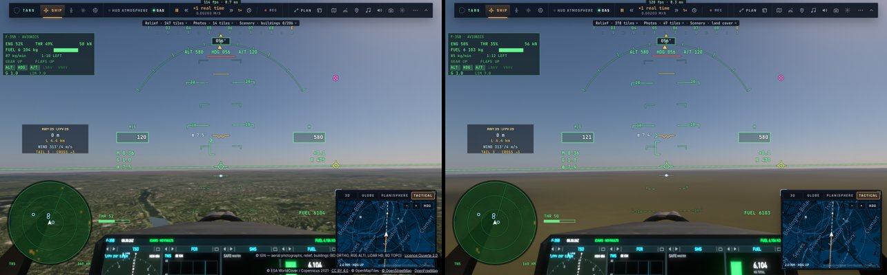
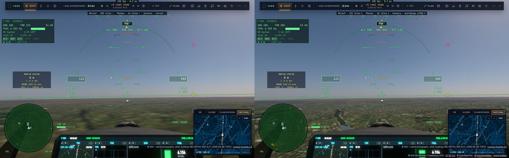

# T8a, T8b, T8c, T8d — le décodage des tuiles, la spécialisation des noyaux hors du fil de la page, le budget CPU de la boucle (T8)

Plan : [PLAN-REFRACTION-HORIZONS.md](../../PLAN-REFRACTION-HORIZONS.md), phase T8 (« le décodage en worker », « aucune longue tâche du
fil principal due aux tuiles »). Le 3 novembre 2026, kerr-mini, A/B A B B A contre cc754242. e2e `tests/e2e/tile-cpu.e2e.test.ts` ;
unitaires `tests/ortho.test.ts` ; données : [T8/](T8/).

## Fiche (§20.8 de l'analyse de stratégie)

| Champ | Réponse |
|---|---|
| Destination | §7.6 et §19.7 : préparer les données hors de l'image ; §8.3 : pas de blocage du fil principal à l'arrivée des données ; l'observabilité du coût CPU. |
| Bénéfice courant | Le décodage des tuiles (bitmaps relus, hauteurs Terrarium) et leurs couleurs (ajustements EOX et orthophotos, lumières) ne prennent plus rien au fil de la page : ~1,25 s de travail en 25 s de vol bas sur Paris, jusqu'à 9 ms d'un seul tenant par tuile, partent dans un worker. |
| Réutilisation | Les requêtes, leurs portillons (Géoplateforme) et leurs annulations restent où elles étaient ; seuls les blobs passent au worker. Les fonctions pures (`tile-decode.ts`) servent aussi au repli dans la page (tests). |
| Dépendance retirée | Les boucles de couleur allouant un tableau et une fermeture par pixel ; le `pow` par pixel des orthos (une table de la courbe de ton). |
| Acceptation | Décodage et couleurs à 0 ms sur le fil principal en vol ; images inchangées (les ajustements identiques, testés) ; aucune erreur. |
| État de preuve | **Mesuré** (kerr-mini, A/B, e2e `tile-cpu`) ; **vérifié statiquement** (typage, tests unitaires dont l'équivalence des mots de tuile). |
| Transition restante | `put` reste sur le fil principal (~280 ms en 25 s, 2,4 ms au plus) ; une ou deux longues tâches (51–103 ms) par vol, présentes avant comme après — leur cause n'est pas le décodage des tuiles, à chercher ailleurs ; le reste de T8 (priorités, files, validité par tuile, fenêtres d'imagerie à 8 tuiles). |

## Fait

- **`src/system/tile-decode.ts`** : `pixels`, `terrariumHeights`, `imageryWords` (le jour dans les couleurs de la Blue Marble — orthos par
  l'ajustement de leur source, EOX par le sien, GIBS tel quel —, les lumières nocturnes en alpha), `orthoWords` ; les ajustements sans
  allocation par pixel, la courbe de ton tabulée (4096 pas). `orthoColour`, `eoxColour` réexportés par `earth-tiles.ts`.
- **`src/system/tile-decode-worker.ts`** (`tile-decode-worker.js` : `server.ts`, `scripts/build-pages.ts`, `package.json`) : une requête
  par tuile, les tableaux rendus sans copie. Repli dans la page s'il n'y a pas de worker ou s'il échoue (les tuiles en attente refusées,
  redemandées).
- **L'observabilité** : `earthTiles.cpu` (`TILE_CPU`) — décodage, couleurs, écritures sur le fil de la page (total, plus long morceau,
  nombre) et le temps du worker.

## Mesuré (kerr-mini, 25 s de vol bas sur Paris, pilote automatique)

| | A (cc754242) | B (T8a) |
|---|---:|---:|
| Images dessinées en 25 s | 783 / 801 | 812 / 867 (**+6 %**) |
| Décodage + couleurs sur le fil de la page | ~1,25 s, jusqu'à 9,1 ms d'un tenant (mesure de référence) | **0** |
| Écritures (`put`) | ~325 ms | 274 / 281 ms, 2,4 ms au plus |
| Travail du worker | — | 1,75 / 2,17 s (≤ 22 ms une tuile) |
| Longues tâches > 50 ms | 1 (75 / 70 ms) | 2 (78, 51 ms) / 1 (103 ms) |

## T8b — la spécialisation WGSL des variantes dans un worker (le 3 novembre)

- **Le constat** (profil CPU de Chrome sur le vol, `TC_PROFILE=1`, bundle non minifié `E2E_NODE_ENV=development`) : dans les
  longues tâches restantes, **40 ms sur 217 venaient de la spécialisation d'une variante du traceur** (`specialisedModule` →
  `WgslSpecialiser.specialise` : les constantes repliées, les fonctions mortes retirées — du texte, sur le fil de la page, au moment
  où le vol demande une variante) ; le reste : la simulation du vol (`step`, `flyShip`, les hauteurs sous le train, 26 ms),
  `writeParams` (16 ms), le dessin de l'image.
- **Fait** : `src/system/wgsl-specialise-worker.ts` (`wgsl-specialise-worker.js`) reçoit une fois la source composée du traceur, puis
  une demande par variante ; `mkVariant` attend la source spécialisée avant de lancer la compilation (déjà asynchrone) ; repli dans
  la page sans worker. `renderer.specialiseCpu` : le temps de spécialisation hors du fil (14 variantes en vol : 1,3 s, jusqu'à 174 ms
  chacune — autant de moins sur le fil de la page).
- **Mesuré** (ce Mac en headless — la consigne de Sam —, sous pression thermique « Heavy » : les temps à prendre avec prudence ;
  A/B A B B A contre edf215a7, e2e `tile-cpu`) :

| | A (T8a) | B (T8b) |
|---|---:|---:|
| Longues tâches (> 50 ms) en 25 s | 2 (160 ms) / 2 (141 ms) | 1 (58 ms) / 2 (131 ms) |
| Images en 25 s | 1653 / 1886 | 1864 / 1778 |

  Temps de longues tâches **−37 %** (94 contre 150 ms par vol) ; un passage profilé sans aucune longue tâche. Celles qui restent
  viennent de la simulation et de la préparation de l'image — la prochaine tranche.

## T8c — le budget CPU de la boucle principale (le 3 novembre)

- **La mesure** (commit 871e1b8f) : `game.perf().loopCpu`, le temps CPU de la boucle principale sur ses 600 dernières itérations
  (médiane, 95ᵉ et 99ᵉ centiles, pire) ; l'e2e `tile-cpu` le rend avec les sections CPU, et avec `TC_PROFILE=1` garde le profil brut
  de Chrome (`.cpuprofile`) et les temps inclusifs de tout le vol. Le §8.3 de l'analyse vise ~4 ms au 95ᵉ centile.
- **Le constat** (profil du vol, bundle lisible) : le même calcul refait des dizaines de fois par image — le nivellement des pistes
  (`runwayGrade`, appelé par chaque échantillon du relief sous le train, 1,3 s sur 25 s : il testait les ~30 pistes à chaque appel,
  avec une allocation par piste), la bouche du trou de ver (`mouth()` → deux bissections `ellOfR` de 80 pas à chaque appel, 1,4 s),
  les sphères d'influence (`referenceBody` : toutes recalculées à chaque appel, la recherche linéaire du parent comprise) ; et une
  lecture de mise en page (`getBoundingClientRect` de la barre du haut) juste après l'écriture des compteurs, deux fois par seconde :
  ~6 ms de mise en page forcée chaque fois.
- **Fait** (les mêmes nombres rendus — un test compare `runwayGrade` à l'ancien parcours complet sur 8 000 points, avant et après un
  changement des pistes) :
  - `sites.ts` : la liste des pistes proches d'une cellule de 8 km, refaite quand le point en sort ou quand les pistes changent
    (`setWorldRunways`) ; plus d'allocation par piste ;
  - `wormhole.ts` : les dernières réponses d'`ellOfR` gardées (4) ;
  - `our-side.ts` : les sphères d'influence gardées pour le dernier instant et la dernière version des éphémérides ;
  - `main.ts` : les bas de la barre du haut et du compteur de compilation lus dans un `ResizeObserver` (la mise en page faite), plus
    dans la boucle ; `style.top` écrit seulement s'il change.
- **Mesuré** — profil CPU du vol (ce Mac, bundle de développement, profileur actif) :

| Fonction (inclusif, 25 s de vol) | Avant | Après |
|---|---:|---:|
| `runwayGrade` | 1 313 ms | 40 ms |
| `ellOfR` | 1 405 ms | 33 ms |
| `flightInfo` | 2 448 ms | 939 ms |
| boucle principale | 15 893 ms | 12 723 ms |
| inactif (`idle`) | 4 825 ms | 7 040 ms (relevé intermédiaire) |

- **Mesuré** — A/B sur ce Mac en headless (bundle de production, sans profileur), deux campagnes A B B A contre 871e1b8f, **sous
  pression thermique « Heavy » (81–86 °C)** : les temps sont à prendre avec prudence. Les passages B de la première campagne et le premier
  de la seconde ont chargé peu de tuiles (45, 117 et 66 contre ~410 — le serveur B froid ; un passage B seul en charge 401) : ils
  sont écartés de la comparaison (ils montraient un p95 de 4,7 à 5,3 ms, trompeur).

| Boucle principale [ms] | A (4 passages, 350–417 tuiles) | B comparables (B3′ : 308 tuiles ; B seul : 401) |
|---|---|---|
| médiane | 5,0 · 5,7 · 5,5 · 6,3 | 5,1 · 5,5 |
| 95ᵉ centile | 6,3 · 7,8 · 7,7 · 8,4 | 7,0 · 7,3 |
| 99ᵉ centile | 8,2 · 13,8 · 11,5 · 11,0 | 9,7 · 10,9 |
| pire itération | 24,2 · 27,7 · 25,8 · 29,5 | 13,8 · 12,2 |

  Ce qui tient : **la pire itération divisée par deux** dans les cinq passages B (12–15 ms contre 24–30), aucune longue tâche de part
  et d'autre ; le 95ᵉ centile à peine plus bas (≈ 7,6 → 7,2 ms en moyenne, −5 %), dans le bruit thermique. La cible de ~4 ms au 95ᵉ centile
  n'est **pas** atteinte (≈ 7 ms à tuiles chargées).

- **Reste** : l'encodage du rendu (`encodePost`, `dispatchTrace`, ~1,4 ms), le HUD dessiné en canvas (textes contournés,
  ~0,6 ms), `sceneBodies` (les corps vus avec le retard de la lumière, ~0,5 ms), le repère de l'appareil (`sfFrame`, encore refait
  ~10 fois par image) ; `put` des tuiles ; une mesure sur une machine froide (le mini ou le PC).

## T8d — les recalculs du repère de l'appareil (le 3 novembre, après-midi)

- **Le constat** (profil du vol de T8c, `profile-C0`) : le repère de l'appareil (`sfFrame`, 856 ms sur 25 s) est demandé par une
  dizaine de lecteurs à chaque image (`geoNow`, `attitudeNow`, le radar, la carte, le replay, l'aide au vol…), chacun le recalculant
  au même point et au même instant ; l'essentiel est `gravityHome` (l'attraction de tous les corps du système solaire : 460 ms
  sous `sfFrame`), dont `mouthAccel` (l'accélération propre du repère, 418 ms). `mouth()` (la bouche, recalculée depuis les réglages,
  270 ms en propre) est appelé des centaines de fois par image ; `escapeRadius` reconstruit chaque image toute la liste des corps de
  notre côté (`sceneBodies`, 242 ms) alors qu'il ne lit que ceux de Gargantua ; `taxiGuide.frame` lit la boîte du canvas à chaque
  image, juste après les écritures du HUD (une mise en page forcée : 293 ms), même hors du roulage de l'A320.
- **Fait** (les mêmes nombres rendus ; `tests/frame-memo.test.ts`) :
  - `our-side.ts` : `gravityHome` sans vitesse garde ses 4 dernières réponses (point, instant, version des éphémérides) et rend
    une copie ; avec la vitesse, toujours calculé (le test compare les deux chemins) ;
  - `solar.ts` : `mouthAccel` gardé pour le dernier instant ;
  - `wormhole.ts` : `mouth()` gardé pour les mêmes réglages de la bouche et le même instant, **figé** (`Object.freeze`) : un
    lecteur qui le modifierait lèverait une erreur au lieu de corrompre la réponse partagée ;
  - `scene-bodies.ts` / `renderer.ts` : `sceneBodies(s, t, obs, ours = true)` ; `escapeRadius` demande Gargantua seule (les
    mêmes premières entrées ; les nôtres ne sont jamais `where 0`) ;
  - `ui/taxiguide.ts` / `main.ts` : la boîte du canvas passée en fonction, lue seulement quand le guidage est affiché ; `geoNow`
    aussi ; `display` écrit seulement s'il change.
- **Mesuré** — profil CPU du vol (ce Mac, headless, bundle de développement ; `profile-D0` contre `profile-C0`) :

| Fonction (inclusif, 25 s de vol) | T8c | T8d |
|---|---:|---:|
| `sfFrame` | 856 ms | 396 ms |
| `gravityHome` | 783 ms | 276 ms |
| `mouthAccel` | 418 ms | 162 ms |
| `mouth` | 329 ms | 42 ms |
| `getBoundingClientRect` | 304 ms | 23 ms |
| `escapeRadius` | 251 ms | 35 ms |
| `geoNow` | 480 ms | 226 ms |
| `flightInfo` | 947 ms | 770 ms |

  Soit ≈ 1,2 s de moins sur 25 s pour ces fonctions (≈ 0,4 ms par itération en moyenne). D0 n'a chargé que 51 tuiles (C0 : 430) :
  ces fonctions n'en dépendent pas, la boucle entière si (12 723 → 12 230 ms) — elle n'est pas comparée.
- **Mesuré** — A/B A B B A contre 7a1f668c sur ce Mac en headless, thermique **Nominal** :

| Boucle principale [ms] | A1 (254 tuiles) | B2 (420) | B3 (131) | A4 (38) |
|---|---:|---:|---:|---:|
| médiane | 4,0 | 3,6 | 3,7 | 3,8 |
| 95ᵉ centile | 5,1 | 4,5 | 4,5 | 4,7 |
| 99ᵉ centile | 8,8 | 6,7 | 6,8 | 6,7 |
| pire itération | 13,5 | 15,7 | 13,3 | 11,9 |

  Sections par image : `camera.update` 0,70 · 0,68 → 0,54 · 0,61 ms ; `flightInfo` 0,38 · 0,35 → 0,27 · 0,29 ms. Les B sont au plus
  bas, mais les tuiles chargées vont de 38 à 420 (beaucoup restent en attente côté IGN) : **l'écart de 95ᵉ centile (≈ 0,2–0,6 ms)
  n'est pas démontré** par ces quatre passages. À noter : la machine froide donne ≈ 4,5–5 ms au 95ᵉ centile, contre ≈ 7 ms sous
  pression « Heavy » en T8c — la cible de ~4 ms est proche, pas atteinte.

- **Mesuré** — second A/B, **cache chaud** (`TC_CHROME_PROFILE=<dossier>` : un profil Chrome commun, son cache HTTP sert les
  mêmes tuiles à chaque passage une fois réchauffé ; le décodage et les écritures restent mesurés, le réseau et l'IGN sortent de la
  comparaison — deux passages de réchauffe : 411 puis 468 tuiles, 224 puis 35 en attente). Ce Mac en headless, **la machine
  passée de Nominal (89 °C CPU au départ) à Heavy** pendant les passages :

| Boucle principale [ms] | A1 (162 tuiles en vol) | B2 (456) | B3 (457) | A4 (473) |
|---|---:|---:|---:|---:|
| médiane | 4,3 | 4,1 | 4,3 | 3,8 |
| 95ᵉ centile | 6,7 | 5,2 | 5,9 | 8,0 |
| 99ᵉ centile | 9,5 | 8,7 | 9,3 | 12,8 |
| pire itération | 40,5 | 20,2 | 24,4 | 29,2 |

  À tuiles égales (B2, B3, A4 : 456–473), le 95ᵉ centile de B est plus bas (5,2–5,9 contre 8,0 ms), mais A4 passe en dernier, le
  plus chaud (toutes ses sections sont plus lentes, la HUD 1,39 contre 0,62–0,82 ms) : **une tendance, pas une preuve**. A1 (le plus
  froid) a reçu la plupart de ses tuiles avant le vol, d'où ses 162. À refaire machine froide, avec ce cache.

- **Reste** : `gearHeight` sous `sfFrame` (le relief et les plateformes changent : il faudrait une révision du sol), `sceneBodies` du
  rendu (les corps vus avec le retard de la lumière, ~0,5 ms), le HUD en canvas, l'encodage du rendu ; `orbitExtreme` des chiffres
  du Ranger ; une mesure à tuiles égales (sol bloqué ou mis en cache avant le vol).

