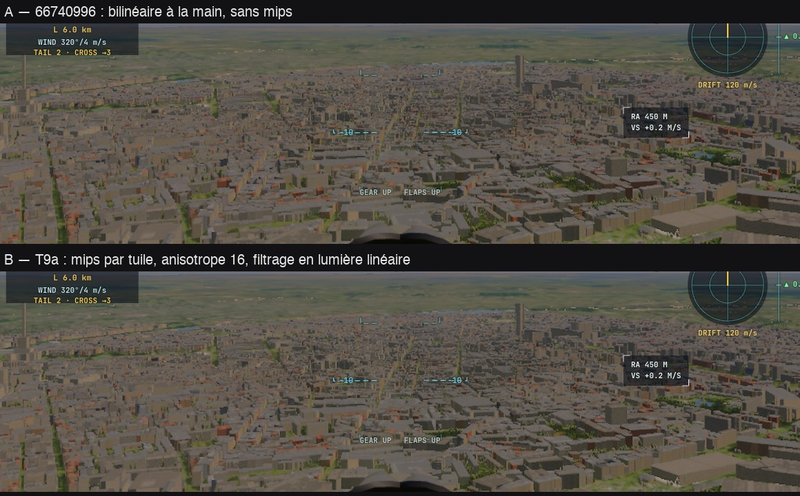
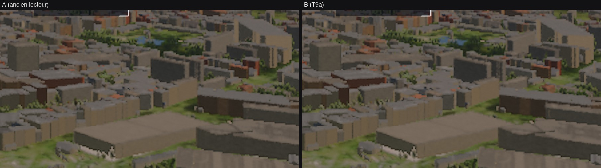
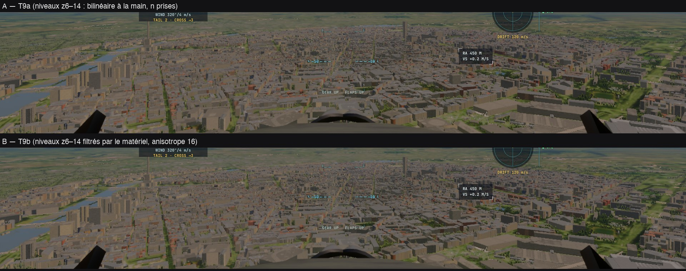

# T9a, T9b — l'imagerie de la Terre filtrée par le matériel (T9, contrat C0-4)

Plan : [PLAN-REFRACTION-HORIZONS.md](../../PLAN-REFRACTION-HORIZONS.md), phase T9 ; contrat [C0-4](C0.md). Le 3 novembre 2026,
kerr-mini (M1, Chrome plein écran), A/B A B B A contre 66740996. e2e `tests/e2e/ortho-filter.e2e.test.ts` ; unitaires
`tests/ortho.test.ts`, `tests/earth-tiles.test.ts` ; données : [T9/](T9/).

## Fiche (§20.8 de l'analyse de stratégie)

| Champ | Réponse |
|---|---|
| Destination | §20.5 étape 3 et §7.6 : une imagerie réellement filtrable, préparée avant l'image (mips à l'arrivée), lue par le filtrage matériel ; contrat C0-4 (2, 3, 4). |
| Bénéfice courant | Les orthophotos IGN (z15–18) sont filtrées en lumière linéaire, avec des mips et l'anisotropie 16, en une lecture au lieu de n prises × 4 `textureLoad` décodées à la main ; la couverture (alpha) remplace le test « un des 4 texels manque » (fondu au lieu d'un saut vers le niveau grossier). |
| Réutilisation | Le chargement, les fenêtres toroïdales, la validité et la table `TABLE_ORTHO` d'avant ; la même structure de texture servira à T9b (l'imagerie des niveaux z6–14) et aux horizons de H5. |
| Dépendance retirée | Les orthos sortent de la texture `rg32uint` des hauteurs (leurs quarts de couche) et le lecteur `orthoImage` disparaît ; le décodage sRGB manuel des orthos aussi. |
| Acceptation | A/B : aucune erreur GPU, images équivalentes, coût du matériau non dégradé. |
| État de preuve | **Mesuré** (kerr-mini, 4 passages) ; **vérifié statiquement** : 71/71 shaders (la passe des mips comprise), budgets des noyaux, tests unitaires. **Non mesuré** : le scintillement en mouvement (le gain attendu du filtrage), le Mac de Sam, le PC. |
| Transition restante | Les niveaux z6–14 gardent l'imagerie empaquetée et le bilinéaire à la main (T9b) ; les hauteurs restent en `rg32uint` (T9c : `r32float`) ; fenêtres d'orthos à 4 tuiles (C0-4 en prévoit 8). Sous 30 textures, pas d'orthos (les niveaux grossiers) : pas d'adaptateur gardé. |

## Fait

- **La texture** (`EarthTiles.orthoTexture`) : `rgba8unorm` avec une vue `rgba8unorm-srgb`, 1024² × 4 couches (une par niveau : la
  fenêtre est la couche entière, l'adressage `repeat` fait l'enroulement du tore), 5 mips, 22 Mo. Alpha = la couverture (0 : pas
  d'image IGN ; le filtrage est prémultiplié, la couleur divisée par la couverture, qui devient le poids).
- **Les mips** par tuile, à l'arrivée, d'une passe de rendu (la moyenne en lumière linéaire, prémultipliée) : les mips d'une tuile
  ne lisent jamais sa voisine.
- **La lecture** : `orthoAt` (mip par l'empreinte, `earthImagery`) et `orthoGrad` (les gradients du pixel, `earthImageryAniso` —
  les axes de son empreinte par les dérivées de la longitude et de la latitude de Mercator), un échantillonneur trilinéaire,
  anisotrope 16, en `repeat` (liaisons 44 et 45, palier de 30 textures — `withOrthoImagery`, talon sans orthos sinon).
- **La mémoire** : les orthos quittent la texture des hauteurs : 2048² × 6 couches au lieu de 7 (−32 Mo), 1024² × 12 au lieu de
  16 (−32 Mo), pour 22 Mo de la nouvelle texture.

## Mesuré (kerr-mini, A B B A, la scène entière : 32 000 bâtiments, ~17 900 maillés)

| Vue | A (66740996) | B (T9a) | Écart |
|---|---:|---:|---:|
| Droit devant (la ville rasante) — matériau raster | 19,00 / 18,85 ms | 18,57 / 18,54 ms | **−0,37 ms (−2 %)** |
| 35° vers le sol — matériau raster | 26,40 / 26,30 ms | 25,79 / 25,81 ms | **−0,55 ms (−2 %)** |
| Écart moyen d'image A1/B2 (bande du sol) | | | 1,08 niveau — le bruit A1/A4 : 0,97 |

## Ce que les e2e ont appris

- **Une texture à usage de stockage n'accepte pas de vue sRGB** (validation WebGPU) : la vue échouait, le groupe de liaisons du
  traceur devenait invalide — l'image entière noire côté B au premier A/B. Les mips passent par une passe de rendu.
  `check-wgsl` ne voit pas ces erreurs : un passage local de l'e2e avant l'A/B distant.
- **Le premier A/B mesurait une ville presque vide** : il attendait les tuiles et les orthos, pas le décor — la capture prise
  avant la scène complète (au mieux la première scène réduite). L'e2e attend désormais la scène entière (`sceneryReady`).

## Reste

- **T9b** : l'imagerie des niveaux z6–14 dans la même structure (des couches 1024² et 2048²), mips et anisotropie ; le canal des
  lumières nocturnes.
- **T9c** : les hauteurs en `r32float` ; puis les horizons de H5 dans une texture filtrée.
- Mesurer le scintillement en vol (une séquence, le même trajet A/B).

## T9b — l'imagerie des niveaux z6–14 (le 3 novembre, fin de matinée)

- **Deux textures filtrées** : la 1024² garde les 4 couches d'orthos et reçoit les 9 niveaux d'imagerie du relief (z6–14) quand leur
  fenêtre fait 1024² (couche `IMG_LAYER0` + leur indice) ; une **2048²** (`EarthTiles.imagery2k`, 4 couches) reçoit z11–14 aux
  portées lointaines (fenêtres de 8 tuiles), un bouchon 1 × 1 à la portée normale. Liaison 46, palier de 31 textures.
- **L'écriture** (`putImagery`) : chaque tuile du relief porte sa couleur dans sa couche, alpha la couverture, ses mips par la même
  passe de rendu que les orthos ; une tuile sans imagerie efface son emplacement.
- **La lecture** : `tileImgAt` (mip par l'empreinte) et `tileImgGrad` (les gradients du pixel en texels du niveau, anisotrope 16)
  remplacent le bilinéaire à la main (n prises × 4 `textureLoad` par niveau) ; la couverture devient le poids (fondu au lieu du saut
  quand un texel manque). **Les lumières nocturnes** restent lues à la main dans l'alpha de la texture du relief (`tileLights`), seulement
  quand elles sont voulues.
- **Le talon** (sous 31 textures) garde le chemin d'avant (`tileImgHand`, une prise bilinéaire) : aucune perte d'imagerie.
- **Tests** : un bouchon GPU commun aux faux appareils (`tests/lib/gpu-stubs.ts`).

**Mesuré** (kerr-mini, A B B A contre 1b9b26f4, Paris 450 m, la scène entière) :

| Vue | A (T9a) | B (T9b) | Écart |
|---|---:|---:|---:|
| Droit devant — matériau raster | 18,71 / 18,64 ms | 17,58 / 17,54 ms | **−1,12 ms (−6 %)** |
| 35° vers le sol — matériau raster | 25,96 / 25,93 ms | 24,84 / 24,89 ms | **−1,08 ms (−4 %)** |
| Écart moyen d'image A1/B2 (sol) | | | 1,36 niveau — bruit A1/A4 0,98, B2/B3 1,10 ; luminance moyenne égale (92,2) |

T9a + T9b : **−1,5 ms (−8 %)** au matériau raster droit devant, −1,6 ms vers le sol, depuis 66740996.

**Transition (mémoire)** : l'imagerie existe deux fois — dans le canal g de la texture du relief (`rg32uint`, encore lu par le talon et
les lumières) et dans les textures filtrées : à la portée « très loin » 192 + 73 + 89 Mo (≈ +140 Mo depuis avant T9). **T9c** la
referme : les hauteurs seules en `r32uint` (192 → 96 Mo), les lumières nocturnes dans des couches filtrées.
