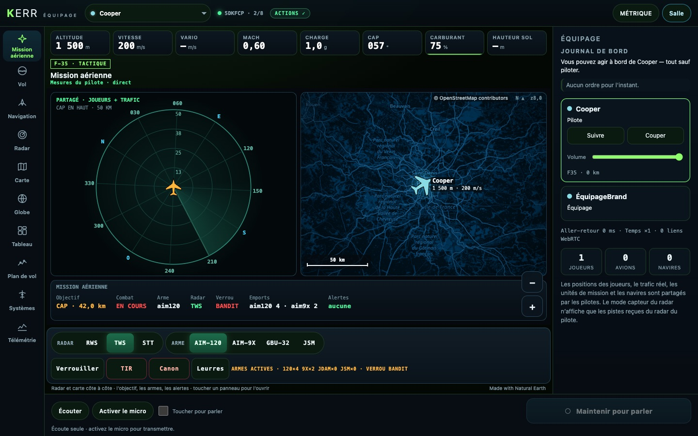
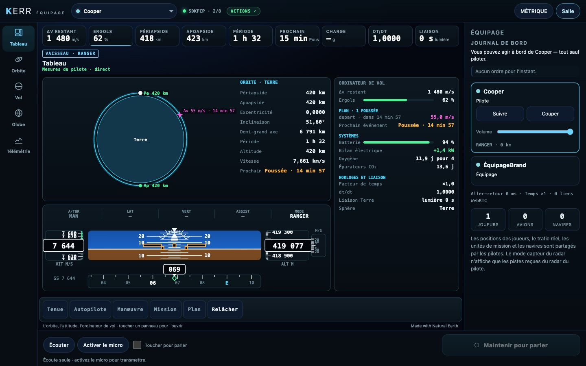
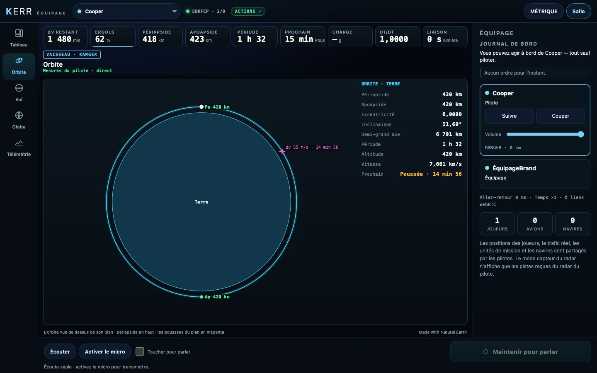

# K2 — Une console par appareil ; le crew F-35 distinct

*2026-10-18, branche `vaisseaux-aaa` — `docs/PLAN-VAISSEAUX-AAA.md`, phase K2.*

La console crew prend le profil de l'appareil du pilote suivi (`src/crew/profile.ts`) et change d'elle-même quand il
change d'appareil.

- **Le choix du profil.** La console lit le bloc `craft` de K1. Pour un pilote plus ancien, elle se fie aux familles
  d'ordres : `weapons` signifie le F-35, `space` un vaisseau.
- **Le F-35 : une console tactique.**
  - Thème vert phosphore, badge carré `F-35 · TACTIQUE`.
  - Sa première vue, **Mission aérienne**, met côte à côte le radar et la carte des unités. Un bandeau dessous donne
    l'objectif, le combat, l'arme, le mode radar, le verrou, les emports et les alertes. Le panneau des armes
    (radar, arme, verrouiller, tirer, canon, leurres) est en avant.
  - Ses vues sont ordonnées pour le combat : Vol, Navigation, Radar, Carte, Globe, Tableau, Plan de vol, Systèmes,
    Télémétrie.
- **Le vaisseau : la console d'un contrôle de mission.**
  - Thème bleu, badge `VAISSEAU · RANGER`.
  - Ses tuiles : Δv restant, ergols, périapside, apoapside, période, prochain événement, charge, dτ/dt, liaison.
  - Son **Tableau** montre l'orbite en grand, l'attitude, et la colonne de l'**ordinateur de vol** : Δv et ergols,
    poussée en cours, poussées du plan, prochain événement, cible, systèmes de X3, anneau et ports de l'Endurance,
    facteur de temps, dτ/dt, liaison avec la Terre.
  - Sa vue **Orbite** montre la conique vue de dessus de son plan, reconstruite à partir de l'état reçu
    (`src/crew/orbitmath.ts`, Kepler elliptique et hyperbolique). On y voit le corps à l'échelle, Pe et Ap avec leurs
    hauteurs, le vaisseau, les poussées du plan à l'endroit où elles tombent, et les éléments orbitaux.
- **Le changement d'appareil.** La vue que les deux profils partagent (Vol, Globe, Télémétrie) est gardée ; sinon la
  console s'ouvre sur la première vue du profil. La bande de tuiles est reconstruite.
- Correctifs :
  - la mise en page de « Mission aérienne » en paysage de téléphone (un radar sans place faisait planter la carte) ;
  - un panneau trop petit n'est plus dessiné.

## Mesures

`tests/crew-profile.test.ts` (2/2) couvre :
- le profil selon le bloc ou les familles, et des vues et tuiles distinctes ;
- la conique d'une orbite ISS (51,6°, 92,6 min) ;
- une ellipse (apsides, demi-période), une hyperbole coupée au rayon demandé.

`tests/e2e/crew-space.e2e.test.ts` (2/2, salle réelle, clics réels) : un pilote de test vole en F-35 puis en Ranger
en orbite.
- La console passe en tactique : badge, Mission aérienne en premier, pas d'Orbite.
- Puis elle passe en vaisseau : badge, tuiles Δv « 1 480 » et Pe « 418 », Tableau en premier, pas de radar.
- Un clic ouvre Orbite.

Les e2e crew existants passent aussi : `crew` 7/7 (y compris tablette et paysage), `crew-actions` 6/6.

## Pas encore

- La carte 3D du système et de Gargantua (K3) ; les vues amarrage, Δv, EECOM, chronologie, relativité, sol (K4).
- La console est en français, comme le reste du crew.
