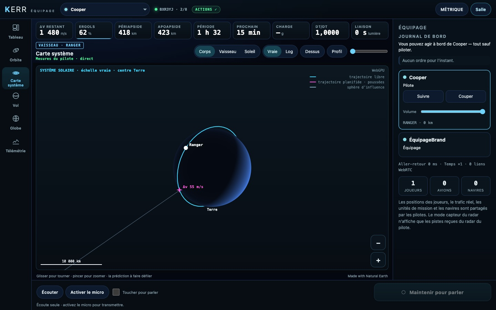
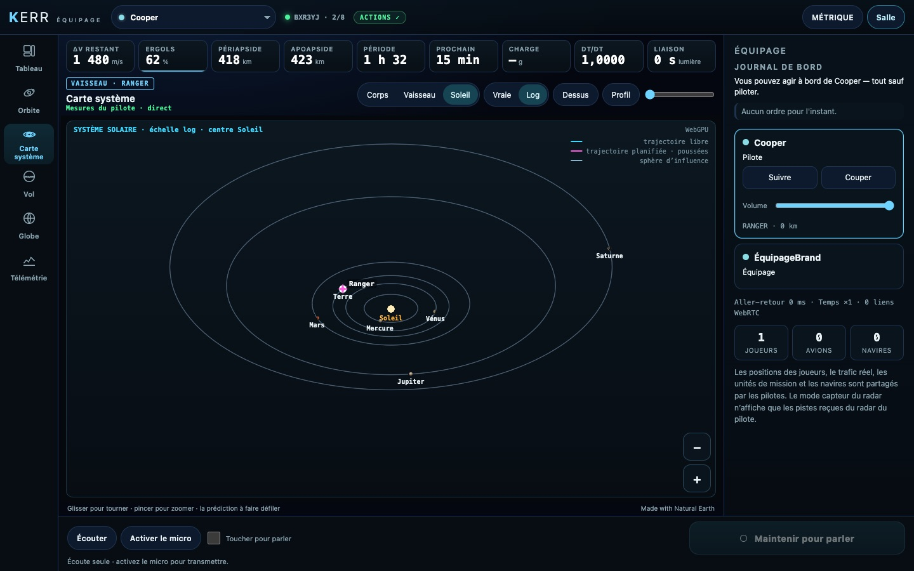
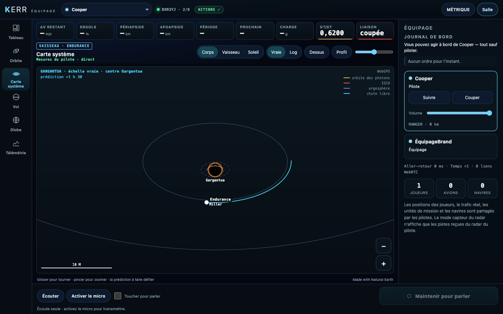

# K3 — La carte du système solaire et de Gargantua (3D WebGPU, repli 2D)

*2026-10-18, branche `vaisseaux-aaa` — `docs/PLAN-VAISSEAUX-AAA.md`, phase K3.*

La console vaisseau a sa **Carte système** (`src/crew/sys3d/`, `src/crew/draw/system.ts`).

- **La scène** (`scene.ts`, pure, construite à partir des blocs de K1) :
  - **notre côté** :
    - le Soleil et ses planètes ;
    - leurs orbites, chacune reconstruite autour de son parent. Le contrat K1 envoie désormais la vitesse et le GM
      de chaque corps ; la console en tire la conique (`orbitmath.ts`) ;
    - les lunes du corps visité, la sphère d'influence, l'orbite du vaisseau ;
    - les trajectoires libre et planifiée par sphère, les poussées, la cible ;
  - **le côté Gargantua** (nouveau bloc `hole` de K1) : le trou noir et son horizon, l'ergosphère, l'orbite des photons
    et l'ISCO (rayons de Bardeen pour son spin), Miller et Mann sur leurs cercles, la bouche du trou de ver,
    l'Endurance et sa chute ;
  - **la prédiction** : un curseur avance le temps. Les corps avancent sur leurs orbites (Kepler) et un fantôme du
    vaisseau suit sa trajectoire.
- **La caméra** (`camera.ts`) :
  - elle tourne autour du centre choisi (le corps, le vaisseau, le Soleil) ;
  - l'échelle est vraie ou logarithmique (f(r) = E·log₁₀(1 + 9r/E) : planètes intérieures et extérieures sur un même
    écran) ;
  - perspective, profondeur logarithmique ; vues **Dessus** et **Profil** ;
  - les sphères gardent quelques pixels au moins.
- **Le rendu WebGPU** (`gpu.ts`, shader dans le code) :
  - il n'est demandé qu'à la première ouverture de la carte ;
  - sphères éclairées par l'étoile : leur nuit sombre, le halo du Soleil qui ne cache rien, le trou noir sous son
    anneau de photons, la bouche en anneau ;
  - orbites et trajectoires en rubans antialiasés, en tirets quand il le faut ;
  - profondeur : une planète cache l'orbite qui passe derrière elle.
- **Le repli 2D** (`draw2d.ts`) : sans WebGPU, la même projection sur le canvas (disques ombrés du plus loin au plus
  proche). La caméra orientable et les vues Dessus et Profil restent.
- Les étiquettes (sans chevauchement), la légende, la barre d'échelle et le mode sont dessinés par-dessus l'un ou
  l'autre rendu.
- Le bundle crew pèse 233 Ko minifié (budget relevé à 320 Ko en K5).

## Mesures

`tests/crew-system.test.ts` (3/3) :
- notre côté : les orbites reconstruites ; la Lune un quart de tour plus loin après un quart de mois ; le cadrage
  autour de la Terre ou du Soleil ;
- les rayons de Kerr (Schwarzschild : 2, 3 et 6 M ; spin extrême ≈ 1 M) ; la scène Gargantua ;
- la projection : le centre au centre de la vue ; l'échelle logarithmique rapproche les planètes lointaines ; disques
  de 3 px au moins.

`tests/e2e/crew-space.e2e.test.ts` (3/3, salle réelle) : la carte autour de la Terre, rendue en **WebGPU** dans le
Chrome headless ; le Soleil en échelle logarithmique ; la prédiction déplacée ; le côté Gargantua. Les tests K1 et K2
passent toujours.

## Pas encore

- Les autres joueurs et leurs orbites sur la carte (phase N : leurs états dans la salle).
- Choisir une cible sur la carte, déplacer les nœuds (K6).
