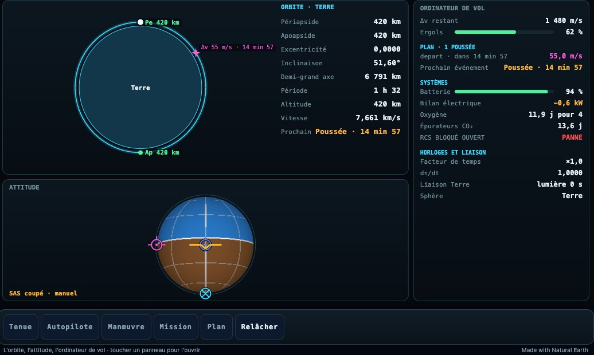
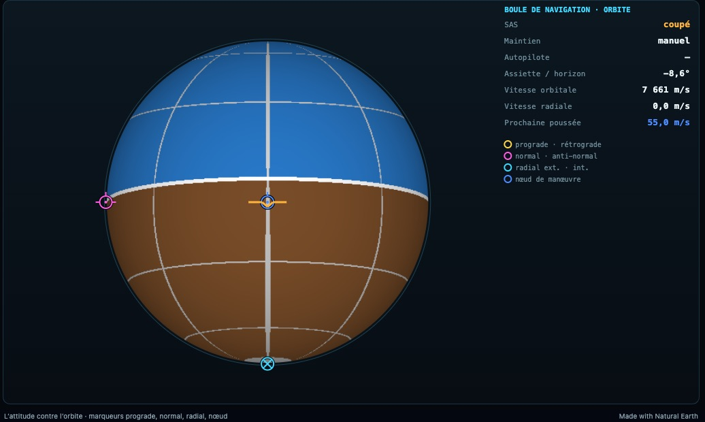
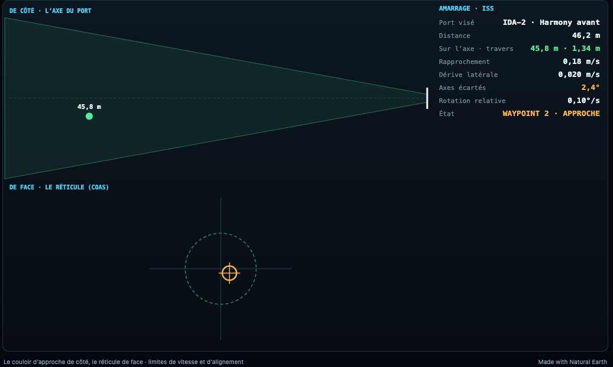
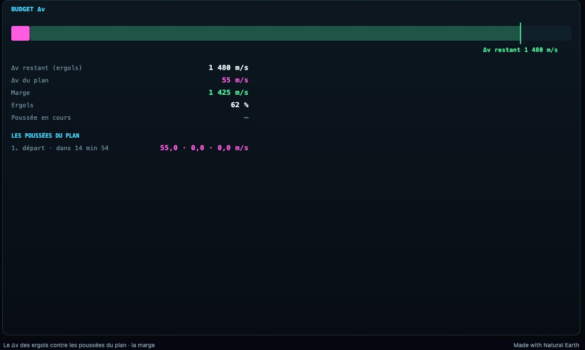
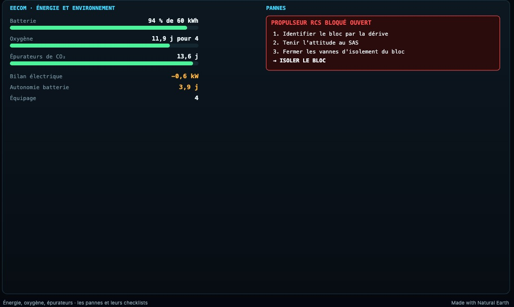
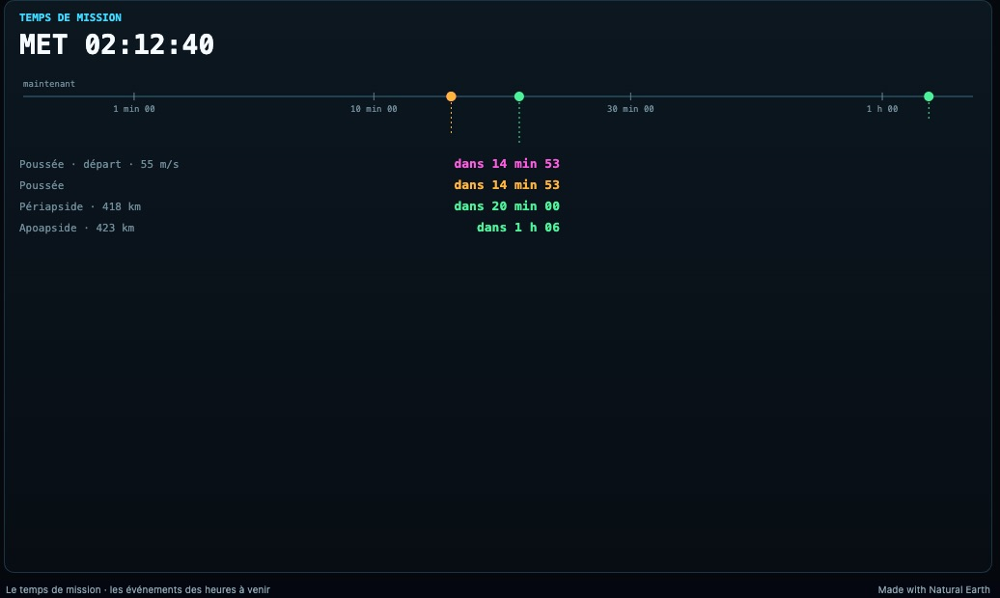
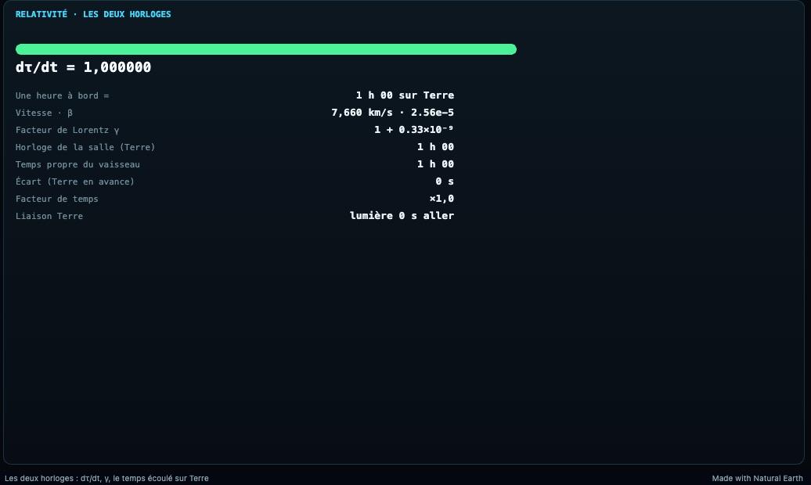
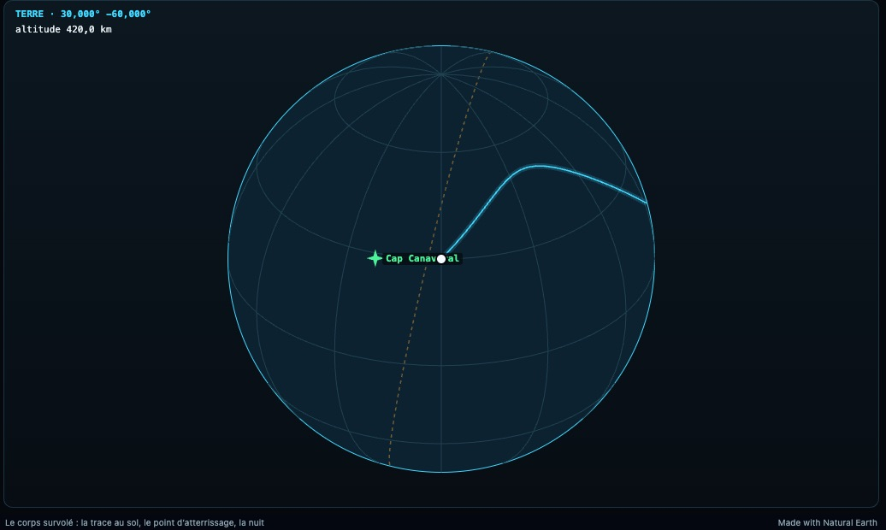

# K4 — Les vues vaisseau de la console crew

*2026-10-18, branche `vaisseaux-aaa` — `docs/PLAN-VAISSEAUX-AAA.md`, phase K4.*

Sept vues rejoignent la console vaisseau (`src/crew/draw/navball.ts`, `src/crew/draw/spaceviews.ts`) :

- **Boule** — la boule de navigation, le PFD du vaisseau.
  - Elle montre l'attitude contre l'orbite : le ciel du côté radial extérieur, la boule vue de derrière le vaisseau.
  - Marqueurs : prograde, rétrograde, normal, anti-normal, radial, et le nœud de manœuvre (Δv du plan projeté sur
    les axes orbitaux).
  - Lectures : SAS, maintien, autopilote, assiette sur l'horizon, vitesses orbitale et radiale.
  - Le Tableau vaisseau l'affiche à la place du PFD.
- **Amarrage**
  - Le couloir vu de côté, avec le cône de ±(0,3 m + 10 %) ; le réticule de face (COAS).
  - Les vitesses comparées à leurs limites, les axes écartés, la rotation relative, la phase de l'autopilote.
- **Δv** : les poussées du plan bout à bout contre le Δv des ergols, la marge en vert (un manque en rouge), le
  réservoir, le détail des poussées (prograde · normal · radial, rôles en français).
- **EECOM** : batterie, oxygène, épurateurs, bilan, autonomie de la batterie ; chaque panne avec sa checklist dans le
  français du jeu (`src/crew/checklists.ts`, un test le garde aligné sur le dictionnaire).
- **Chronologie** : le temps de mission (MET) en grand. Les poussées, apsides, changements de sphère et approches
  minimales sont placés sur un axe en racine carrée (les prochaines minutes au large), avec leurs comptes à rebours.
- **Relativité** : dτ/dt, « une heure à bord = … sur Terre », β, γ (en 10⁻⁹ près de la Terre), l'horloge de la salle
  contre le temps propre et leur écart, r · E · L côté Gargantua, la liaison.
- **Sol** : le corps survolé en projection orthographique autour du vaisseau ; grille, terminateur, trace au sol, point
  d'atterrissage (ambre quand le pilote l'a redésigné au LPD).

Les nouveaux blocs du contrat :
- `att` : le nez et le haut du vaisseau, pris sur les axes de sa pose. La matrice S du HUD est en coordonnées caméra :
  un test l'a révélé, le nez sortait à l'envers.
- `dock` : la géométrie d'amarrage à moins de 5 km d'un port. Les écarts latéraux sont pris sur les axes droite et
  haut du vaisseau.
- `land` : le site visé ou le point du LPD, en latitude et longitude sur son corps.
- `time.met` : le temps écoulé depuis le début du vol.

## Mesures

- `tests/crew-space.test.ts` (3/3) : en plus de K1, l'Endurance maintenue prograde pendant 60 s. Le nez envoyé, comparé
  à la vitesse envoyée, donne 0,9999.
- `tests/crew-profile.test.ts` (3/3) : en plus de K2, les checklists françaises identiques à celles du jeu.
- `tests/e2e/crew-space.e2e.test.ts` (3/3) : les sept vues ouvertes au clic tour à tour, sans erreur. Les captures
  viennent de ce test.
- Tests crew : 24/24. Le bundle crew reste sous son budget de 256 Ko.

## Pas encore

- Côtes et images des corps sur la vue Sol (la Terre a déjà son globe photographié).
- Cocher les checklists depuis la console, isoler un RCS, les disjoncteurs (K6).
