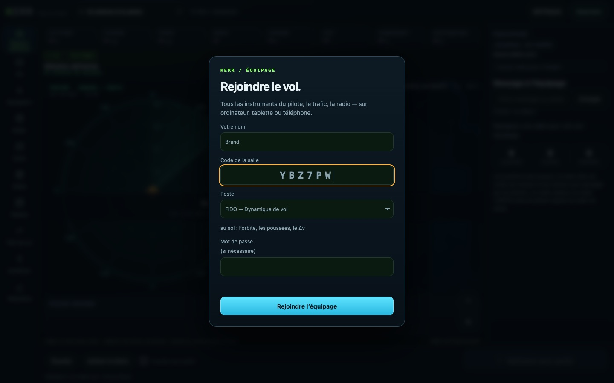
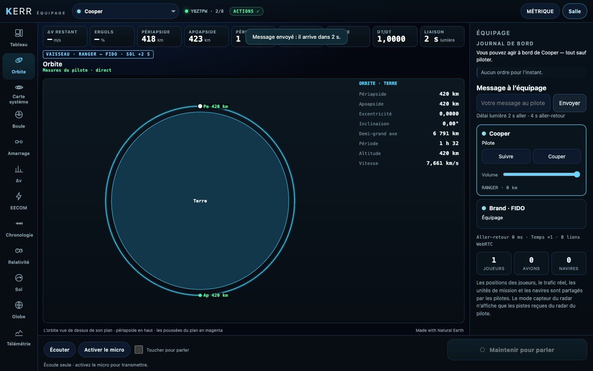
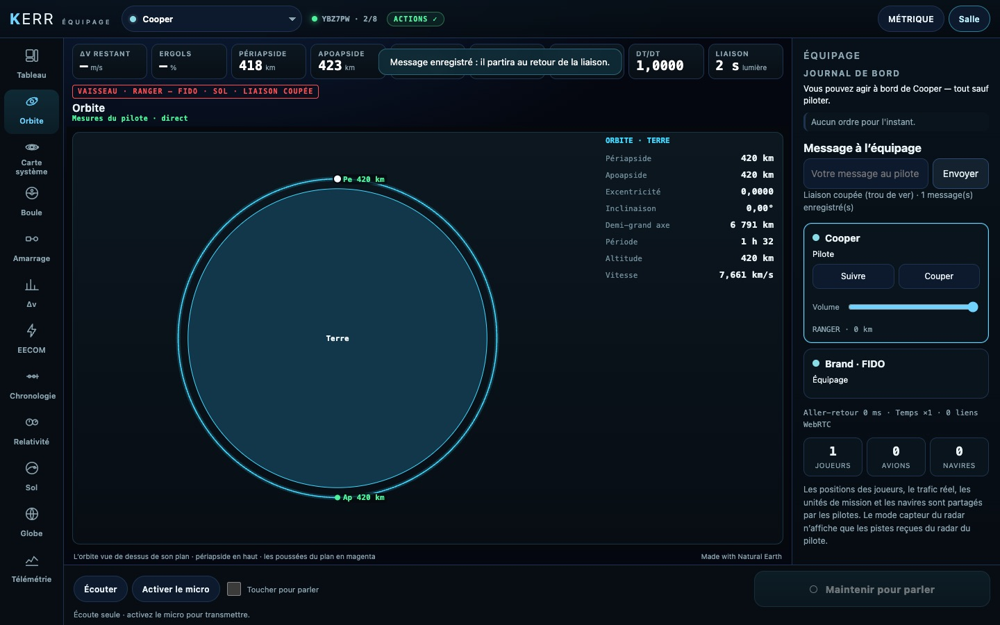

# K5 — Les postes : à bord ou au sol, le délai lumière réglable

*2026-10-18, branche `vaisseaux-aaa` — `docs/PLAN-VAISSEAUX-AAA.md`, phase K5.*

- **Le choix du poste** se fait au lobby de la console (`src/crew/station.ts`).
  - À bord : Copilote, Navigateur, Ingénieur de bord.
  - Au sol, au contrôle de mission : FLIGHT, FIDO, GUIDO, EECOM, CAPCOM.
  - L'indicatif suit le nom dans la salle (« Brand · FIDO »). La console vaisseau s'ouvre sur la vue du poste (FIDO
    l'Orbite, GUIDO la Boule, EECOM et l'ingénieur l'EECOM, le navigateur la Carte système, CAPCOM la Chronologie).
- **Le délai lumière** est un réglage de la salle, porté par le pilote : *Réseau → Délai lumière vers le sol* (réel,
  un dixième, aucun ; FR et EN). L'instantané en donne la valeur (`link.delay`).
  - Le modèle de la console met les instantanés d'un poste au sol dans une file (`DelayLine`) : ils s'affichent avec
    ce retard. Pour Mars, la file ne garde qu'un instantané par seconde.
  - Les ordres partent avec le même retard, leurs réponses reviennent avec lui, et le délai d'attente le prend en
    compte.
  - À bord, rien n'est retardé.
- **Derrière le trou de ver**, la liaison du sol est coupée.
  - Plus rien de neuf ne s'affiche (la ligne d'état le dit) et les ordres sont refusés.
  - Les messages sont enregistrés (`Outbox`) et partent au retour de la liaison avec leur âge. Le pilote lit : « Message
    enregistré de … (il y a …) : … ».
- **Message à l'équipage** : un texte depuis le panneau Équipage vers le pilote suivi, qui le reçoit en toast
  (`crew-msg`, adressé à lui seul).
- **CAPCOM** : les tonalités Quindar d'Apollo à chaque prise de parole (2 525 Hz à l'ouverture, 2 475 Hz à la
  fermeture, 250 ms).
- **Le badge** indique le poste et la liaison (« VAISSEAU · RANGER — FIDO · SOL +2 S », en rouge quand elle est
  coupée). La ligne d'état indique « Mesures du pilote · différées de 2 s (lumière) ».

## Mesures

- `tests/crew-station.test.ts` (3/3) : les postes et la liaison (à bord en direct, sol en retard, coupée derrière le
  trou de ver, réglages un dixième et aucun) ; la file (rien avant l'arrivée de la lumière, puis le plus récent dû ;
  Mars allégée à 600 éléments pour 10 min) ; les messages enregistrés.
- `tests/e2e/crew-stations.e2e.test.ts` (2/2, salle réelle) :
  - FIDO choisi au lobby, « Brand · FIDO » dans la salle, la console sur l'Orbite ;
  - les mesures affichées **2,00 s** en retard sur le pilote, le badge ;
  - un message entendu par le pilote **2,27 s** après l'envoi ;
  - la liaison coupée : badge, ordre refusé, message enregistré et non parti ; puis, à la reprise, le message délivré
    avec son âge.
- Les e2e crew existants passent : `crew` 7/7, `crew-actions` 6/6, `crew-space` 3/3.

## Pas encore

- Les messages vocaux enregistrés : le texte suffit pour l'instant ; la voix viendra avec la phase N.
- Les actions mises en avant par poste (K6).
