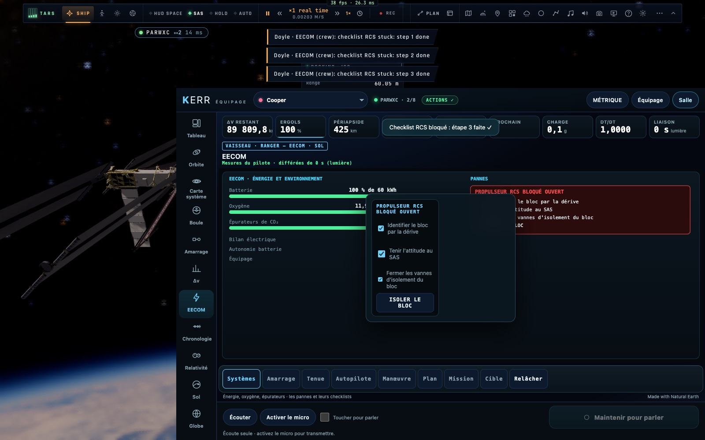

# K6 — Toutes les actions vaisseau depuis la console

*2026-10-18, branche `vaisseaux-aaa` — `docs/PLAN-VAISSEAUX-AAA.md`, phase K6.*

- **De nouveaux ordres** (`net/crewcmd.ts`, exécutés par `ui/crew-exec.ts` avec les fonctions du contrôleur) :
  - `sp.dock` : maintien à poste, désamarrer, faire le plein, mode RCS ;
  - `sp.ring` : l'anneau de l'Endurance ;
  - `sp.node` : déplacer une poussée du plan dans le temps, ou la supprimer ;
  - `sys.step` et `sys.fix` : cocher une étape de checklist de panne, donner son action. L'action est refusée tant
    que toute la checklist n'est pas cochée (« la checklist d'abord »).
- **Les checklists partagées** : les cases cochées vivent désormais dans le contrôleur (`camera.sysTicks`). La page
  Systèmes de la tablette du pilote et les consoles voient les mêmes ; l'instantané les porte (`sysx.failures[].ticks`).
- **L'ordinateur de vol de la console** :
  - il apparaît sous **toutes** les vues vaisseau, avec de nouveaux panneaux : **Cible** (enfin `sp.target` dans
    l'interface), **Amarrage**, **Systèmes** (les cases et le bouton d'action, retenu tant qu'il le faut), **Anneau**
    pour l'Endurance ;
  - ses panneaux sont rangés **selon le poste**, le premier mis en avant : EECOM Systèmes, FIDO Manœuvre, GUIDO
    Tenue, FLIGHT Autopilote.
- **La Carte système** : toucher un corps ouvre un menu (« Prendre pour cible », « Mission vers … — aperçu »).
- **L'Orbite** : une poussée se fait glisser le long de l'orbite. Son nouveau temps (Kepler, `timeBetween`) s'affiche
  pendant le geste et la poussée est déplacée d'autant.
- Les messages du pilote nomment les pannes (« checklist RCS stuck: step 1 done »). Les refus des systèmes arrivent
  dans la langue de la console, quelle que soit celle du pilote.
- Toujours « tout sauf piloter » : liste blanche, verrou du pilote, 4 ordres par seconde (tests de `crew-actions`
  inchangés, 7/7).

## Mesures

`tests/e2e/crew-space-actions.e2e.test.ts` (4/4, **sur le vrai simulateur**) : le Ranger près de l'ISS dans une salle,
la console dans un cadre de la même page, au poste EECOM.
- **La panne** : déclenchée en jeu. Le bouton d'action est retenu. Trois clics sur les cases de la console, et la
  tablette du pilote compte 1, 2, puis 3 étapes. Le bouton « ISOLER LE BLOC » est donné et la panne est réparée.
- **Le maintien à poste** est commandé depuis Amarrage.
- **La Lune** est prise pour cible depuis le menu de la carte.
- **Une poussée** est déplacée de 120 s le long de l'orbite.

Les tests unitaires crew passent (dont `timeBetween` : un quart d'orbite fait un quart de période), ainsi que les e2e
`crew-space` (3/3) et `crew-actions` (déjà vérifié en K5).

## Pas encore

- Les ordres de flotte aux autres joueurs (demande d'amarrage, « tiens ta position ») : phase N.
- Les disjoncteurs comme commandes distinctes : les actions de panne (couplage des bus, centrale de secours) en
  tiennent lieu.
