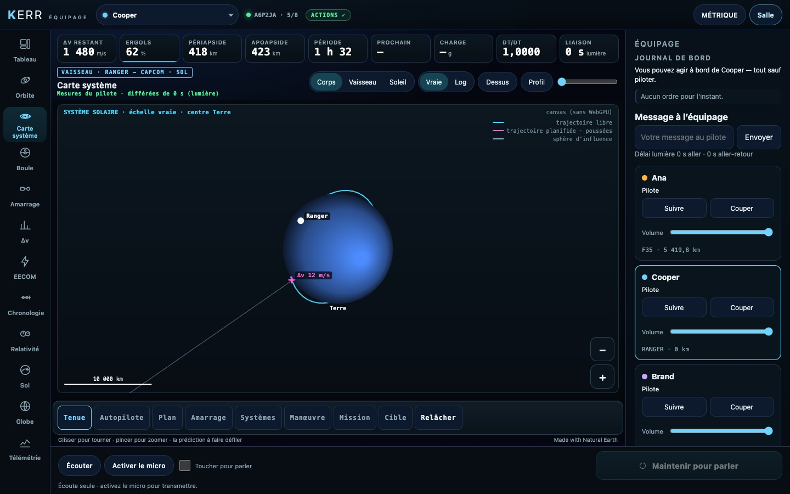
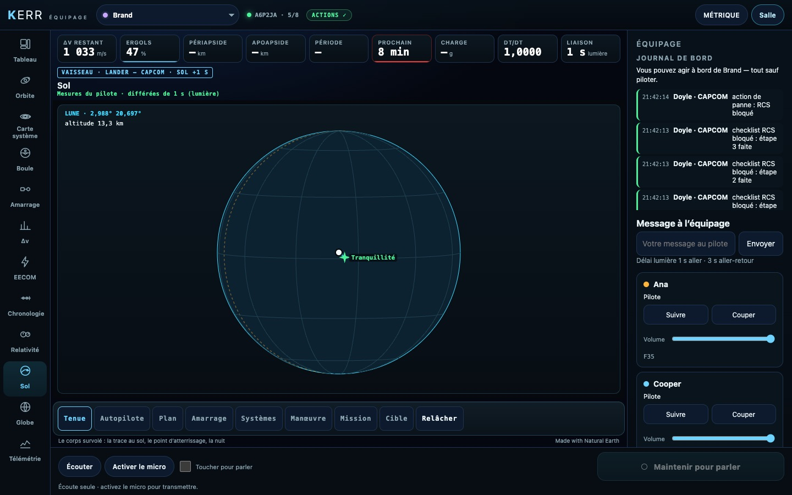
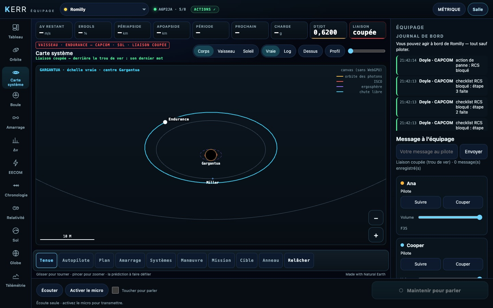

# K7 — La salle de démonstration vaisseau, les tests, la doc

*2026-10-18, branche `vaisseaux-aaa` — `docs/PLAN-VAISSEAUX-AAA.md`, phase K7. Fin du bloc 2 (les deux équipages).*

- **La salle de démonstration** : `bun scripts/crew-demo.ts --space` (`scripts/lib/space-demo.ts`). Une salle
  accueille quatre pilotes : on garde le F-35 de tête et on ajoute trois vaisseaux scénarisés, qui envoient tous les
  blocs K1–K6 et répondent aux ordres de l'équipage :
  - **Cooper** : le Ranger à 420 km, qui s'approche de l'ISS (de 300 à 20 m, en boucle). On y voit son orbite, sa
    trajectoire, une poussée planifiée, la géométrie d'amarrage et les phases de l'autopilote. Une panne de RCS
    arrive à 40 s : l'équipage coche sa checklist et donne l'action, et la panne se répare ;
  - **Brand** : le Lander qui descend sur la Lune, de 15 km au sol de Tranquillité en dix minutes. On y voit sa trace,
    son point d'atterrissage et son Δv décroissant ; 1,28 s de lumière ;
  - **Romilly** : l'Endurance à 12 M de Gargantua. On y voit son anneau (qu'on règle), le Ranger au moyeu avant, Miller
    et Mann, la bouche du trou de ver, dτ/dt = 0,62. La liaison est coupée pour le sol.
- **Deux corrections trouvées par cette salle** :
  - les blocs envoyés une fois par seconde (corps, trajectoires, côté Gargantua) se perdaient trois images sur quatre ;
    la console garde désormais les derniers reçus et les remet dans les instantanés suivants ;
  - un poste au sol ne voyait jamais un vaisseau déjà derrière le trou de ver. Il le reconnaît désormais à son dernier
    mot (son profil, son badge, sa carte) : « Liaison coupée — derrière le trou de ver : son dernier mot ».
- **Les tests vaisseau de la console** (`docs/E2E-CATALOGUE.md`) : `crew-space` (profils, vues, carte 3D),
  `crew-stations` (postes, délai, liaison coupée), `crew-space-actions` (ordres sur le vrai simulateur) et
  `crew-demo-space`.
- **`docs/CREW.md`** décrit les deux consoles, la carte système, les vues vaisseau, les postes et le délai, les
  actions vaisseau, et la démonstration.

## Mesures

`tests/e2e/crew-demo-space.e2e.test.ts` (2/2, trois passages) : la salle de démonstration lancée contre le serveur
du test, et la console au poste CAPCOM **sans WebGPU**.
- **Cooper** : la carte système est dessinée sur le canvas (le repli). Sa panne arrive ; ses trois étapes sont cochées
  au clic, chacune revient de la démo, l'action est donnée et la panne réparée.
- **Brand** : la vue Sol.
- **Romilly** : la carte de Gargantua et le badge LIAISON COUPÉE.

Repassés après les corrections : `crew-space` 3/3.

