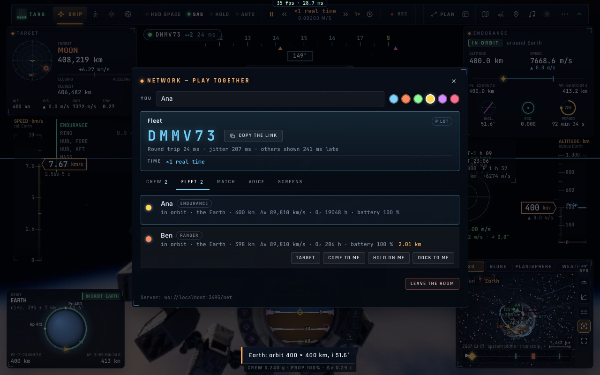
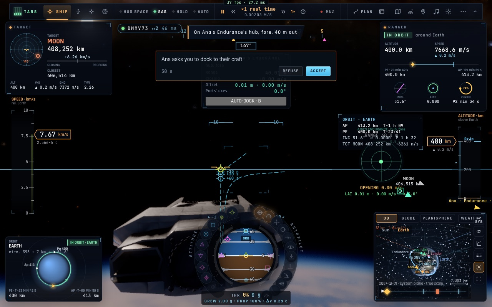

# N1 — La flotte de salle et les ordres entre joueurs

*2026-10-20, branche `vaisseaux-aaa` — `docs/PLAN-VAISSEAUX-AAA.md`, phase N.*

- **L'état de chaque vaisseau** (`net/spacefleet.ts`, événement `stel`, une fois par seconde) :
  - le type et le corps de la sphère d'influence ;
  - l'altitude et l'état de vol (orbite, posé, échappement, trou de ver…) ;
  - le Δv restant, les pannes non réparées, l'amarrage ;
  - l'O₂ restant et la batterie ;
  - le côté (le nôtre ou celui de Gargantua).

  À la réception, tout est vérifié (un champ faux, le message est ignoré).
- **L'onglet « Flotte » du panneau Réseau** affiche les pilotes aux commandes d'un vaisseau, soi d'abord, puis du
  plus proche au plus loin. Chaque ligne donne le vaisseau, où il est, son Δv (en km/s pour les réservoirs du jeu),
  ses consommables et ses pannes. Elle donne aussi la distance, et la vitesse de rapprochement (▼) ou
  d'éloignement (▲) ; un déplacement instantané ne compte pas comme une vitesse.
- **Les ordres** « Rejoins-moi », « Maintiens-toi sur moi » et « Amarre-toi à moi » :
  - on les donne depuis l'onglet Flotte, ou depuis la roue du vaisseau (« Flotte › Flotte de la salle » et les trois
    ordres au pilote ciblé) ;
  - chez l'autre, une carte s'affiche (Accepter / Refuser, 30 s) ;
  - accepté : son vaisseau cible le nôtre, et son autopilote se met en amarrage ou en maintien à poste si l'autopilote
    l'atteint (3 km). Plus loin, il cible et dit de planifier le rendez-vous ;
  - la réponse revient dans le panneau de celui qui a donné l'ordre (« accepté » / « refusé »).
- **L'alerte de proximité** se déclenche quand un autre vaisseau s'approche :
  - « PROXIMITÉ » sous 200 m à plus de 1 m/s, ou sous 1 km et moins d'une minute de l'impact ;
  - « Trafic » sous 2 km et moins de 3 min ;
  - jamais entre vaisseaux amarrés ni pour un passager ; au plus une alerte par vaisseau et par 15 s.
- **Correctif** : la ligne de « soi » dans la liste de l'équipage portait la classe `.me`, qui recevait la hauteur de
  720 px de l'éditeur de missions F-35. Elle s'appelle désormais `.netp-mine`.

## Mesures

- `tests/netspace.test.ts` (4/4) : l'état vérifié et dit, les lignes et leur ordre, les ordres et leur autopilote
  selon la distance, les seuils de proximité.
- `tests/e2e/net-fleet.e2e.test.ts` (3/3, deux navigateurs) :
  - les deux vaisseaux sont dans l'onglet Flotte, Ben à 2,01 km ;
  - Ben placé à 180 m qui se rapproche à 1,5 m/s déclenche l'alerte ;
  - Ana clique « Amarre-toi à moi » ; la carte apparaît chez Ben, il accepte. Son autopilote d'amarrage cible le
    vaisseau d'Ana, et le panneau d'Ana affiche « accepté ».

