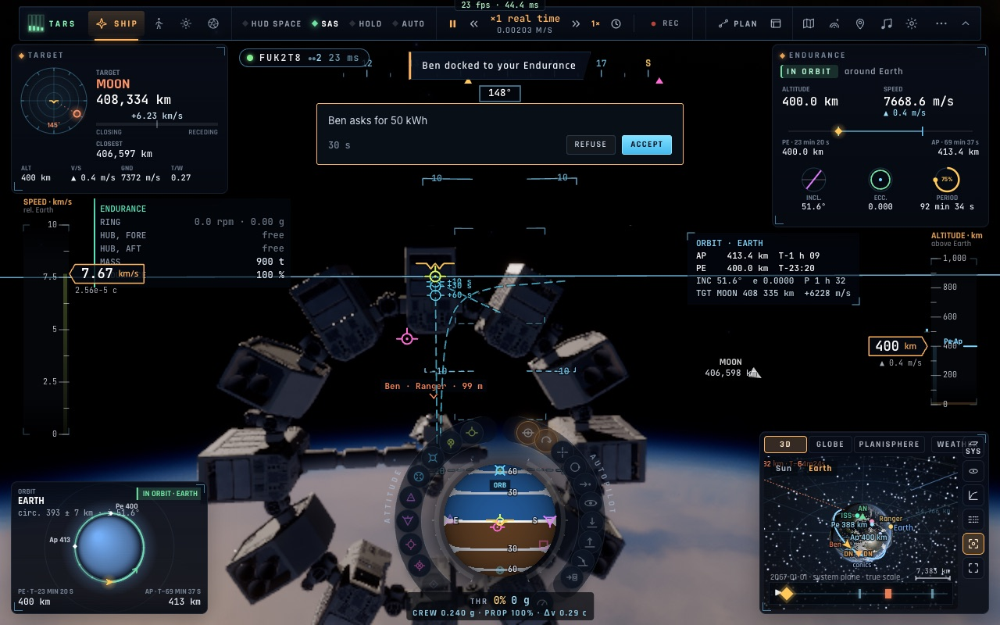
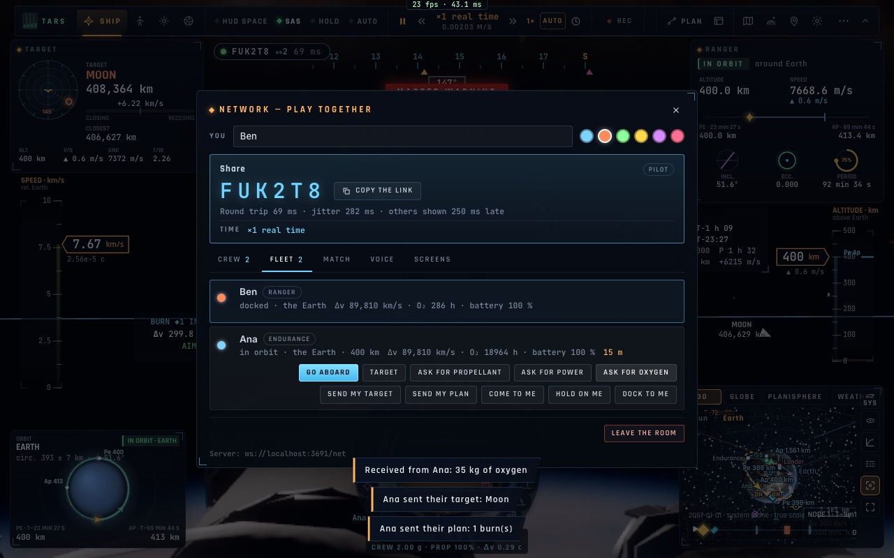

# N2 — Le partage entre vaisseaux amarrés

*2026-10-20, branche `vaisseaux-aaa` — `docs/PLAN-VAISSEAUX-AAA.md`, phase N.*

- **Ergols, électricité, oxygène** (`net/spaceshare.ts`, événements `xask` / `xgive`) :
  - celui qui en manque demande, depuis l'onglet Flotte, quand les deux vaisseaux sont amarrés l'un à l'autre ;
  - la demande vaut ce que son réservoir peut encore contenir ;
  - l'autre voit une carte (« Ben demande 50 kWh », Accepter / Refuser) ;
  - accepté, il donne ce qui est demandé, sans jamais descendre sous **25 % de sa propre capacité** ;
  - ses réservoirs sont les siens : c'est son client qui retire, celui du receveur qui ajoute, dans la limite de ce
    qu'il peut contenir ;
  - les quantités sont vérifiées à la réception (un nombre fini et positif) et dites dans leur unité : t ou kg
    d'ergols, kWh, kg d'oxygène ;
  - les ergols ne passent que dans les scènes qui les comptent.
- **La cible et le plan** (`xtgt` / `xplan`) :
  - « Envoyer ma cible » : sa cible devient celle de l'autre. Si l'on visait son vaisseau, l'autre vise le nôtre ;
  - « Envoyer mon plan » : les poussées du plan de mission (au plus 12), à leurs heures sur l'horloge commune de la
    salle, deviennent le plan de l'autre ; celles déjà passées sont écartées.
- **Régression corrigée (X1b)**, en deux parties :
  - la garde de la sphère d'exclusion prenait la main pendant un amarrage. Une approche lente (≤ 0,5 m/s) sur l'axe
    d'un port (écart < 15 % de la distance), ports en face (< 15°), n'est plus jamais reprise (`kosCorridor`) ;
  - `net-dock` échouait depuis X1b (bissection sur 32 commits). Dans le cas de la coque heurtée hors axe, la garde
    du vaisseau **heurté**, armée en réaliste, se mettait en maintien à poste sur l'arrivant. Le test vole désormais
    les deux vaisseaux en manuel. `net-dock` repasse 5/5.

## Mesures

- `tests/netspace.test.ts` (5/5) : la réserve du donneur, la place du receveur, les quantités dites, les montants
  vérifiés. `tests/spaceguard.test.ts` (6/6) : le couloir d'amarrage.
- `tests/e2e/net-share.e2e.test.ts` (2/2, deux navigateurs). Ben est amarré à l'Endurance d'Ana, batterie à 10 kWh
  et O₂ à 5 kg :
  - il demande de l'électricité (« Ben asks for 50 kWh »), Ana accepte : Ben a 60 kWh, Ana passe de 2 000 à
    1 950 kWh ;
  - pour l'oxygène, Ben a ensuite 40 kg ;
  - Ana envoie sa cible (la Lune) et son plan : Ben a la même poussée, à la même heure.
- `tests/e2e/net-dock.e2e.test.ts` 5/5.

