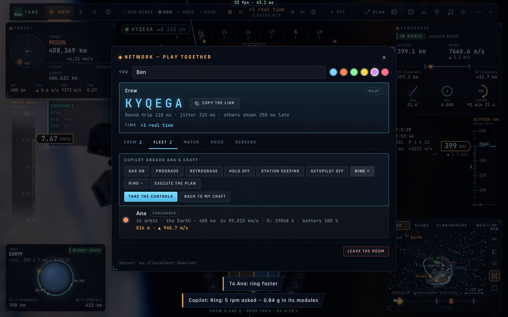
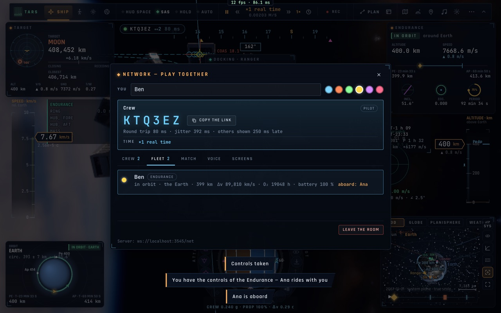

# N3 — L'équipage à bord et la passation du manche

*2026-10-20, branche `vaisseaux-aaa` — `docs/PLAN-VAISSEAUX-AAA.md`, phase N.*

- **Monter à bord en orbite** :
  - amarré au vaisseau d'un autre, on passe le sas (« Monter à bord » dans l'onglet Flotte, ou ⇧K) ;
  - on devient son passager : toutes les vues sont les siennes, avec ses instruments ;
  - notre vaisseau reste amarré, et on y revient par le sas quand on veut ;
  - l'onglet Flotte de chacun affiche « à bord : Ben ».
- **Le copilote** : à bord, l'onglet Flotte donne au passager les commandes de copilote :
  - SAS, prograde, rétrograde, tenue coupée, maintien à poste, autopilote coupé, anneau + et −, exécuter le plan ;
  - ces ordres passent par le chemin des écrans d'équipage (`crew-cmd`, validés par leur schéma, au rythme de
    l'équipage), et le pilote les accepte d'un passager à bord comme d'un écran d'équipage ;
  - le réglage du pilote qui verrouille les actions de l'équipage s'applique aussi au copilote ;
  - la réponse revient au copilote (« Copilote : Anneau : 5 tr/min demandés »).
- **La passation du manche** (`helm-ask` / `helm`) :
  - le passager demande les commandes, le pilote accepte sur sa carte ;
  - le passager prend alors le vaisseau à l'endroit où il le voyait (la trace du pilote, relative à son corps et à
    l'horloge de la salle), avec ses ergols, sa batterie et son oxygène ;
  - l'ancien pilote devient son passager, sur le même vaisseau ;
  - l'ancien vaisseau n'est plus dessiné chez personne, n'est plus amarrable ni heurtable (sinon : « Contact » avec
    soi-même) ;
  - l'ancien pilote ne peut pas « revenir à son vaisseau », qui est désormais celui de l'autre : il redemande les
    commandes.
- **Correctifs** :
  - le panneau Réseau se reconstruisait chaque seconde : un clic tombé entre l'appui et le relâchement était perdu.
    Il ne se reconstruit plus pendant qu'un bouton est enfoncé ;
  - un passager ne calcule plus la distance et la vitesse de rapprochement depuis sa propre position.

## Mesures

`tests/e2e/net-crew.e2e.test.ts` (2/2, trois passages de suite, deux navigateurs). Ben est amarré à l'Endurance
d'Ana :
- il monte à bord, et Ana le voit « à bord » ;
- en copilote, il met prograde et fait tourner l'anneau (5 tr/min demandés), exécutés sur le vaisseau d'Ana ;
- il demande les commandes, Ana accepte : Ben pilote l'Endurance, à 80 m de la position où se trouverait celle
  d'Ana (sa trace extrapolée par Kepler, environ 10 ms à 7,7 km/s), et Ana est sa passagère ;
- l'ancien vaisseau d'Ana a disparu du monde de Ben.

## Pas encore

- Un vaisseau « libre » de la salle (l'Endurance de salle) pris avec un bail, et repris à la déconnexion : il faut
  passer d'un vaisseau par joueur à des vaisseaux identifiés (R7, `VesselId` → identifiant de vaisseau).
- Monter à bord depuis le vaisseau hôte vers l'invité amarré (seul l'invité passe le sas).
