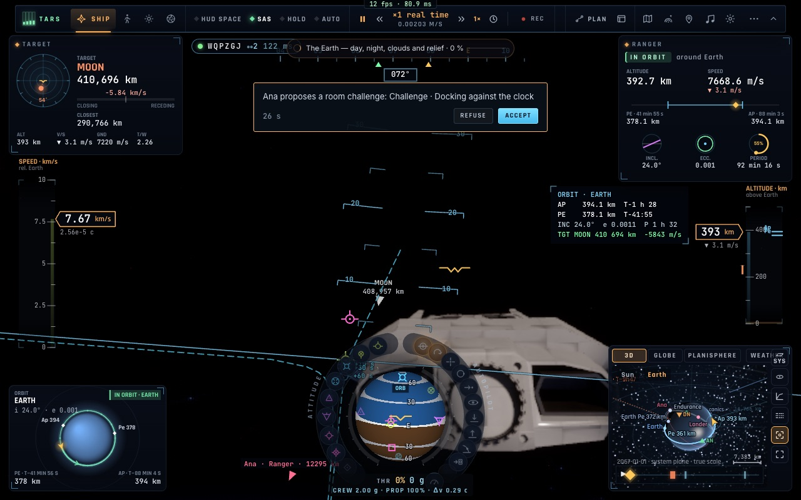
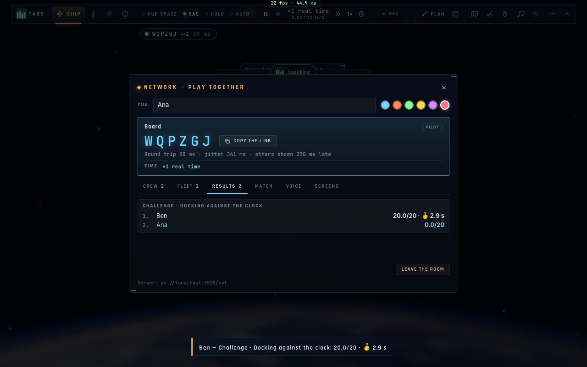

# N4 — Les défis de salle, les résultats partagés, le classement

*2026-10-20, branche `vaisseaux-aaa` — `docs/PLAN-VAISSEAUX-AAA.md`, phase N.*

- **Chaque compte rendu est partagé** (`net/roomboard.ts`, événement `rpt`) : leçon, défi, mission, ou compte rendu
  de phase (poser, amarrage, ascension, insertion, rendez-vous, rentrée).
  - Tout compte rendu volé dans une salle part à tous ; un toast l'annonce chez chacun (« Ben — Défi · L'amarrage
    contre la montre : 20,0/20 · 🥇 2,9 s »).
  - Les comptes rendus portent une référence stable (`challenge:dock-clock`, `mission:iss`, `lesson:holds`) : le
    titre s'affiche dans la langue de celui qui lit.
  - Un défi porte en plus sa médaille et son résultat brut.
  - À la réception, tout est vérifié (type, note de 0 à 20, référence, médaille, mesure).
- **L'onglet « Résultats » du panneau Réseau** classe, pour chaque chose volée (la plus récente d'abord), le meilleur
  de chaque pilote :
  - un défi se classe par son résultat (le plus bas devant), le reste par la note sur 20 ;
  - on y voit sa propre ligne en bleu.
- **Les défis de salle** :
  - dans une salle, chaque carte du panneau des défis a « Proposer à la salle » ;
  - le défi démarre chez celui qui le propose, et les autres pilotes reçoivent une carte (Accepter / Refuser) ;
  - ceux qui acceptent sont placés au même départ ;
  - tant qu'ils volent tous deux le défi, ils sont des **fantômes** l'un pour l'autre : un nom, jamais un vaisseau à
    heurter ni à amarrer ;
  - un pilote qui a fini cesse d'être un fantôme ;
  - l'onglet Résultats affiche la bannière du défi en cours et qui le vole.

## Mesures

- `tests/netspace.test.ts` (6/6) : les résultats vérifiés, le meilleur par pilote, le classement d'un défi par son
  résultat, les titres traduits.
- `tests/e2e/net-board.e2e.test.ts` (2/2, deux navigateurs, deux Rangers) :
  - Ana propose « L'amarrage contre la montre » à la salle (vrais clics), Ben accepte ;
  - tous deux sont sur le défi, fantômes l'un pour l'autre ;
  - Ben finit (son but réduit à quelques secondes, 2,9 s, or), le temps d'Ana s'écoule ;
  - l'onglet Résultats d'Ana affiche « 1. Ben 20,0/20 · 🥇 2,9 s », puis « 2. Ana 0,0/20 » ; plus de fantômes.

