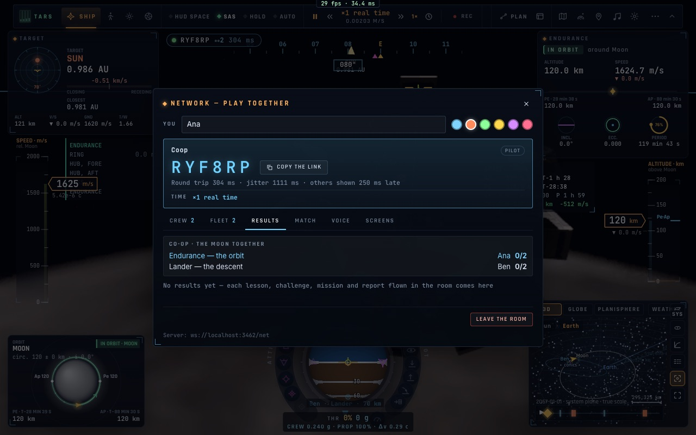
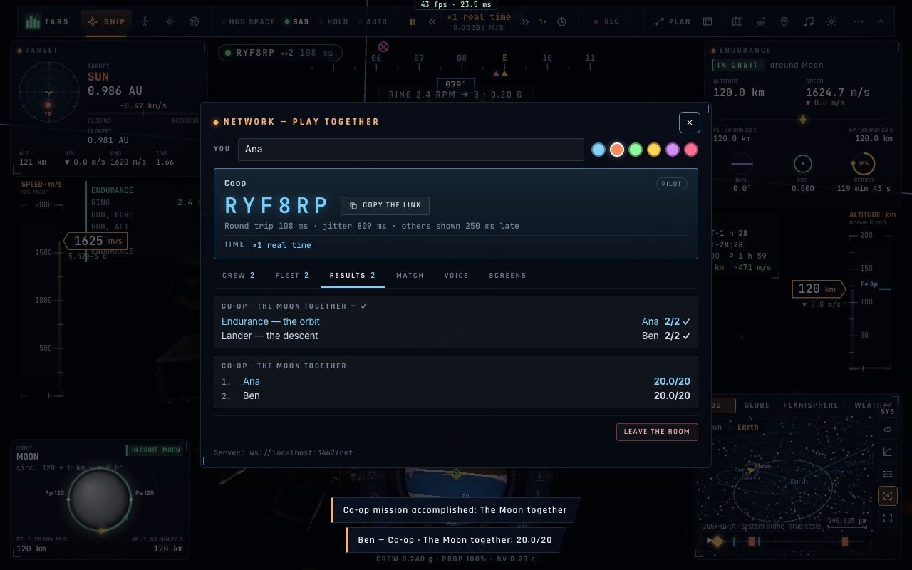

# N5 — Les missions coopératives à rôles

*2026-10-20, branche `vaisseaux-aaa` — `docs/PLAN-VAISSEAUX-AAA.md`, phase N.*

- **Deux missions à rôles** (`game/coopmissions.ts`). Chaque rôle a son vaisseau, son départ et ses objectifs dans
  l'ordre :

  | mission | rôles |
  |---|---|
  | La Lune ensemble | **Endurance — l'orbite** (120 km, l'anneau au-delà de 2 tr/min, l'orbite tenue au-dessus de 100 km) · **Lander — la descente** (de 50 km jusqu'au sol) |
  | Le sauvetage ensemble | **Endurance — arrêter la vrille** (à bord du vaisseau-mère en vrille) · **Ranger — l'amarrage** (à moins d'un km, puis amarré) |

- **Proposer** : dans une salle, le panneau des missions a une section « En coopération, dans la salle », avec un
  bouton par rôle (« Voler en Endurance — l'orbite »). Les autres reçoivent une carte qui leur offre le rôle libre.
  Chaque rôle est pris par un seul pilote, le premier qui accepte.
- **Voler** :
  - chaque rôle se vole comme une mission à part entière, avec ses objectifs annoncés par TARS et son temps
    maximal ;
  - chaque objectif atteint, et la fin du rôle, partent à la salle (`coopst`) ;
  - l'onglet Résultats affiche chaque rôle, son pilote et sa progression (« 2/2 ✓ »).
- **La réussite est commune** :
  - la mission est gagnée quand tous les rôles sont finis, perdue dès qu'un rôle finit sans ses objectifs ;
  - chacun reçoit alors le compte rendu de la mission, avec la ligne de chaque rôle et de son pilote ;
  - ce compte rendu va au tableau de la salle (les comptes rendus propres à chaque rôle restent chez leur pilote) ;
  - le titre se lit dans la langue de chacun.
- **Un pilote qui part** libère son rôle : un toast l'annonce, et l'onglet Résultats affiche « libre » avec
  « Prendre le rôle » pour un autre.

## Mesures

- `tests/netspace.test.ts` (7/7) : un rôle volé comme une mission, la victoire, la défaite, les rôles libres.
- `tests/e2e/net-coop.e2e.test.ts` (3/3, deux navigateurs) :
  - Ana propose « La Lune ensemble » en Endurance (vrais clics), Ben accepte le Lander ; chacun est placé au départ
    de son rôle au-dessus de la Lune ;
  - Ana fait tourner l'anneau au clavier (⇧] trois fois) et ses deux objectifs sont faits. Ceux de Ben sont réduits
    (la descente est longue). La mission est gagnée sur les deux écrans, compte rendu « Coop · La Lune ensemble
    20/20 » avec les deux rôles ;
  - deuxième mission : Ben quitte la salle, et son rôle s'affiche « libre » chez Ana.

## Pas encore

- Le contrôle de mission comme troisième rôle : la console crew (K5) y joue déjà, mais hors du compte des rôles.
- Reprendre un rôle après s'être reconnecté (l'état de la mission n'est pas renvoyé à ceux qui entrent dans la
  salle).
