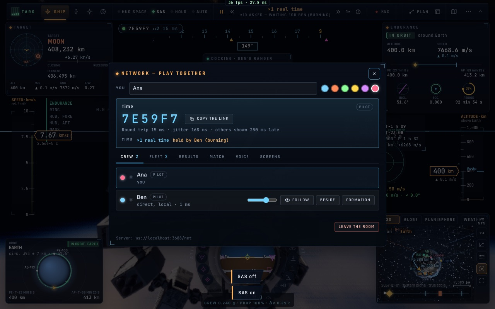
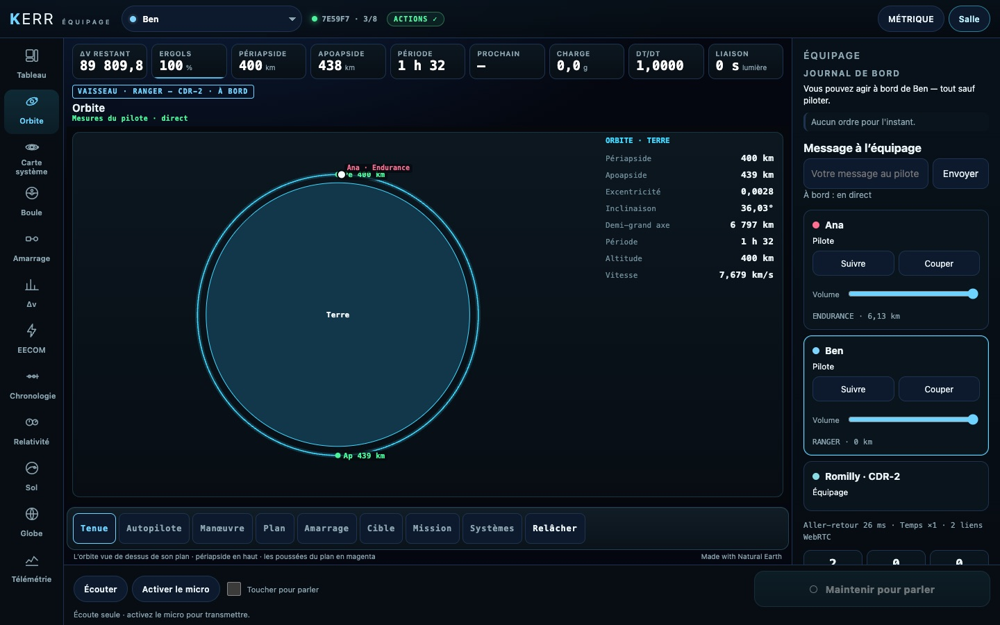

# N6 — Le temps à plusieurs et les restes du réseau

*2026-10-20, branche `vaisseaux-aaa` — `docs/PLAN-VAISSEAUX-AAA.md`, phase N.*

- **Le warp retenu, et pourquoi** :
  - la salle tourne au warp du pilote le plus lent (R6), et un pilote en poussée le retient (le plafond des rails
    pendant une poussée devient sa demande) ;
  - c'est maintenant dit : « ×10 demandé — en attente de Ben (en poussée) » sous l'horloge, et « retenu par Ben (en
    poussée) » dans le panneau Réseau ;
  - « en poussée » se lit dans la télémétrie du pilote (moteur ou manette des gaz).
  - Décisions conservées : une seule horloge de salle, avec τ par joueur affiché sur les étiquettes (R8), et le délai
    lumière réservé aux postes au sol de la console crew (K5).
- **Le moteur des autres** (`audio/engine.ts` `othersFrame`) :
  - le vaisseau le plus proche qui pousse dans un rayon de 3 km s'entend, comme un grondement spatialisé à sa place ;
  - le volume suit sa manette des gaz ;
  - dans l'air, le son est plus clair et plus fort ; dans le vide, il est sourd (la licence du jeu, comme pour le
    nôtre) ;
  - le son se tait hors de la salle.
- **Les autres vaisseaux sur la console crew** :
  - le contrat des instruments gagne un bloc `others` : les autres vaisseaux de la salle autour du même corps, en km,
    au plus 8, vérifiés à la lecture (couleur comprise) et gardés entre deux envois lourds ;
  - la vue ORBITE les dessine dans le plan de l'orbite suivie, à leur couleur, avec leur nom et leur vaisseau.

## Mesures

- `tests/netspace.test.ts` (8/8) : le bloc `others` lu et borné, une couleur fautive remplacée.
- `tests/e2e/net-time.e2e.test.ts` (2/2, trois pages : Ana, Ben, un écran crew) :
  - Ben pousse à 400 m d'Ana, et Ana l'entend (niveau 0,07) ;
  - Ana demande ×10 : warp « retenu par Ben (en poussée) » ;
  - Ben coupe, le son se tait ;
  - l'écran crew reçoit Ben dans le bloc de l'autre pilote, à 6 778 km du centre de la Terre, et la vue ORBITE le
    dessine.

## Pas encore

- Les feux et le train d'un Ranger distant (le drapeau `F_LIGHTS` est envoyé ; le dessin des feux d'un vaisseau
  distant est à faire dans le renderer).
- Les autres vaisseaux sur la carte 3D du système de la console (la vue ORBITE les montre).
- Les messages vocaux enregistrés vers un vaisseau derrière le trou de ver (les messages écrits le sont déjà, K5).
- La masse de l'assemblage pour l'hôte d'un amarrage entre joueurs, et les repères courbés par la lentille au loin
  (restes R7/R8).
