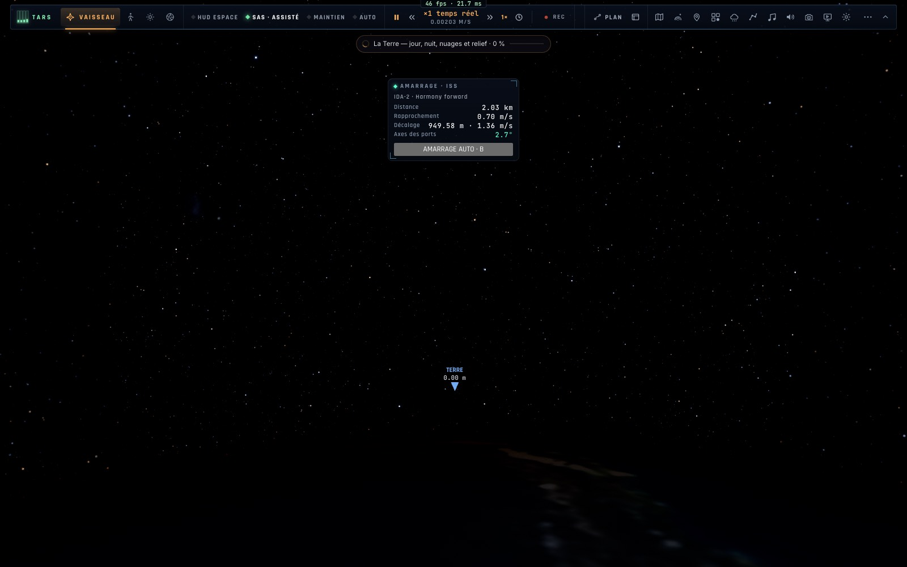
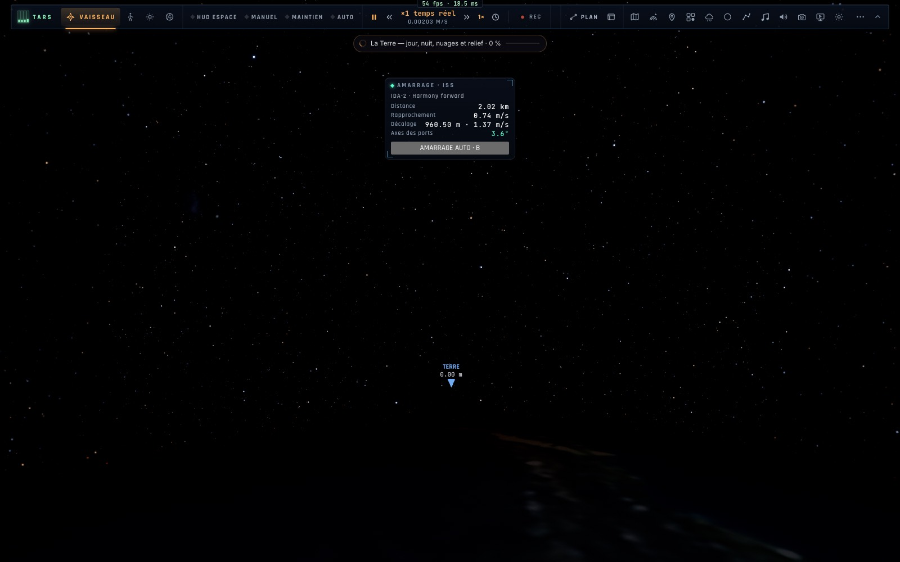
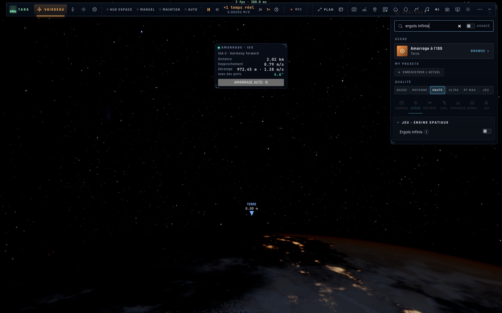

# X0 — Les niveaux d'assistance des vaisseaux, ⇧X « Récupérer », défauts

*2026-10-18, branche `vaisseaux-aaa` — `docs/PLAN-VAISSEAUX-AAA.md`, phase X0.*

## Ce qui change en jeu

- **Réglages › Jeu › Engins spatiaux** (Ranger, Lander, Endurance — comme le groupe F-35) :
  - **Assistance** : *Manuel* (pas de SAS : le manche accélère la rotation, elle garde son élan jusqu'à l'arrêt à la
    main) · *Réaliste* (le SAS du pilote, touche T, comme avant) · *Assisté* (SAS toujours actif ; à moins d'1 km d'un
    vaisseau ou de la station, le RCS relâché annule la dérive par rapport à lui) · *Débutant* (la même chose à moins
    de 2 km, rotations à moitié) ;
  - **Ergols infinis** (avec les ergols du moteur réaliste actifs).
- **⇧X « Récupérer »** marche maintenant pour les vaisseaux (c'était le F-35 seul) : au-dessus d'un sol à moins de 3 km,
  **vol stationnaire** aussitôt ; sinon maintiens et autopilotes coupés, moteur coupé, **rotation arrêtée**, puis en
  orbite **prograde maintenu** (près d'un vaisseau : l'attitude gardée, la dérive annulée). Le manche repris coupe la
  récupération. En mode avion (Ranger en vol plané), c'est la récupération du F-35 (ailes à plat, montée douce).
- **La puce SAS du HUD** dit le niveau : `SAS`, `MANUEL`, `SAS · ASSISTÉ`, `SAS · DÉBUTANT`, `SAS · DÉRIVE ANNULÉE` ;
  la touche T explique quand le niveau impose le SAS.
- La feuille des touches : « Piloter un vaisseau (K) » (et non plus « le Ranger ») ; ⇧X décrit pour les deux.
- TARS indiquait le planificateur sur **0** (c'est l'approche) : c'est **O**.
- **E1** (`docs/ERRORS-TO-FIX.md`) : la direction d'une poussée dénormalisée est maintenant calculée sans débordement
  (`controller/motion.ts` `unitOf`) ; la source (le régime ramené à 0 sous 10⁻⁶) était déjà corrigée.

## Mesures

`bun test tests/spaceassist.test.ts` — 7/7 :
- Manuel : 0,1 rad/s lâchée, gardée 2 s ; Réaliste + SAS : arrêtée en 3 s ; SAS coupé : gardée ; Assisté : arrêtée.
- ⇧X dans l'espace (Ranger à 100 km de la Lune, SAS coupé, 18°/s en culbute) : arrêtée, puis « stable — prograde
  maintenu » en 0,6 s.
- ⇧X au-dessus du sol (Lander à 1,5 km de Tranquility, en chute et basculé) : vol stationnaire engagé, dérive < 2 m/s
  après 25 s, pas posé.
- Assisté près d'un vaisseau (Ranger à 150 m du port avant de l'Endurance, 0,30 m/s de dérive latérale) : **0,002 m/s**
  après 20 s ; en Réaliste, toujours 0,300 m/s.
- Une poussée de 10⁻³¹¹ : direction finie, unitaire.

Tests voisins : assistlevel (F-35), gcas, pilot, rigid-body, dock-spin, crew, crew-actions, i18n, keymap, bindings,
tars, tars-tools — 80/80. `tsc` propre.

## Captures (Chrome headless, « Amarrage à l'ISS », en français)

## Déplacé ou reporté (noté dans le plan)

- Les défauts d'autopilotes de la campagne du 2026-10-07 (mission Jupiter, Δv d'ascension +27–30 %, pôle J2000 contre
  pôle de la date) passent en **X1** (autopilotes).
- Les **profils par vaisseau** (`VESSELS.*.space`) naîtront avec leur premier usage (HUD en X4, roue en X5) plutôt que
  vides ici ; le groupe de réglages grossit à chaque phase (pannes, consommables, HUD…).
- **Réseau** : rien de nouveau à partager (préférences locales) ; l'affichage des « triches » (ergols infinis) dans le
  tag des autres et leur refus en match classé vont en **N**.
