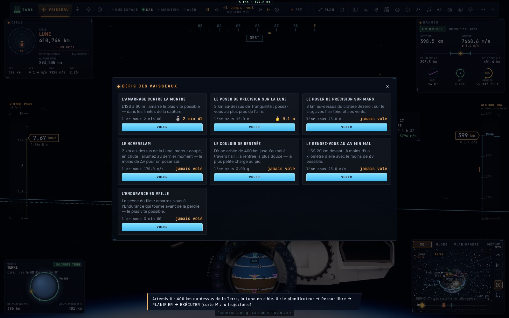

# X10 — Les défis des vaisseaux

*2026-10-18, branche `vaisseaux-aaa` — `docs/PLAN-VAISSEAUX-AAA.md`, phase X10.*

- **Sept défis** (`game/spacechallenges.ts`). Chacun a son départ (les mises en place de l'école), son but (les
  conditions de l'école), sa mesure, ses médailles (plus bas, c'est mieux) et son temps maximal :

  | défi | départ | mesure | or · argent · bronze |
  |---|---|---|---|
  | L'amarrage contre la montre | l'ISS à 60 m | le temps | 2 min · 3 min 20 · 5 min 20 |
  | Le poser de précision sur la Lune | 3 km au-dessus de Tranquillité | l'écart à l'aire | 15 · 50 · 150 m |
  | Le poser de précision sur Mars | 3 km au-dessus de Jezero | l'écart au site | 25 · 80 · 250 m |
  | Le hoverslam | 2 km, moteur coupé, en chute | le Δv dépensé | 170 · 220 · 300 m/s |
  | Le couloir de rentrée | une orbite de 400 km | la charge maximale | 3 · 4 · 5,5 g |
  | Le rendez-vous au Δv minimal | l'ISS à 20 km | le Δv dépensé | 25 · 50 · 100 m/s |
  | L'Endurance en vrille | la scène du film | le temps | 3 · 5 · 8 min |

- **La mesure** (`controller/spacechallenge.ts`) : temps, Δv dépensé, charge maximale, et l'écart au site, calculé
  par l'arc de grand cercle sur le corps à partir de la position géodésique du vaisseau. Le but doit tenir une
  seconde. Au-delà du temps maximal, le défi est manqué.
- **Le résultat** est un compte rendu : la mesure, la médaille, la marque de l'or, le meilleur (« nouveau record »).
  La note /20 vaut 20 pour l'or, 15 pour l'argent, 10 pour le bronze. Les meilleurs sont gardés sur l'appareil
  (`kerr.space.bests`).
- **Le panneau des défis des vaisseaux** (`ui/spacechallenges.ts`) s'ouvre depuis la roue d'un vaisseau (« École et
  défis › Défis ») : chaque carte montre la marque de l'or, le meilleur et sa médaille. Il est aussi accessible par
  `__bh.flight.spaceChallenges` (documenté dans BH-API).
- La mise en place est partagée entre leçons et défis (`placeSpaceStart`).

## Mesures

`tests/spacechallenges.test.ts` (2/2) :
- les médailles et leurs marques, les résultats dans leur unité, un meilleur gardé seulement s'il est meilleur ;
- **en vol** (le contrôleur réel) : le poser de précision à Tranquillité, piloté par l'autopilote d'atterrissage.
  Écart à l'aire **0,1 m**, médaille d'or, nouveau record.

En jeu : le panneau en français, avec deux meilleurs (argent à 2 min 42 pour l'amarrage, or à 0,1 m pour la Lune).

## Pas encore

- La fuite de la vague de Miller et la fronde de Gargantua : côté trou noir, il faut des conditions nouvelles
  (altitude au-dessus d'un monde de Kerr, rayon minimal). Ils viendront avec X11.
- Les défis de salle (même départ, classement en direct, fantômes des autres) : phase N.
