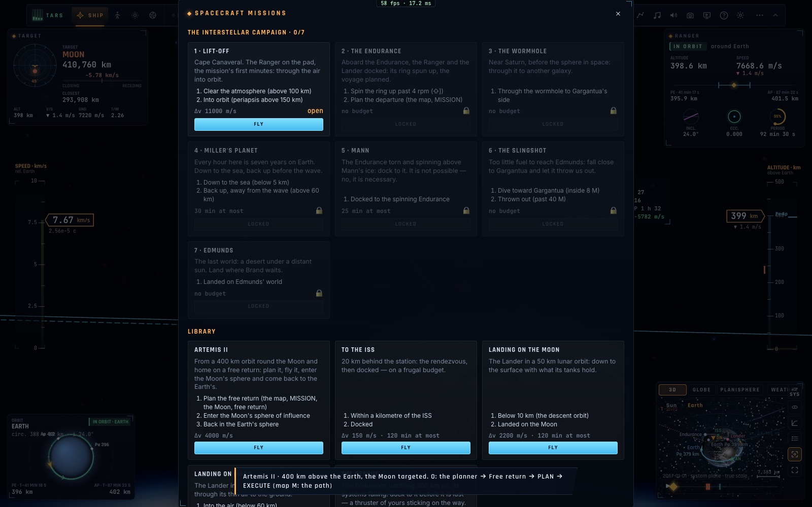
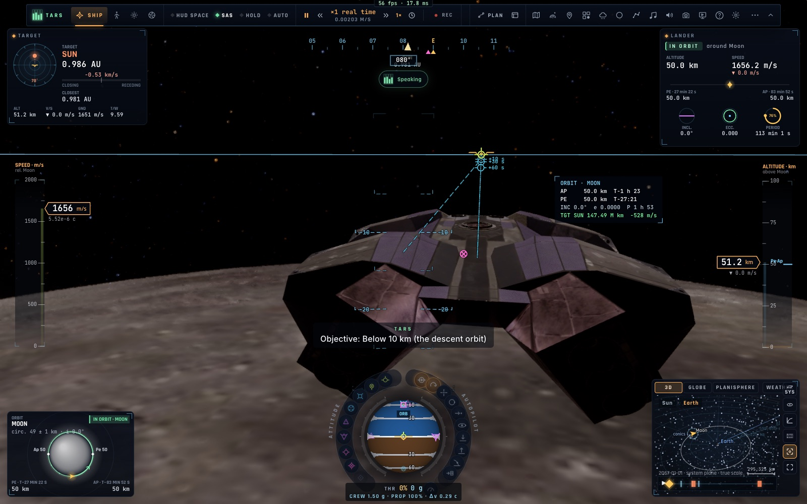
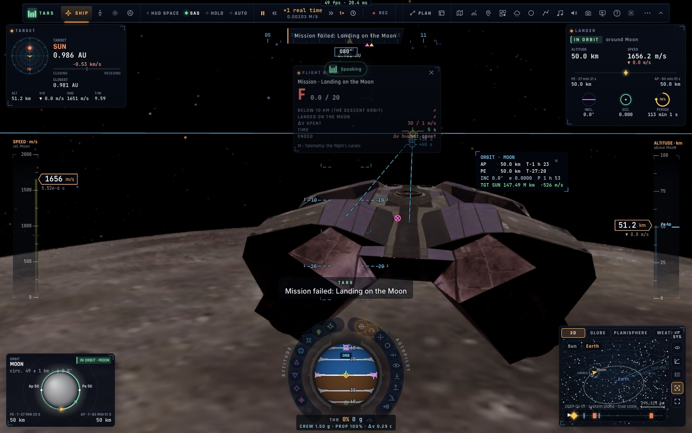
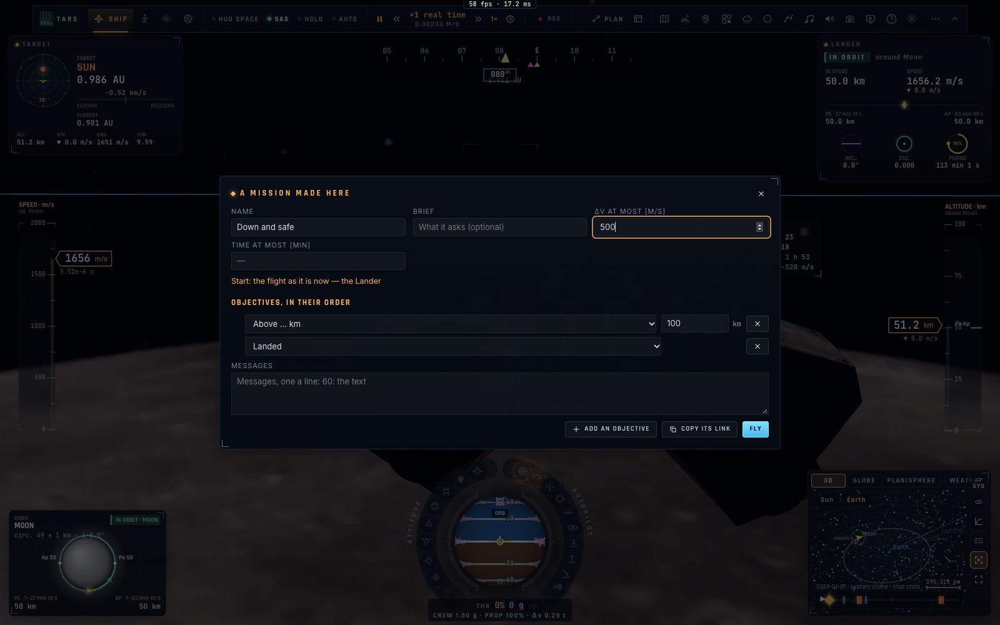

# X11 — Les missions des vaisseaux, l'éditeur, la campagne Interstellar

*2026-10-18, branche `vaisseaux-aaa` — `docs/PLAN-VAISSEAUX-AAA.md`, phase X11.*

- **Douze missions** (`game/spacemissions.ts`). Chacune a :
  - un départ (les mises en place de l'école, plus deux nouvelles : `near`, à côté d'un corps de notre côté ou de
    celui de Gargantua, et `wormhole`, devant la bouche) ;
  - des objectifs dans l'ordre (les conditions de l'école, plus de nouvelles : `side`, `kerrBelow`/`kerrAbove`
    — le rayon autour de Gargantua, en M —, `ringAbove`, `altBelow`/`altAbove`, `soi`) ;
  - un budget en Δv et en temps ;
  - des pannes injectées à heure fixe ;
  - des messages à heure fixe (les déclencheurs).
- **La bibliothèque** :

  | mission | départ | objectifs | budget |
  |---|---|---|---|
  | Artemis II | orbite terrestre, la Lune visée | retour libre planifié → sphère de la Lune → retour dans celle de la Terre | Δv 4 000 m/s |
  | Vers l'ISS | 20 km derrière la station | à moins d'1 km → amarré | Δv 150 m/s, 2 h |
  | Se poser sur la Lune | le Lander en orbite de 50 km | sous 10 km → posé | Δv 2 200 m/s, 2 h |
  | Se poser sur Mars | le Lander en orbite de 200 km | dans l'air (sous 60 km) → posé | 2 h |
  | Le sauvetage | l'Endurance en vrille à 300 km | amarré (un propulseur se bloque à 60 s) | 25 min |

- **La campagne Interstellar**, sept chapitres. Chacun s'ouvre quand le précédent a été volé en entier :
  1. le décollage de Cap Canaveral jusqu'en orbite ;
  2. l'Endurance (l'anneau à 4 tr/min, le départ planifié) ;
  3. le trou de ver ;
  4. Miller (descendre jusqu'à la mer, remonter avant la vague, 30 min) ;
  5. Mann (s'amarrer à l'Endurance en rotation) ;
  6. la fronde (plonger sous 8 M de Gargantua, être projeté au-delà de 40 M) ;
  7. Edmunds (s'y poser).

  La progression est gardée dans `kerr.space.campaign`.
- **Le déroulement** (`controller/spacemission.ts`) :
  - chaque objectif doit tenir une seconde, puis TARS annonce le suivant ;
  - les pannes et les messages tombent à leur heure ;
  - au-delà d'un budget, la mission échoue et les objectifs restants sont marqués manqués.
- **Le débrief** est un compte rendu de type « mission » : chaque objectif (✓ avec l'heure, ou ✗), le Δv dépensé
  face au budget, le temps, la raison de l'échec et le chapitre suivant ouvert. La note sur 20 est la part des
  objectifs atteints.
- **Le panneau** (`ui/spacemissions.ts`) s'ouvre depuis la roue d'un vaisseau (« École et défis › Missions ») :
  - la campagne (chapitres ✓, ouverts ou 🔒), puis la bibliothèque ;
  - chaque carte montre le briefing, les objectifs numérotés et le budget.
- **L'éditeur** (« Créer une mission d'ici… ») :
  - le départ est le vol tel qu'il est maintenant, sauvegardé dans la mission ;
  - les objectifs se choisissent parmi treize conditions, avec une valeur dans leur unité ou un choix (corps, côté) ;
  - on règle aussi le budget Δv et temps, et des messages (« 60: le texte ») ;
  - « Voler » la lance tout de suite, « Copier son lien » donne un `#smission=…` ;
  - ouvert, ce lien recharge la page et vole la mission ; il est vérifié, et ne compte jamais comme un chapitre.
  - Les mots des objectifs créés sont générés dans la langue du lecteur.
- **Accès** : `__bh.flight.spaceMissions` (`open`, `go`, `fly`, `link`) — BH-API. Tous les textes sont traduits en
  français (`i18n/fr-spacemissions.ts`).

## Mesures

`tests/spacemissions.test.ts` (4/4) :
- les données : 12 missions, l'ordre de la campagne, l'ouverture des chapitres, tout le français ;
- le lien : relu (sans chapitre, avec un id `link-…`), une mission fautive refusée, les mots générés ;
- **en vol** (le contrôleur réel) : se poser sur la Lune. Sous 10 km à 1 s, puis posé par l'autopilote à 74 s, pour
  **117 / 2 200 m/s**. Note 20/20 ; une mission de bibliothèque n'ouvre aucun chapitre ;
- un chapitre volé en entier ouvre le suivant. Dans le même test : une panne `bus` injectée à 0,5 s, un message dit
  à 0,3 s, et un budget Δv dépassé qui fait échouer la mission (0/20, « budget Δv épuisé »).

`tests/e2e/space-missions.e2e.test.ts` (2/2, vrais clics, ~1,5 min) :
- le panneau, où seuls le chapitre 1 et la bibliothèque sont ouverts (un chapitre verrouillé ne réagit pas) ;
- se poser sur la Lune depuis sa carte : le Lander est mis en orbite lunaire de 50 km et son objectif est annoncé ;
- un budget forcé à l'échec, puis la carte du débrief ;
- l'éditeur : un titre tapé, deux objectifs, Δv 500. La mission est volée, son lien copié puis ouvert dans une page
  rechargée, qui la vole à nouveau.

## Pas encore

- Les fenêtres de lancement et la carte de mission dans la vue 3D du système, propres à chaque mission. La carte 3D
  de l'équipage (K3) montre déjà orbites et prédictions.
- Le voyage automatique de `mission.ts` comme démonstration de la campagne.
- Les missions coopératives à rôles (l'Endurance en orbite, le Lander qui descend, le contrôle de mission) : phase N.
