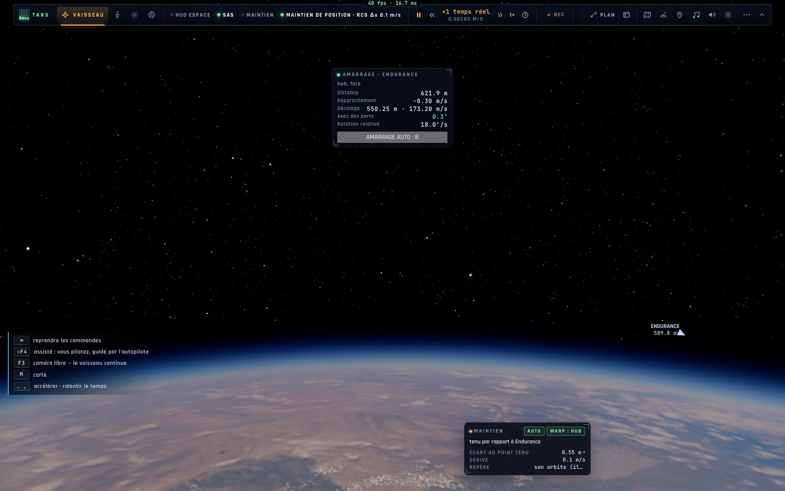

# X1a — Maintien à poste, désamarrage et recul, mode RCS translation

*2026-10-18, branche `vaisseaux-aaa` — `docs/PLAN-VAISSEAUX-AAA.md`, phase X1 (première partie).*

## Ce qui change en jeu

- **⇧8 — Maintien à poste** (nouvel autopilote `keep`, `controller/stationkeep.ts`) : le vaisseau est tenu où il
  est par rapport à la station ou à un vaisseau à moins de 5 km (le sien ou celui d'un autre joueur), aux seuls
  propulseurs RCS, l'attitude laissée au SAS. Le point est tenu **dans le repère propre de la cible** (l'ISS tourne
  avec son orbite : c'est son repère orbital LVLH, un point sur sa R-bar ou sa V-bar) ; une cible qui tourne vite
  (> 0,2°/s, l'Endurance en vrille) : son repère orbital. Retour au point à 1 m/s au plus, freiné à 0,02 m/s² ;
  temps accéléré limité à ×10.
- **Amarré, ⇧8 désamarre, recule de 30 m puis tient** (à la station ou à un vaisseau de la flotte).
- **⇧9 — Mode RCS** : rotation (les touches d'attitude tournent le vaisseau) ou **translation** — Z S haut · bas,
  Q D gauche · droite, ⇧ Alt avant · arrière (AZERTY), A E roulent toujours. La puce SAS l'affiche (`RCS TRANSL.`).
- Le HUD : le bouton **À POSTE** dans la couronne d'autopilotes (grisé sans vaisseau à 5 km), sa carte (écart au
  point tenu, dérive, repère) ; la roue (Tab) › Autopilote › Maintien à poste ; TARS (`autopilot keep`) et la
  console crew (ordinateur de vol) le proposent.

## Mesures

`bun test tests/stationkeep.test.ts` — 4/4 :
- le Ranger à 150 m du port avant de l'Endurance (immobile), dérivant à 0,30 m/s : après 240 s, **0,04 m** du point
  tenu, **0,005 m/s**, distance 150,0 → 150,0 m ;
- amarré à l'Endurance (DOCK depuis 15 m), ⇧8 : désamarré, **30,0 m** tenus, 0,005 m/s ;
- le repère orbital (orthonormé, sa rotation = celle de l'orbite), la loi de vitesse, les touches du mode translation.

Dans le vrai jeu (Chrome headless, « l'Endurance en vrille, 300 km ») : ⇧8 engagé, 0,55 m du point après 8 s, repère
orbital (la cible tourne à 3 tr/min), aucune erreur de page.

Tests voisins : spaceassist, dock-spin, crew, crew-actions, i18n, keymap, bindings, tars-tools, pilot — 67/67.

## Réseau

Le maintien vise aussi le vaisseau d'un autre joueur (les cibles réseau de l'amarrage, R7) ; l'e2e à deux navigateurs
viendra avec le rendez-vous complet (X1c).

*(Renommé « maintien à poste » en X1b : « maintien de position » est déjà le nom français du vol stationnaire, touche 8.)*
