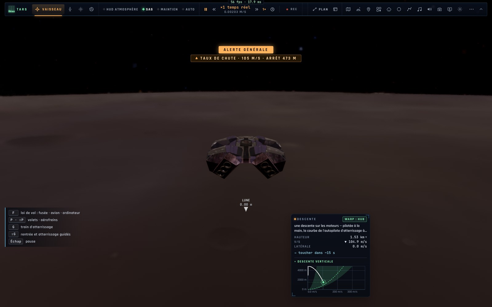
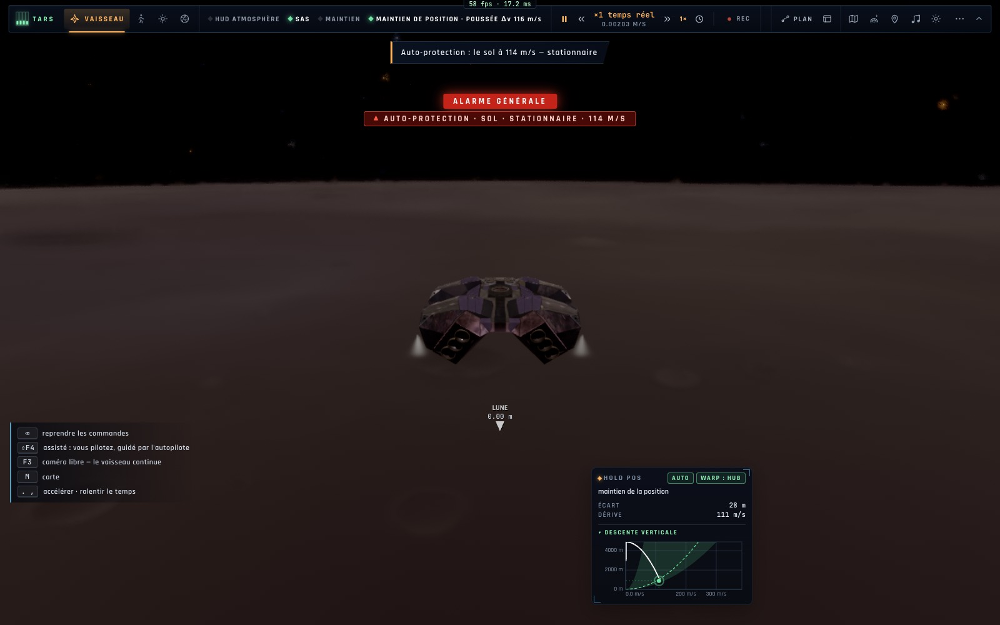

# X1b — Les protections automatiques des vaisseaux

*2026-10-18, branche `vaisseaux-aaa` — `docs/PLAN-VAISSEAUX-AAA.md`, phase X1.*

L'équivalent de l'Auto-GCAS / Auto-ACAS du F-35 pour le Ranger, le Lander et l'Endurance (`game/spaceguard.ts` pur,
`controller/spaceguard.ts`) :

- **Le sol** : en descente sur les moteurs plus vite qu'ils ne peuvent encore arrêter le vaisseau au-dessus du sol
  (90 % de la poussée, 2 s pour pivoter et monter en régime, 20 m de marge ; seulement au-delà de 80 % de la vitesse
  de crash) — une **alerte ambre** d'abord (« TAUX DE CHUTE · 105 M/S · ARRÊT 600 M »), puis le **vol stationnaire**
  engagé tout seul, une **alarme rouge** tant qu'il dompte la descente.
- **La sphère d'exclusion** (200 m autour de la station ou d'un vaisseau) : un rapprochement plus rapide que sa limite
  — 0,05 m/s + 0,5 % de la distance (1 m/s au bord, 0,1 m/s à 10 m) — une alerte à 1,5×, le **maintien à poste**
  engagé à 2×.
- **Armées** aux niveaux Assisté et Débutant, en Réaliste avec le réglage *Protections automatiques* (activé par
  défaut), **jamais en Manuel** (alerte seulement) ; jamais sous un autopilote, amarré ou posé ; pas pour un avion en
  vol sur ses ailes (son GPWS).
- Chaque alarme a son explication (pourquoi, que faire) dans le HUD ; le manche ou ⇧X reprennent la main.

## Mesures

`bun test tests/spaceguard.test.ts` — 5/5 :
- le Lander lâché à 2,5 km au-dessus de Tranquility (Réaliste) : alerte, puis stationnaire **à 507 m, 80 m/s** →
  30 s après, 505 m, 1,6 m/s, pas de crash ; en Manuel : « le train s'est effondré à 90 m/s » ;
- le Ranger lancé à 2 m/s vers le port de l'Endurance depuis 150 m : maintien à poste engagé, **au plus près
  148 m**, 0,005 m/s ensuite ;
- les seuils (sol, sphère) et les alarmes du HUD (ambre, rouge prise en main, rouge non armée).

Suite complète : 1 352 pass ; deux échecs corrigés — un crash volontaire (« flown tail first ») que la protection
empêchait désormais (le test la coupe), et une fuite de `fleet.activePose` entre fichiers de test (rendue après chaque
test). Dans le vrai jeu (headless) : le Lander en chute libre depuis 3 km sur la Lune — alerte à 1 532 m (105 m/s),
stationnaire à 912 m (113 m/s), aucune erreur.

## À reprendre

- La protection du couloir de rentrée (rebond, surchauffe prédits) : avec l'entrée assistée et les pannes (X3).
- « HUD ATMOSPHÈRE » s'affiche au-dessus de la Lune sur la capture (le choix automatique du HUD) — à voir en X4.
