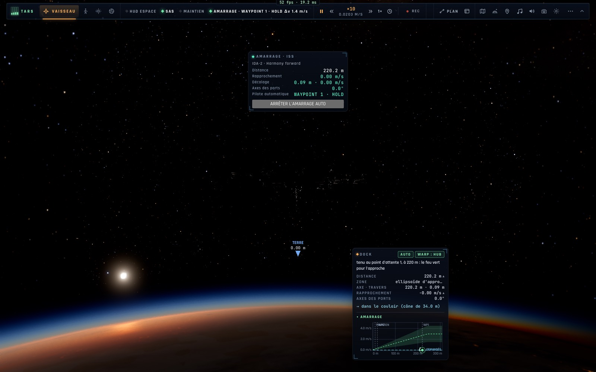

# X1c — Le rendez-vous complet : une touche, les points d'attente, les zones de la station

*2026-10-18, branche `vaisseaux-aaa` — `docs/PLAN-VAISSEAUX-AAA.md`, phase X1.*

Le rendez-vous lointain existait déjà (le plan ISS/vaisseau : départ, deux corrections, arrivée à 200 m du port, puis
l'autopilote d'amarrage). X1c en fait une opération complète, comme une vraie approche de l'ISS :

- **B, la station ou un vaisseau ciblé au-delà de 3 km** : le rendez-vous entier est planifié (`planIss`) et volé (les
  nœuds exécutés), puis l'amarrage enchaîne — il fallait avant passer par l'onglet MISSION. TARS et la console crew
  (autopilote « amarrage ») en profitent.
- **Les points d'attente** (`docking-guidance.ts DOCK_WAYPOINTS`, ceux de Dragon) : **Waypoint 1 à 220 m** (30 s,
  « feu vert pour l'approche »), **Waypoint 2 à 20 m** (20 s, « feu vert pour la capture »), chacun seulement si
  l'approche commence au-delà ; puis l'attente alignée à 10 m et la capture, comme avant.
- **La carte d'amarrage** dit la **zone** : dehors, dans l'**ellipsoïde d'approche** (4 × 2 × 2 km dans le repère
  orbital de la cible), dans la **sphère d'exclusion** (200 m) ; le profil de rapprochement porte les marques WP1/WP2.

## Mesures

- `tests/stationkeep.test.ts` (7/7) : l'amarrage depuis 300 m de l'Endurance passe par APPROACH → **WAYPOINT 1 · HOLD →
  WAYPOINT 2 · HOLD** → FINAL, les deux feux verts annoncés, amarré (147 s de temps réel avec le temps accéléré de
  l'autopilote) ; B depuis le Lander à 500 km, l'Endurance ciblée à 800 km : « rendez-vous avec l'Endurance, 200 m de
  son port arrière · départ dans 15,1 h, 735 min de vol · Δv 636,9 m/s », 4 nœuds, le dernier enchaînant l'amarrage.
- `tests/dock-spin.test.ts` (l'Endurance en vrille) toujours vert avec le Waypoint 2.
- En jeu (headless, « Amarrage à l'ISS », B à 976 m) : axe, approche, **tenu au point d'attente 1 à 220,2 m**, 0,00 m/s.

## Pas encore

- Le rendez-vous lointain n'est volé de bout en bout que par les tests existants du plan ISS ; un e2e « B depuis une
  orbite de parking jusqu'à la capture » (≈ 15 h de jeu en temps accéléré) ira dans la campagne sur kerr-mini.
- L'e2e réseau (rendez-vous et maintien à poste sur le vaisseau d'un autre joueur) : en N, avec deux navigateurs.
