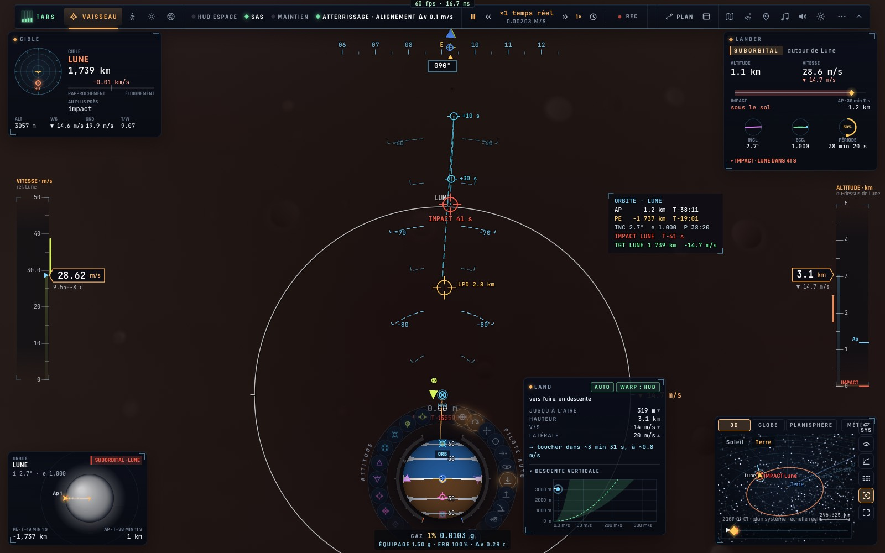

# X1d — Le désignateur de point d'atterrissage (LPD) de la descente motorisée

*2026-10-18, branche `vaisseaux-aaa` — `docs/PLAN-VAISSEAUX-AAA.md`, phase X1.*

Comme le LPD du module lunaire Apollo (programme P64) : pendant l'atterrissage automatique (F7) vers un point (un site,
ou le point sous le vaisseau une fois lent), **le manche redésigne le point** — Z S avant · arrière, Q D (ou les touches
de translation) gauche · droite (AZERTY) —, l'attitude restant celle de l'autopilote.

- Le point glisse au sol à **5 % de la hauteur par seconde** (5 m/s au moins), jamais plus loin de sa première place que
  la hauteur (250 m au moins) — ce que la descente peut encore rejoindre ; sous 5 km.
- Le HUD dessine le point : une croix dans un cercle au sol, « LPD 2,8 km », **vert** tant qu'il est celui de
  l'autopilote, **ambre** une fois déplacé.
- Le « hoverslam » (freinage au dernier moment) du plan existe déjà sous forme d'aide : le graphique de descente
  verticale et le compte à rebours de la poussée d'arrêt (C5) ; pas d'autopilote séparé.

## Mesures

`bun test tests/lpd.test.ts` — le Lander à 1,5 km au-dessus de Tranquility, F7, Z (W) maintenu 4 s : point déplacé de
**298 m** vers l'avant, marqueur dans la vue, LPD « déplacé » ; posé à **0,0 m** du point désigné, 0,8 m/s.

En jeu (headless, le Lander au-dessus de la Lune, F7 puis Z 2,5 s, regard incliné vers le sol) : le marqueur ambre
« LPD 2,8 km » au sol, aucune erreur.

