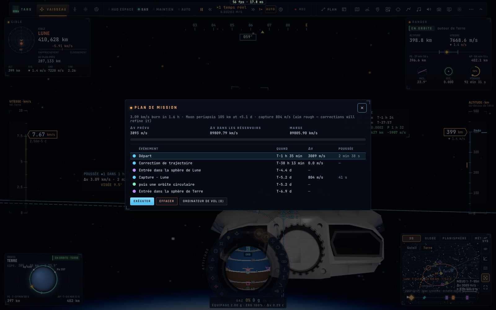

# X1e — Le plan de mission des vaisseaux (⇧O)

*2026-10-18, branche `vaisseaux-aaa` — `docs/PLAN-VAISSEAUX-AAA.md`, phase X1.*

L'équivalent du plan de vol du F-35 pour les vaisseaux : **⇧O** ouvre le **plan de mission** (`ui/missionplan.ts`,
`game/missiontimeline.ts`) — en vaisseau dans l'espace ; un appareil volant en avion dans l'air garde le plan de vol.

- **La chronologie** : chaque poussée (son rôle — départ, correction, capture, arrivée —, son échéance, son Δv, sa
  durée à pleine poussée), l'entrée dans chaque sphère d'influence que la trajectoire traverse, un impact, et ce que
  l'autopilote fait à la fin (« puis l'autopilote d'amarrage », « puis une orbite circulaire ») ; la prochaine poussée
  surlignée ; rafraîchie toutes les 0,7 s.
- **Le budget** : Δv prévu, Δv dans les réservoirs, la marge (rouge si elle manque), une jauge.
- **Les actions** : Exécuter (l'autopilote vole les nœuds), Effacer, l'ordinateur de vol (O) pour planifier.
- La roue (Tab) › Navigation › Plan de mission ; la feuille des touches le dit.
- **Garde-fou du rendez-vous en une touche (X1c)** : un plan au-delà de 10 km/s est refusé avec la raison — l'orbite de
  l'ISS n'est connue que près de la date du jour (ses éléments propagés sur des décennies donnent des Δv absurdes), et
  une orbite de départ trop éloignée de la sienne coûte trop (constaté dans la scène « Interstellar », en 2067 puis
  ramenée à aujourd'hui : 15 puis 12 km/s demandés, refusés).

## Mesures

- `tests/missiontimeline.test.ts` (3/3) : une mission lunaire — départ, sphère de la Lune, capture, puis une orbite ;
  durée de poussée (3 100 m/s à 10 m/s² → 5 min 10 s), marge ; manque d'ergols (marge négative) ; impact ; formats.
- En jeu (headless, Artemis en orbite basse, une mission vers la Lune planifiée puis adoptée) : départ T−1 h 35 min
  3 089 m/s (2 min 38 s), correction, entrée dans la sphère de la Lune T−4,4 j, capture 804 m/s (41 s), puis orbite
  circulaire ; Δv prévu 3 893 m/s ; aucune erreur.

## Pas encore

- L'édition des nœuds depuis la chronologie (glisser une date, un Δv) : l'ordinateur de vol le fait (O) ; la console
  crew l'aura sur sa carte (K6).
- La note du planificateur reste en anglais (texte du planificateur, hors de cette phase).
