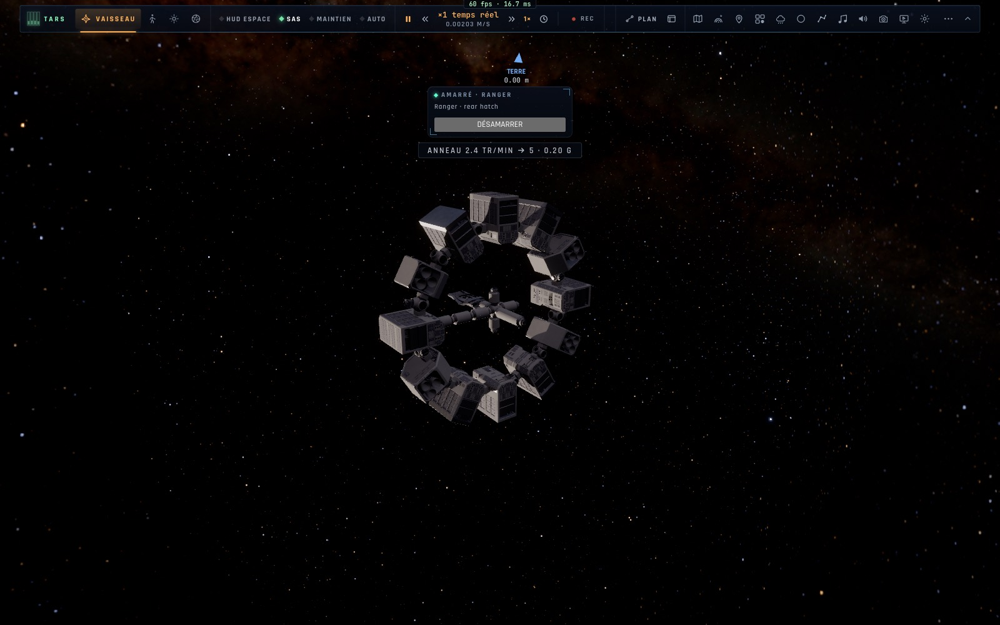

# X2a — L'anneau de l'Endurance : sa rotation et la pesanteur de ses modules

*2026-10-18, branche `vaisseaux-aaa` — `docs/PLAN-VAISSEAUX-AAA.md`, phase X2 (l'Endurance vaisseau-mère).*

Comme dans le film, **toute l'Endurance tourne** autour de son axe pour donner du poids à son équipage dans les modules de
son anneau (la traction ω² r, à 30 m de l'axe — `VESSELS.endurance.ring`).

- **⇧[ · ⇧]** : sa rotation demandée d'un tour par minute de moins · de plus (0 à 10 tr/min) ; ses propulseurs l'y
  amènent **lentement** (0,01 rad/s² : 5 tr/min en ≈ 50 s — un anneau de 900 t) et la tiennent (le SAS en roulis,
  `controller/ring.ts`, `pilot.ts` `spinHold`/`spinAcc`) ; 0 l'arrête et rend le roulis au manche.
- **Le HUD** : « ANNEAU 2.4 TR/MIN → 5 · 0.20 G » pendant la montée, puis « ANNEAU 5.0 TR/MIN · 0.84 G » ; ambre au-delà
  de 7 tr/min (« au-delà du confort de sa structure ») ; l'explication de l'alerte (5 tr/min = 0,84 g, 1 g = 5,5 tr/min ;
  pour s'amarrer au moyeu, égaler sa rotation — l'amarrage le sait déjà).
- Les alertes du HUD passent **sous le panneau d'amarrage** quand il est affiché (ils étaient au même endroit : le panneau
  les cachait).

## Mesures

`tests/ring.test.ts` (3/3) : 5 tr/min à 30 m = 0,839 g, 1 g = 5,46 tr/min ; l'alerte (avis, consigne pendant la montée,
ambre au-delà de 7) ; en pilotant l'Endurance : cinq ⇧] → « 5 tr/min demandés — 0,84 g », **4,97 tr/min en 52 s**, tenu
20 s de plus, les autres axes immobiles ; arrêtée en moins de 300 s. Tests voisins (pilote, corps rigide, amarrage en
vrille, assistance, maintien à poste, i18n, touches, flotte) : 45/45. En jeu (headless, « l'Endurance à 800 km ») : 2,4
tr/min après 25 s vers 5, l'alerte visible sous le panneau d'amarrage, aucune erreur.

## Pas encore

- Un anneau qui tourne séparément d'un moyeu immobile (ce n'est pas le cas du film) demanderait de découper le modèle.
- Les noms des ports (« rear hatch ») restent en anglais — à traduire avec les HUD spécialisés (X4).
