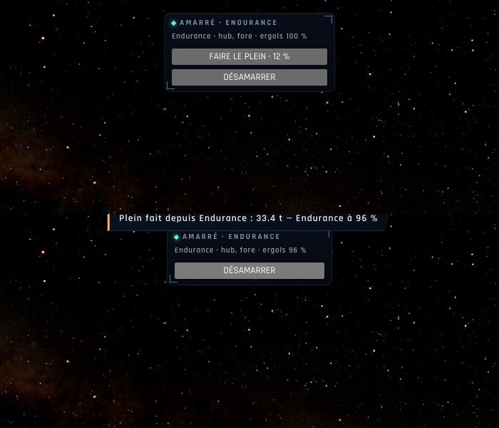

# X2b — Les ergols de chaque vaisseau, le plein depuis l'Endurance

*2026-10-18, branche `vaisseaux-aaa` — `docs/PLAN-VAISSEAUX-AAA.md`, phase X2.*

- Chaque vaisseau de la flotte a ses ergols, déduits de la rapidité que ses moteurs ont dépensée (`fleet.spent`) et du
  réservoir de la scène (`game/propellant.ts` : la masse restante, la rapidité qui en laisse tant, le transfert).
- **Amarré à un vaisseau de la flotte**, le panneau d'amarrage montre les ergols de chacun (« Endurance · moyeu ·
  ergols 96 % ») et, si le réservoir n'est pas plein, **FAIRE LE PLEIN · 12 %** : le réservoir du vaisseau piloté rempli
  depuis l'Endurance (son réservoir vaut 22 fois celui du Ranger), à défaut depuis le plus plein ; jamais plus que ce
  que l'un a, ni que ce que l'autre contient ; la masse d'ergols conservée (`controller/refuel.ts`).
- Le largage du Lander depuis l'Endurance existait déjà (le Lander piloté, DÉSAMARRER).

## Mesures

`tests/propellant.test.ts` (3/3) : ergols ↔ rapidité aller-retour ; un transfert borné par l'un et l'autre, la masse
conservée ; le Ranger amarré à l'Endurance, à moitié plein → « Plein fait depuis l'Endurance : 19,0 t — l'Endurance à
98 % », plein, puis « le réservoir est plein ». En jeu (headless, « l'Endurance à 800 km », [ pour le Ranger, réservoir à
12 %, clic sur le vrai bouton) : 33,4 t transférées, l'Endurance à 96 %, aucune erreur.

## Pas encore

- Un rapport de masse par vaisseau (aujourd'hui celui de la scène pour tous : l'Endurance n'a « que » 22 Rangers
  d'ergols parce qu'elle pèse 22 Rangers) ; le transfert d'électricité et d'O₂ viendra avec les consommables (X3).
- TARS et la console crew (K6) déclencheront le plein ; les noms de ports restent en anglais (X4).
